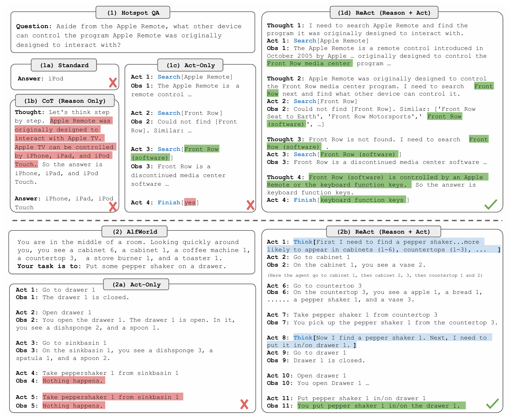
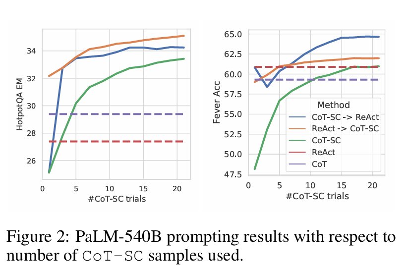
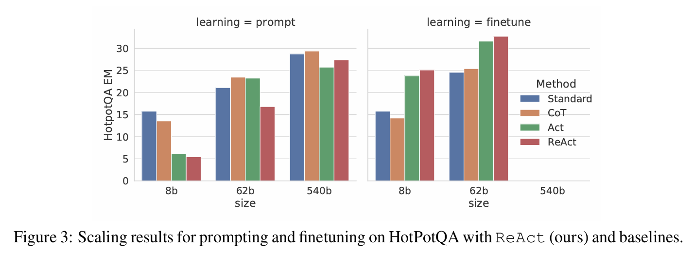
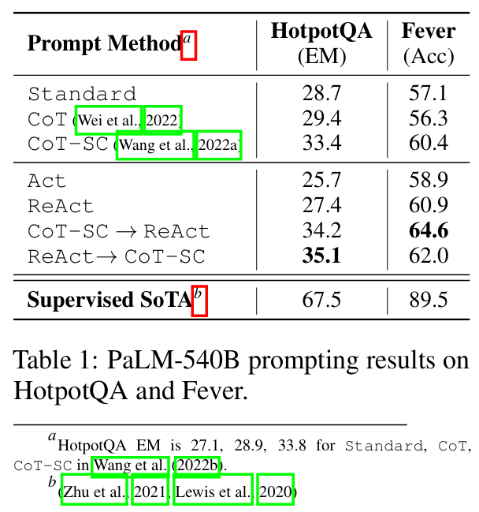
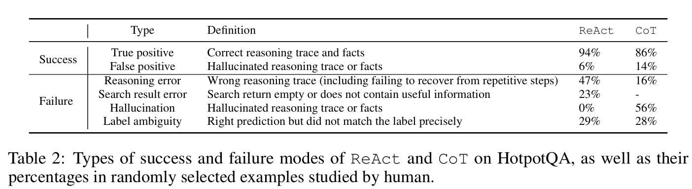
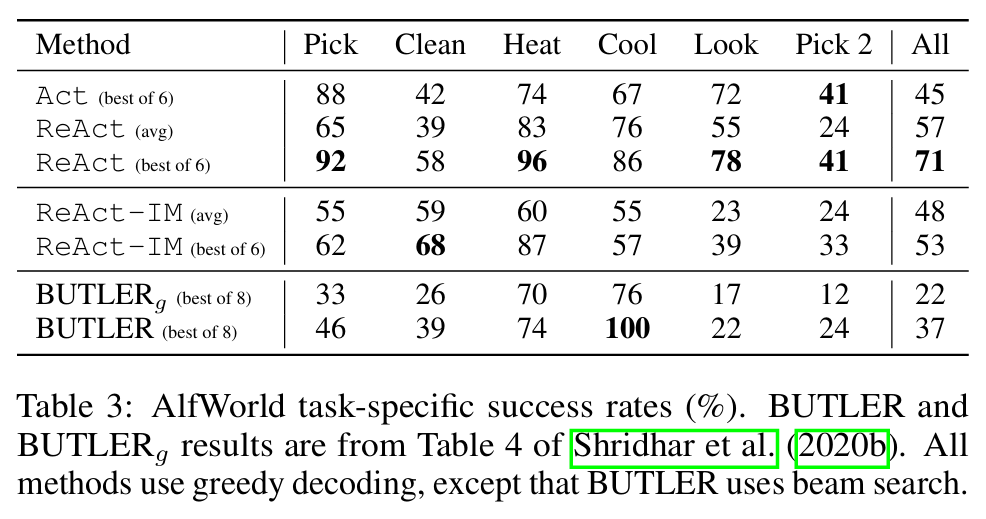
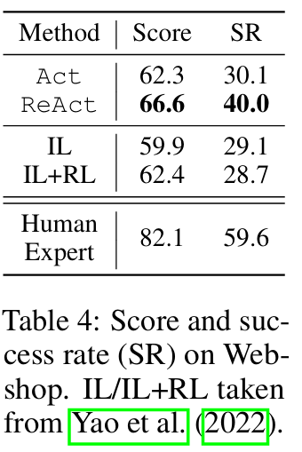

# ReAct: Synergizing Reasoning and Acting in Language Models

> 2026.7.8-2026.7.10

## 0. 论文信息

- Title: ReAct: Synergizing Reasoning and Acting in Language Models
- Venue: ICLR 2023
- Authors: Shunyu Yao, Jeffrey Zhao, Dian Yu, Nan Du, Izhak Shafran, Karthik Narasimhan, Yuan Cao
- PDF: `ReAct-Synergizing-Reasoning-and-Acting-in-Language-Models.pdf`
- Pages: 33
- Reading status: Completed

## 0.1 阅读进度清单

- [x] Abstract: 先确认这篇文章的核心主张和任务范围
- [x] 1 Introduction: 理解为什么要把 reasoning 和 acting 交替起来
- [x] 2 ReAct: Synergizing Reasoning + Acting: 搞清楚 ReAct 的trajectories 格式和 prompting 方式
- [x] 3 Knowledge-Intensive Reasoning Tasks: 读 HotpotQA / FEVER 实验
- [x] 3.1 Setup: 记录任务、模型、动作空间和评价指标
- [x] 3.2 Methods: 对比 Standard / CoT / Act-only / ReAct 等方法
- [x] 3.3 Results and Observations: 总结 ReAct 为什么能减少 hallucination 和 error propagation
- [x] 4 Decision Making Tasks: 读 ALFWorld / WebShop 实验
- [x] 5 Related Work: 连接 CoT、tool use、planning、interactive agents 相关工作
- [x] 6 Conclusion: 提炼论文结论和局限
- [x] Appendix A-E: 按需要补读实验细节、prompts、trajectories 和 failure mode

## 1. 一句话总结

ReAct 的核心思想是让语言模型在同一条任务轨迹中交替生成 reasoning trace 和 task-specific action: reasoning 用来规划、跟踪状态、处理异常，action 用来查询外部知识源或与环境交互，从而把纯 CoT 的内在推理和纯 action 的外部执行结合起来。

## 2. 读前核心问题

- ReAct 相比 Chain-of-Thought 的关键增量是什么？

- 为什么只让模型推理会出现 hallucination 和 error propagation？

- 为什么只让模型行动又会缺少高层计划、状态跟踪和异常处理？

- ReAct 中的 Thought / Action / Observation 之间是什么信息流？

- 在知识问答任务和交互式决策任务中，ReAct 的收益是否来自同一个机制？

- ReAct 的成功是否依赖 prompt 设计、工具接口、模型规模，还是任务本身的可交互性？

  > | 因素          | 具体作用                                         | 出问题时的表现                                         |
  > | ------------- | ------------------------------------------------ | ------------------------------------------------------ |
  > | Prompt 设计   | 告诉模型如何推理、何时调用工具、Action 的格式    | Thought 冗长、动作格式错误、不会在正确时机使用工具     |
  > | 工具接口      | 决定模型能执行什么动作、能获得什么反馈           | Action space 太大、返回信息含糊，模型会迷失或反复调用  |
  > | 模型规模/能力 | 提供常识、语言理解、规划和从示例中学习格式的能力 | 小模型仅靠 few-shot prompt 很难生成稳定轨迹，需要微调  |
  > | 任务可交互性  | 决定 Observation 是否能够补充、验证或纠正推理    | 如果没有有价值的外部反馈，ReAct 可能退化成更繁琐的 CoT |

## 3. 摘要理解

### 3.1 论文主张

- 过去 LLM 的 reasoning 和 acting 常被分开研究。
- 这篇文章主张把二者交替生成，让模型一边思考一边行动。
- reasoning trace 的作用:
  - 形成任务计划
  - 跟踪当前进度和状态
  - 更新行动计划
  - 处理异常情况
- action 的作用:
  - 访问外部知识库
  - 从环境中获得 observation
  - 用外部信息校正模型内部推理

### 3.2 论文报告的主要效果

- 在 HotpotQA 和 FEVER 上，通过简单 Wikipedia API 交互缓解 CoT 中常见的 hallucination 和 error propagation。
- 在 ALFWorld 和 WebShop 上，ReAct 在只有少量 in-context examples 的情况下，相比 imitation / reinforcement learning 方法取得更高成功率。
- 论文特别强调 human interpretability 和 trustworthiness，因为 ReAct 轨迹展示了模型为什么这样做以及接下来做了什么。

## 4. 论文结构索引

页码按 PDF 页数记录。

- p.1 - 1 Introduction
- p.3 - 2 ReAct: Synergizing Reasoning + Acting
- p.4 - 3 Knowledge-Intensive Reasoning Tasks
- p.4 - 3.1 Setup
- p.4 - 3.2 Methods
- p.5 - 3.3 Results and Observations
- p.7 - 4 Decision Making Tasks
- p.9 - 5 Related Work
- p.9 - 6 Conclusion

## 5. 背景与动机

### 5.1 作者想解决的问题

- LLM 能用 CoT 生成中间推理，但推理过程可能不接触外部世界，容易把错误前提继续传播下去。
- LLM 也能生成 action plan 或动作序列，但如果没有显式 reasoning，动作可能缺少计划、状态记忆和异常处理能力。
- 人类解决任务时通常不是先完整推理再执行，而是在思考、行动、观察、再思考之间循环。

### 5.2 需要重点理解的对比

- Standard prompting: 直接输出答案或动作。
- Chain-of-Thought / Reason-only: 输出推理链，但不与外部环境交互。
- Act-only: 执行动作，但没有显式语言推理轨迹。
- ReAct: 交替生成 reasoning trace 和 action，让 observation 反过来影响后续 thought。

## 6. 方法: ReAct

### 6.1 基本形式

可以先按如下结构理解:

```text
Thought: 当前需要推理、计划、检查或决定什么？
Action: 基于 Thought 采取什么外部动作？
Observation: 环境或工具返回了什么信息？
Thought: 根据 Observation 更新判断或计划。
...
Answer / Finish: 给出最终答案或完成任务。
```


ReAct 方法先把 agent 的通用形式写成：

```text
当前上下文 c_t -> 选择动作 a_t
```

其中 `c_t` 表示当前上下文，包含历史 observation、历史 action 和当前 observation；`a_t` 表示当前步要选择的动作。作者认为直接学习 `c_t -> a_t` 很难，因为这个映射里隐藏了目标理解、历史记忆、计划维护和异常处理等复杂计算。


ReAct 的核心想法是：**扩展 action space**。原来 agent 只能输出真实动作，比如 search、click、open fridge、go to kitchen；现在还允许它输出一种“语言动作”，也就是：

```
Thought
```

这个 Thought 属于 language space `L`，不会直接改变外部环境，但会被加入上下文，帮助后续决策。

所以 ReAct 的轨迹变成：

```
Observation -> Thought -> Action -> Observation -> Thought -> Action ...
```

或者在某些任务里：

```
Observation -> Action -> Action -> Thought -> Action ...
```

第二节还说明 Thought 可以有很多作用：

- 分解任务目标
- 制定行动计划
- 注入常识
- 提取 observation 中的重要信息
- 跟踪当前进度
- 调整计划
- 处理异常情况

然后作者说明他们的实验设置：使用 **frozen PaLM-540B**，也就是参数不更新的大模型，只通过 few-shot in-context examples 来提示模型生成 Thought 和 Action。每个示例是一条人类写好的任务轨迹，里面有 actions、thoughts 和 observations。

ReAct 的几个优点：

- **直观、容易设计**：人类只要在动作轨迹上写下自己的思考。
- **通用、灵活**：可以适配问答、事实验证、文字游戏、网页导航等不同任务。
- **效果好、鲁棒**：少量示例就能超过只 reasoning 或只 acting 的 baseline。
- **可解释、可控制**：人可以检查 Thought 是否合理，甚至通过编辑 Thought 来纠正 agent 行为。


### 6.2 reasoning trace 的作用

- 任务分解:

  将一个复杂目标拆成更小的子目标，避免模型直接从问题跳到最终动作或答案。例如在多跳问答中，先判断需要查哪个实体，再决定下一步查询什么。

- 计划维护:

  在任务执行过程中保存当前计划，说明接下来应该做什么。它相当于 agent 的临时计划表，让后续 action 不只是凭当前 observation 随机反应。

- 状态跟踪:

  记录已经做过什么、已经观察到什么、哪些路径已经被排除。对于 ALFWorld / WebShop 这类多步任务尤其重要，因为模型需要记住之前找过哪里、点过什么、还缺什么信息。

- 异常处理:

  当 observation 和原计划不一致时，reasoning trace 可以帮助模型调整策略。例如发现某个位置没有目标物品，就需要重新判断下一步去哪里找，而不是继续产生错误动作。

- 信息需求识别:

  判断当前缺少什么信息，以及是否需要调用外部工具或与环境交互。例如在 HotpotQA 中，模型可能先意识到“我不知道这个人物的出生地”，然后再执行 search 或 lookup。

### 6.3 action 的作用

- 查询知识库:

  action 可以让模型访问外部知识源，例如在 HotpotQA / FEVER 中调用 Wikipedia API。这样模型不完全依赖内部参数记忆，可以用外部证据减少 hallucination。

- 与环境交互:

  action 可以改变或探索外部环境，例如在 ALFWorld 中移动、打开容器、拿取物品，或者在 WebShop 中搜索商品、点击页面、筛选结果。

- 获取 observation:

  每次 action 之后，环境或工具会返回 observation。这个 observation 是后续 reasoning 的新依据，使模型能够根据真实反馈更新判断，而不是一直在内部闭门推理。

- 让模型从外部信息中校正内部推理:

  action 返回的信息可以纠正模型原本的猜测。例如模型以为某个物品可能在 sinkbasin，但 observation 显示没有，那么后续 thought 就应该更新计划，去其他位置寻找。

### 6.4 ReAct 和 CoT 的关系

- CoT 偏向 internal reasoning。

- ReAct 在 reasoning 之间插入 external action。

- 需要重点比较: ReAct 是否只是 CoT + tools，还是在轨迹结构上有更强约束？

  > CoT + tools:
  > 模型会边推理边调用外部工具。
  >
  > ReAct:
  > 把推理、行动、环境反馈组织成一条显式 trajectory，
  > 让 Thought 指导 Action，让 Observation 反过来修正 Thought。
  >
  > 因此，**ReAct 是 CoT + tools 的一种更结构化、更 agent 化的形式**。它的重点不是“有工具”本身，而是 **reasoning 和 acting 在同一条轨迹里循环互相影响**。

### 6.5 ReAct 和 tool use / agent 的关系

- 这篇论文可以看作 later LLM agents 的早期核心范式之一。

- 需要记录: 它的 action space 是任务定制的，还是可泛化到更开放的工具集合？

  > action space 主要是任务定制的。
  >
  > 不同任务有不同的可用动作集合。
  >
  > 比如知识问答 HotpotQA / FEVER 里，动作空间是围绕 Wikipedia API 设计的：
  >
  > ```
  > Search[entity]
  > Lookup[string]
  > Finish[answer]
  > ```
  >
  > 而在 ALFWorld 里，动作空间是文字游戏/家庭环境里的动作：
  >
  > ```
  > go to ...
  > open ...
  > take ...
  > put ...
  > examine ...
  > ```
  >
  > 在 WebShop 里，动作空间又变成网页购物相关操作：
  >
  > ```
  > search[...]
  > click[...]
  > choose[...]
  > buy[...]
  > ```
  >
  > 所以论文里的 ReAct 不是一个“拿来就能调用任意工具”的通用工具框架。它的核心是通用的：
  >
  > ```
  > Thought -> Action -> Observation
  > ```

## 7. 实验一: Knowledge-Intensive Reasoning Tasks

### 7.1 任务与设置

| 项目 | 内容 |
| --- | --- |
| Tasks | HotpotQA: multi-hop question answering；FEVER: fact verification |
| 输入设置 | question-only setup: 模型只收到 question / claim，不给 support paragraphs |
| External interface | 一个简单 Wikipedia API |
| Actions | `search[entity]`, `lookup[string]`, `finish[answer]` |
| 主要考察 | 外部检索是否能降低 hallucination / error propagation；reasoning 是否能指导检索 |
| 指标 | HotpotQA 用 EM；FEVER 用 ACC |

论文中特意把 Wikipedia API 设计得比较弱：`search` 只能返回实体页面前 5 句或相似实体，`lookup` 只能在当前页面里找包含某字符串的下一句。这不是为了做最强检索器，而是为了模拟人类查 Wikipedia 的过程，并迫使模型用语言推理决定查什么。

### 7.2 方法对比

- Standard: 删除 ReAct trajectories 中的 thoughts、actions、observations，直接从问题得到答案。
- CoT / Reason-only: 删除 actions 和 observations，只保留 reasoning trace，作为 reasoning-only baseline。
- CoT-SC: 以 temperature 0.7 采样 21 条 CoT trajectories，用多数答案作为最终答案，通常比单条 CoT 更稳。
- Act-only: 删除 thoughts，只保留 action / observation 交互，作为 acting-only baseline。
- ReAct: 使用人工写的 few-shot ReAct-format trajectories，让模型交替生成 Thought / Action / Observation。
- ReAct -> CoT-SC: 如果 ReAct 在给定步数内没有 `finish`，就回退到 CoT-SC；HotpotQA 和 FEVER 分别设为 7 步和 5 步。
- CoT-SC -> ReAct: 如果 CoT-SC 多个样本的多数答案不够集中，说明内部知识不自信，就切换到 ReAct 检索外部信息。
- Finetuning: 用 3,000 条由 ReAct 生成且答案正确的 trajectories，以及其他 baseline 对应格式的数据，微调 PaLM-8B / PaLM-62B。

### 7.3 读这部分时要抓住的问题

- ReAct 为什么在 FEVER 上强于 CoT，但在 HotpotQA 上弱于 CoT？

  FEVER 的 SUPPORTS / REFUTES 可能只差一个小事实，例如地点、年份、人物关系。此时外部检索非常关键，ReAct 能通过 Wikipedia observation 校正内部记忆。HotpotQA 更需要组织多跳推理结构，而 CoT 在形成连续 reasoning structure 上更灵活，所以纯 ReAct 可能落后。

- Wikipedia API 的 action space 为什么被设计得比较弱？

  为了模拟人类显式查找页面和关键词的过程，而不是让强检索器替模型解决任务。这样实验更能检验模型是否会用 thought 规划 search / lookup。

- ReAct 是怎样通过 search / lookup 拿到证据的？

  Thought 决定下一步要查哪个实体或关键词；Action 调用 `search` 或 `lookup`；Observation 返回页面句子；后续 Thought 再抽取证据、更新计划或合成答案。

- CoT 的错误传播在具体案例里怎么发生？

  CoT 如果一开始生成了错误事实，就可能在后续推理中继续使用这个错误事实，最后给出看似完整但实际 hallucinated 的答案。

- Act-only 为什么可能缺少可解释的任务策略？

  Act-only 虽然能查 Wikipedia，但没有 Thought 来说明为什么查这个实体、为什么换关键词、什么时候可以 finish，因此更容易出现盲目检索和错误终止。

### 7.4 结果与观察

- HotpotQA:
  - 主要结果: PaLM-540B prompting 中，ReAct 为 27.4 EM，Act 为 25.7，CoT 为 29.4，CoT-SC 为 33.4；最佳是 ReAct -> CoT-SC，达到 35.1。
  - 错误类型: ReAct 的主要失败来自 reasoning error 和 search result error；CoT 的主要失败来自 hallucinated reasoning trace or facts。
  - ReAct 改进原因: ReAct 通过外部 Wikipedia observation 让推理更 grounded，但结构约束和弱检索接口会降低它组织多跳推理的灵活性。

- FEVER:
  - 主要结果: ReAct 为 60.9 ACC，高于 Act 的 58.9 和 CoT 的 56.3；最佳是 CoT-SC -> ReAct，达到 64.6。
  - 错误类型: FEVER 的标签可能只由一个细微事实决定，因此内部知识不稳时容易误判 SUPPORTS / REFUTES。
  - ReAct 改进原因: FEVER 更依赖精确事实核查，ReAct 的 search / lookup 能直接获得外部证据，因此比纯 CoT 更有优势。

- ReAct vs CoT 的核心权衡:
  - CoT 更灵活，擅长组织连续推理结构，但容易 hallucinate facts。
  - ReAct 更 factual、grounded、trustworthy，但依赖检索动作是否成功，也更容易出现循环或无法从无效 search 中恢复。
  - 因此论文提出 ReAct + CoT-SC 的混合策略，用内部知识和外部知识互补。

## 8. 实验二: Decision Making Tasks

### 8.1 任务与设置

| 项目 | 内容 |
| --- | --- |
| Tasks | ALFWorld, WebShop |
| Interaction type | Text-based household environment / web shopping environment |
| Main concern | 长程动作、稀疏奖励、环境反馈、目标达成 |
| 核心问题 | sparse thoughts 是否能帮助 agent 规划、跟踪子目标、探索和选择动作 |
| 指标 | ALFWorld 用 task success rate；WebShop 用 average score 和 success rate |

### 8.2 ALFWorld

- 任务目标: 在文字版家庭环境中完成高层目标，例如 `examine paper under desklamp`。agent 需要导航、找物体、拿取物体、使用物体，最后满足任务条件。
- observation 格式: 环境用文字描述当前房间、可见物品、容器、物体状态等。
- action 格式: 文本动作，例如 `go to coffeetable 1`, `take paper 2`, `use desklamp 1`, `open cabinet`。
- prompt 设置: 每种任务类型人工标注 3 条训练轨迹，每次取其中 2 条并排列顺序，得到 6 个 prompts。ReAct prompt 保留 sparse thoughts，Act prompt 使用同样轨迹但删除 thoughts。
- sparse thoughts 的作用: 分解目标、跟踪子目标是否完成、决定下一子目标、用常识判断物品可能在哪里以及如何操作。
- 相比 Act-only 的改进: Table 3 中 best ReAct 平均成功率为 71%，高于 best Act 的 45% 和 BUTLER 的 37%；即使最差 ReAct trial 也达到 48%，超过 Act 和 BUTLER 的最好结果。
- 失败模式: Act 没有 thought 时容易无法分解目标或丢失环境状态；ReAct-IM 这类外部反馈式 thought 又容易缺少高层目标分解和常识推理。

### 8.3 WebShop

- 任务目标: 根据用户购物指令，在模拟购物网站中搜索、浏览、选择选项并购买满足要求的商品。
- 环境规模: WebShop 有 1.18M 个真实世界商品和 12k 条人类购物指令，商品文本包括标题、描述、选项等结构化和非结构化信息。
- observation 格式: 网页返回搜索结果、商品标题、价格、描述、颜色/尺寸等选项和按钮。
- action 格式: 搜索、选择商品、选择选项、返回搜索、购买，例如 `search nightstand drawers`, `choose color: modern-nickel-white`, `buy`。
- ReAct 轨迹示例: Thought 先抽取用户需求，例如商品类型、价格、颜色、功能；Action 搜索或点击；Observation 返回商品信息；下一步 Thought 判断该商品是否满足需求以及是否继续探索。
- 指标: average score 衡量所选商品覆盖了多少用户要求属性；success rate 衡量是否满足全部要求。
- 相比 imitation / RL 方法的改进: Table 4 中 ReAct 得到 66.6 score 和 40.0 SR，高于 Act 的 62.3 / 30.1、IL 的 59.9 / 29.1、IL+RL 的 62.4 / 28.7。
- 失败模式: 现有 prompting 方法仍远低于 human expert 的 82.1 score / 59.6 SR，主要差距在更充分的商品探索、查询改写和复杂属性匹配。

### 8.4 读这部分时要抓住的问题

- environment observation 如何进入下一步 reasoning？

  Observation 被追加到上下文，后续 Thought 会根据它判断当前计划是否成立、子目标是否完成，以及下一步 action 应该如何调整。

- ReAct 是否能处理环境中的意外情况？

  可以，但不是完美。ReAct 的 Thought 能在某处没有目标物品、商品选项不符合需求等情况下调整计划；但如果检索或环境反馈长期无效，模型仍可能循环或错误终止。

- 推理文字是否真的帮助行动，还是只是结果解释？

  ALFWorld 的 controlled trials 说明 Thought 有实际作用：ReAct 和 Act 使用相同示例轨迹，差别只是有没有 Thought，ReAct 在 6 个 prompts 中都优于 Act。

- 在长程任务中，ReAct 的上下文长度和历史轨迹会不会成为瓶颈？

  会。论文结论也承认复杂任务和大 action space 需要更多 demonstrations，而 in-context learning 的上下文长度会限制示例数量和轨迹长度。

## 9. 附录阅读重点

### 9.1 A Additional Results

- GPT-3 实验: 附录 A.1 给出 GPT-3 上的额外结果，用于说明 ReAct 不只依赖 PaLM-540B。
- HotpotQA up-to-date knowledge: 附录 A.2 展示 ReAct 能通过外部检索获得更新知识，这对应正文里 ReAct 更 grounded 的论点。
- AlfWorld human-in-the-loop correction: 附录 A.3 / Figure 5 展示人可以通过编辑 Thought 来纠正 agent 行为，这支持论文关于 controllability / diagnosability 的主张。

### 9.2 B Experiment Details

- HotpotQA finetuning details: 附录 B.1 说明 PaLM-8B / 62B 的 finetuning 设置。ReAct / Act 通常从更多训练步数中受益，而 Standard / CoT 训练太久会退化。
- AlfWorld IM-style details: 附录 B.2 说明 ReAct-IM 的设置，即把轨迹改写成更像 Inner Monologue 的 dense external feedback，用来和自由稀疏的 ReAct thoughts 对比。

### 9.3 C Prompts

这部分对复现和理解 ReAct 很重要，prompt 不是简单一句指令，而是由人工标注的示例 trajectories、可用动作格式和当前任务组成。

- HotpotQA prompt: 展示 `search`, `lookup`, `finish` 如何和 dense Thought 交替出现。
- FEVER prompt: 展示如何通过检索证据判断 claim 属于 SUPPORTS / REFUTES / NOT ENOUGH INFO。
- WebShop prompt: 展示购物任务中如何搜索、点击、选择选项、购买，以及 Thought 如何抽取用户需求。
- ALFWorld prompt: 展示 sparse thoughts 如何分解目标、跟踪子目标、用常识判断物品位置。

### 9.4 D Trajectories

建议重点对比:

- FEVER trajectories: 看 SUPPORTS / REFUTES 的细微事实差异如何影响最终标签。
- ALFWorld ReAct trajectory: 看 Thought 如何维护子目标和常识搜索策略。
- ALFWorld Act trajectory: 看没有 Thought 时如何丢失状态或无法分解目标。
- ALFWorld ReAct-IM trajectory: 看仅有环境反馈式 monologue 为什么不如自由 reasoning trace。
- WebShop trajectories: 看 Thought 如何连接 noisy product observations 和最终购买动作。

### 9.5 E More Analysis

- Success modes: ReAct 的成功通常更 grounded，答案或动作能被 observation 支撑。
- Failure modes: ReAct 的失败常来自 reasoning loop、无效 search result、无法从错误 observation 中恢复。
- 来自工具接口的失败: search 返回空结果或没有有用信息，占 ReAct HotpotQA 错误案例的重要部分。
- 来自模型推理的失败: 模型重复生成先前 Thought / Action，或无法判断下一步该做什么。
- 来自环境理解或动作选择的失败: ALFWorld / WebShop 中可能表现为找错位置、选错商品选项、过早 buy。

## 10. Related Work 连接

### 10.1 Chain-of-Thought prompting

- 共同点: 都让 LLM 显式生成语言形式的中间推理，用来分解问题和组织解题过程。
- 差异: CoT 是 isolated / fixed reasoning，主要在模型内部推理；ReAct 把 action 和 observation 也接入同一条输入流，让外部反馈参与后续 reasoning。
- ReAct 对 CoT 的修正: ReAct 试图缓解 CoT 的 hallucination 和 error propagation，用外部知识库或环境观察校正内部推理。

### 10.2 Tool use / retrieval-augmented reasoning

- 共同点: 都让模型不只依赖参数记忆，而是通过工具或检索获得外部信息。
- 差异: 普通 tool use 可能只是“需要时调用工具”，ReAct 更强调 Thought -> Action -> Observation 的轨迹结构，以及 observation 对后续 Thought 的反馈闭环。
- ReAct 中工具调用的作用: action 不是附属功能，而是和 reasoning 互相配合；Thought 决定查什么，Observation 反过来更新 Thought。

### 10.3 Planning and interactive agents

- 共同点: 都关注 agent 如何在环境中根据目标选择多步动作。
- 差异: WebGPT / SayCan / Inner Monologue 等方法更多关注 action prediction、浏览器交互或机器人 affordance；ReAct 显式把内部 reasoning trace 纳入 action trajectory。
- ReAct 对 agent 范式的启发: 现代 LLM agent 的基本循环可以看成 ReAct 思想的工程化版本，即模型根据上下文思考、调用工具、接收结果、继续决策。

### 10.4 与已读论文的联系

- 与 CoT / reasoning prompting 的关系:
  - CoT 可以看作 ReAct 中 Thought 部分的前身或近似形式。
  - ReAct 的 Thought 不是连续闭门推理，而是服务于下一步 Action，并被 Observation 修正。

- 与 tool-use / agent 框架的关系:
  - ReAct 的核心范式可泛化，但论文中的 action space 是任务定制的。
  - 后来的 function calling / tool calling agents 可以看作把 ReAct 的 action 接口工程化、结构化。

- 与 finetuning / trajectory supervision 的关系:
  - 论文里的 finetuning 实验说明 ReAct 不只是 prompt trick，也可以作为一种训练数据格式。
  - 但它不是严格公平的算法比较，因为不同方法的输出格式和训练动态不同。

- 后续可补:
  - 与 Reflexion、Tree-of-Thought、Toolformer、WebGPT、SayCan、现代 Agent SDK / function calling 的具体关系。

## 11. 关键术语表

| Term | 我的解释 | 论文中的作用 |
| --- | --- | --- |
| ReAct | Reasoning + Acting 的交替范式 | 核心方法 |
| reasoning trace | 模型显式生成的中间思考 | 规划、跟踪、异常处理 |
| action | 面向工具或环境的操作 | 查询信息或改变环境状态 |
| observation | 工具或环境返回的信息 | 约束和更新后续推理 |
| Chain-of-Thought | 只生成中间推理链的 prompting 方法 | 主要对比对象 |
| Act-only | 只生成动作、不显式推理 | 主要对比对象 |
| hallucination | 缺少外部证据时生成不可靠内容 | ReAct 试图缓解的问题 |
| error propagation | 早期错误在后续推理中被放大 | ReAct 试图缓解的问题 |
| in-context example | prompt 中给模型看的少量示例 | ReAct prompt 构造方式 |

## 12. 图表与例子记录

### Figure 1



Q:图中对比了哪些 prompting 方法？

> A:Standard、Act-Only和Reason-Only

Q:HotpotQA 示例说明了什么？

ALFWorld 示例说明了什么？

哪个差异最能体现 ReAct 的价值？

### Figure 2



图2表示了CoT-SC的采样次数对于不同方法的影响

两条水平虚线分别表示了ReAct和CoT的标准值，真正受到CoT-SC trials影响的是：

- CoT-SC（绿线）

  > 采样次数越多，多数投票越稳定，所以性能通常会上升

- CoT-SC -> ReAct(蓝线)

  > 先跑 CoT-SC。如果 CoT-SC 的多个 sample 答案不一致，说明模型不自信，再切到 ReAct。
  > 所以 CoT-SC sample 数量会影响“答案是否集中”，也会影响是否触发 ReAct。

- ReAct -> CoT-SC(橙线)

  > 先跑 ReAct。如果 ReAct 在限定 step 内没有返回答案，就 fallback 到 CoT-SC。
  > 这时 fallback 阶段用多少个 CoT-SC samples，也会影响最终性能。

### Figure 3



图三展示了四种不同方法（ Standard, CoT,Act, ReAct）分别采用prompt和finetune的方法在HotpotQA上的表现。

在PaLM-8/62B中，prompt的ReAct在四种方法中表现最差，因为很难从上下文示例中学习推理和行动。

然而，当仅用3000个示例进行微调时，ReAct成为四种方法中最好的一种，PaLM-8B微调的ReAct优于所有PaLM-62B提示方法，PaLM-62B finetuning的ReAct 优于所有540B提示方法。==（注意：3,000 samples 控制了数据规模，但没有完全控制输出格式和训练动态；这个实验主要支持的是 ReAct-format trajectories 更适合微调，而不是证明在所有变量严格相同下 ReAct 绝对更强。）==

相比之下，对于PaLM 8/62B来说，对standard或CoT进行微调明显比对ReAct或Act进行微调差，因为前者本质上是教模型记忆知识事实（可能导致幻觉），而后者教模型如何（推理和）从维基百科访问信息，这是一种更具普遍性的知识推理技能。

由于所有提示方法距离特定领域的最先进方法还有很长的路要走（表1），作者认为，用更多的人工编写数据进行微调可能是释放ReAct力量的更好方法。


### Table 1



- 对应任务:Table 1 shows HotpotQA and Fever results using PaLM 540B as the base model with different prompting methods.

- 指标：**HotpotQA（EM）** 里的 **EM = Exact Match**，意思是“精确匹配率”。**FEVER（ACC）** 里的 **ACC = Accuracy**，意思是“准确率”。

- 关键结论：

  A) We note that ReAct is better than Act on both tasks, demonstrating the value of reasoning to guide acting, especially for synthesizing the final answer.

  B)the best prompting method on HotpotQA and Fever are ReAct → CoT-SC and CoT-SC → ReAct respectively.

### Table 2 



- 对应任务：统计了ReAct和CoT这两个方法分别在成功和失败时情况的精细分类
- 指标：
  - Success分为两类：1、真阳性：正确的推理；2、假阳性：幻觉推理痕迹或事实。
  - Failure分为四类：1、推理错误：错误的推理trace（包括未能从重复步骤中恢复）； 2、查找结果错误：搜索返回为空或不包含有用信息；3、模型幻觉：幻觉推理trace或事实；4、标签歧义：正确的预测，但是输出结果没有完美贴合答案（同一个意思，换了个表达）。

- 关键结论：
  - A）幻觉是CoT的一个严重问题，在成功模式下，其假阳性率远高于ReAct（14%对6%），并弥补了其主要失败模式（56%）。相比之下，得益于外部知识库的访问，ReAct问题解决轨迹更加脚踏实地、以事实为导向、值得信赖。
  - B）虽然将推理、行动和观察步骤交织在一起可以提高ReAct的基础性和可信度，但这种结构约束也降低了其制定推理步骤的灵活性，导致推理错误率高于CoT。我们注意到，ReAct有一种常见的错误模式，在这种模式中，模型重复生成之前的想法和行动，我们将其归类为“推理错误”的一部分，因为模型无法推理出下一步应该采取什么行动并跳出循环。
  - C）对于ReAct来说，通过搜索成功检索信息性知识至关重要。非信息性搜索占错误案例的23%，它破坏了模型推理，并给恢复和重新制定想法带来了困难。这可能是事实性和灵活性之间的预期权衡，这促使我们提出将两种方法结合起来的策略。

### Table 3



- 对应任务：使用134 个测试任务。这些任务没有出现在 prompt 示例里，也不是训练/标注轨迹本身。6个任务类型：比如找物体、移动物体、清洗物体、加热/冷却物体等。**每种任务类型单独构造对应的 prompt**，而不是所有任务共用一个 prompt。为了测试结果是否稳定，他们对每个任务类型构造 6 个 prompt。方法是：他们为每个任务类型人工标注了 3 条轨迹，每次从 3 条里选 2 条，并考虑顺序排列，因此得到 6 种 prompt。

  > 因为 few-shot prompt 对示例选择和顺序很敏感。作者不想结果只是因为“刚好选了某两个示例”或“刚好这个顺序好”。所以他们构造多个 prompt，测试 ReAct 在不同 prompt 组合下是否仍然稳定。

  baseline采用BUTLER（一个在100000个专家轨迹上训练的模拟学习agent）。

- 指标：任务成功率

### Table 4



- 对应任务：像是在亚马逊上购物。一共有500个测试指令。对照的baseline是1012人工标注的trajectories训练的模拟学习方法（IL）和10587个训练指令加以训练的模拟+强化学习方法（IL+RL）
- 指标：平均分数（所选产品覆盖的属性在所有需要的属性中的平均百分比）、成功率（模型选中的商品是否满足全部要求。只有全部满足才算成功）。


- ==Table 3、4 的关键结论：==
  - ReAct 在 ALFWorld（表3）和WebShop（表4）上都优于Act。
  - 在ALFWorld上，best ReAct 试验的平均成功率为71%，显著高于best Act（45%）和BUTLER（37%）试验的成功率。事实上，就算是最烂的ReAct试验（48%）也打败了所有方法的最好试验。
  - 六种不同的 prompt，ReAct 相对 Act 的性能提升从 **33% 到 90%** 不等，平均提升 **62%**。这说明在 ALFWorld 这种任务里，ReAct 的提升不是因为刚好选了某个好 prompt，而是因为加入 Thought 本身确实有帮助。
  - WebShop 上，ReAct 的成功率为 40.0%，高于 Act 的 30.1%、IL 的 29.1% 和 IL+RL 的 28.7%；说明在 noisy web shopping environment 中，sparse reasoning 能帮助模型判断相关商品属性和购买时机。

## 13. 我的理解与复述

### 13.1 用自己的话解释 ReAct

ReAct 是一种把“想”和“做”放进同一条任务轨迹里的 agent 范式。普通 CoT 让模型连续写推理链，但不接触外部世界；普通 Act 让模型和环境交互，但缺少显式计划和状态跟踪。ReAct 让模型先用 Thought 判断当前缺什么、下一步该做什么，再用 Action 查询工具或操作环境，随后把 Observation 放回上下文继续推理。

可以简单写成：

```text
Thought -> Action -> Observation -> Thought -> Action -> Observation -> Finish
```

这里 Thought 不是单纯解释，而是参与决策；Action 也不是单纯工具调用，而是把模型接到外部世界；Observation 则让后续推理不再完全依赖模型内部知识。

### 13.2 用一个例子解释 ReAct

以 HotpotQA 问答为例：

```text
Question: Hamlet 的作者出生在哪个国家？
Thought: 我需要先确认 Hamlet 的作者。
Action: Search[Hamlet author]
Observation: Hamlet was written by William Shakespeare.
Thought: 现在需要确认 Shakespeare 的出生地。
Action: Search[William Shakespeare birthplace]
Observation: William Shakespeare was born in Stratford-upon-Avon, England.
Thought: 问题问的是国家，所以答案是 England。
Action: Finish[England]
```

这个例子体现了 ReAct 的关键：模型不是一次性从内部记忆推出答案，而是通过 action 获取外部 evidence，再把 evidence 纳入后续 thought。

### 13.3 这篇论文最重要的贡献

- 提出 thought-action-observation trajectory，把 LLM reasoning 和 acting 统一进一个可执行轨迹。
- 说明 Thought 可以作为一种 language action，被加入 agent 的 action space，用来帮助后续 reasoning 或 acting。
- 用 controlled baselines 证明：只有 Action 不够，Thought 对长程决策任务有稳定帮助；只有 CoT 也不够，外部 observation 能降低 hallucination。
- 展示 ReAct 的价值不只在准确率，还包括 grounding、interpretability、diagnosability 和 human controllability。
- 提供一个早期 LLM agent 范式，为后来的 tool-use / function calling / agent loop 提供了基础结构。

### 13.4 这篇论文的局限

- ReAct 不是所有任务上都优于 CoT。在 HotpotQA 的 PaLM-540B prompting 中，纯 ReAct 低于 CoT / CoT-SC，说明它不是万能替代方案。
- ReAct 强依赖 action space 和工具质量。弱 Wikipedia API、错误 search entity、无效 lookup 都会拖累后续 reasoning。
- ReAct trajectory 更长，错误点更多，可能出现重复 Thought / Action 或无法跳出循环。
- few-shot prompt 对示例数量、示例顺序和上下文长度敏感；复杂任务和大 action space 需要更多 demonstrations，但 in-context learning 放不下太多示例。
- finetuning 实验有启发性，但不同方法的输出格式和训练动态不同，因此不能简单解读为“ReAct 在完全公平条件下绝对更强”。
- 论文重点是范式和实验，不是新模型结构或新训练算法；真正落地细节主要在 prompt、action space 和 trajectory 设计。

### 13.5 对混合策略的理解

- ReAct -> CoT-SC: 先尝试用外部检索 grounded 地解题。如果 ReAct 在限定步数内没有 `finish`，说明交互轨迹没有成功收束，就回退到 CoT-SC 利用模型内部推理和多数投票。
- CoT-SC -> ReAct: 先用多条 CoT 样本测试模型内部知识是否自信。如果多数答案不集中，说明内部知识不可靠，就切换到 ReAct 查外部证据。

==这个设计**说明作者并不认为 ReAct 单独替代 CoT，而是认为二者互补：CoT 擅长组织推理结构，ReAct 擅长引入外部事实和环境反馈。**==

## 14. 可复用想法

- ==ReAct-SC 有研究价值：可以采样多条 ReAct trajectories，然后根据最终答案投票，或更进一步根据 observation / evidence 质量选择轨迹。==
- 如果以后做 LLM agent，可以把 ReAct 看成最基础的 thought-action-observation loop。
- 如果任务需要事实性，可以让 action 访问检索工具来减少纯推理幻觉。
- 如果任务需要长程决策，可以让 reasoning trace 维护目标、子目标和异常处理逻辑。
- 如果要分析 agent 失败，应该同时看 reasoning 错在哪里、action 选错在哪里、observation 是否被正确利用。
- Prompt 和 trajectory 的关系要区分清楚：prompt 是输入上下文，里面可以包含人工示例 trajectories；模型在新任务上生成的是自己的 trajectory。
- ReAct 的 action space 在论文中是任务定制的，但 thought-action-observation 范式可以迁移到更开放的工具集合。
- 对实际系统来说，finetuning 和 prompting 不是替代关系：训练可以把 ReAct 行为写入模型参数，运行时仍然需要 prompt、tool schema、memory 和 workflow 组织行为。

## 15. 未解决问题

- [ ] ReAct 的 reasoning trace 是否一定要显式输出给用户？如果隐藏 Thought，会损失多少可解释性和可控性？
- [ ] 如果不显示 Thought，只保留 Action 和 Observation，模型性能、诊断能力和安全性会如何变化？
- [ ] ReAct 在更开放的工具环境中是否容易出现错误工具调用、无效循环或危险 action？
- [ ] 这种方法对 prompt examples 的质量、顺序和覆盖任务类型的程度有多敏感？
- [ ] ==如何设计更好的 ReAct-SC，不只是多数投票答案，而是利用 observation / evidence 来选择最佳轨迹？==
- [ ] 如何在长程任务中压缩 trajectory，避免上下文长度被历史 Thought / Action / Observation 占满？
- [ ] 和后来 function calling / tool calling agent 框架相比，ReAct 的核心思想保留了哪些，哪些被工程化替代了？
- [ ] ==对于强推理任务，什么时候应该优先 CoT / CoT-SC，什么时候应该优先 ReAct？能否自动学习切换策略？==

## 16. 阅读时可随手追加的笔记格式

```markdown
### 页码 / 小节

- 原文要点:
- 我的理解:
- 与前文的关系:
- 与已读论文的关系:
- 仍然不懂的问题:
```
