# Toolformer: Language Models Can Teach Themselves to Use Tools

## 0. 论文信息

- Title: Toolformer: Language Models Can Teach Themselves to Use Tools
- Authors: Timo Schick, Jane Dwivedi-Yu, Roberto Dessi, Roberta Raileanu, Maria Lomeli, Luke Zettlemoyer, Nicola Cancedda, Thomas Scialom
- Venue: NeurIPS 2023
- arXiv: [2302.04761](https://arxiv.org/abs/2302.04761)
- PDF: `Toolformer-Language-Models-Can-Teach-Themselves-to-Use-Tools.pdf`
- Pages: 17
- Reading status: 2026.7.10-

## 0.1 阅读进度清单

- [x] Abstract：确认论文要解决的问题、核心方法和主要结论

- [x] 1 Introduction：理解为什么仅扩大语言模型规模不能解决所有问题

  > 模型不能快速更新到最新的信息，易产生幻觉的事实，很难理解训练资源较少的语言，缺乏精确计算解决数学问题的能力，缺乏时间理念

- [x] 2 Approach：掌握 API 调用采样、执行、过滤、微调和推理流程
- [ ] 3 Tools：了解五种工具及其接口限制
- [ ] 4.1 Experimental Setup：记录数据、模型、阈值、训练设置和基线
- [ ] 4.2 Downstream Tasks：阅读知识、数学、问答、多语言和时间任务
- [ ] 4.3 Language Modeling：确认工具学习是否损害基础语言建模能力
- [ ] 4.4 Scaling Laws：理解模型规模对工具使用能力的影响
- [ ] 5 Analysis：分析解码策略和自监督数据质量
- [ ] 6 Related Work：联系检索增强、工具学习和自训练方法
- [ ] 7 Limitations：梳理工具链、交互、效率和成本方面的限制
- [ ] 8 Conclusion：用自己的话复述贡献
- [ ] Appendix A：重点读 API 实现、启发式筛选和生成 prompts
- [ ] Appendix B-D：按需读训练配置、评测 prompts 和 DATESET 构造

## 1. 一句话总结

Toolformer 让语言模型利用少量 API 使用示例自动生成候选工具调用，再根据工具结果能否降低后续 token 的预测损失筛选训练数据，使模型通过标准语言模型微调学会何时调用什么工具、传入什么参数以及如何使用返回结果。

## 2. 阅读前的核心问题

- Toolformer 所说的“自监督”具体体现在哪里？其中仍有哪些人工设计？
- 模型如何学习“何时调用工具”，而不只是“怎样生成一个 API 调用”？
- 为什么“降低后续 token 的预测损失”可以作为工具调用是否有用的标准？
- 过滤标准衡量的是工具结果的真实性，还是它对文本预测的帮助？
- Toolformer 在训练阶段和推理阶段分别怎样使用工具？
- 工具调用被插入普通文本后，为什么不会明显破坏原有语言建模能力？
- Toolformer 与 ReAct 的差异，是训练方法不同，还是解决的问题本身不同？
- 论文的实验是否真正证明了模型具有通用的工具选择能力？

## 3. 论文结构索引

页码按 PDF 页数记录。

- p.1 - Abstract / 1 Introduction
- p.2 - 2 Approach
- p.4 - 3 Tools / 4 Experiments / 4.1 Experimental Setup
- p.5 - 4.2 Downstream Tasks
- p.6 - 4.2.1 LAMA / 4.2.2 Math Datasets / 4.2.3 Question Answering
- p.7 - 4.2.4 Multilingual Question Answering / 4.2.5 Temporal Datasets
- p.8 - 4.3 Language Modeling / 4.4 Scaling Laws / 5 Analysis
- p.9 - 6 Related Work
- p.11 - 7 Limitations / 8 Conclusion
- p.15 - A API Details / A.1 Implementation / A.2 Prompts
- p.17 - B Toolformer Training / C Zero-Shot Prompts / D DATESET

## 4. 摘要理解

### 4.1 研究问题

- 大语言模型擅长：仅通过几个示例或文本指令解决新任务
- 大语言模型不擅长：基础功能，如算数和搜集常识
- 外部工具可以补足什么：补足语言模型在一些基础功能上的不足，尤其是精确算术和事实查询。

### 4.2 核心方案

- 起始模型：GPT-J 6.7B
- 监督信号：工具返回结果对后续 token 预测损失的改善
- 所需人工信息：每个 API 的少量示例、接口定义和部分启发式规则
- 学习目标：决定何时调用、调用哪个 API、传入什么参数、如何利用结果

### 4.3 主要结果

- 零样本下游任务：
- 与更大模型的比较：
- 原始语言建模能力是否保留：
- 结论成立的条件：

## 5. 背景与动机

### 5.1 仅靠模型参数难以解决的问题

- 最新知识与事实检索：
- 精确计算：
- 低资源语言理解：
- 时间感知：
- 幻觉：

### 5.2 作者提出的两个 desiderata

1. 工具使用应通过自监督方式学习，避免大量人工标注。
2. 模型应保留通用语言能力，并自行决定何时、如何使用哪个工具。

## 6. 方法：Toolformer

### 6.1 API 调用的文本表示

一个调用记为 c = ($a_c$, $i_c$)，其中：

- $a_c$：API 名称
- $i_c$：API 输入
- r：API 返回结果

线性化表示（就是表示成文本形式，即序列化、摊平成文本）：

```text
e(c)    = <API> API_NAME(input) </API>
e(c, r) = <API> API_NAME(input) -> result </API>
```

- 为什么要把 API 调用表示成文本：这允许将API调用无缝插入到任何给定的文本中，使用特殊的token`<API>和</API>`来标记每个此类调用的开始和结束。
- 特殊 token 在实际实现中如何处理：
- 这种表示对通用性的影响：

### 6.2 整体流程

```text
普通文本语料 C
    ↓
1. Sampling API Calls：模型生成候选调用位置和参数
    ↓
2. Executing API Calls：实际执行候选调用并取得结果
    ↓
3. Filtering API Calls：保留能显著降低后续 token 损失的调用
    ↓
带 API 调用的语料 C*
    ↓
4. Model Finetuning：用标准语言模型目标微调
    ↓
推理时自主生成 API 调用
```

### 6.3 第一步：Sampling API Calls

候选调用位置的概率（说人话就是，模型认为这个位置应该调用API的概率）：

$p_i = p_M(<API> | P(x), x_1:i-1)$

当$p_i >$ $\mathcal{T}_s$ 时，将位置 `i` 视为候选位置；最多保留概率最高的 `k` 个位置，并在每个位置采样最多 `m` 个调用。

- P(x) 中少量 demonstrations 的作用：本质上就是few-shot prompt，主要教模型**写出 API 调用及参数**。
- $\mathcal{T}_s$控制什么：控制API插入阈值，当前调用API概率$p_i$大于$\mathcal{T}_s$时，就将当前位置i视为候选位置。
- 为什么模型在数据生成时能够看到完整文本：因为这一阶段的目标不是测试模型能力，而是自动制造训练样本。

### 6.4 第二步：Executing API Calls

- API 输入如何产生：由之前的sampling产生
- API 返回值必须满足的形式：需要以单个文本序列形式返回

### 6.5 第三步：Filtering API Calls

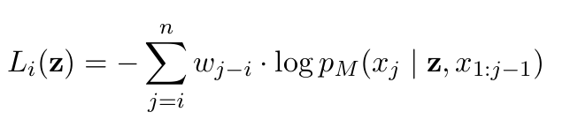

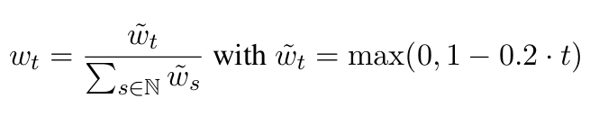

论文比较三种情况：

1. 有 API 调用且提供结果：$L_i^+$
2. 完全不调用 API：$L_i($ $\mathcal{epsilon})$
3. 有 API 调用但不给结果：$L_i(e(c_i, epsilon))$

计算公式：

有 API 调用且提供结果：$L_i^+ = L_i(e(c_i, r_i))$
$L_i^- = min(L_i(epsilon), L_i(e(c_i, epsilon)))$

保留条件：$L_i^- - L_i^+ >= tau_f$


- $L_i^+$ 的含义：将API 调用和结果作为前缀插入sequence后的损失
- $L_i^-$为什么取两个基线的最小值：要使用不加入结果的情况下的最小损失和加入结果后的最小损失比较才有意义
- $tau_f$ 越大时，训练数据数量和质量如何变化：如果$tau_f$越大，在加入API之后的损失降低幅度要更大，也就是说，对帮助模型判断的效果越好才可以被保留。质量会上升，数量会减少。
- 加权函数$w_t$为什么更关注调用位置附近的 token：距离调用位置越近的 token，通常与 API 返回结果越直接相关。

### 6.6 第四步：Model Finetuning

- 如何把保留下来的调用插回原始文本：直接放到i的位置
- 训练目标是否发生变化：没有发生变化，仍然使用标准的自回归语言模型目标，即根据前面的 token 预测下一个 token，并最小化交叉熵损失。模型架构仍然是原来的模型 `M`，但微调过程会更新其参数。


- 为什么同时保留原始文本内容：要保留原本模型的语言表达能力
- 模型从训练数据中分别学到什么：何时调用API，调用哪个工具，参数怎么构造，如何使用返回结果。

### 6.7 推理阶段

- 正常解码何时被中断：在模型M输出“→” token时，说明其需要等待调用API，并接收返回值
- 系统何时真正执行 API：在模型M输出“→” token时，说明M在等待API返回值。系统需要解析此前生成的 API 名称和参数，实际调用对应工具。
- API 结果怎样插入上下文：直接放入末尾，“→”后面，并在结果后面插入API结束标记`</API>`
- 解码参数 `k` 如何影响调用频率和校准：`k`值越大，在推理阶段对API的调用越积极。但 `k` 过大时，模型会在原本不需要工具的样本上也调用 API，使“是否需要工具”的校准能力下降。
- 论文为什么限制每个输入最多调用一次(在PDF第6页开头，实验部分)：
  - 修改后的解码策略会提高 `<API>` 的触发概率，如果不限制调用次数，模型可能反复生成 API 调用，陷入只调用工具而不继续输出正文的循环。
  - 因此作者在实验中限制每个输入最多调用一次，以避免无限调用并控制推理成本。
  - 这一限制同时使模型无法进行多步工具调用和工具链，例如先查询日期，再把日期用于另一个问答调用，因而也是 Toolformer 的重要局限。

## 7. 五种工具

对于工具的两个要求：

1、输入输出都能够表示为文本序列

2、能够获得少量示例，用来展示这些工具应该如何使用。

| 工具 | 实现 | 解决的问题 | 输入 | 输出 | 重点疑问 |
| --- | --- | --- | --- | --- | --- |
| Question Answering | Atlas | 事实问答 | 自然语言问题 | 简短答案 | 与搜索工具怎样分工？ |
| Calculator | Python script | 精确算术 | 算术表达式 | 数值 | 只支持四则运算是否足够？ |
| Wikipedia Search | BM25 over KILT Wikipedia | 信息检索 | 搜索词 | 文本片段 | 模型能否识别并提取相关信息？ |
| Machine Translation | NLLB 600M + fastText | 非英语文本理解 | 待翻译文本 | 英文翻译 | 语言检测错误如何传播？ |
| Calendar | 日期接口 | 时间感知 | 无 | 当前日期 | 静态文档时间如何构造？ |

## 8. 实验设置

### 8.1 数据与训练

| 项目 | 设置 | 我的备注 |
| --- | --- | --- |
| 基础模型 | GPT-J 6.7B |  |
| 原始语料 `C` | CCNet 子集 |  |
| 增强语料 `C*` | 经采样、执行、过滤后的 API 调用语料 |  |
| 每个 API 的训练样本上限 | 25k |  |
| 最大序列长度 | 1,024 |  |
| 有效 batch size | 128 |  |
| 学习率 | $1*10^{-5}$ |  |
| 训练硬件 | 8 x A100 40GB, BF16 |  |

### 8.2 主要基线

- GPT-J：原始模型
- GPT-J + CC：只在普通 CCNet 子集上继续微调
- Toolformer：在带 API 调用的 `C*` 上微调并允许调用工具
- Toolformer (disabled)：同一模型，但推理时禁用 API
- OPT 66B：更大模型基线
- GPT-3 175B：更大模型基线

### 8.3 评测设置需要警惕的地方

- 所有任务采用 prompted zero-shot，但 prompt 本身仍是人工设计的。

- 解码时把 `<API>` 放宽到 top-k token 内即可触发，不完全等同于普通 greedy decoding。

  >  这里的top-k的k不是之前推理解码参数k,即“最多保留 `k` 个候选位置”，而是指发现 `<API>` 的概率排名进入前 `k`，就强制触发工具调用，即使另一个普通 token 的概率更高。文章中使用的k=10

- 每个输入最多一次 API 调用，限制了多步工具使用。

- 部分评测使用比 exact match 更宽松的指标。

- 某些训练数据先经过工具特定的启发式预筛选。

  - 这是构建增强训练集 `C*` 的前置步骤。作者先针对不同工具，从原始语料 `C` 中筛选出更可能需要该工具的文本，再进行候选调用生成、API 执行和损失过滤。

    - 这样可以减少在明显不相关文本上生成和执行 API 调用的计算成本。
    - 例如，Calculator 优先处理包含多个数字或计算线索的文本，Machine Translation 优先处理包含非英语片段的文本。

## 9. 下游任务与结果

### 9.1 LAMA：事实补全

- 数据集：SQuAD、Google-RE、T-REx 子集

- 主要使用的工具：question answering tool

- 指标：只检查正确答案是否出现在模型预测的前五个单词中。

  > 为了考虑不同模型分词方式的差异，以及没有明确告诉模型答案只需要一个单词所带来的额外难度，我们使用了一个比完全匹配稍微宽松的评价标准：只检查正确答案是否出现在模型预测的前五个单词中。

- Toolformer 相对基线的结果：最强

- 是否存在数据或检索优势：没有，因为屏蔽了维基百科API

### 9.2 Math Datasets：数学题

- 数据集：ASDiv、SVAMP、MAWPS
- 主要使用的工具：calculator tool
- Toolformer (disabled) 是否也有提升：有极大提升，作者认为是因为在微调过程中插入的API请求和答案提升了他们的计算能力。
- 工具调用带来的额外提升：将准确率翻倍

### 9.3 Question Answering：开放域问答

- 数据集：WebQuestions、Natural Questions、TriviaQA

- 主要工具：Wikipedia Search

  > 禁用了question answering tool，因为QA系统是基于Natural Questions微调的

- 评判标准：whether the first 20 words predicted by a model contain the correct answer instead of requiring an exact match.

- 关键结果：优于其他基于GPT-J的模型，但落后于GPT-3

- 搜索返回不理想时模型能否重试：

  不能，作者只是提出一种未来的方向，他认为：“**这可能是由于我们的搜索引擎的简单性（在许多情况下，它返回的结果显然与给定的查询不匹配）和Toolformer无法与之交互**，例如，如果结果没有帮助，可以重新构建查询，或者浏览多个顶部结果。”

### 9.4 Multilingual Question Answering

- 数据集：MLQA
- 主要工具：Machine Translation
- 评判标准：Our evaluation metric is the percentage of times the model’s generation, capped at 10 words, contains the correct answer.
- 翻译工具是否真正改善结果：未改善
- 失败原因：这主要是因为对于某些语言，CCNet上的微调会降低性能；这可能是由于与GPT-J的原始预训练数据相比，分布发生了变化。

### 9.5 Temporal Datasets

- 数据集：TEMPLAMA、DATESET
- 评判标准：和LAMA评判标准一样
- Calendar API 的预期作用：弱，只有 0.2%的样本调用了Calendar API
- 实际最常调用的工具：the Wikipedia search and question answering tools
- 为什么一次调用限制尤其影响这类任务：TEMPLAMA中的命名实体通常非常具体和罕见，即使只知道确切的日期也无济于事。

## 10. 语言建模能力与规模效应

### 10.1 Language Modeling

- WikiText perplexity：少量衰退
- CCNet perplexity：轻微提升
- `Toolformer (disabled)` 与 `GPT-J + CC` 的差异：GPT-J的预训练数据集更加贴近于WikiText，而不是随意选择的CCNet
- 这些结果支持了什么结论：没有使模型语言能力显著降低

### 10.2 Scaling Laws

- 比较的模型规模：124M / 355M / 775M / 1.6B / 6.7B
- 小模型能否学会正确调用工具：未能学会，模型的工具调用能力从775M才开始出现
- 模型规模增大时，无工具与有工具结果的差距：仍然保持较大差距
- 工具使用是否也是一种 emergent ability：是

## 11. Analysis

### 11.1 Decoding Strategy

- top-k 中允许 `<API>` 触发调用的目的：更多的使用API调用
- `k` 增大如何影响调用率：k增大显著提升调用率
- `k` 增大如何影响模型对“是否需要工具”的校准：
  - `k=1` 时，只有当 `<API>` 是概率最高的 token，模型才调用工具，此时模型具有一定校准能力：它倾向于在自身难以直接回答的样本上调用 API，而在能够自行回答的样本上不调用。
  - 随着 `k` 增大，只要 `<API>` 进入 top-k 就被强制触发，调用条件变得宽松，API 调用率迅速升高。
  - 当 `k=10` 时，T-REx 和 WebQS 的调用率分别达到 98.1% 和 100%，模型几乎不再区分样本是否真正需要工具，因此“是否需要工具”的校准能力下降。

- 性能提高是否依赖人为提高工具调用倾向：
    - 部分依赖。论文使用 top-k 触发规则，人为提高了 `<API>` 被选择的概率；最佳结果通常出现在 `k>1`、API 调用率大幅提高的情况下。
    - 这种依赖在 WebQS 上尤其明显：`k=1` 时调用率只有 8.5%，整体性能仅从禁用工具时的 18.9 提高到 19.3；当 `k=3`、调用率达到 99.3% 时，性能提高到 26.3。
    - 但性能提升也不能完全归因于强制调用。T-REx 在普通 greedy decoding（`k=1`）下已经从 34.9 提高到 47.8，说明模型本身确实学会了在部分场景中主动调用和利用工具。


### 11.2 Data Quality

- 过滤分数高的调用通常有什么特点：
- 过滤分数低但仍被保留的噪声：
- 为什么少量噪声可能反而有用：
- 该过滤标准容易保留哪些“有助预测但语义无关”的调用：

## 12. 与 ReAct 的联系

| 维度 | Toolformer | ReAct |
| --- | --- | --- |
| 核心目标 | 让 LM 通过自监督微调学会使用多种工具 | 让 LM 在任务中交替进行推理与行动 |
| 主要学习方式 | 生成并过滤 API 调用数据，再微调模型 | 少样本 prompting，通常不更新模型参数 |
| 轨迹形式 | 文本中插入 API 调用及结果 | Thought - Action - Observation 循环 |
| 工具选择 | 从训练语料中学习何时、如何调用 | 根据任务 prompt 和当前轨迹在线决定 |
| 多步交互 | 当前版本不支持工具链和交互式重试 | 天然支持多轮行动与观察 |
| 自监督信号 | 后续 token 损失是否降低 | 主要依赖任务示例和环境反馈 |
| 主要优势 | 低人工标注、工具调用内化进模型 | 推理过程显式、适合多步任务 |

### 12.1 需要进一步想清楚的问题

- Toolformer 能否被看作“把工具调用模式蒸馏进参数”的方法？
- ReAct 的 `Observation` 与 Toolformer 插入上下文的 API result 有何异同？
- Toolformer 若加入多轮调用数据，是否会自然演化成 ReAct 式 agent？
- 两者分别更适合“高频、局部工具调用”和“低频、长程任务规划”吗？

## 13. Related Work 连接

### 13.1 Retrieval-Augmented Language Models

- REALM / RETRO / Atlas 与 Toolformer 的共同点：
- 检索发生在预训练、微调还是推理阶段：
- Toolformer 新增的“选择是否调用”能力：

### 13.2 Tool-Augmented Language Models

- TALM：
- WebGPT / BlenderBot 3：
- PAL / calculator-augmented models：
- Toolformer 与这些工作的监督方式差异：

### 13.3 Self-Training / Bootstrapping

- 模型自己生成什么：
- 哪一步负责质量控制：
- 与 STaR 等自举方法的相似性：
- 误差自我强化的风险：

## 14. 局限性

- 无法进行链式工具调用：
- 无法与搜索结果进行多轮交互或改写查询：
- 对输入措辞敏感：
- 样本效率低，特别是 Calculator 和 MT：
- 过滤标准不直接保证事实正确或任务相关：
- 决策时没有考虑不同工具的计算成本：
- 每次输入最多一次调用，可能限制复杂任务：
- 只要求文本输入输出，无法直接覆盖非文本工具：
- 我的补充批评：

## 15. 附录阅读重点

### 15.1 Appendix A：API Details

建议重点阅读，因为正文中的“少量示例即可自监督学习”实际上依赖不少工具特定的实现与启发式筛选。

- 默认参数：`tau_s`、`tau_f`、`k`、`m`
- 不同工具为什么使用不同阈值：
- Calculator 数据的启发式筛选：
- Calendar 如何从 URL 近似文档日期：
- MT 如何定位非英语片段：
- 五种工具的采样 prompts：

### 15.2 Appendix B：Toolformer Training

- 每个 API 的样本上限：
- 训练步数与 checkpoint 选择：
- 算力成本：
- 复现时缺失的信息：

### 15.3 Appendix C：Zero-Shot Prompts

- LAMA / TEMPLAMA：
- Math benchmarks：
- Question answering：
- MLQA：
- prompt 是否对结果有偏置：

### 15.4 Appendix D：DATESET

- 数据构造方式：
- 模板数量与类型：
- 是否与 Calendar 工具过度匹配：
- 对真实时间推理能力的代表性：

## 16. 关键术语表

| Term | 我的解释 | 在论文中的作用 |
| --- | --- | --- |
| API call | 以特殊文本格式表达的工具调用 | 工具使用的基本单元 |
| self-supervised tool use | 用模型自身预测损失筛选工具调用数据 | 减少人工标注 |
| sampling threshold `tau_s` | 候选位置触发 API 调用的概率门槛 | 控制候选调用数量 |
| filtering threshold `tau_f` | 工具结果必须带来的最小损失改善 | 控制训练数据质量和数量 |
| perplexity | 语言模型对文本预测不确定性的指标 | 评估调用帮助程度与语言能力 |
| in-context learning | 通过 prompt 中少量示例诱导模型生成调用 | 产生候选 API 数据 |
| bootstrapping | 用模型自己的预测继续训练模型 | Toolformer 数据构造范式 |
| tool chaining | 把一个工具输出作为另一个工具输入 | 当前 Toolformer 不支持 |
| calibration | 模型调用工具的信心与实际需要是否匹配 | Analysis 中考察 |

## 17. 图表记录

### Figure 1：Toolformer 调用示例

- 展示了哪些工具：QA（问答系统）、Calculator（计算器）、MT（机器翻译系统）、WikiSearch（维基百科搜索引擎）

- API 调用嵌入文本的形式：

- 该图说明了能力，还是只说明了输出格式：

- asset 文件：

  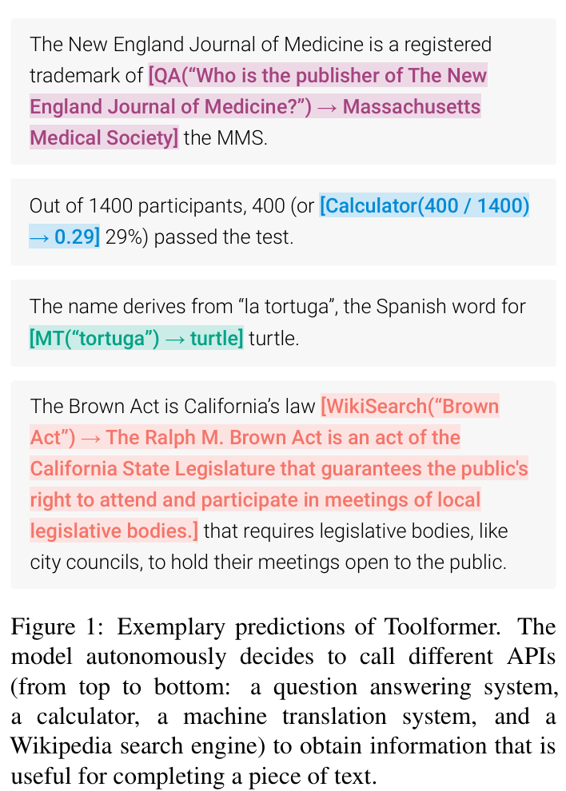

### Figure 2：训练数据生成流程

- 三个核心步骤：

  - 第一步：利用M的上下文学习能力来对大量潜在的API调用进行采样。
  - 第二步：然后我们执行这些API调用，并最终检查获得的响应是否有助于预测未来的token；这被用作筛选标准。
  - 第三步：在筛选之后，合并了对不同工具的API调用，从而得到增强数据集$C^*$，然后在这个数据集上微调了M

- 最容易误解的环节：

  $L_i$的计算是指对于下一个token预测时的损失，作者将哪些没有将后续token预测损失$L_i$降低的API调用删除了

- 用自己的话复现流程：

  - 首先采样一个位置i（不是简单随机采样），图中的就是 Pittsburgh is  also known as 【i】the Steel City.使用【i】之前的部分作为提示词让模型进行API调用（这一部分的能力是通过prompt完成的），文章对同一句话采用多次API调用。

  - 其次，将模型M想要调用的API执行，得到每个调用的答案。
  - 最后，将多次API调用及其答案与原文拼接起来再送到模型M（逐个候选调用单独评估），预测后续token（the Steel City）的loss是否下降，下降了，就说明是有效的API调用，添加到数据集内。

- asset 文件：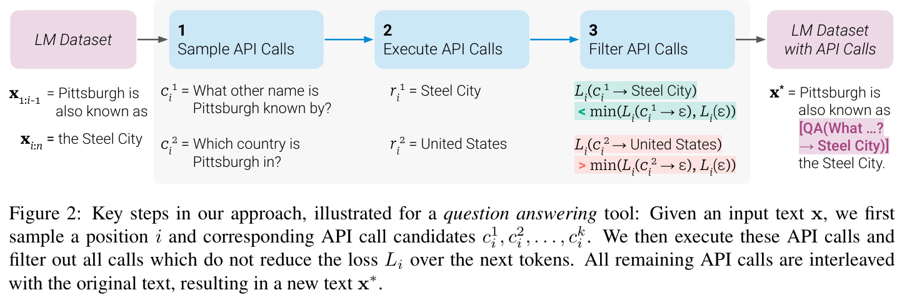

### Figure 3：QA API prompt

- demonstrations 提供了哪些信息：
- 模型需要从示例中归纳什么：
- asset 文件：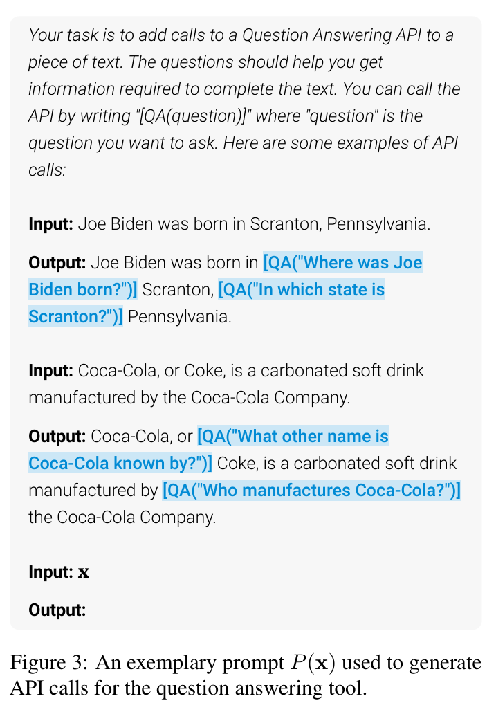

### Figure 4：Scaling Laws

- 横轴与纵轴：横轴：参数量；纵轴：Average performance on LAMA, our math benchmarks and our QA benchmarks
- 不同模型规模的趋势：有无API调用能力的Toolformer都随着模型规模的提升而提升
- 能否支持 emergent ability 的判断：
- asset 文件：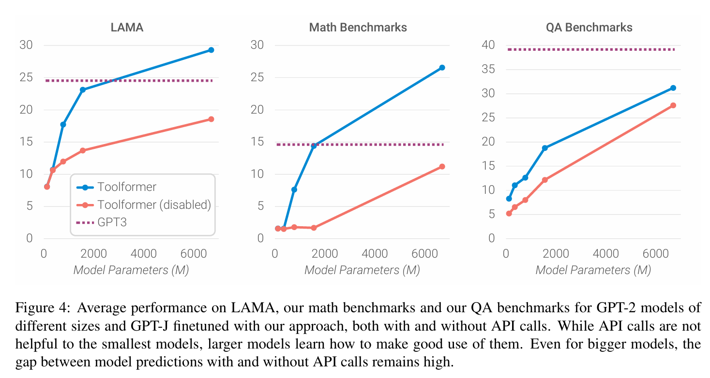

### 重要表格

| 表格 | 内容 | 关键结论 | 我是否相信 |
| --- | --- | --- | --- |
| Table 1 | 五种 API 输入输出示例 |  |  |
| Table 2 | 不同过滤阈值下的数据量 |  |  |
| Table 3-7 | 各类下游任务结果 |  |  |
| Table 8 | 语言模型 perplexity |  |  |
| Table 9 | 解码 `k` 的影响 |  |  |
| Table 10 | 过滤后的 API 调用质量 |  |  |
| Table 11 | DATESET 模板 |  |  |

assets文件：

- Table 1:API输入输出样例

  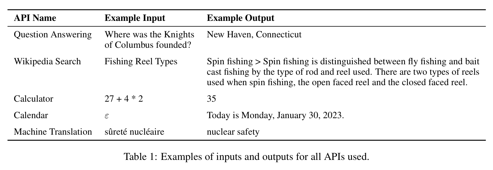

- Table 2:不同的阈值对于训练集数据大小的影响

  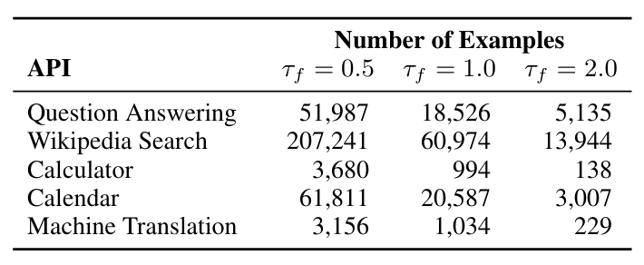

- Table 3-7：下游任务测试数据

  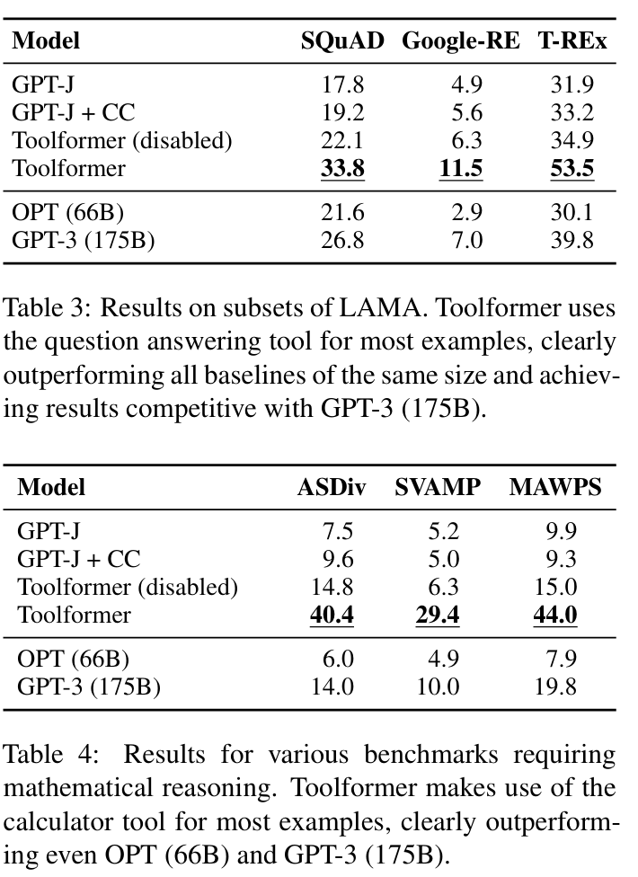

  

  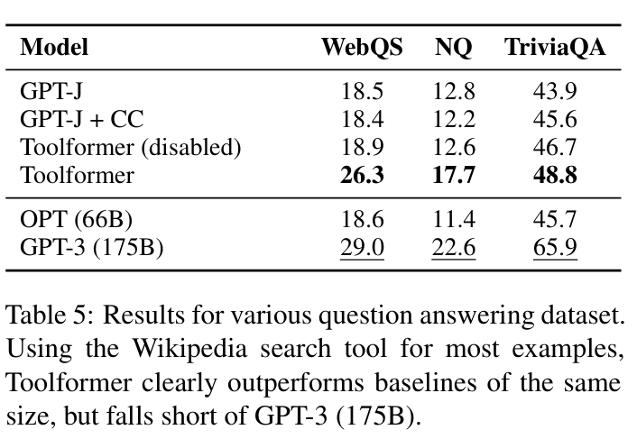

  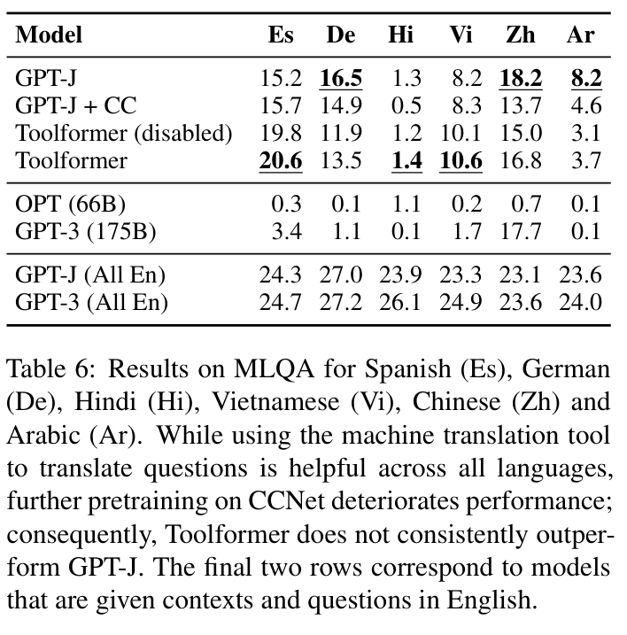

  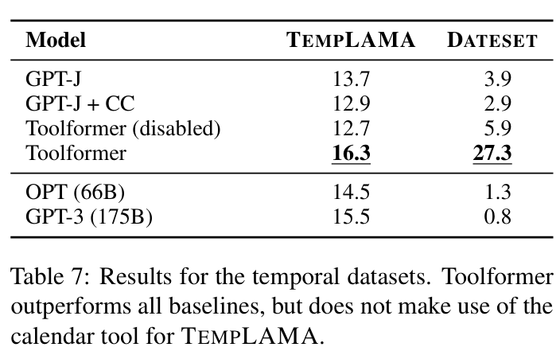

- Table 8：微调对模型语言能力的影响

  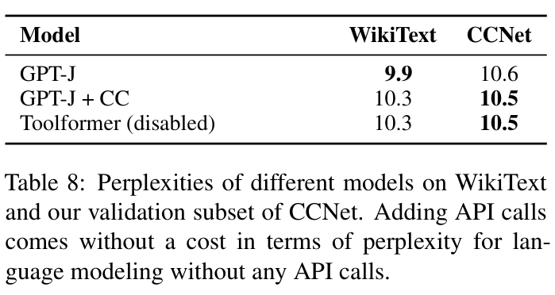

- Table 9：在不同测试集上不同k值设定，对模型调用API积极性的影响。==**数据：** WebQS, k=1行存在一个数字不一致：0.085 × 17.1 + 0.915 × 19.9 ≈ 19.7==

  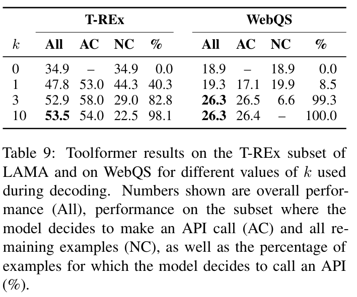

- Table 10：

  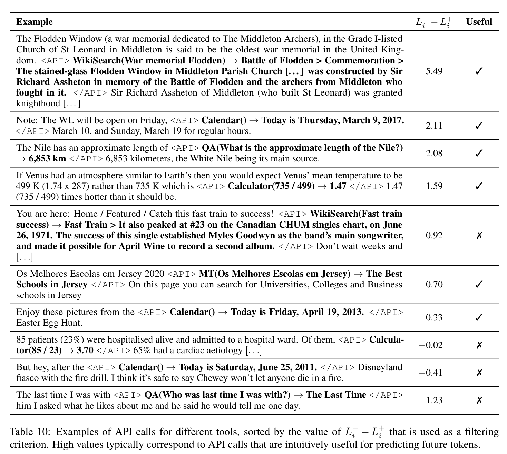

## 18. 我的理解与复述

### 18.1 用自己的话解释 Toolformer

待写。

### 18.2 用一个完整例子走通训练流程

1. 原始文本：
2. 候选调用：
3. 工具返回：
4. 三种损失：
5. 是否保留：
6. 插入增强语料：
7. 微调后推理行为：

### 18.3 最重要的贡献

待写。

### 18.4 最值得质疑的地方

待写。

==过滤标准不直接保证事实正确或任务相关==

### 18.5 可以复用的思想

- 用模型自己的损失变化评估外部信息是否有帮助。
- 把结构化工具调用线性化，使其可以继续使用标准语言模型目标训练。
- 使用少量 demonstrations 生成大规模候选数据，再通过可计算信号过滤。
- 通过保留原始语料分布，尽量避免专项微调损害通用能力。

## 19. 未解决问题

- [ ] 模型判断调用位置时，数据生成阶段与真实自回归推理是否存在信息差？
- [ ] 损失降低是否会偏向“重复后文答案”的调用，而不是具有真实推理价值的调用？
- [ ] 如果工具返回错误信息，Toolformer 会在什么情况下盲目采用它？
- [ ] 为什么 Toolformer (disabled) 在部分任务上也可能优于普通 GPT-J？
- [ ] 一次 API 调用限制取消后，如何避免无限调用循环？
- [ ] 工具返回很长时，过滤和推理成本怎样变化？
- [ ] 如何学习新工具，而不重新生成并混合全部训练数据？
- [ ] 与 ReAct 结合时，应使用 Toolformer 负责工具选择，还是负责生成调用参数？
- [ ] 现代 function calling 的结构化约束解决了 Toolformer 的哪些问题？

## 20. 阅读时随手追加的格式

```markdown
### 页码 / 小节

- 原文要点：
- 关键公式或实验：
- 我的理解：
- 与前文的关系：
- 与 ReAct 或其他已读论文的关系：
- 仍然不懂的问题：
```

