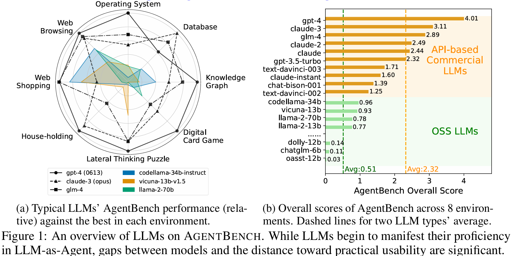
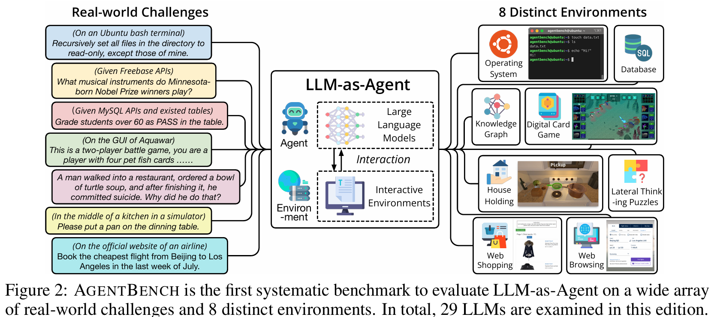
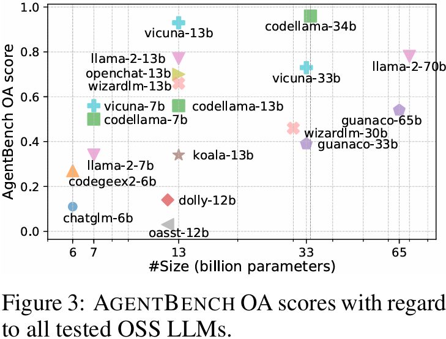
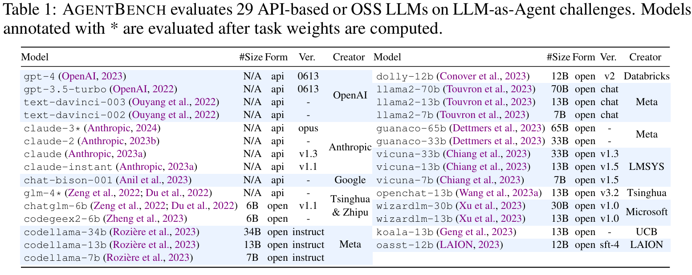
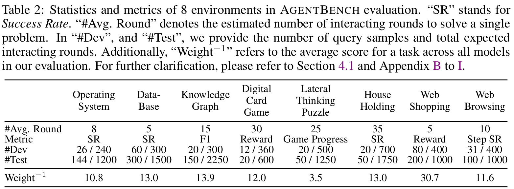
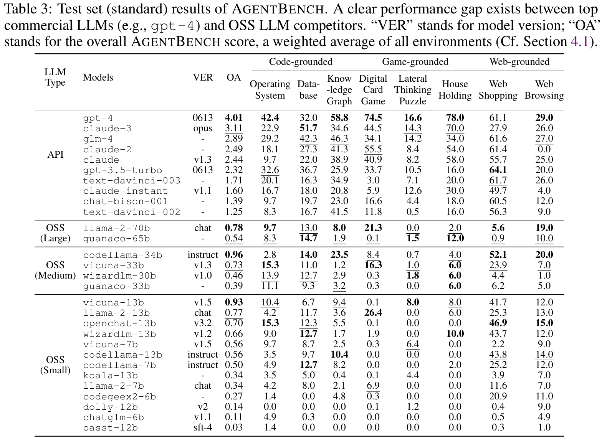
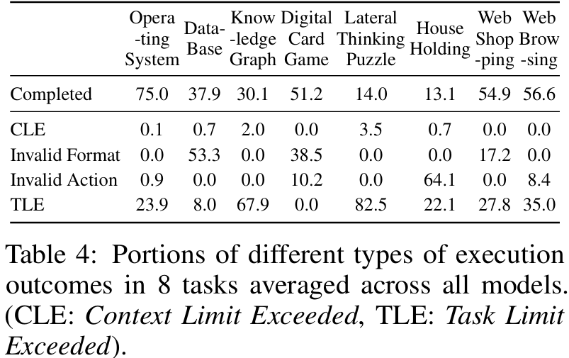

# AgentBench: Evaluating LLMs as Agents

> 阅读时间：2026.7.13-

## 0. 论文信息

- Title: AgentBench: Evaluating LLMs as Agents
- Venue: ICLR 2024
- Authors: Xiao Liu, Hao Yu, Hanchen Zhang, et al.
- arXiv: 2308.03688
- PDF: `AgentBench Evaluating LLMs as Agents.pdf`
- Pages: 58
- Reading status: Reading

## 0.1 阅读进度清单

- [x] Abstract：确认研究问题、基准规模和主要结论
- [x] 1 Introduction：理解为什么需要专门评测 LLM-as-Agent
- [x] 2 LLM-as-Agent: Definition and Preliminary：掌握交互式评测形式与终止类型
- [x] 3 Composition of AgentBench：比较 8 个环境分别测什么能力
- [x] 3.1 Code-grounded Environments：OS、DB、KG
- [x] 3.2 Game-grounded Environments：DCG、LTP、House-Holding
- [x] 3.3 Web-grounded Environments：Web Shopping、Web Browsing
- [ ] 4.1 Evaluation Setup：记录模型、提示、上下文管理和总分计算
- [ ] 4.2 Main Results：比较商业 API 模型与开源模型
- [ ] 4.3 Analysis：理解失败原因、代码训练和对齐数据的影响
- [ ] 5 Related Work：联系静态基准、ReAct 和可执行环境评测
- [ ] 6 Conclusion：用自己的话复述贡献与局限
- [ ] Appendix A：评测框架和工具包，需要复现时细读
- [ ] Appendix B-I：8 个环境的实现、数据、提示和指标，按需阅读
- [ ] Appendix J：详细结果、失败案例和能力分析，建议在读完 4.3 后阅读

## 1. 一句话总结

> AgentBench 通过 8 个交互环境统一评测 29 个 LLM 作为 Agent 的能力，发现商业 API 模型显著领先多数不超过 70B 的开源模型，而长期推理、决策和指令遵循仍是主要瓶颈。

## 2. 阅读前的核心问题

- AgentBench 所说的“Agent 能力”具体包含哪些能力？
- 为什么传统静态问答或生成基准不足以评估 LLM-as-Agent？
- 8 个环境之间的差异是否足以体现 benchmark 的多样性？
- 不同环境的指标量纲不同，论文如何计算统一总分？这种方法公平吗？
- 模型失败究竟来自推理能力不足、决策错误、指令遵循失败，还是环境接口设计？
- AgentBench 评测的是基础模型能力，还是“模型 + Prompt + CoT + 交互框架”的整体能力？
- 论文结论能否推广到今天的 Agent 系统？哪些结论只适用于论文当时的模型？
- AgentBench 与 ReAct 的关系是什么？它是在评测 ReAct 范式，还是一般 Agent 能力？
- AgentBench 与 Toolformer 的关注点有何不同？

## 3. 论文结构索引

页码按 PDF 页数记录。

- p.1 - Abstract / 1 Introduction
- p.3 - 2 LLM-as-Agent: Definition and Preliminary
- p.4 - 3 Composition of AgentBench: A Brief Look
- p.4 - 3.1 Code-grounded Environments
- p.4 - 3.2 Game-grounded Environments
- p.5 - 3.3 Web-grounded Environments
- p.5 - 4 Evaluation of AgentBench
- p.6 - 4.1 Evaluation Setup
- p.7 - 4.2 Main Results
- p.8 - 4.3 Analysis
- p.9 - 5 Related Work / 6 Conclusion
- p.17 - Appendix 目录
- p.20 - Appendix A: Framework
- p.21 - Appendix B: Operating System
- p.24 - Appendix C: Database
- p.26 - Appendix D: Knowledge Graph
- p.29 - Appendix E: Digital Card Game
- p.34 - Appendix F: Lateral Thinking Puzzles
- p.38 - Appendix G: House-Holding
- p.40 - Appendix H: Web Shopping
- p.42 - Appendix I: Web Browsing
- p.45 - Appendix J: Detailed Analysis

## 4. 图表阅读记录

### 4.1 图表通用记录方法

阅读每个图表时，至少回答下面四个问题：

- 图表展示了什么变量或比较关系：先识别横纵轴、模型组别、任务指标和比较基线。
- 作者希望用它支持什么结论：检查图表是否对应正文中的性能差距、失败原因或能力分析。
- 数据是否真的支持这个结论：区分相关性、案例证据和受控因果证据。
- 是否存在异常值、混杂变量或不公平比较：关注模型版本、训练数据、任务指标和权重差异。

### 4.2 正文图片

#### Figure 1：AgentBench 总体结果概览（p.1）



- [x] 已阅读
- 图 1(a) 比较了什么：不同模型在八个不同交互环境上的表现
- 图 1(b) 的 Overall Score 表示什么：8 个任务分数按各任务平均分归一化后再取平均，表示模型相对于参评模型平均水平的综合表现。
- API-based 模型与 OSS 模型的平均差距：平均 OA 分别为 2.32 和 0.51，API 模型约为 OSS 模型的 4.5 倍。
- 哪些环境中模型间差距最大：Knowledge Graph、Digital Card Game 和 House-Holding 中多数 OSS 模型接近低分区，而顶尖 API 模型明显领先。
- 作者用这张图支持的核心结论：LLM 已显示出充当 Agent 的潜力，但商业模型与开源模型之间、现有能力与稳定可用之间仍有明显差距。
- 我的观察或疑问：OA 依赖初始参评模型计算的任务权重，因此它适合在本基准内比较，但不是完全独立于模型集合的绝对能力值。

#### Figure 2：AgentBench 的任务与环境构成（p.2）



- [ ] 已阅读
- LLM、Agent、Environment 三者的关系：LLM 充当 Agent 的决策核心，根据环境 Observation 生成 Action，环境执行后再返回反馈。
- 8 个环境如何分成 Code、Game、Web 三类：Code 包括 OS、DB、KG；Game 包括 DCG、LTP、House-Holding；Web 包括 Web Shopping、Web Browsing。
- 每个环境对应的真实任务示例：执行 Shell 操作、修改数据库、查询知识图谱、卡牌对战、猜海龟汤、完成家务、购买商品和操作网页。
- 这张图体现了哪些 Agent 能力：指令遵循、规划、决策、工具使用、代码生成、常识理解和多轮状态跟踪。
- 8 个环境是否具有足够的代表性：覆盖面较广，但仍以文本接口为主，未覆盖视觉 GUI、机器人控制、社会协作和超长任务。
- 我的观察或疑问：这些环境的 Action space 和评价方式差异很大，统一总分需要额外归一化。

#### Figure 3：开源模型规模与 Overall Score（p.8）



- [ ] 已阅读
- 横轴与纵轴分别表示什么：横轴是 OSS 模型参数量（B），纵轴是 AgentBench Overall Score。
- 模型规模与 AgentBench 分数是否单调相关：不是，参数更多并不保证 OA 更高。
- 重要异常点：Llama-2-70B 与 Llama-2-13B 表现接近；Vicuna-13B 超过多个更大模型；CodeLlama-34B 是最强 OSS 模型。
- CodeLlama、Llama-2、Vicuna 等模型之间如何比较：CodeLlama 在程序化任务中占优，Vicuna-13B 显示高质量对齐数据的作用，Llama-2 系列没有呈现稳定的规模收益。
- 这张图能否证明“参数越多，Agent 能力越强”：不能，只能说明规模与 Agent 能力存在一定关系，但训练量、代码数据和对齐方式同样重要。
- 我的观察或疑问：图中是不同模型家族的观察性比较，不能把差异全部归因于参数规模。

### 4.3 正文表格

#### Table 1：参与评测的 29 个模型（p.3）



- [ ] 已阅读
- API-based 模型包括：GPT-4、GPT-3.5-Turbo、Text-Davinci、Claude 系列、Chat-Bison 和 GLM-4，共 10 个。
- OSS 模型包括：Llama-2、CodeLlama、Vicuna、Guanaco、WizardLM、ChatGLM、CodeGeeX2、OpenChat、Dolly、Koala 和 OASST 等，共 19 个。
- 模型规模和版本范围：OSS 模型约为 6B-70B；API 模型多数不公开参数量，具体版本见表中 `VER`。
- 不同模型是否处于公平、可比的设置中：任务、Prompt 和解码设置基本统一，但上下文长度、训练数据、发布时间和对齐方式不同，并非严格控制变量。
- OSS competitors 在本文中具体指哪些模型：指表中可获取权重、主要不超过 70B 的开源或开放权重模型，与商业 API 模型形成对照。
- 我的观察或疑问：Claude-3 和 GLM-4 在权重确定后补测，说明榜单具有跨版本扩展性，但也混合了不同发布时间的模型。

#### Table 2：8 个环境的数据规模、指标和权重（p.6）



- [ ] 已阅读

| 环境 | Dev / Test 样本 | 指标 | 估计交互轮数 | Overall Score 权重 | 预计 Dev / Test 调用数 |
| --- | --- | --- | --- | --- | --- |
| Operating System | 26 / 144 | SR | 8 | $1/10.8$ | 240 / 1200 |
| Database | 60 / 300 | SR | 5 | $1/13.0$ | 300 / 1500 |
| Knowledge Graph | 20 / 150 | F1 | 15 | $1/13.9$ | 300 / 2250 |
| Digital Card Game | 12 / 20 | Reward | 30 | $1/12.0$ | 360 / 600 |
| Lateral Thinking Puzzles | 20 / 50 | Game Progress | 25 | $1/3.5$ | 500 / 1250 |
| House-Holding | 20 / 50 | SR | 35 | $1/13.0$ | 700 / 1750 |
| Web Shopping | 80 / 200 | Reward | 5 | $1/30.7$ | 400 / 1000 |
| Web Browsing | 31 / 100 | Step SR | 10 | $1/11.6$ | 400 / 1000 |

- 为什么不同环境使用不同指标：任务目标不同，问答适合 F1，执行任务适合 SR，游戏和购物则需要连续 Reward 或进度指标。
- 为什么不能直接平均原始分数：指标量纲和平均难度不同，直接平均会让 Web Shopping 等高分任务支配总分。
- 权重如何计算：使用初始参评模型在每个任务上的平均分的倒数。
- 哪些任务对总分影响最大：按每个原始分数点看，均分最低的 LTP 权重最大，Web Shopping 权重最小；归一化后各任务的平均贡献均为 1。
- 我的观察或疑问：表中的轮数是估计解题轮数，不是所有任务统一的硬性最大轮数。

#### Table 3：AgentBench 主实验结果（p.7）



- [ ] 已阅读
- Overall Score 最高的模型：GPT-4，OA 为 4.01。
- 每个环境的最佳模型：GPT-4 在 OS、KG、DCG、LTP、HH、WB 最佳；Claude-3 在 DB 最佳；GPT-3.5-Turbo 在 WS 最佳。
- API-based 模型的整体表现：平均 OA 为 2.32，所有 API 模型均高于 1.00。
- OSS 模型的整体表现：平均 OA 为 0.51，多个模型在 KG、DCG 和 HH 上接近 0。
- 最强 OSS 模型与 GPT-3.5 / GPT-4 的差距：CodeLlama-34B 为 0.96，低于 GPT-3.5-Turbo 的 2.32 和 GPT-4 的 4.01。
- 是否存在某个模型只在少数环境中特别突出：有，例如 CodeLlama-34B 在 Web Shopping 得分 52.1，但在 OS、DCG 和 HH 上较弱。
- 表格中最值得关注的三个结果：
  1. GPT-4 在 6 个环境领先，但仍远未在所有任务达到满分。
  2. 商业 API 模型整体显著领先 OSS 模型。
  3. 模型规模不是唯一决定因素，CodeLlama 与 Vicuna 显示训练数据和对齐方式的重要性。
- 我的观察或疑问：不同环境指标经归一化后才能形成 OA，因此还应同时查看各任务原始分数。

#### Table 4：不同任务终止类型的比例（p.8）



- [ ] 已阅读

| 环境 | 主要失败原因 |
| --- | --- |
| Operating System | Task Limit Exceeded |
| Database | Invalid Format |
| Knowledge Graph | Task Limit Exceeded |
| Digital Card Game | Invalid Format |
| Lateral Thinking Puzzles | Task Limit Exceeded |
| House-Holding | Invalid Action |
| Web Shopping | Task Limit Exceeded |
| Web Browsing | Task Limit Exceeded |

- 哪些环境主要受格式错误影响：Database、Digital Card Game
- 哪些环境主要受非法动作影响：House-Holding
- 哪些环境主要因超过最大轮数而失败：Operating System、Knowledge Graph、Lateral Thinking Puzzles、Web Shopping、Web Browsing
- 失败类型能否直接对应某一种模型能力：不能完全对应。IF/IA 常与指令遵循有关，TLE 常与多轮规划有关，但 Prompt、动作空间和轮数上限也会造成这些失败。
- 我的观察或疑问：`Complete` 只表示按流程结束，不代表答案正确，因此该表分析的是执行有效性而非最终任务准确率。

### 4.4 附录图片与表格

附录图表先扫读，分析某个环境或验证正文结论时再细读。

#### Figure 4：8 个环境的完整示例（p.19）

- [ ] 已扫读
- 每个环境的 Instruction、Action 和 Observation 有何差异：Code 环境执行 Bash、SQL 或 KG API；Game 环境执行规则化游戏动作；Web 环境执行搜索、点击、输入和选择，并接收对应环境反馈。
- 哪些环境对输出格式要求最严格：Database、Digital Card Game 和 House-Holding，需要严格 SQL、JSON 或合法动作格式。
- 哪些环境的 Action space 最开放：OS 的 Bash 和 DB 的 SQL 参数最开放；其他环境多使用预定义 API 或候选动作。
- 我的观察或疑问：环境差异提高了覆盖面，但格式复杂度本身也成为评测变量。

#### Figure 5：AgentBench 工具包架构（p.21）

- [ ] 已扫读
- Model Server、Controller、Task Worker 的关系：Model Server 提供模型推理；Controller 管理任务；Task Worker 实际运行独立样本；Evaluation Client 协调两端。
- HTTP 接口承担什么作用：用统一协议调用不同本地或远程模型，降低模型接入成本。
- Docker 和 Worker 如何实现环境隔离：复杂环境封装进 Docker，每个 Worker 独立运行，避免依赖和状态冲突。
- 新模型或新任务如何接入：新模型提供 HTTP 服务；新任务实现对应 Controller、Worker、环境和评分逻辑。
- 我的观察或疑问：框架统一了执行流程，但任务自身的 Prompt、动作空间和评测器仍然不同。

#### Table 5：Database 重标注数据对比（p.26）

- [ ] 已扫读
- 为什么需要重新标注：验证使用 GPT-3.5-Turbo 扩充 DB 数据是否引入特定模型偏差，作者用 Claude-2 重新标注一小批样本。
- 原始数据与重标注数据上的结果差异：两批数据都保持 GPT-4 在 INSERT 上高于 GPT-3.5、GPT-3.5 在 UPDATE 上高于 GPT-4 的相对模式。
- 数据质量对评测结果有什么影响：若扩充数据带有生成模型偏好，可能夸大或压低某些模型与操作类型的分数。
- 我的观察或疑问：重标注样本很少且新数据没有 SELECT，证据只能说明未发现明显偏差，不能彻底排除偏差。

#### Table 6：API 模型与 OSS 模型的终止结果分布（p.46）

- [ ] 已扫读
- 两类模型的 Complete 比例：商业 API 模型为 61.5%，OSS 模型为 39.1%。
- 两类模型最主要的失败类型：两类模型都是 TLE 最多，分别为 24.9% 和 36.9%；OSS 的 IF 和 IA 也更高。
- 这张表如何支持商业模型与 OSS 模型存在差距的结论：OSS 的完成率更低，IF、IA、TLE 均更高，说明其指令遵循和多轮执行更不稳定。
- 我的观察或疑问：这是按模型类别聚合的相关性结果，不能单独确定差距来自开源属性、模型规模还是训练方式。

#### Figure 6：不同模型的 Action 有效性分析（p.47）

- [ ] 已扫读
- Invalid Format、Invalid Action 和 TLE 如何随模型变化：顶尖 API 模型通常 Complete 比例更高；多数 OSS 模型的 IF、IA 和 TLE 更高；CLE 主要出现在 Text-Davinci 模型。
- 指令遵循能力与任务完成率的关系：格式和动作错误越少，轨迹越有机会继续执行并完成任务，但完成轨迹仍不一定答对。
- 我的观察或疑问：即使 GPT-4 也会忽略 DB 的 `Action` 标签，说明格式遵循并非已解决问题。

#### Figure 7：GPT-4 的 Thought 与 Plan 案例（p.51）

- [ ] 已扫读
- GPT-4 如何分解目标：把“把干净肥皂放到台面”拆为 Find -> Clean -> Put，并逐个搜索位置。
- Plan 如何随 Observation 更新：每次发现目标不在当前位置后回退并检查下一个位置；搜索失败后重新检查遗漏的 countertop。
- 这个案例体现了 Planning 还是 Self-correction：两者都有，前半体现一致规划和回溯，后半体现对错误假设的修正。
- 与 ReAct 轨迹的相似之处：显式 Thought 指导 Action，环境 Observation 再更新后续计划。
- 我的观察或疑问：这是成功案例，能展示机制但不能量化该能力在全部样本中的稳定性。

#### Figure 8：成功轨迹的轮数和 Token 分布（p.54）

- [ ] 已扫读
- 成功任务通常需要多少轮：中位数 6 轮、平均 7.95 轮，中间 50% 位于 4-9 轮。
- 不同模型的 Token 使用差异：该图是所有成功轨迹的聚合分布，没有按模型拆分；Token 中位数 1850、平均 2220.1。
- 更长的推理是否意味着更高的成功率：不能据此推出。图中只包含成功轨迹，且大多数成功任务在 3000 tokens 内完成。
- 我的观察或疑问：这是完成轨迹的描述性统计，存在只选择成功样本的偏差。

#### Figure 9：TLE 轨迹中的重复响应（p.55）

- [ ] 已扫读
- $P(n,t)$ 的含义：在所有 TLE 轨迹中，最后 $n$ 轮至少存在两次回复的 Rouge-L 不低于阈值 $t$ 的轨迹比例。
- 重复生成与 TLE 的关系：超过 90% 的 TLE 轨迹在最后 10 轮存在 Rouge-L 不低于 0.8 的重复回复，重复是 TLE 的主要伴随现象。
- 这是记忆、规划还是自我纠错能力的问题：三者都可能涉及，模型可能忘记已执行动作、无法更新计划或不能识别循环；该统计不能单独区分原因。
- 我的观察或疑问：作者在计算前截断到 3500 tokens 以内，以减少历史省略策略对重复检测的干扰。

#### Figure 10：WebShop 样本有效率（p.56）

- [ ] 已扫读
- Sample validity ratio 如何定义：图中比较 CodeLlama 与 Llama-2 系列在 WebShop 上不同执行结局所占的平均比例。
- 不同模型或设置之间的差异：CodeLlama 的 Complete 比例为 50.3%，高于 Llama-2 的 36.5%，且 Invalid Action 比例更低。
- 该指标与最终任务成功率的关系：Complete 只表示轨迹正常结束，不保证购买结果完全正确，因此它与 Reward 相关但不等同。
- 我的观察或疑问：该图支持代码训练有利于程序化流程的相关性结论，但仍不是只改变代码训练数据的受控实验。

## 5. 摘要理解

### 5.1 研究问题

- 现有评测缺少什么：

  现有 LLM 评测大多采用静态、单轮的输入输出形式，或者只关注单一环境，缺少能够在多种交互环境和挑战性任务中系统评估 LLM-as-Agent 能力的统一基准。

- 为什么要在交互环境中评测：

  Agent 不仅要生成答案，还需要根据任务指令观察环境、规划步骤、执行动作，并根据环境反馈不断调整决策。静态评测无法充分衡量模型的多轮推理、决策、工具使用、指令遵循和自我纠错能力。

### 5.2 核心方案

- 环境数量与类型：AgentBench 包含 8 个交互环境，分为三类：

  - Code-grounded 环境，包括 Operating System、Database 和 Knowledge Graph；
  - Game-grounded 环境，包括 Digital Card Game、Lateral Thinking Puzzles 和 House-Holding；
  - Web-grounded 环境，包括 Web Shopping 和 Web Browsing。

- 被测模型：论文评测了 29 个 LLM，包括通过 API 使用的商业模型和开源模型。

  - 商业模型包括 GPT-4、GPT-3.5-Turbo、Claude 等；
  - 开源模型包括 Llama-2、Vicuna、CodeLlama、WizardLM、ChatGLM 等，开源模型规模最大不超过 70B。

- 统一评测工具：

  作者构建了基于 Server-Client 架构的统一评测工具包。模型通过 HTTP 接口接入，具体任务由相互隔离的 Worker 执行，复杂环境封装在 Docker 中，从而支持不同模型和不同环境的统一、模块化评测。

### 5.3 主要结论

  - 商业模型与开源模型的差距：顶尖商业模型在大多数环境中明显优于开源模型。API-based 模型的 AgentBench 平均总分约为 2.32，而开源模型约为 0.51。GPT-4 在 8 个环境中的 6 个取得最佳表现；表现最好的开源模型 CodeLlama-34B 总分为 0.96，仍明显低于 GPT-3.5-Turbo 的 2.32。
  - 主要失败原因：现有模型的主要障碍是长期推理、决策和指令遵循能力不足。具体表现为输出格式错误（Invalid Format）、生成环境不允许的动作（Invalid Action），以及在最大交互轮数内无法完成任务或不断重复操作（Task Limit Exceeded）。其中 TLE 是总体上最常见的失败类型。
  - 高质量对齐数据的影响：使用高质量多轮对话数据进行对齐训练可能提高 Agent 能力。论文比较发现，使用 ShareGPT 对话数据对齐的 Vicuna-13B 明显优于采用不同对齐方式的 Llama-2-13B，甚至能够接近参数量更大的 CodeLlama-34B。这说明高质量的多轮对齐数据有助于模型理解指令、维持任务目标并根据反馈继续行动。不过，这一结论主要来自模型间比较，不能完全视为严格的因果证明。
  - 代码训练的影响：代码训练对 Agent 能力具有双重影响。它能够改善流程相对固定、需要遵循明确操作步骤的任务，例如 Web Shopping；但也可能削弱需要通用推理、灵活决策和环境交互的任务表现，例如 Digital Card Game 和 Operating System。因此，代码训练并不会统一提升所有 Agent 任务，而是需要在程序化操作能力与通用推理能力之间取得平衡。

## 6. 背景与动机

### 6.1 传统 LLM Benchmark 的不足

- 静态输入输出无法体现什么能力：
- 单轮评测与多轮交互的差异：
- 文本匹配指标与任务真实完成之间的差异：

### 6.2 既有 Agent 环境的不足

- 文本游戏：只有预先定义好的、离散的动作。这些环境主要评测常识与环境理解，不能全面考查工具使用、长期规划、指令遵循和真实任务执行。
- 多模态模拟器：一些具身 Agent Benchmark依赖游戏画面、GUI 或室内场景。它们虽然复杂，但不一定符合文本 LLM 的实际使用场景，也提高了评测现有纯文本模型的门槛。
- 单一环境 Benchmark：单一环境无法全面反映模型在不同应用场景中的 Agent 能力。

### 6.3 论文贡献

1. 提出了AgentBench，一个多维度的benchmark，旨在评估LLM-as-Agent在不同环境中的表现。AgentBench包含了八种不同的环境（可以被分为三种类型：Code、Game、Web），其中有五种是首次提出。
2. 我们使用AGENTBENCH对29种不同的LLM进行了全面评估，发现领先的基于API的商业LLMs和许多大于70B的OSS模型之间存在显著的性能差距。我们还定量分析了现有LLM agents失败的原因和改进的重点方向，如改进结构、更高质量的对齐数据。此外，我们还发现，代码训练是一把双刃剑，这会在提高一些Agent任务的同时，损害其他Agent任务。
3. 我们开发了一套统一的评估工具包（基于S-C的架构，模块化和可拓展的设计理念，这使得使用HTTP协议就可以轻松定制任何LLM的模型评估。），支持LLMs在多样化定制Agent任务上运行，从而实现对AGENTBENCH上29种不同LLM作为代理能力的全面基准测试，包括基于API和OSS的模型。

## 7. LLM-as-Agent 的定义

### 7.1 交互式评测形式

论文将交互式 LLM-as-Agent 评测形式化为 POMDP（部分可观察的马尔可夫决策过程）：

$$
(S, A, T, R, U, O)
$$

```
任务指令 U
    ↓
观察 O → LLM Agent M → 动作 A
    ↑                    ↓
    └──── 环境状态 S ←───┘
             |
           奖励 R
```

| 符号 | 论文含义               | 我的理解                                                  | 例子                         |
| ---- | ---------------------- | --------------------------------------------------------- | ---------------------------- |
| $S$  | State space            | 当前环境状态。                                            | 当前数据库的表、字段和数据   |
| $A$  | Action space           | 动作空间                                                  | 查看表、执行 SQL、提交答案   |
| $T$  | Transition function    | 状态转移函数（在S的环境下做出动作A，会导致S发生什么变化） | 执行 SQL 后，数据库如何变化  |
| $R$  | Reward function        | 奖励函数                                                  | 根据任务是否正确完成给出分数 |
| $U$  | Task instruction space | 任务指令                                                  | 修改不及格学生的状态         |
| $O$  | Observation space      | 返回结果                                                  | SQL 返回结果、报错信息       |
| $M$  | LLM agent              | LLM Agent                                                 | GPT-4、Claude、Llama-2       |

- 为什么是“部分可观测”：

  Agent 通常**看不到环境的全部真实状态**。

  但 Agent 一开始可能只看到：

  ```
  You are connected to a database.
  Please update the failed students.
  ```

  它必须主动执行动作：

  ```
  SHOW TABLES;
  DESCRIBE students;
  SELECT * FROM students;
  ```

  才能逐步获得 Observation。

- Instruction $U$ 为什么要单独列出：Agent 不只是对环境做出反应，而是在一个明确目标的约束下与环境交互。

### 7.2 推理策略

- 论文采用的推理方式：Chain-of-Thought
- 为什么只采用基础 CoT：CoT是人们部署LLMs agents最简单、最便宜也是最普遍的方法。
- 是否使用 reflection、search、ensemble 或多次采样：没有使用
- 这一选择对评测结论的影响：这一设置减少了不同 Agent 策略带来的干扰，使评测结果更主要地反映不同 LLM 在基础 Agent 设置下的指令遵循、推理和决策能力，同时降低评测成本并提高可复现性。但是，实验结果只代表模型在“基础 CoT + Action”设置下的表现，不能代表这些模型结合 reflection、search、记忆或多次采样之后能够达到的最佳 Agent 能力；使用更复杂的 Agent 策略后，模型的绝对分数甚至相对排名都有可能改变。

### 7.3 任务终止类型

| 类型 | 全称 | 含义 | 反映的能力问题 |
| --- | --- | --- | --- |
| CLE | Context Limit Exceeded | 上下文长度超出LLM的最大窗口大小 | 上下文窗口过小 |
| IF | Invalid Format | 当前agent输出了不适配格式的命令，比如给出了Thought：我需要先查看数据库中有哪些表。但是没有给出Action: SHOW TABLES; | LLMs’ poor instruction following |
| IA | Invalid Action | 输出的格式正确了，但是使用的命令不在动作空间内，使用了当前环境不支持的动作 | LLMs’ poor instruction following |
| TLE | Task Limit Exceeded | 在达到预设置的最大互动轮次之后没有完成任务，或者在许多轮中不断重复相同、无效的内容。 | a weak multi-turn ability in certain tasks |
| Complete | Complete | 任务正常结束 |  |

- “Complete”是否一定表示任务成功：只表示结束，输出答案了，不代表正确。
- IF 与 IA 的边界：Invalid Format 是“话没有按规定格式说”；Invalid Action 是“格式说对了，但要求执行的动作不在环境允许范围内”。
- TLE 为什么能反映长期推理和决策问题：忘记长期目标、无法根据反馈调整目标、不会分解长期任务、陷入重复行动。

## 8. AgentBench 的 8 个环境

### 8.1 总体对照

| Grounding | 环境 | 任务目标 | Action / Interface | 指标 | 主要能力 |
| --- | --- | --- | --- | --- | --- |
| Code | Operating System | 评估模型在真正的可运行环境中的表现 | 基于Ubuntu Docker上，询问系统相关问题（如操作系统中具有non-/home目录的用户数），或执行一系列操作来完成一个特定的目的（如递归地将所有目录文件设置为只读，不包括我的） | Success Rate |  |
| Code | Database | 评估模型在通过使用SQL语句操作一个真实数据库时的表现 | AGENTBENCH在真实的SQL接口、数据库和不同类型的查询上评估LLM，如现实世界场景中所见的那样。 | Success Rate |  |
| Code | Knowledge Graph | 在这种只能部分观察到的环境中操作，需要Agent在不完整信息的情况下做出决策，并使用各种技能管理固有的不确定性，包括语言理解（例如，复杂性和微妙性）、规划（例如，将指令分解为更易管理的组件）和工具使用（例如，与KG界面交互）。评价Agent决策能力 | Knowledge Graph | Answer F1 |  |
| Game | Digital Card Game | 测试模型对游戏规则、操作逻辑的理解，以及根据游戏中的当前情况制定战略决策的能力 | 在Aquawar中，代理扮演一个玩家，控制一组具有不同天赋的鱼，以回合制的形式与另一个基于算法的团队作战。 | Win Rate |  |
| Game | Lateral Thinking Puzzles | 深入了解、评估LLMs横向推理能力的深度和灵活性。 | Lateral Thinking Puzzles。with responses limited to "yes", "no", or "irrelevant". |  |  |
| Game | House-Holding | 评估模型的常识基础 | agent需要完成家务，比如“把锅放在餐桌上”。 | Success Rate |  |
| Web | Web Shopping | 需要agent强大的推理能力和决策水平 | Webshop |  |  |
| Web | Web Browsing |  | Mind2Web |  |  |

### 8.2 Code-grounded Environments

#### 8.2.1 Operating System

- 环境与任务：Agent 在独立的 Ubuntu Docker 容器中执行 Bash。任务包括回答系统问题，以及修改文件、用户或系统状态，默认最多交互 8 轮。
- 成功判定：检查脚本验证最终答案或系统状态，所有脚本均通过才算成功；指标为 Success Rate。
- 主要难点：需要把指令转成正确命令、处理报错并跟踪系统状态。Docker 用于隔离危险操作。

> 原文位置：正文 3.1，PDF p.4；Appendix B.1，PDF p.21-22。

#### 8.2.2 Database

- 环境与任务：Agent 操作 Docker 中的真实 MySQL 数据库，执行 SELECT、INSERT 和 UPDATE。环境会执行 SQL 并返回原始结果。
- 与 Text-to-SQL 的区别：不只是一次生成 SQL，而是允许多轮查询、纠错和修改数据库状态。
- 成功判定：SELECT 比较最终答案；INSERT、UPDATE 比较操作后表的哈希值。指标为三类任务 Success Rate 的宏平均。
- 主要难点：理解表结构、严格遵守 SQL 输出格式，并根据执行结果继续决策。

> 原文位置：正文 3.1，PDF p.4；Appendix C.1-C.3，PDF p.24-25。

#### 8.2.3 Knowledge Graph

- 环境与接口：Agent 通过 `get_relations`、`get_neighbors`、`intersection` 等工具查询 Freebase，逐步找到答案实体。
- 部分可观测：完整知识图谱无法放入上下文，Agent 每次只能看到工具返回的局部关系和实体。
- 成功判定：主要指标为预测答案集合与标准答案集合之间的 Answer F1，同时报告 Exact Match 和动作序列 Executability。
- 主要难点：样本至少需要 5 次工具调用，要求 Agent 保存中间结果并进行长期规划。

> 原文位置：正文 3.1，PDF p.4；Appendix D.1-D.2，PDF p.26-28。

### 8.3 Game-grounded Environments

#### 8.3.1 Digital Card Game

- 游戏与动作：在 Aquawar 中，双方各控制 4 条鱼。Agent 每轮选择鱼、攻击方式和目标，第二阶段还要猜测敌方鱼的身份。
- 主要考查：规则理解、动态规划、隐藏信息推断和格式遵循。
- 评价指标：固定战斗场景并平均两个阶段的表现；最终 reward 为 `0.7 * Win Rate + 0.3 * Damage Rate`。

> 原文位置：正文 3.2，PDF p.4-5；Appendix E.1，PDF p.29-30。

#### 8.3.2 Lateral Thinking Puzzles

- 任务流程：Agent 扮演海龟汤猜谜者，每轮提出可由 `Yes/No/Irrelevant` 回答的问题，逐步还原真相。
- 自动判定：将真相拆成关键点，判断 Agent 命中了多少。主指标为 Game Progress（GP），另有 SGA、RE 和 QR。
- 主要考查：侧向思维、提出有效问题、排除错误假设和多轮整合线索。部分自动判断依赖 GPT-3.5-Turbo，可能比人工评价宽松。

> 原文位置：正文 3.2，PDF p.5；Appendix F.1-F.3，PDF p.34-35。

#### 8.3.3 House-Holding

- 环境与任务：使用 ALFWorld 的 134 个文本家庭任务。Agent 需要移动、打开容器、拿取、清洗、加热或放置物体。
- 成功判定：完成目标状态则成功，达到动作上限或连续 3 次重复输出则失败；指标为 Success Rate。
- 与 ReAct 的关系：沿用 ReAct 的 ALFWorld 环境、示例和 `Thought/Action/Observation` 形式，但目的变为统一比较不同 LLM。

> 原文位置：正文 3.2，PDF p.5；Appendix G.1-G.2，PDF p.38-39。

### 8.4 Web-grounded Environments

#### 8.4.1 Web Shopping

- 环境与流程：使用 WebShop 文本购物环境。Agent 根据商品属性和价格要求，通过 `search` 与 `click` 找到商品并点击 `Buy Now`。
- 评价指标：使用 0 到 1 的 matching reward，衡量所购商品与目标在类型、属性、选项和价格上的匹配程度。
- 与 ReAct 的关系：复用相同的 WebShop 环境和 `Thought -> Action -> Observation` 形式，但用于横向比较不同 LLM。

> 原文位置：正文 3.3，PDF p.5；Appendix H.1-H.2，PDF p.40-42。

#### 8.4.2 Web Browsing

- 环境与动作：使用 Mind2Web 的跨领域网页任务，覆盖 73 个网站。Agent 需要选择网页元素并执行 `Click`、`Type` 或 `Select Option`。
- 成功判定：报告 Element Accuracy、Action F1、Step Success Rate 和 Task Success Rate，以 Step Success Rate 为主指标。
- 与 Web Shopping 的区别：WebShop 在单一购物环境中按最终商品匹配度评分；Web Browsing 根据参考轨迹评价每一步网页操作，更强调跨网站泛化。

> 原文位置：正文 3.3，PDF p.5；Appendix I.1，PDF p.42-43。

## 9. 评测设置

### 9.1 被测模型

- API-based models：共 10 个，包括 GPT-4、GPT-3.5-Turbo、Text-Davinci、Claude、Chat-Bison 和 GLM-4 等商业 API 模型。
- Open-source models：共 19 个，包括 Llama-2、CodeLlama、Vicuna、Guanaco、WizardLM、ChatGLM、OpenChat 等模型。
- 参数规模范围：API 模型大多未公开参数量；被测 OSS LLM 约为 6B-70B，即不超过 70B。
- 模型版本与发布时间是否可比：评测尽量统一了任务、Prompt 和解码设置，但模型的发布时间、上下文长度、训练数据和对齐方法不同，因此结果可以横向比较，却不能完全视为严格控制变量的实验。Claude-3 和 GLM-4 还是在任务权重确定后补充评测的。

> 原文位置：Table 1，PDF p.3；Section 4.1 “LLMs to Evaluate”，PDF p.6。

### 9.2 统一评测框架

- Server-Client 架构：模型由 Agent Server 提供，任务由 Task Server 中的 Controller 和多个 Worker 执行，Evaluation Client 负责分配任务并协调双方交互。
- 环境隔离方式：将复杂任务封装到 Docker 镜像中，并让不同任务在独立 Worker 中运行，避免依赖冲突和状态互相影响。
- 如何接入一个新模型：搭建一个可通过 HTTP 协议访问的模型服务器，评测客户端即可通过统一 API 调用模型。
- 这个框架控制了哪些变量：统一任务数据、环境、交互协议、Prompt 格式、轮数限制、解码温度和评分方法，使结果主要反映模型差异；但模型训练数据、上下文长度和对齐方法仍不相同。

> 原文位置：Section 4.1 “Toolkit”，PDF p.6；Appendix A / Figure 5，PDF p.20-21。

### 9.3 Prompt 与交互历史

- User / Agent 两角色如何交替：User 负责发送初始任务指令和后续环境反馈，Agent 根据这些信息生成回复。交互历史表示为 `(u0, a0, ..., uk, ak)`。

- Thought 与 Action 的输出格式：Agent 在同一次回复中输出 `Thought` 和 `Action`；环境执行 Action 后，再以 User 消息返回新的 Observation。

- CoT demonstration 如何提供：任务指令中通常还会提供一个简单的 CoT 示例，帮助模型学习格式。

- temperature：temperature=0，采用 greedy decoding，以减少随机性并提高结果的可复现性。

- 上下文长度管理：

  - 多轮交互可能超过模型的上下文长度。因此，作者把输入限制在大约 3500 tokens。

  - 处理方式是：

  ```
  始终保留最初的任务指令 u0
  + 保留最近的几轮交互
  + 删除较早的中间对话
  ```

  - 同时在 `u0` 中加入提示：

  ```
  [NOTICE] 2r messages are omitted.
  ```

  - 告诉模型前面有 `2r` 条消息被省略了。

- 截断历史是否会破坏 Agent 状态：可能会。被删除的消息可能包含早期 Observation、已执行动作或中间计划，模型只知道消息被省略，却不知道具体内容，因此可能忘记任务进度或重复行动。

### 9.4 Overall Score

- 为什么不能直接平均 8 个环境的原始分数：如果只用简单的平均分数，最终结果会被容易取得极高分数的项目影响，从而掩盖了那些低分。

- 每项任务的权重如何得到：先计算每个任务上所有模型的平均分，再将平均分的倒数作为权重。

- 总分计算过程：

  先计算每个任务上所有模型的平均分：

  \[ \bar{s}_j=\text{任务 }j\text{ 上所有模型的平均分} \]

  再用平均分的倒数作为权重：

  \[ w_j=\frac{1}{\bar{s}_j} \]

  某个模型在该任务上的归一化分数就是：

  \[ s_{ij}w_j=\frac{s_{ij}}{\bar{s}_j} \]

- 使用参评模型平均分确定权重是否会导致 benchmark-relative：会导致，权重不仅由任务本身决定，也由最初选择了哪些模型决定。

- 后续新增模型时权重是否保持不变：否，权重会变化

## 10. 主要实验结果

### 10.1 总体结果

- 表现最好的模型：gpt-4在AGENTBENCH的8个数据集中的6个数据集上表现最佳
- 商业 API 模型平均表现：所有基于API的LM的AGENTBENCH评分都高于1.00。
- 开源模型平均表现：一般来说，大多数OSS LLM在AGENTBENCH中的表现远不如基于API的LLM（Avg. 0.51 v.s. 2.32）。
- 开源模型中表现最好的模型：codellama-34b
- 哪些环境区分度最大：
- 哪些环境可能存在天花板或地板效应：

### 10.2 不同环境的结果

| 环境 | 最佳模型 | 关键结果 | 最常见失败 | 我的解释 |
| --- | --- | --- | --- | --- |
| Operating System |  |  |  |  |
| Database |  |  |  |  |
| Knowledge Graph |  |  |  |  |
| Digital Card Game |  |  |  |  |
| Lateral Thinking Puzzles |  |  |  |  |
| House-Holding |  |  |  |  |
| Web Shopping |  |  |  |  |
| Web Browsing |  |  |  |  |

## 11. 结果分析

### 11.1 失败类型分布

- 哪些任务主要出现 IF：Database and Digital Card Game（因为严格的格式要求）
- 哪些任务主要出现 IA：House Holding and Web Browsing（LLMs生成的动作不在原本定义的动作空间内）
- 哪些任务主要出现 TLE：Operating System、Knowledge Graph、Lateral Thinking Puzzle、Web Shopping、Web Browsing
- 同一种失败在不同环境中是否代表相同原因：否

### 11.2 代码训练的双重影响

- 论文比较了哪些模型：codellama and llama-2 series
- 代码训练改善了哪些任务：改善了相对静态的流程（例如Web Shopping）
- 代码训练损害了哪些任务：损害了一般思维能力（llama-2系列就在Digital Card Game和Operating System中表现得不那么好）
- 作者观点：例如在Operating System中，与Linux系统交流比写bash代码更重要。这说明对于擅长遵循流程和擅长总体思考这两点是当前微调模型需要平衡的部分

### 11.3 高质量对齐数据

- 论文比较了哪些模型：vicuna-13b and llama-2-13b
- 观察到的结果：vicuna-13b表现得更好
- 作者观点：高质量的对齐数据对于建立更好的LLM agents非常重要

### 11.4 模型规模与训练量

- Llama-2 13B 与 70B 的结果：表现相近
- 作者提出的可能原因：llama-2-70b的预训练不足或者llama-2-70b没有充分地对遵循指令对齐
- 与 scaling law 的关系：越大的LLM应该使用更多的Token数量来训练
- Agent 能力是否会随参数规模单调增长：

### 11.5 Planning、Self-correction 与 Tool Use

- Planning 的成功或失败案例：
- Self-correction 的成功或失败案例：
- Tool use 的成功或失败案例：
- 这些能力如何被操作化测量：

## 12. 与已读论文的联系

### 12.1 与 ReAct 的联系

| 维度 | ReAct | AgentBench |
| --- | --- | --- |
| 核心问题 | 如何组织 reasoning 与 acting | 如何系统评测 LLM-as-Agent |
| Agent 轨迹 |  |  |
| 环境 |  |  |
| Prompt / CoT |  |  |
| 评测重点 |  |  |
| 主要结论 |  |  |

- AgentBench 是否默认采用了 ReAct 风格：
- AgentBench 的 House-Holding / Web Shopping 与 ReAct 实验有何继承关系：
- 当 Agent 失败时，如何区分是 ReAct 策略失败还是模型能力失败：

### 12.2 与 Toolformer 的联系

| 维度 | Toolformer | AgentBench |
| --- | --- | --- |
| 核心问题 | 模型如何学会调用工具 | 模型能否在多种环境中完成任务 |
| 学习阶段 |  |  |
| 推理阶段 |  |  |
| 工具 / 环境 |  |  |
| 交互轮数 |  |  |
| 评测指标 |  |  |

- Toolformer 学到的工具使用能力能否直接转化为 AgentBench 表现：
- 单次 API 调用能力与长期多轮决策能力之间还缺少什么：

## 13. Related Work

### 13.1 LLM Evaluation

- 传统综合基准：
- AgentBench 的新增评测维度：

### 13.2 LLM-as-Agent

- ReAct 之前的文本 Agent：
- ReAct 及后续 reasoning strategy：
- AgentBench 在这条研究线中的位置：

### 13.3 Executable Environment Evaluation

- 代码生成的执行式评测：
- 多轮执行环境：
- 与 InterCode 的关系：

## 14. 局限性与批判性思考

- 8 个环境是否真的覆盖了通用 Agent 能力：
- 仅使用文本接口会遗漏哪些能力：
- CoT Prompt 是否对不同模型公平：
- temperature=0 是否足以代表模型的最佳 Agent 能力：
- 不使用 reflection、search 和多次尝试，是在测模型还是在测最简部署方案：
- 不同任务的 Action space 与格式要求是否引入人为失败：
- Overall Score 的权重是否合理：
- 部分环境的自动评测是否可靠：
- 模型和 API 版本变化会怎样影响可复现性：
- 环境污染、训练数据泄漏与 benchmark overfitting：
- 论文中的因果性结论是否主要来自观察性模型比较：

## 15. 附录阅读记录

### 15.1 Appendix A: Framework

- 客户端与服务端如何通信：
- Worker 与 Docker 如何隔离环境：
- 如何保证任务复现：

### 15.2 Appendix B-I: Environment Details

阅读某个环境时统一记录：

- 数据来源与划分：
- 初始 Instruction：
- Observation 格式：
- Action space：
- Prompt 示例：
- 最大交互轮数：
- 成功条件与指标：
- 自动评测逻辑：
- 可能的捷径或偏差：

### 15.3 Appendix J: Detailed Analysis

- 不同模型和环境的详细失败比例：
- 格式遵循案例：
- Planning 案例：
- Self-correction 案例：
- Tool use 案例：
- Instruction following 案例：
- 哪些案例真正支持正文结论：

## 16. 最终总结

### 16.1 论文最重要的贡献

- 

### 16.2 我学到的新东西

- 

### 16.3 我仍然不理解的问题

- 

### 16.4 可以用于自己研究的部分

- 

### 16.5 阅读后的总体评价

- 优点：
- 缺点：
- 可信度：
- 推荐程度：
