# Efficient Memory Management for Large Language Model Serving with PagedAttention

> 阅读时间：2026.7.16-

## 0. 论文信息

- Title: Efficient Memory Management for Large Language Model Serving with PagedAttention
- System: vLLM
- Authors: Woosuk Kwon, Zhuohan Li, Siyuan Zhuang, Ying Sheng, Lianmin Zheng, Cody Hao Yu, Joseph E. Gonzalez, Hao Zhang, Ion Stoica
- Venue: SOSP 2023
- arXiv: 2309.06180v1
- DOI: 10.1145/3600006.3613165
- PDF: `Efficient Memory Management for Large Language Model Serving with PagedAttention  vLLM.pdf`
- Pages: 16
- Reading status: Finished

## 0.1 阅读进度清单

- [x] Abstract：确认问题、方法和主要结果
- [x] 1 Introduction + Figure 1-2：理解 KV cache 为什么限制 batch size 和吞吐
- [x] 2.1 Transformer-Based Large Language Models：只掌握自回归注意力与 K/V 的来源
- [x] 2.2 LLM Service & Autoregressive Generation：理解 prompt、output、sequence 和 KV cache
- [x] 2.3 Batching Techniques for LLMs：区分静态 batching 与 iteration-level scheduling
- [x] 3 Memory Challenges in LLM Serving：弄清内存碎片和共享机会
- [x] 4.1 PagedAttention：掌握 logical block、physical block 和 block table
- [x] 4.2 KV Cache Manager：理解块的分配、释放与 copy-on-write
- [x] 4.3 Decoding with PagedAttention and vLLM：走通一次请求的执行过程
- [x] 4.4 Application to Other Decoding Scenarios：理解 parallel sampling、beam search 和 shared prefix
- [x] 4.5 Scheduling and Preemption：比较 recomputation 与 swapping
- [x] 4.6 Distributed Execution：了解多 GPU 下的协同方式
- [x] 5 Implementation：略读 CUDA kernel 与 decoding 支持，按问题回看
- [x] 6 Evaluation：核对实验设置及各负载下的吞吐/延迟结论
- [x] 7 Ablation Studies：理解 kernel、block size 和抢占策略的影响
- [x] 8 Discussion：关注适用边界与局限
- [x] 9 Related Work：联系已有 LLM serving 与内存管理方法
- [x] 10 Conclusion：用自己的话复述问题、方法、机制和证据

> 本地这版论文没有附录；参考文献从第 14 页开始。

## Abstract

### 这一节只回答四个问题

1. 为了提高 LLM serving 的吞吐，系统为什么需要同时处理足够多的请求？
    **答：**GPU 只有在同时处理足够多的 token 时，才能充分发挥并行计算能力。请求太少时，GPU 的大量计算单元会处于空闲状态。同时处理多个请求，可以在一次迭代时生成多个token。
2. 现有系统的 KV cache 管理为什么会限制 batch size？
   **答：**因为现有系统有过多的内存碎片，导致了极低的内存利用效率。
3. PagedAttention 和 vLLM 分别做了什么？
   **答：**PagedAttention是一种内存调度策略，模仿OS中的内存分页机制。vLLM是建立在PagedAttention上的一种LLM serving system。
4. 在相同延迟水平下，论文报告了多大的吞吐提升？
   **答：**2-4倍

### 现在必须知道的词

- **Throughput（吞吐）**：单位时间内完成多少请求或生成多少 token。
- **Batch size**：同一轮在 GPU 上一起处理的请求数量；通常越大，GPU 利用率越高。
- **KV cache**：保存已经处理过的 token 的 key/value 状态，生成下一个 token 时复用，避免反复重算历史 token。
- **Fragmentation（内存碎片）**：有显存空着，却因为预留方式或空闲块不合适而无法有效使用。
- **Paging / block**：把连续增长的 KV cache 切成固定大小的块，逻辑上连续，但物理显存不必连续。

### 摘要信息核对

- 问题：每个请求的 KV cache 很大，而且会随着生成动态增长或缩短；连续预留会产生碎片和重复数据，压缩可用 batch size。
- 方法：PagedAttention 借鉴操作系统虚拟内存分页；vLLM 在其上管理、共享和调度 KV cache 块。
- 结果：KV cache 内存浪费接近于零，并能在请求内部或请求之间共享 KV cache。
- 论文结论：相同延迟水平下，vLLM 相比 FasterTransformer 和 Orca 将吞吐提高约 **2-4 倍**。

### ==我的复述==

> 提出了PagedAttention算法，他们借鉴了操作系统中虚拟内存和分页的概念。同时，还建立了一个vLLM推理系统，能够实现接近0的KV cache内存损失和非常灵活的不同requests之间KV cache的共享。
>
> 作者还对vLLM进行了评估，在相同的延迟水平下，与最先进的FasterTransformer 和 Orca相比将吞吐量提升了2-4倍。

### 当前问题

- vLLM是什么？是一个让模型推理的服务器？
  - 是推理系统，向上支持模型的推理。
- 不同的request是指不同输入（即不同的问题）？
  - 是的，不同的request就指的是一次推理请求，一次用户提问

## 1. Introduction

### 本节主线

1. LLM 推理昂贵，因此系统希望通过更大的 batch 提高吞吐。
2. 模型权重长期占用显存，剩余显存中 KV cache 又是主要的动态部分。
3. 请求输出长度事先未知，KV cache 会逐 token 增长；连续预留因此容易浪费显存。
4. 现有方式既有内部/外部碎片，也难以在多个候选序列或共享前缀之间复用 KV cache。
5. PagedAttention 用固定大小、可非连续存放的块解决这些问题，vLLM 再把内存管理与调度结合起来。

> 第一遍先抓住这条因果链：**KV cache 管理低效 → 可同时容纳的请求变少 → batch size 变小 → GPU 利用率和吞吐下降。**

### 图表记录：Figure 1（第 1 页）

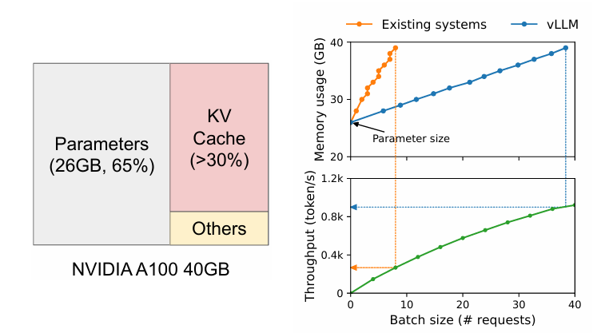

- 图在说明什么：
  - 左图展示 13B 模型在 A100 40GB 上的显存分布；
  - 右图展示现有系统与 vLLM 的 KV cache 增长方式及其对吞吐的影响。

- 与当前段落的关系：它把“显存管理决定最大 batch size，进而决定吞吐”这条主线画了出来。
- ==我的理解==：除了模型本身参数的占用之外，KV Cache占用了显存中较多的空间（>30%），而通过右图，对比当前现有推理系统和vLLM的推理系统，可以发现：当Batch Size逐渐扩大时，vLLM的显存占用上升明显缓慢，从而在同样的显存占用下，vLLM推理系统可以使用更大的Batch Size进行推理。再观察右下角的图表可以发现，当Batch Size越大的时候，模型的吞吐量也会提升。结合就可以发现，在显存大小相同的情况下，vLLM可以实现更大的吞吐量。
- 当前问题：这么厉害，怎么实现的？

### 图表记录：Figure 2（第 2 页）

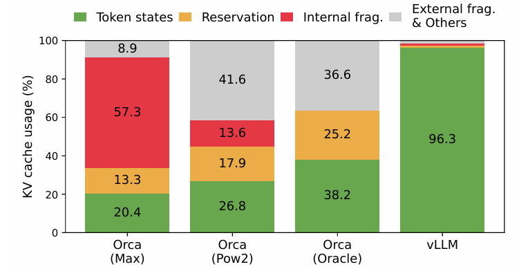

- 图在说明什么：现有系统只有约 20.4%-38.2% 的 KV cache 显存真正保存 token states，而 vLLM 达到 96.3%。
- 与当前段落的关系：它量化了 reservation、internal fragmentation、external fragmentation 等浪费。
- 我的理解：当前推理系统的碎片情况较为严重，内部碎片和外部碎片都非常显著。
- 当前问题：这种类似操作系统的虚拟内存技术是如何在显卡上实现的？显卡只有显存吗？还是和CPU一样有缓存？

### 本节读完后再回答

1. 为什么不能简单地给每个请求按最大长度一次性分配一整块连续显存？
   **答：**按最大长度分配显存会导致块内碎片的产生，对显存空间的利用率很低。

2. 内部碎片、外部碎片和预留但尚未使用的空间分别是什么？

   **答：**
   内部碎片：分配给某一条请求的空间，但请求永远不会使用完这块空间。
   外部碎片：无法分配的空间，由于两侧空间都被其他请求占用，无法拓展的小空间。
   尚未使用的空间：将来会被当前请求使用，但是由于分配给了该请求，尽管暂时空闲，也无法被使用。

3. 为什么 parallel sampling、beam search 和 shared prefix 会创造 KV cache 共享机会？
   **答：**因为都有可以复用的部分KV cache

4. PagedAttention 更像“新的注意力数学公式”，还是“新的 KV cache 存储与访问方式”？
   **答：**新的 KV cache 存储与访问方式

### ==我的笔记==

- KV Cache有其独特性，当模型在生成新的Token的时候，它的显存占用大小会动态发生变化，而且它的生命周期和占用长度是不可预测的。这些特点导致了当今现有系统的解决方案非常低效，主要是以下两个方面：
  - 内部和外部碎片：为了将KV Cache存储在连续空间中，他们会为了当前的request预分配一块最大长度的连续内存空间，而request的真实长度往往小于这个值，这就会导致严重的**内部碎片**。此外，就算我们能够预测一个request所需的真实长度，预分配空间仍然会十分低效。因为整个区块都被分配给了这个request的生命周期内，其他更短的request反而是用不了这些暂时未使用的区块。
  - 当前已有系统**无法利用内存共享**。当前的LLM多数采用较为高级的解码策略，比如parallel sampling和beam research。这些解码方法都是对同一个request生成多种输出。在这些场景下，**单一request的多条sequences可以部分共享他们的KV cache**。当前系统都无法做到这一点，因为它们都将各个sequence的KV cache存储在**相邻但是分离**的空间内。
  
  为了解决上述的限制，提出了PagedAttention，类似于OS中的虚拟内存分页。将request的KV cache分成blocks，每个block包含一定数量token的Key和Value。从而实现将KV cache像内存一样灵活分配，可以把request当作进程，blocks当作页，tokens当作字节。这一方法完全消除**外部碎片**，因为每个blocks都是固定的大小。此外还实现了在blocks粒度的内存共享，让同一个request的不同sequence共享，或甚至是不同requests之间的共享。
  
- vLLM就是一个基于 PagedAttention的分布式LLM服务引擎，实现了几乎为0的KV cache浪费。使用了blocks级的内存管理和与PagedAttention共同设计的抢占式请求调度（preemptive request scheduling）。与以前的最强系统相比提升了2-4倍的LLM吞吐量。


### 当前问题

- 在LLM推理过程中，同一个request会被分为多条sequence是什么意思？

  - 就是指高级的解码策略会导致多条sequences。
    例如，Parallel Sampling的三条sequences：
    
     ```
    Request: "写一个故事"
    ├─ Sequence 1: 从前有一只狐狸……
    ├─ Sequence 2: 深夜，飞船降落……
    └─ Sequence 3: 小镇突然停电……
     ```
    


## 2. Background

### 本章作用

- 只补齐理解后文所需的三块背景：自回归注意力、两阶段生成、iteration-level scheduling。
- 第一遍不需要推导注意力公式；重点是看清“历史 K/V 为什么要保存”。

### 2.1 Transformer-Based Large Language Models

#### 阅读目标

- 看懂语言模型为什么按 token 顺序分解概率。
- 认清 query、key、value 在标准 causal self-attention 中分别参与什么计算。
- 知道除 attention 外，多数 Transformer 操作都能按位置独立执行。

#### 公式记录：Eq. (1)-(3)（第 3 页）

$$
𝑃(𝑥) = 𝑃(𝑥1) · 𝑃(𝑥2 | 𝑥1) ···𝑃(𝑥𝑛 | 𝑥1,...,𝑥𝑛−1)
\tag{1}
$$

- Eq. (1)：自回归分解，把整段序列的联合概率写成一连串条件概率。


$$
𝑞𝑖 =𝑊_𝑞x_i, 𝑘_i =𝑊_𝑘𝑥_𝑖, 𝑣𝑖 =𝑊_𝑣𝑥_𝑖
\tag{2}
$$

- Eq. (2)：每个位置的 hidden state 经过线性变换得到 q、k、v。


$$
a_{ij}
=
\frac{\exp\left(q_i^{T}k_j/\sqrt{d}\right)}
{\sum_{t=1}^{i}\exp\left(q_i^{T}k_t/\sqrt{d}\right)},
\qquad
o_i
=
\sum_{j=1}^{i}a_{ij}v_j.
\tag{3}
$$

- Eq. (3)：当前位置的 q 与此前各位置的 k 计算权重，再对对应的 v 加权求和。


- 这组公式与本节的关系：它们说明生成当前位置时需要访问此前位置的 key/value 状态。
- 我的理解：这三个公式说明了为什么要在内存中保留KV矩阵。生成当前位置的token时，要使用前面所有token的K和V。

#### 本节读完后回答

1. Eq. (1) 为什么决定了 token 必须按顺序生成？
   生成第i个token需要先确定前面的1到i-1个token，才能计算第i个token

2. 在 Eq. (3) 中，位置 i 的 attention 输出会访问哪些位置的 key 和 value？
   需要位置1到i的所有token的key和value

3. q、k、v 分别来自哪个输入，彼此有什么区别？
   $q_i、k_i、v_i$均来自位置i 的hidden state \(x_i\)，但分别经过三个不同矩阵\(q_i=W_qx_i,\qquad k_i=W_kx_i,\qquad v_i=W_vx_i\)

   - Query：表示当前位置“想寻找什么信息”。

   - Key：表示每个位置“可以通过什么特征被匹配”。

   - Value：表示匹配后真正提供给当前位置的信息。

​	Query 与 Key 决定 attention 权重，权重再用于对 Value 加权求和。

#### 我的笔记与问题

- ==我的复述==：说明了**KV cache的原因**，讲述了transformer架构是**一定要按序生成**的，**要在内存中保留KV矩阵**。因为生成当前位置的token时，要使用前面所有token的K和V。
- 当前问题：暂无

### 2.2 LLM Service & Autoregressive Generation

#### 阅读目标

- 区分 prompt、output 与二者拼接后的 sequence。
- 区分 prompt phase（prefill）和 autoregressive generation phase（decode）。
- 明确 KV cache 保存什么、为什么存在，以及 decode 为什么常是 memory-bound。

#### 记录重点

- Prompt phase：所有 prompt token 已知，可用 matrix-matrix multiplication 并行计算，同时产生 prompt 的 K/V。
- Generation phase：每轮只输入一个新 token，只计算该位置的 K/V，历史位置的 K/V 从 KV cache 读取。
- 生成结束条件：达到最大长度，或生成 `<eos>`。
- 性能差异：prefill 较能利用 GPU 并行性；decode 有跨迭代数据依赖，常使用 matrix-vector multiplication，GPU 计算利用率低且受内存访问限制。
- 位置依赖：相同 token 出现在不同位置时，其 KV cache 可能不同。

#### 本节读完后回答

1. 为什么 prefill 能并行处理整个 prompt，而 decode 不能一次生成多个未知 token？
   **答：**prefill阶段是计算所有token各个层的kv矩阵，因为当前输入全部都是可见的，所以可以直接并行计算。decode阶段，模型因为无法看到未来的token，要一个一个按顺序生成。只有得到了前面的token才可以继续后续token的生成。
2. 生成第 t 个输出 token 时，哪些 K/V 是新计算的，哪些来自缓存？
   **答：**设input长度为n，则$k_{n+t}$和$v_{n+t}$是最新计算的，1到n+t-1的部分是在之前迭代的时候存的。
3. KV cache 避免了哪一部分重复计算？
   **答：**避免了当前token之前所有token的k和v的计算。
4. 为什么论文把 generation phase 描述为 memory-bound？
   **答：**因为Generation phase 具有跨 iteration 的数据依赖，每个请求每轮通常只处理一个新 token，因此计算多为 matrix-vector multiplication，模型权重的复用率较低。

#### 我的笔记与问题

- ==我的复述==：讲解了模型在推理时的两个阶段：

  - Prompt phase：将整个user的prompt当作输入，因为所有的token都是知道的，所以可以充分利用GPU，并行计算key向量和value向量。
  
  
    - Generation phase：有顺序地生成后续的tokens，当sequence达到最大长度后，或者模型自己输出<eos>时，终止该阶段。


- KV cache：某个token的KV cache通常指该token在所有层的K/V向量。

- 当前问题：

  - 为什么某一个token的KV cache要依赖于所有前文的token？某一个token的key和value不应该是直接通过与w相乘得到的吗？
    **答：**某个token的KV cache通常指在所有层的K/V。因为transformer架构多数采用的是多层的架构，因此一般不指第一层，第一层的KV确实不包含前文token的信息。而作为其他的层，k和v的计算都是使用上一层的输出作为输入，上一层中必定包含前文的token信息。

  - prefilling也是要一层一层的并行计算吧，层与层之间不能并行吧？

    **答：**是的，Prefill 是一层一层顺序执行，但每一层内部可以并行处理所有 prompt token。

### 2.3 Batching Techniques for LLMs

#### 阅读目标

- 理解 batching 为什么能摊薄模型权重读取开销、提高 GPU 利用率。
- 看清 request-level batching 的等待与 padding 问题。
- 掌握 iteration-level scheduling 如何动态加入和移除请求。

#### 记录重点

- 请求到达时间不同：固定批次会让早到请求等待，或让新请求等待旧批次完成。
- 输入/输出长度不同：简单补齐到相同长度会浪费计算和显存。
- Iteration-level scheduling：每轮结束后移除已完成请求并加入新请求；新请求最多等待一个 iteration。
- 特制 GPU kernel 可以避免对输入和输出做机械 padding。

#### 本节读完后回答

1. 更大的 batch 为什么通常能提高 serving 吞吐？
   **答：**多个请求能够共同使用同一套模型权重，并让 GPU 同时获得更多可并行计算的任务。
2. 静态 batching 在到达时间和序列长度两个维度上分别浪费什么？
   **答：**在时间上，需要等待后续request的到来。 在序列长度上，静态batching会填充许多没有用的部分来使序列一样长。
3. Iteration-level scheduling 改变的是“请求何时进入 batch”，还是“KV cache 如何存放”？
   **答：**请求何时进入batch
4. 即使细粒度 batching 已经解决等待和 padding，系统还剩下什么显存约束？
   **答：**还剩下对于显存的利用效率。

#### 我的笔记与问题

- ==我的复述==：
  因为同一个batch使用的是同一套模型权重，因此，从显存读取和搬运模型权重的成本，可以由 batch 中的多个requests共同分担。简单的batching策略都会有明显的缺点：

  1、让较早到达的请求等待，直到收集到足够多的新请求再组成 batch；或者立即运行当前 batch，但让后来到达的请求等待，直到整个 batch 全部执行完毕。这均会浪费时间。

  2、因为不同的请求的输入输出长度不一样，传统batching会把所有请求补齐到相同长度，但是补充的部分没有任何意义，浪费计算资源和显存。
  **Iteration-level scheduling：**每轮结束后移除已完成请求并加入新请求；新请求最多等待一个 iteration。

- 当前问题：细粒度batching的实现细节？

## 3. Memory Challenges in LLM Serving

### 本章阅读目标

- 把 vLLM 要解决的问题拆成三类：KV cache 很大、复杂 decoding 带来共享机会、输入输出长度未知带来调度压力。
- 先量化问题，再观察现有连续预分配方案具体浪费在哪里。

### 核心数据记录

- OPT-13B 的单个 token KV cache 约为 800 KB：`2 × 5120 × 40 × 2 bytes`。
- 最大序列长度为 2048 时，单个请求的 KV cache 最多约 1.6 GB。
- Parallel sampling 的 prompt KV cache 可共享；论文实验中 prompt 约占总 KV cache 的 12%。
- Beam search 的动态共享在实验中最多带来约 55% 的显存节省；具体证据在 §6.3。

### 本节读完后回答

1. 为什么 GPU 算力增长快于显存容量增长，会让 KV cache 问题越来越突出？
   **答：**因为随着request数量的增加，KV cache的大小会随之迅速增加。在GPU算力增长时，可以并行处理的requests就增多了，从而导致KV cache占用增加。
2. 复杂 decoding 的难点为什么不仅是“多生成几条序列”，还包括共享关系随时间变化？
   **答：**在某些decoding策略中，如Parallel sampling，在自回归生成阶段就没办法使用内存共享，因为生成的sample都不一样。而在像beam search中，最高就可以节约55%的内存。
3. 输出长度未知时，scheduler 为什么可能需要 eviction、swapping 或 recomputation？
   **答：**因为在解码阶段一个output的长度可能会不停增长，可能就会耗尽可用的内存空间，就会影响当前正在生成的prompts或者未来的requests。就可能需要eviction、swapping 或 recomputation。

### 3.1 Memory Management in Existing Systems

#### 阅读目标

- 理解现有系统为什么为每个请求预分配连续、按最大长度估算的 KV cache tensor。
- 准确区分 reservation、internal fragmentation 和 external fragmentation。
- 理解 compaction 为什么不足以解决这里的问题。

#### 图表记录：Figure 3（第 4 页）

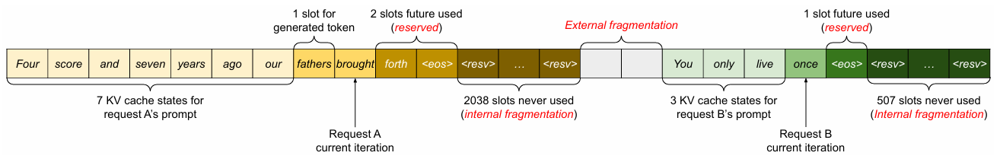

- 图在说明什么：请求 A 和 B 按最大长度获得连续空间后，出现预留给未来 token 的槽位、请求结束后确认永远不用的内部碎片，以及 allocator 造成的外部碎片。
- 阅读时重点：分别指出三类浪费何时产生、是否可能被当前请求使用、为什么其他请求仍无法利用。
- 与当前段落的关系：Figure 3 是现有连续预分配方案的具体反例，也是 Figure 2 中各类浪费的来源。
- 我的理解：有三种内存浪费。1、预留的内存空间：当前还没用到，未来会用到。2、内部碎片：当前没用到，未来也用不到。3、外部碎片：两个request之间的碎片。
- 当前问题：暂无

#### 记录重点

- 连续 tensor + 输出长度不可预知，迫使系统按最大可能长度静态预留。
- Reservation 未来可能被本请求用到，但在请求存活期间阻止其他请求使用。
- Internal fragmentation 在请求结束后确认不会被使用；external fragmentation 是 allocator 留下的不可用空洞。
- 论文实验中，==已有系统真正保存 token states 的有效比例最低只有 20.4%。==
- Compaction 搬移巨大的 KV cache 成本过高，而且无法自动提供不同序列间的 KV cache 共享。

#### 本节读完后回答

1. Reservation 与 internal fragmentation 的关键区别是什么？
   **答：**Reservation是分配给当前request的预留空间，在过程中确实被使用过。而Internal fragmentation是分配的预留空间，在过程中也没有被使用。

2. External fragmentation 为什么即使总空闲显存足够，也可能放不下新请求的连续 tensor？
   **答：**因为不连续

3. 为什么提前知道真实输出长度只能缓解一部分浪费，不能自然实现 KV cache sharing？
   **答：**因为要分配该真实长度的空间，在此期间并不是时刻被使用的

4. Compaction 解决的是哪类问题，又遗漏了哪类问题？
   **答：**解决的是外部碎片的问题，不能解决内部碎片、Reserved slots和重复 KV cache / 无法共享。


#### ==我的笔记与问题==

- | 类型                   | 以后是否使用     | 是否属于纯粹浪费                     |
  | ---------------------- | ---------------- | ------------------------------------ |
  | Reserved slots         | 会被当前请求使用 | 最终不是浪费，但提前阻止其他请求使用 |
  | Internal fragmentation | 永远不会使用     | 纯粹浪费                             |
  | external fragmentation | 空闲但是难以利用 | 纯粹浪费                             |

- 当前问题：暂无

## 4. Method

### 本章阅读目标

- 先看系统全貌，再依次理解 PagedAttention、KV cache manager、单请求 decode、共享、抢占和分布式执行。
- 始终区分三个层次：attention kernel 如何访问块、manager 如何映射块、scheduler 何时分配或回收块。

### 图表记录：Figure 4（第 5 页）

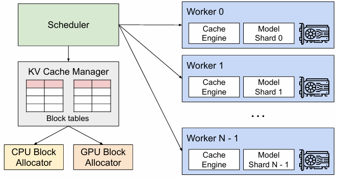

- 图在说明什么：中央 scheduler 与 KV cache manager 协调 CPU/GPU block allocator、block tables，以及各 GPU worker 的 model shard 和 cache engine。
- 阅读时重点：scheduler、KV cache manager、block allocator、worker 各自负责什么，哪些信息集中管理，哪些计算分布执行。
- 与当前段落的关系：Figure 4 是后续 §4.1-§4.6 的总索引。
- ==我的理解==：vLLM采用集中的调度器来让分布式的GPU合作起来。KV cache manager用分页的形式高效地调度KV cache。KV cache manager是在调度器的指挥下调度各个GPU上的物理KV cache。
- 当前问题：暂无

### 本章入口问题

1. PagedAttention、KV cache manager 和 vLLM scheduler 分别处于哪一层？
2. 论文如何把 §3 的三类挑战逐一映射到系统机制？

### 4.1 PagedAttention

#### 阅读目标

- 理解连续的逻辑 token 序列如何映射到不连续的物理 KV blocks。
- 读懂 block size、key block、value block 和 block-wise attention 的语义。
- 明确 PagedAttention 改变的是 KV cache 的存储与访问方式，而不是取消标准 attention。

#### 公式记录：Eq. (4)（第 5 页）

$$
A_{ij}
=
\frac{\exp\left(q_i^{T}K_j/\sqrt{d}\right)}
{\sum_{t=1}^{\lceil i/B\rceil}
\exp\left(q_i^{T}K_t/\sqrt{d}\right)},
\qquad
o_i
=
\sum_{j=1}^{\lceil i/B\rceil}
V_jA_{ij}^{T}.
\tag{4}
$$

- 公式在做什么：把逐 token 的 attention 改写成按 KV block 读取和计算；每个 block 含固定数量 B 个 token 的 K/V。
- 阅读时重点：$K_j$、$V_j$、$A_ij$ 各代表哪个 block 内的数据；最终输出仍是对 value 的加权和。
- 与标准 attention 的关系：数学结果保持一致，kernel 只是分别定位并读取可能不连续的物理块。
- 我的理解：$A_{ij}$表示第i个token对于Block j中各个的token的注意力权重向量组成的矩阵。$𝐴_{𝑖𝑗} =(𝑎_{𝑖,(𝑗−1)𝐵+1},...,𝑎_{𝑖,𝑗𝐵})$
  $o_i$是位置i的attention输出向量，是把所有前面的block 1到⌈𝑖/𝐵⌉都计算一遍之后求和得到的
- 当前问题：这个公式实现的位置在哪？
  **答：**这个公式具体在GPU kernel中实现。而CPU负责“KV 应该放在哪里”，是Scheduler + Block Manager

#### 图表记录：Figure 5（第 5 页）

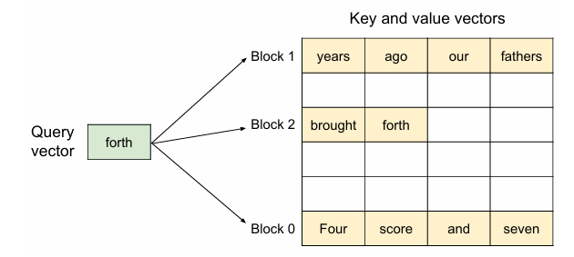

- 图在说明什么：同一序列的 key/value 被分到三个 block，物理位置不连续；query 仍可依次访问各块完成 attention。
- 阅读时重点：逻辑顺序由谁维护，kernel 如何知道应该抓取哪些 block。
- 与当前段落的关系：它把 Eq. (4) 的 block-wise 访问画成了直观示例。
- 我的理解：forth这个Query 向量先分别和Block 0-2这三个Blocks分别做QK计算分别得到$A_{i0}、A_{i1}、A_{i2}$。$A_{ij}$是个矩阵，由当前Query向量与第j个Block中的所有token分别得到a组成。例如，$a_{i1}.....a{i4}$组成了$A_{i0}$。从而计算最终的attention输出向量$o_i$。
- 当前问题：暂无

#### 本节读完后回答

1. “逻辑上连续、物理上不连续”分别指什么？
   **答：**逻辑上连续是指，在模型和请求的视角来看，所有token的KV 矩阵都是连续相邻的。但是在物理存储位置上看，他们是分离开的。具体映射关系由block table 保存。

2. PagedAttention kernel 相比普通 attention kernel 多做了哪一步定位工作？
   **答：**比普通的attention kernel多了一步计算block号的步骤。普通attention kernel只需要完成1到i的计算。PagedAttention kernel需要计算当前token i属于第x个块，然后计算0到x块。需要把当前request的block号（逻辑）转化为真实的block号（物理）

3. 为什么把 KV cache 切块后仍能得到等价的 attention 输出？

   **答：**Softmax是在所有有效 token 上进行全局归一化。而且本质上只是把一整个求和拆成多个小组。只是重新组织了求和顺序，因此能得到与普通 attention 等价的输出。

#### 我的笔记与问题

- ==我的复述==：将Attention输出向量的计算转变为以块为单位计算。计算某一个token i时，会将$q_i$分别与每个块的K相乘，再在总体所有token的尺度下做归一化得到与各个块的QK矩阵（包含所有属于该块的Token的QK向量）。接下来再将各个块的注意力矩阵与其的Value矩阵（包含所有属于该块的Token的Value向量）相乘，将所有块的注意力向量相加得到最终注意力向量$o_i$。
- 当前问题：暂无

### 4.2 KV Cache Manager

#### 阅读目标

- 建立 virtual memory page 与 vLLM KV block 的类比。
- 区分 logical KV block、physical KV block 与 block table。
- 理解按需分配为什么把单请求浪费限制在最后一个 block 内。

#### 记录重点

- Logical KV blocks 按 token 顺序从左到右填充；它们对请求呈现连续视图。
- GPU block engine 预先把一段 GPU DRAM 划分成固定大小的 physical KV blocks；CPU RAM 也有用于 swapping 的 block allocator。
- Block table 记录每个 logical block 对应的 physical block，以及已填充位置数。
- Physical block 只在需要时分配，因此无需为最大序列长度一次性预留连续空间。

#### 图表记录：Figure 6（第 6 页）

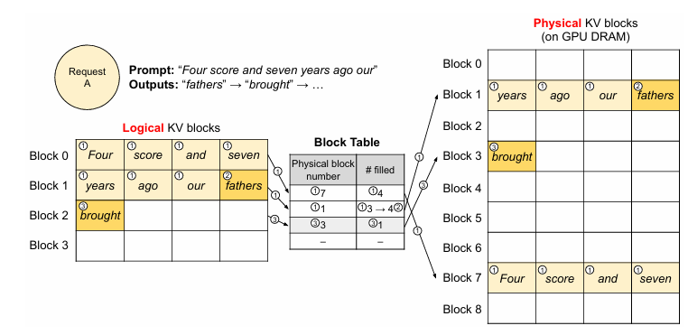

- 图在说明什么：请求 A 的 logical blocks 通过 block table 映射到物理编号 7、1、3 等不连续 physical blocks，并记录 `# filled`。
- 阅读时重点：跟踪 logical block 0、1、2 在三次状态变化中的 physical block number 与已填充数。
- 与当前段落的关系：它既解释 block table，也被下一节用于演示完整 decode 流程。
- ==我的理解==：新token及其KV cache会先填充到最新的空闲的block中，当一个block被填满，再申请新的block。在GPU上，一个block engine会把一个物理上连续的显存空间分割成一个个KV blocks。然后由统一的KV blocks manager来完成管理。每个sequence都有一个block表，每个表入口都有虚拟block对应的物理地址和块内占用情况。
- 当前问题：block table是每个request一个还是每个sequence一个？
  **答：**每个sequence。

#### 本节读完后回答

1. Block table 至少需要保存哪两类信息？
   **答：**至少要保存当前逻辑块的物理地址，还有该块内占用情况。
2. 按需分配如何同时减少 reservation 和 external fragmentation？
   **答：**Reservation 主要由“按需分配”减少；external fragmentation 主要由“固定大小 block + 允许物理不连续”减少。
3. 在 block size 为 B 时，单条 sequence 最多会在什么位置留下内部碎片？
   **答：**最多会在一个全新的block中只占用一个token slot，留下B-1个token slot的碎片。

#### 我的笔记与问题

- ==OS paging 类比==：block table类似于页表，每个sequence类似于一个进程，每个sequence维护一个block table，每个block table中都有block对应的物理块和块内的占用情况。
- 当前问题：暂无

### 4.3 Decoding with PagedAttention and vLLM

#### 阅读目标

- 沿 Figure 6 的编号走通 prefill、填满最后空位、申请新 block 三步。
- ==理解每个 decoding iteration 中 scheduler、block manager、PagedAttention kernel 的配合。==

  > 1. Scheduler：决定本轮计算哪些 sequence
  > 2. Block Manager：为这些 sequence 准备 KV 存储位置
  > 3. PagedAttention kernel：按照映射进行实际计算
- 看清多个请求的逻辑相邻性为何不要求物理相邻性。

#### 单请求流程记录

1. Prompt 有 7 个 token、block size 为 4：先为 logical block 0 和 1 分配 physical block 7 和 1。
2. 第一次 decode：最后一个 logical block 仍有空位，新 KV 写入原 physical block，并更新 `# filled`。
3. 第二次 decode：原 block 已满，新增 logical block，并按需分配 physical block 3、更新 block table。
4. 每轮全局流程：选择 batch 中的 sequences，分配新需要的 blocks，拼接本轮输入 token，执行模型并通过 block table 读写 KV cache。
5. 请求结束后释放 blocks，供其他请求复用。

#### 图表记录：Figure 7（第 6 页）

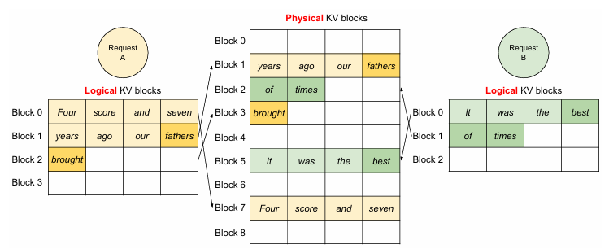

- 图在说明什么：请求 A、B 的 logical blocks 交错映射到同一 physical block 池，各请求逻辑上连续但物理位置不连续。
- 阅读时重点：同一请求的相邻 logical blocks 不必在显存中相邻；不同请求能共同填满 block pool。
- 与当前段落的关系：它从单请求的 Figure 6 扩展到并发请求。
- 我的理解：两个独立的request不需要再在连续的区域存储。
- 当前问题：暂无

#### 本节读完后回答

1. vLLM 在什么时候才为新 logical block 分配 physical block？
   **答：**当前所有blocks都满了之后，vLLM才会为新的logical block分配新的physical block。
2. PagedAttention 在一次 iteration 中从 block table 读取什么、又写回什么？
   **答：**PagedAttention 从 block table 中读取各个逻辑 KV block 所对应的物理块号和有效位置数，据此定位并读取当前 sequence 的历史 KV cache。随后，它将本次 iteration 输入 token 新计算出的 K、V 写入对应的物理 KV block，并利用 attention 结果继续计算，最终预测下一个 token。刚预测出的 token 的 KV 要到下一次 iteration 才会计算和写入。
3. Block size 大于 1 为什么能提升并行访问效率，又会带来什么代价？
   **答：** 当 block size 大于 1 时，一次 block table 查询就可以定位一组连续位置的 KV cache。PagedAttention kernel 可以并行读取这些位置的 K、V，并行计算当前 query 与多个 key 的 attention score，以及多个 value 对最终输出的贡献。这可以分摊地址转换开销，提高显存访问效率和 GPU 利用率。但是会带来块内碎片。
4. 为什么这种方案把每个请求的浪费限制在至多一个未填满的 block？
   **答：**因为需要了再分配。最多就浪费一个未填满的block。

#### 我的笔记与问题

- Figure 6 三步复述：
  - 系统预留能存下当前prompt的KV cache。
  - 将自回归解码阶段产生的新KV cache存入空余位置
  - 当没有空余位置时，就将其存入新的block中
- 当前问题：暂无

### 4.4 Application to Other Decoding Scenarios

#### 阅读目标

- 分别理解 parallel sampling、beam search、shared prefix 中可共享的 KV cache 范围。
- 掌握 reference count 与 copy-on-write 如何让共享安全地分叉。
- 理解统一 logical-to-physical mapping 如何隐藏不同 decoding 的共享模式。

#### 图表记录：Figure 8（第 7 页，Parallel sampling）

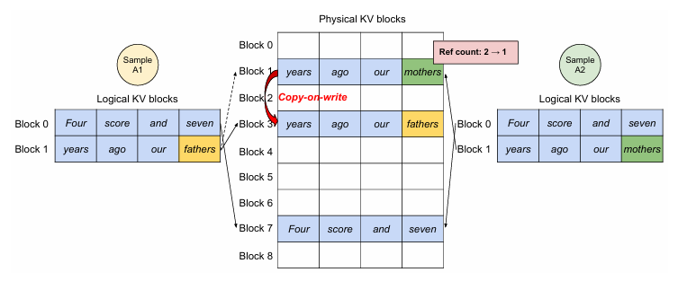

- 图在说明什么：两个 sample 共享 prompt 的 physical blocks；当 sample A1 要写入共享的最后一块时，触发 block-level copy-on-write。
- 阅读时重点：ref count 从 2 变 1 的时机、哪一个 block 被复制、为什么只复制最后一个将被修改的 block。
- ==我的理解==：在prompt阶段，两个sequences的blocks都指向相同的物理地址，因为他们的prompt是相同的。因此一个物理块可以对应多个逻辑块，作者就对每个物理块加入了引用计数（reference count）。在generation阶段，由于两个sequence输出的token不一样，从而就需要分开存储KV cache。vLLM就采用了一种写时复制技术（与操作系统类似）。当Sample A1在最后一个部分写入father时，vLLM发现Ref count为2，所以分配了一个全新的block，并命令block engine将信息从physical block 1复制到physical block 3中，再将Ref count降到1。因为Ref count = 1，所以Sample A2在写入时，就不需要再复制了，直接在physical block 1中写入。
- 当前问题：暂无

#### 图表记录：Figure 9（第 7 页，Beam search）

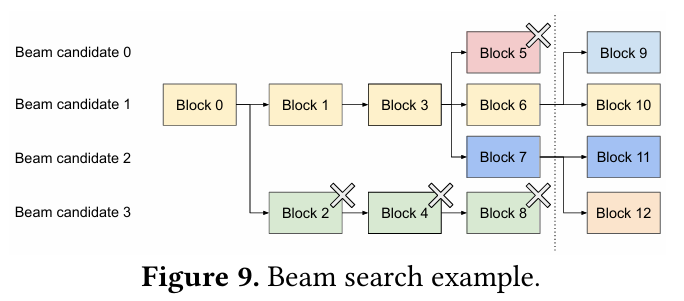

- 图在说明什么：beam candidates 像不断 fork 的进程树，动态共享不同长度的前缀；淘汰旧 candidate 后降低引用计数并释放 ref count 为 0 的 blocks。
- 阅读时重点：虚线前后哪些 blocks 被共享、释放和新增；为什么 vLLM 避免复制整段 candidate KV cache。
- ==我的理解==：在虚线之前四个候选对象均有四个逻辑blocks，0123candidates共享blocks0，012candidates共享blocks013，在更新了新的candidates之后，所有candidates均共享block0，原本的candidate0和3被淘汰了。
- 当前问题：暂无

#### 图表记录：Figure 10（第 8 页，Shared prefix，共享前缀）

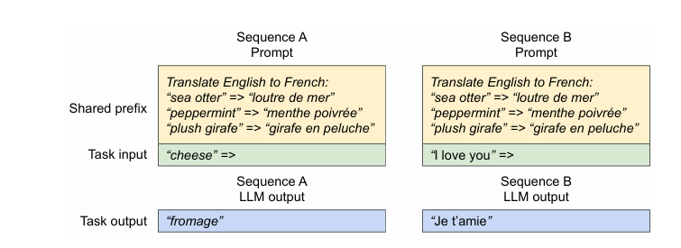

- 图在说明什么：不同翻译请求共享相同的 instruction 与 demonstrations，只在 task input 和 output 上分叉。
- 阅读时重点：服务提供者如何预先缓存 shared prefix 的 physical blocks，以及最后一块为何仍需 copy-on-write。
- ==我的理解==：共享前缀，大多数是对于有系统提示词的情况。对于LLM服务提供商而言，可以预留一系列物理块来存储一系列的共享前缀，当用户使用共享前缀时，就可以非常简单地从逻辑块映射到物理块，在prompt阶段就只需要运行用户的任务输入了。
- 当前问题：暂无

#### 记录重点

- Parallel sampling：共享 prompt blocks；各 sample 开始写不同输出时，用 reference count + copy-on-write 分离。
- Beam search：不仅共享 prompt，还动态共享中间生成前缀；淘汰 candidate 时通过引用计数回收 blocks。
- Shared prefix：服务端可预缓存常用 system prompt / demonstrations，只对用户 task input 执行新的 prompt computation。
- Mixed decoding：执行 kernel 只接收每条 sequence 的 physical block IDs，不必理解上层共享关系。

#### 本节读完后回答

1. Copy-on-write 在什么条件下触发，为什么不是一开始就复制？
   **答：**当Ref count大于1时触发，一开始就复制，就不会有内存共享了，全浪费了。

2. Parallel sampling 与 beam search 的共享范围和变化方式有何不同？
   **答：**Parallel sampling共享范围是prompt，生成的部分不再共享，beam search共享范围可以扩展到生成的token。

3. Shared prefix 同时减少了哪两类开销？
   **答：**计算开销：减少了prompt阶段的计算开销，共享前缀只需要进行一次 prefill，避免多个请求重复计算同一前缀。显存开销：共享前缀的 KV cache 只保存一份，多条 sequence 的 block table 指向相同的物理块。

4. 统一 block mapping 为什么能让不同 decoding 方法进入同一个 batch？
   **答：**这是因为，vLLM 通过一个通用的映射层，隐藏了不同 sequence 之间复杂的显存共享关系。这个映射层负责将逻辑块转换成物理块。

   LLM 及其执行 kernel 对每条 sequence 只会看到一组物理块 ID，不需要亲自处理不同 sequence 之间的共享关系。

#### 我的笔记与问题

- 三种共享方式对照：

- | 方式              | 谁与谁共享                             | 共享范围                          | 共享关系如何变化                                             | 典型场景                                    |
  | ----------------- | -------------------------------------- | --------------------------------- | ------------------------------------------------------------ | ------------------------------------------- |
  | Parallel sampling | 同一个 request 的多条独立采样 sequence | 主要共享完整 prompt 的 KV cache   | prompt 共享关系基本固定；开始生成后各自独立，生成部分通常不共享 | 针对同一问题一次生成多个候选答案            |
  | Beam search       | 同一个 request 中的多条 beam           | 共享 prompt，也共享相同的生成前缀 | 动态变化：随着分叉、复制和剪枝，共享关系不断改变             | 始终保留概率最高的 \(k\) 条候选序列         |
  | Shared prefix     | 不同 request 或不同 sequence           | 共享相同的公共前缀                | 公共前缀通常保持共享；进入各自不同的后缀后独立存储           | 多个请求具有相同的 system prompt 或任务指令 |

- 当前问题：暂无

### 4.5 Scheduling and Preemption（调度策略）

#### 阅读目标

- 理解显存 block 耗尽时，vLLM 选择谁被抢占、以什么粒度驱逐、怎样恢复。
- 比较 swapping 与 recomputation 的数据路径。

#### 记录重点

- ==调度策略：FCFS==；优先服务最早到达请求，抢占最新到达请求，避免 starvation。
- ==Eviction 粒度==：一条 sequence 的 blocks 要么全部保留、要么全部驱逐；同一 request 的 sequence group 需要 gang scheduling。
- 两种技术来恢复驱逐块：
  - ==Swapping==：把被驱逐 KV blocks 复制到 CPU RAM；CPU swap space 的上界不超过 GPU 中 KV block 总容量。
  - ==Recomputation==：重新调度时，把原 prompt 与已生成 token 拼成新 prompt，通过一次 prompt phase 重建 KV cache。


#### 本节读完后回答

1. 为什么 vLLM 采用 all-or-nothing eviction，而不是只驱逐一条 sequence 的部分 blocks？
   **答：**没用啊，部分的驱逐整个sequence又推理不了。
2. 多个 beam candidates 为什么必须作为 sequence group 一起抢占和恢复？
   **答：**因为他们有共享的部分。
3. Swapping 的主要成本来自哪里？
   **答：**在于通过PCIe总线传输，搬运时间很长。
4. Recomputation 为什么可能比最初逐 token 生成这些状态更快？
   **答：**恢复时，之前生成过的 token 已经全部知道了，因此可以把它们当作 prompt 的一部分。这不是重新“生成或采样”之前的答案，而只是根据已知 token **重新计算它们的 K、V 向量**。

#### 我的笔记与问题

- Swapping：把被驱逐 KV blocks 复制到 CPU RAM；CPU swap space 的上界不超过 GPU 中 KV block 总容量。
- Recomputation：重新调度时，把原 prompt 与已生成 token 拼成新 prompt，通过一次 prompt phase 重建 KV cache。
- 当前问题：（两者的实验比较延后到 §7.3。）

### 4.6 Distributed Execution(==没咋看懂==)

#### 阅读目标

- 理解 vLLM 如何与 Megatron-LM 风格 tensor model parallelism 配合。
- 区分所有 worker 共享的逻辑映射与各 worker 实际保存的 KV cache 分片。

#### 记录重点

- Attention heads 被划分到不同 GPU；每个 worker 只保存自己负责 heads 的 KV cache。
- 所有 model shards 处理相同 token positions，因此可共享同一组 logical-to-physical block IDs。
- Scheduler 每轮广播 input token IDs 与各请求的 block table；worker 按表访问本地 KV cache 分片。
- 中间结果通过 all-reduce 同步，不需要 scheduler 介入每次通信。

#### 本节读完后回答

1. 不同 GPU 上“相同的 physical block ID”是否意味着它们保存完全相同的数据？
   **答：**不相同，因为不同 GPU worker 使用相同的物理块 ID，但每个 worker 实际只保存自己所负责的 attention head 对应的那一部分 KV cache。

2. 为什么集中式 KV cache manager 足以协调多个 model shards？
   **答：**Tensor parallelism 沿 attention head/特征维度切分模型，而 PagedAttention 沿 token 位置维度管理 block。由于所有 shards 的 token 位置结构一致，一个集中式 KV Cache Manager 统一维护映射并广播，就足以协调所有 GPU worker。

3. Scheduler 每个 iteration 必须广播哪些控制信息？
   **答：**Scheduler 需要广播当前 batch 中每个 request 的输入 token ID，以及对应的 block table。

4. 哪些同步由 all-reduce 完成，哪些由 scheduler 完成？

   **答：**All-reduce 同步计算数据，Scheduler 同步执行任务和显存映射。

#### 我的笔记与问题

- 分布式执行流程：
  每个 worker 实际只保存自己所负责的 attention head 对应的那一部分 KV cache。

  在每一个执行步骤中，scheduler 首先准备一条控制消息，其中包含：

  - 当前 batch 中每个请求的输入 token ID；
  - 每个请求对应的 block table。

  接下来，scheduler 将这条控制消息广播给所有 GPU worker。收到消息后，各个 GPU worker 使用输入 token ID 开始执行模型。

  执行到 attention 层时，GPU worker 根据控制消息中的 block table 读取相应的 KV cache。

  模型执行期间，各个 GPU worker 使用 `all-reduce` 通信操作同步中间计算结果。这个同步过程不需要 scheduler 参与协调，与文献 [47] 中的方式相同。

  最后，GPU worker 将本次 iteration 采样得到的 token 返回给 scheduler。

  总而言之，GPU worker 不需要在显存管理方面彼此同步。它们只需要在每次解码 iteration 开始时，连同本轮输入一起接收所有显存管理信息，然后按照统一的 block table 独立访问各自 GPU 上的 KV cache。

- 当前问题：（阅读时记录。）

## 5. Implementation

### 本章阅读目标

- 了解论文方法如何落到端到端系统，不要求记忆代码行数。
- 重点抓住三个定制 kernel 和三个 decoding 原语。

### 系统实现速记

- Frontend：FastAPI，扩展 OpenAI API 风格接口，允许设置最大长度、beam width 等 sampling 参数。
- Engine：约 8.5K 行 Python 与 2K 行 C++/CUDA；调度和 block manager 在 Python，关键算子使用 CUDA。
- Model executor：支持 GPT、OPT、LLaMA；使用 PyTorch、Transformers 与 NCCL。

### 5.1 Kernel-level Optimization

#### 阅读目标

- 看懂不连续 block 访问带来的额外开销，以及作者怎样把它们融合进 GPU kernels。

#### 三个 kernel 记录

1. Fused reshape and block write：把新 KV 的切块、layout reshape 与按 block table 写入合为一次 kernel。
2. Fusing block read and attention：按 block table 读取 KV，并就地执行 attention；一个 warp 负责读取一个 block，同时支持 batch 内可变序列长度。
3. Fused block copy：把 copy-on-write 产生的多个不连续小块复制合并到一次 kernel launch，避免大量 `cudaMemcpyAsync` 调用。

#### 本节读完后回答

1. 三种 fusion 分别减少了 kernel launch、显存访问或小数据搬运中的哪类开销？
   **答：**第一种fusion减少了kernel launch；第二种fusion减少了显存访问开销；第三种fusion减少了小数据搬运开销。
2. 为什么一个 warp 读取一个 block 有助于 coalesced memory access？
   **答：**PagedAttention 的物理块之间可以分散，但每个物理块内部连续。让一个 warp 专门读取一个 block，可以使同一 warp 中的线程访问相邻地址，从而把多次小读取合并成少量大读取，提高 HBM 带宽利用率。
3. 不连续 block copy 为什么不适合逐块调用 `cudaMemcpyAsync`？
   **答：**这会导致多次的小数据搬运调用。

#### 我的笔记与问题

- ==我的复述==：
  本文用三种fusion来提高效率。将block划分和写入融合，减少kernel启动和数据搬运；将读取block与注意力计算融合（不拼接KV，直接计算再求和），提高访存效率；将多个不连续块的复制融合，避免每个block都要调用一次复制，一次调用达成多个不连续块的复制。
 | 优化                           | 融合了什么                              | 主要解决什么问题                   |
  | ------------------------------ | --------------------------------------- | ---------------------------------- |
  | Fused reshape and block write  | KV reshape + 写入物理块                 | 减少 kernel 启动和中间数据搬运     |
  | Fused block read and attention | 按 block table 读取 KV + attention 计算 | 避免先收集 KV 再计算，提高访存效率 |
  | Fused block copy               | 多个不连续物理块的复制                  | 减少大量零碎的复制操作和启动开销   |

- 当前问题：暂无

### 5.2 Supporting Various Decoding Algorithms

#### 阅读目标

- 理解 vLLM 用 `fork`、`append`、`free` 三个 sequence 原语统一表达不同 decoding 方法。

#### ==记录重点==

- `fork`：从已有 sequence 创建新 sequence，并复用可共享 blocks。
- `append`：在每个 iteration 为 sequence 追加新 token，必要时触发分配或 copy-on-write。
- `free`：删除完成或淘汰的 sequence，递减引用计数并回收 blocks。
- Parallel sampling、beam search 与 prefix sharing 都能由这三个原语组合实现。

#### 本节读完后回答

1. Parallel sampling 的“从一条输入变成多条输出”主要对应哪个原语？
   **答：**fork。
2. Beam candidate 被淘汰时，`free` 为什么必须配合 reference count？
   **答：**因为可能当前的block可能被共享了，必须Ref count确定当前block无人共享，即Ref count为0时，才真正释放该物理块。
3. 这三个原语抽象的是 decoding 数学，还是 sequence 与 KV block 的生命周期？
   **答：** sequence 与 KV block 的生命周期。

#### 我的笔记与问题

- ==我的复述==：作者抽象了三种原语，通过这三种原语可以支持多种decoding算法。
- 当前问题：暂无

## 6. Evaluation

### 本章阅读目标

- 先核对实验对象、工作负载、baseline 和 metric，再判断每张结果图支持哪条论文主张。
- 区分三类证据：更高可承载 request rate、更大的实际 batch、来自 KV block sharing 的显存节省。
- 遇到例外结果时判断系统处于 memory-bound 还是 compute-bound，而不是只记倍数。

### 6.1 Experimental Setup

#### 阅读目标

- 记录模型与 GPU 配置、ShareGPT/Alpaca 长度分布、FasterTransformer/Orca baseline，以及 normalized latency 的定义。

#### 表格记录：Table 1（第 9 页）

| Model size | GPUs | Total GPU memory | Parameter size | Memory for KV cache | Max. KV cache slots |
|---|---:|---:|---:|---:|---:|
| 13B | 1 × A100 | 40 GB | 26 GB | 12 GB | 15.7K |
| 66B | 4 × A100 | 160 GB | 132 GB | 21 GB | 9.7K |
| 175B | 8 × A100-80GB | 640 GB | 346 GB | 264 GB | 60.1K |

- 表在说明什么：不同模型配置中，参数占用后真正留给 KV cache 的显存差异很大。
- 阅读时重点：不要把“模型更大”直接等同于“KV cache slots 更少”；175B 配置同时使用了更多 80GB GPU。
- 与后文的关系：Table 1 用于解释 §6.2 中 OPT-175B + Alpaca 的例外结果。
- ==我的理解==：主要展示了模型参数和服务器的配置。
- 当前问题：为什么66B的可用KV cache更多了，但是slots变少了？
  **答：**因为66B的模型通常具有更多 Transformer 层和更大的隐藏维度，因此一个 token 在所有层上的 K、V 更大。从而在KV cache增加的情况下，slots数量还减少了。

#### 图表记录：Figure 11（第 9 页）

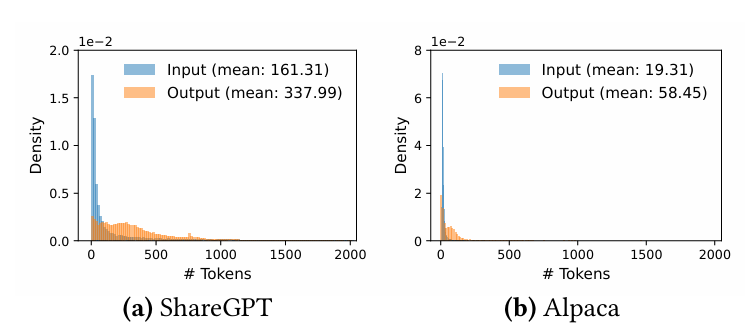

- 图在说明什么：ShareGPT 的平均 input/output 长度约为 161.31/337.99 token；Alpaca 约为 19.31/58.45 token，且 ShareGPT 方差更大。
- 阅读时重点：ShareGPT 平均 input 约长 8.4 倍、output 约长 5.8 倍；长而多变的 sequence 更容易暴露 KV cache 管理差异。
- 与后文的关系：它解释相同系统在两类 trace 上为何呈现不同容量与延迟曲线。
- ==我的理解==：展示了两种不同的工作负载，ShareGPT是用户共享的和ChatGPT对话内容，Alpaca是由GPT-3.5生成的。ShareGPT 平均 input 约长 8.4 倍、output 约长 5.8 倍；长而多变的 sequence 更容易暴露 KV cache 管理差异。
- 当前问题：为什么workload里面还有output?
  **答：**output主要表示**输出长度分布**。为了保障不同系统面对相同负载，预先设置输出token数量。output内容通常只被取token数量，作为max_tokens 或评测停止条件。

#### ==Baseline== 记录

- FasterTransformer：优化单次推理延迟，但论文为它另写 dynamic batching scheduler；最大 batch size B 由显存容量决定。
- Orca (Oracle)：假设预先知道真实 output length，是不可实现的==性能上界==。
- Orca (Pow2)：将 output 预留到**不超过真实长度 2 倍**的 **下一个 2 的幂**（如：2 4 8 16 32 64...）。
- Orca (Max)：总是按模型最大序列长度 2048 预留 output 空间。

#### Metric 与 trace 记录

- ==Normalized latency==：每个请求的端到端延迟除以其 output length，再对请求求均值，单位为 **seconds/token**。
- 用不同 request rate 的 Poisson arrivals 测系统容量；大多数实验运行 1 小时，OPT-175B 因成本限制运行 15 分钟。
- 一个高吞吐系统应在更高 request rate 下仍维持较低 normalized latency。

#### 本节读完后回答

1. Orca (Oracle)、Orca (Pow2)、Orca (Max) 分别做了什么长度假设？
   **答：**理想长度、两倍长度和最大长度
2. 为什么 Orca (Oracle) 是强 baseline，却不能真实部署？
   **答：**因为它实现最强的原因是将不可预测的生成内容长度认为是已知条件。提前预留好了空间。
3. Normalized latency 为什么要除以 output length？
   **答：**因为延迟会受到decode iteration次数影响，一般次数越多，延迟越长。
4. ShareGPT 与 Alpaca 的长度分布差异会怎样影响 KV cache 压力？
   **答：**ShareGPT长度变化较大，长而多变的 sequence 更容易暴露 KV cache 管理差异。

#### 我的笔记与问题

- 实验设置摘要：使用了多种模型参数，不同参数的模型对应不同的服务器配置。使用两种不同的工作负载来评测，ShareGPT的长度更为多变，更能反映系统对于KVcache的管理。对于baseline的选择，作者使用Orca的三种不同长度假设来进行对比：理想长度，两倍长度和最大长度。衡量指标采用Normalized latency来衡量延迟。同时还测量了高request rates时的延迟，在大多数实验都使用一个小时的测试评估，但是由于成本原因，OPT-175B模型只跑了15分钟。
- 公平性疑问：自己写的Orca这能一样吗？

### 6.2 Basic Sampling

#### 阅读目标

- 看懂单请求单序列场景下 normalized latency 随 request rate 的变化。
- 用 Figure 13 的实际 batch 数解释 Figure 12 的吞吐提升，而不只记录最终倍数。

#### 图表记录：Figure 12（第 10 页）

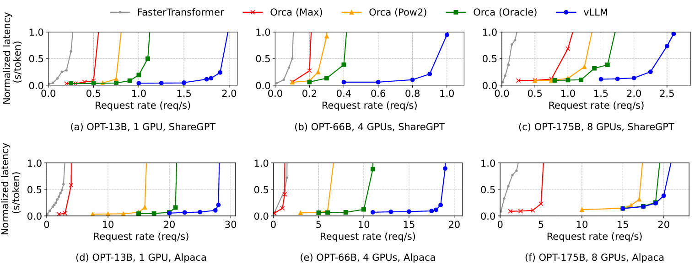

- 图在说明什么：OPT-13B、66B、175B 在 ShareGPT 与 Alpaca 上，五种系统的 normalized latency-request rate 曲线。
- 阅读时重点：当 request rate 超过服务容量后，队列持续增长，延迟曲线会突然发散；比较各系统开始发散的位置。
- ==关键结果==：ShareGPT 上，vLLM 相比 Orca (Oracle) 可承载高 1.7-2.7 倍的 request rate，相比 Orca (Max) 高 2.7-8 倍；相比 FasterTransformer 最高可达 22 倍。
- 例外：OPT-175B + Alpaca 中，序列短且 KV cache 空间大，系统更接近 compute-bound，vLLM 相对 Oracle/Pow2 的优势变小。
- ==我的理解==：当延迟突然升高，说明当前系统无法承载该request rate，等待队列长度无限上升，所以当曲线突然开始发散时，就是该系统的容量上限。这个实验的对比还体现了ShareGPT和Alpaca，在Alpaca中request rate显著高于ShareGPT，这说明request长度变化的场景要求更高。vLLM非常牛，**但是在（f）中可以观察到，在此场景下差距较小，这是因为OPT-175有很大的显存空间的同时，alpaca的sequence长度均比较短，所以Orca（Oracle）和Orca（Pow2）显存低效利用这一缺点就被掩盖了，这个场景下，GPU的算力反而成为了限制系统表现的短板。**
- 当前问题：只说了是单序列场景，没说是具体的哪个decoding方法（不一定是greedy decoding）。

#### 图表记录：Figure 13（第 10 页）

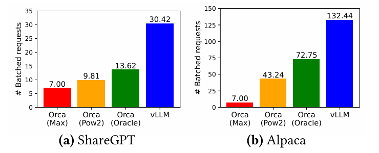

- 图在说明什么：OPT-13B 在固定 trace 下各系统平均同时处理的请求数。
- 关键数据：ShareGPT 上 vLLM 平均 batch 30.42，Orca (Oracle) 13.62，Orca (Max) 7.00；Alpaca 上分别为 132.44、72.75、7.00。
- 与 Figure 12 的关系：显存利用率提高让更多请求同时进入 batch，继而提高 serving capacity。
- 我的理解：vLLM较高的显存利用率让更多的request进入batch。
- 当前问题：暂无

#### 本节读完后回答

1. 延迟曲线突然上升为什么代表 request rate 已超过系统容量？
   **答：**当延迟突然升高，说明当前系统无法承载该request rate，等待队列长度无限上升，所以当曲线突然开始发散时，就是该系统的容量上限。
2. Figure 13 如何把“更省显存”连接到“更高吞吐”？
   **答:**显存利用率高了，就可以batch更多的request。更大的batch矩阵乘法的利用率越高，吞吐量就提升了。
3. 为什么在 OPT-175B + Alpaca 上，内存优化不再带来同样大的优势？
   **答:**这是因为OPT-175有很大的显存空间的同时，alpaca的sequence长度均比较短，所以Orca（Oracle）和Orca（Pow2）显存低效利用这一缺点就被掩盖了，这个场景下，GPU的算力反而成为了限制系统表现的短板。
4. Basic sampling 中没有跨序列共享时，vLLM 的收益主要来自哪种机制？
   **答:**主要来自于internal碎片的减少。

#### 我的笔记与问题

- 主结果：vLLM很牛
- 例外结果：在（f）中可以观察到，在此场景下差距较小，这是因为OPT-175有很大的显存空间的同时，alpaca的sequence长度均比较短，所以Orca（Oracle）和Orca（Pow2）显存低效利用这一缺点就被掩盖了，这个场景下，GPU的算力反而成为了限制系统表现的短板。
- 当前问题：暂无

### 6.3 Parallel Sampling and Beam Search

#### 阅读目标

- 验证 §4.4 的 block sharing 是否转化为真实吞吐与显存收益。
- 对比 parallel size 和 beam width 增大时，两种 decoding 的收益变化。

#### 图表记录：Figure 14（第 11 页）

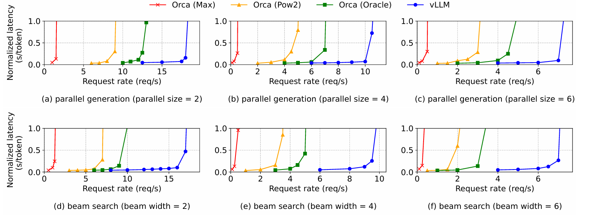

- 图在说明什么：OPT-13B + Alpaca 上，不同 parallel size 与 beam width 下的 normalized latency-request rate 曲线。
- 阅读时重点：==输出序列数越多，共享机会越多，vLLM 相对 Orca 的优势扩大；beam search 的动态共享范围更大。==
- 关键结果：相对 Orca (Oracle)，vLLM 的优势从 basic sampling 的 1.3 倍提高到 beam width 6 时的 2.3 倍。
- 我的理解：在parallel sampling时，vLLM有显著的提升。而在beam search中有更多的共享，vLLM有更好的表现，从1.3倍的basic sampling 到2.3倍的beam search(beam width = 6)
- 当前问题：暂无

#### 图表记录：Figure 15（第 11 页）

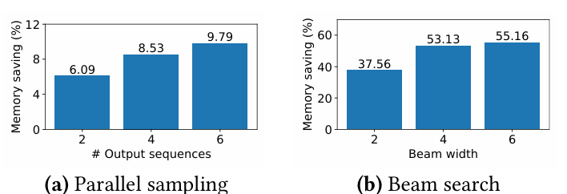

- 图在说明什么：OPT-13B + Alpaca 上，共享 KV blocks 相对 完全不共享 节省的显存比例。
- 关键数据：parallel sampling 节省 6.1%-9.8%，beam search 节省 37.6%-55.2%；ShareGPT 上相应范围为 16.2%-30.5% 与 44.3%-66.3%。
- 阅读时重点：解释为什么 beam search 的共享比例显著高于 parallel sampling，而不是只抄数值。
- 我的理解：因为beam search共享的部分更多，生成的token也可共享。
- 当前问题：暂无

#### 本节读完后回答

1. 为什么 parallel size 或 beam width 增大时，vLLM 的相对优势会扩大？
   **答：**因为在增大时，不同的序列间共享的KV cache部分更多了，显存利用率反而提高了。
2. Parallel sampling 主要共享哪一段 KV cache？
   **答：**共享prompt的KV cache。
3. Beam search 为什么能共享 prompt 之外的中间 blocks？
   **答：**因为Beam search的分叉发生在生成过程中，生成的内容在路径分叉之前所占用的blocks也可以共享。
4. Figure 15 的 memory saving 是如何定义的？
   **答：**以通过==共享blocks节约下来的blocks数量==➗==不共享blocks的blocks总数==。

#### 我的笔记与问题

- Parallel sampling：vLLM表现优于其他。
- Beam search：vLLM提升效果最好。
- 当前问题：暂无

### 6.4 Shared prefix

#### 阅读目标

- 验证跨请求 shared prefix caching 在真实翻译 workload 中的效果。

#### 图表记录：Figure 16（第 12 页）

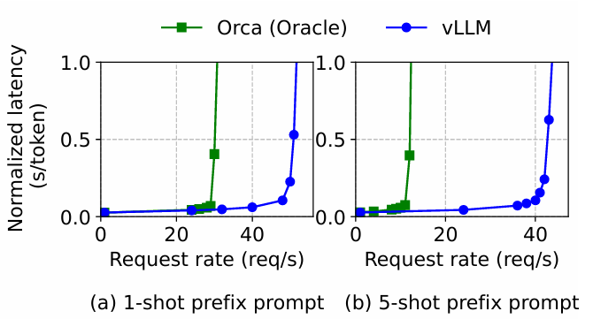

- 图在说明什么：LLaMA-13B 在 WMT16 英德翻译上，共享 1-shot 80-token prefix 与 5-shot 341-token prefix 时的性能。
- 关键结果：共享 1-shot prefix 时，vLLM 吞吐比 Orca (Oracle) 高 1.67 倍；共享 5-shot prefix 时高 3.58 倍。
- ==阅读时重点==：prefix 越长，可避免的 重复 prompt计算与 KV cache复制 就越多。
- 当前问题：暂无

#### 本节读完后回答

1. Figure 16 的两个 workload 只改变了什么？
   **答：**只改变了prefix中的例子数量。1和5。
2. 为什么更长的 shared prefix 带来更大的相对收益？
   **答：**prefix 越长，可避免的重复 prompt 计算 与 KV cache 复制越多。收益更大。
3. 该结果同时验证了节省计算与节省显存中的哪一部分？
   **答：**同时节约计算与显存。

#### 我的笔记与问题

- 我的复述：prefix越长vLLM相对提升就越大。
- 当前问题：暂无

### 6.5 Chatbot

#### 阅读目标

- 理解多轮对话 prompt 的长度特征，以及论文在轮次之间是否保留 KV cache 的选择。

#### 图表记录：Figure 17（第 12 页）

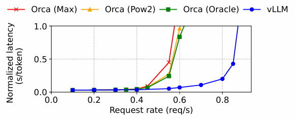

- 图在说明什么：合成 ShareGPT chatbot workload 下，vLLM 与三种 Orca baseline 的 normalized latency-request rate 曲线。
- 实验细节：将聊天历史与当前 query 拼成 prompt；输入截取最后 1024 token，最多生成 1024 token；不同对话轮次之间不保留 KV cache。
- 关键结果：vLLM 可承载约 2 倍 request rate；三种 Orca 表现接近，因为 buddy allocation 都为 output 预留 1024 token 空间。
- 阅读时重点：不跨轮保存 KV cache 是为了避免在两轮之间长期占用显存，挤压其他在线请求。
- 我的理解：如下复述。
- 当前问题：暂无

#### 本节读完后回答

1. 为什么 chatbot 请求的 prompt 往往很长？
   **答：**因为 chatbot 通常包含多轮对话历史，当前请求不仅包含用户最新输入，还会携带之前的上下文信息，因此 prompt 长度随着对话轮次增加而增长。
2. 论文为什么选择不在对话轮次之间保存 KV cache？
   **答：**不跨轮保存 KV cache 是为了避免在两轮之间长期占用显存，挤压其他请求。
3. 三种 Orca baseline 在该 workload 中为什么表现相近？
   **答：**因为Share GPT对话长度很长，大多数都固定在1024tokens，所以Orca要分配大于1024tokens的长度，也就是2048tokens，output的空间大小就是1024，从而表现相近。
4. 这里体现的是 shared-prefix 优势，还是按需 block allocation 的优势？
   **答：**按需 block allocation的优势。

#### 我的笔记与问题

- ==我的复述==：对比了Chatbot这种长prompt情况，就算是Orca知道生成内容长度，也无法提高显存利用效率，更加体现了vLLM block allocation的优势。
- 当前问题：暂无

## 7. Ablation Studies

### 本章阅读目标

- 单独检查 PagedAttention kernel 的额外开销、block size 选择，以及 recomputation/swapping 的恢复策略。
- 区分 microbenchmark 与 end-to-end 结论，避免用单个 kernel 的慢或快替代系统级判断。

### 7.1 Kernel Microbenchmark

#### 阅读目标

- 判断 block table lookup、额外分支和可变序列长度处理给 attention kernel 带来多大代价。

#### 图表记录：Figure 18(a)（第 12 页）比较kernel延迟

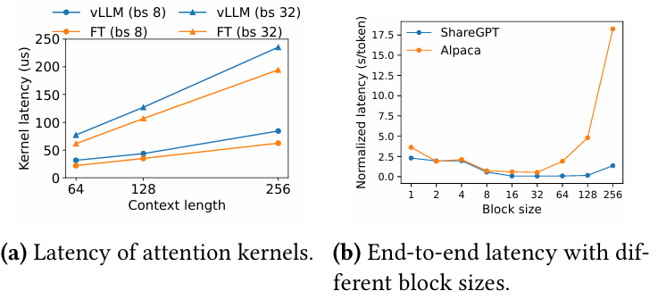

- 图在说明什么：==不同 context length、batch size 下，vLLM 与 FasterTransformer attention kernel 的 latency。==
- 关键结果：PagedAttention kernel 的 latency 高 20%-26%。
- 阅读时重点：额外开销只影响 attention 等涉及 KV cache 的算子，不影响 Linear 等全部模型算子；系统级收益仍来自更大 batch 与更高显存利用率。
- 我的理解：虽然延迟高，但是显存利用率部分带来的收益提升更大。
- 当前问题：暂无

#### 本节读完后回答

1. PagedAttention kernel 为什么比高度优化的 FasterTransformer kernel 更慢？
   **答：**与现有的系统相比，PagedAttention kernel有：查询block table、计算分支、解决变化的sequence长度等额外开销
2. 为什么 kernel-level regression 不与 §6 的 end-to-end speedup 矛盾？
   **答：**Kernel microbenchmark 测量的是固定 batch 和 context length 下，单次 attention kernel 的执行时间。PagedAttention 因为需要查询 block table、处理物理不连续的 KV block、执行额外分支以及支持可变 sequence length，其 attention kernel 比 FasterTransformer 慢 20%～26%。系统级收益超过了 attention kernel 的局部性能损失
3. 评估系统设计时，什么时候应该看 microbenchmark，什么时候必须看 end-to-end？
   **答：**当需要隔离和分析某个组件本身的性能时，应使用 microbenchmark；当需要判断一项系统设计是否真正改善用户体验或==整体服务能力==时，必须进行 end-to-end 评估。

#### 我的笔记与问题

- 我的复述：引入了延迟，但总体提升更大。
- 当前问题：暂无

### 7.2 Impact of Block Size

#### 阅读目标

- 理解 block size 在 GPU 并行性、internal fragmentation 与 sharing probability 之间的三方权衡。

#### 图表记录：Figure 18(b)（第 12 页）


- 图在说明什么：ShareGPT 与 Alpaca trace 上，不同 block size 的 end-to-end normalized latency。
- 关键结果：==ShareGPT 上 block size 16-128 表现较好；Alpaca 序列较短，16 和 32 较好，继续增大会明显恶化。==
- 设计选择：==论文默认 block size 为 16，认为它足以利用 GPU，同时能控制碎片并保留共享机会。==
- 我的理解：这里讲述的是和（a）不同的延迟，这里是end-to-end延迟，对于较短的Alpaca而言，当block size过大时会有显著内部碎片，影响性能。作者设置在16。
- 当前问题：暂无

#### 本节读完后回答

1. Block 太小为什么可能无法充分利用 GPU 并行性？
   **答：**PagedAttention 会让 GPU 并行读取和处理一个 block 内多个 token 位置的 KV。block太小，并行性降低。

2. Block 太大为什么同时增加 internal fragmentation、降低 sharing probability？
   **答：**vLLM 以整个 block 为单位分配显存，但最后一个 block 不一定填满。

3. ShareGPT 与 Alpaca 的最优范围为什么不同？
   **答：**两种 workload 的 sequence 长度不同，ShareGPT更长，长block也能填满，Alpaca更短，很容易有内部碎片。

4. 默认选择 16 代表怎样的工程折中？

   **答：**同时兼顾计算效率、显存利用率和共享粒度：

   - 足够大：能够并行处理多个 KV 位置，分摊 block-table 查询开销；
   - 足够小：每条 sequence 最多浪费 15 个 token slots；
   - 共享粒度较细：分叉时 Copy-on-Write 的范围较小；
   - 对长序列和短序列 workload 都比较稳定。

#### 我的笔记与问题

- ==小 block：并行性弱==
- ==大 block：易有碎片==
- 当前问题：暂无

### 7.3 Comparing Recomputation and Swapping

#### 阅读目标

- 比较两种 preemption recovery 机制随 block size 变化的开销与端到端表现。

#### 图表记录：Figure 19（第 13 页）

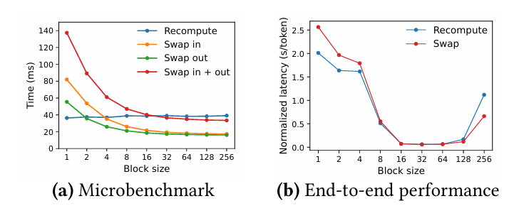

- Figure 19(a)：==小 block 导致大量小规模 CPU-GPU 传输，无法充分利用 PCIe bandwidth，因此 swapping 开销很高；recomputation 不依赖 block 数，开销较稳定。==
- Figure 19(b)：block size 16-64 时，两种方法的 end-to-end 表现接近；小 block 更偏向 recomputation，大 block 更偏向 swapping。
- 阅读时重点：microbenchmark 的传输差异如何传导到 ShareGPT trace 的 normalized latency。
- 我的理解：小block swap更垃圾，block更大，swap效率更高。
- 当前问题：暂无

#### 本节读完后回答

1. Swapping 开销为什么随 block size 变小而急剧上升？
   **答：**block 越小，需要进行的独立 CPU-GPU 传输次数越多。

2. Recomputation 的开销为什么基本不随 block size 改变？

   **答：**其主要计算量由模型大小和 sequence length 决定，而不是由 KV block size 决定。

3. Figure 19(a) 与 19(b) 分别回答“单次恢复成本”和“整体 serving 表现”中的哪个问题？
   **答：**（a）回答了单次恢复成本，（b）回答了整体serving表现。

4. 论文为何仍同时支持两种恢复机制？
   **答：**因为 swapping 和 recomputation 使用不同的硬件资源，哪一种更好取决于 block size、CPU-GPU 带宽、GPU 计算能力、模型大小和 sequence length，不存在一种机制在所有场景下都最优。

#### 我的笔记与问题

- Recomputation 适合：小block
- Swapping 适合：大block
- 当前问题：暂无

## 8. Discussion

### 阅读目标

- 识别 PagedAttention 可迁移到其他 GPU workload 的必要条件，以及不适用时的额外代价。
- 看清 vLLM 借鉴 OS paging 时做了哪些 LLM-specific 改造。

### 记录重点

- 适合条件：内存需求动态变化，且性能主要受 GPU memory capacity 限制。
- 不一定适合 DNN training：tensor shapes 通常静态，可提前优化分配。
- 不一定适合：若系统 compute-bound，内存间接寻址和非连续访问的额外开销可能反而降速。
- LLM-specific 改造：all-or-nothing swap-out、用 recomputation 恢复被驱逐状态、把间接寻址与 attention 等 kernel 融合。

### 本节读完后回答

1. 将 paging 用到其他 GPU workload 前，至少要检查哪两个条件？

   **答：** 第一，workload 的显存需求是否动态变化、无法提前准确确定；第二，系统性能是否受到 GPU 显存容量限制，即提高显存利用率是否能容纳更多工作并提高吞吐量。

2. 为什么“更省显存”不必然等于“更快”？
   **答：** 如果 workload 主要是 compute-bound，即瓶颈在 GPU 计算能力，那么节省显存并不会提高计算吞吐量。与此同时，paging 还会增加地址转换、分支判断和非连续显存访问，因此可能使 kernel 变慢。

3. All-or-nothing eviction 利用了 LLM serving 的什么访问语义？
   **答：**LLM 在生成当前 token 时，需要通过 causal attention 访问该 sequence 的全部历史 KV cache，因此一条 sequence 的所有 KV blocks 通常会被一起访问。

4. Recomputation 为什么是 OS paging 中通常不存在、但 LLM serving 可以利用的恢复方法？
   **答：** OS 中的普通内存页可能包含程序任意修改后的状态，操作系统通常不知道这些内容是如何产生的，因此不能根据少量信息重新计算，只能将其保存到磁盘或其他内存中。KVcache是可以重建的中间结果。

### 我的笔记与问题

- 适用边界： ==DNN training和非 LLM 的 DNN serving。==
- 当前问题：暂无

## 9. Related Work

### 阅读目标

- 把相关工作按 general model serving、Transformer serving、Orca、memory optimization 四类整理。
- 重点比较方法解决的瓶颈，而不是只记系统名字。

### 对照记录

- General model serving：Clipper、TensorFlow Serving、Nexus、InferLine、Clockwork 等关注 batching、caching、placement、scheduling，但没有利用 LLM 自回归与 token states 的特性。
- Specialized Transformer serving：通过 GPU kernels、advanced batching、model parallelism、parameter sharing 提高效率。
- Orca：iteration-level scheduling 让请求更灵活地交错执行；vLLM 提高显存利用率，让更多 working sets 真正装入显存。二者是互补关系。
- Memory optimizations：swapping、recomputation、FlexGen、OLLA 等减少峰值显存或碎片，但不等同于在线 serving 中的细粒度 KV block 管理。
- FlashAttention：通过 tiling 与 kernel 优化降低 attention 计算的 I/O 与峰值内存；本文关注在线 serving 中长期存在、动态增长的 KV cache 管理。

### 本节读完后回答

1. Orca 与 vLLM 分别主要解决“调度”还是“显存容纳能力”？
   **答：**Orca调度，vLLM显存容纳能力

2. 为什么论文说 iteration-level scheduling 反而使内存管理更重要？
   **答：**Iteration-level scheduling 会在每次迭代后动态加入新请求、移除完成的请求，同时每条 sequence 的 KV cache 还会逐 token 增长。这使显存中的请求集合和 KV cache 大小频繁变化，显存分配与释放更加动态，更容易产生 reservation 和 fragmentation。

3. FlexGen 的目标场景与 vLLM 的 online serving 有什么不同？

   **答：**
   FlexGen 更像：

   ```
   硬件资源有限，但有一批任务需要离线跑完
   → 可以用较高延迟换取可运行性和总吞吐
   ```

   vLLM 更像：

   ```
   用户请求不断到达
   → 需要动态调度
   → 既要高吞吐，也不能让请求等待太久
   ```

4. FlashAttention 与 PagedAttention 名字相似，但各自优化的对象是什么？
   **答：**
   
   ```
   FlashAttention：
   优化 attention 的计算过程
   
   PagedAttention：
   优化 KV cache 的长期存储和访问
   ```

### 我的笔记与问题

- 最相关工作：Orca
- 方法差异：提高显存利用率
- 当前问题：暂无

## 10. Conclusion

### 阅读目标

- 用自己的话把问题、核心机制、系统实现和实验结论重新串成一条因果链。

### 结论核对

- 问题：在线 LLM serving 的 KV cache 大、动态增长，连续预分配造成碎片并阻碍共享。
- 算法：PagedAttention 允许 attention 从不连续的 paged KV memory 读取 key/value。
- 系统：vLLM 借鉴 virtual memory、paging 与 copy-on-write，结合 block manager、scheduler 和定制 kernels。
- 证据：相对当时先进系统，论文报告 2-4 倍吞吐提升；长序列、大模型和复杂 decoding 下优势通常更明显。

### 全文读完后回答

1. PagedAttention 为什么能提高吞吐，却可能让单个 attention kernel 稍慢？
   **答：**局部慢了，整体快了。
2. 在什么 workload 上 vLLM 的优势会缩小，为什么？
   **答：**sequence 较短、GPU 留给 KV cache 的显存非常充足，并且系统已经从 memory-capacity-bound 转变为 compute-bound 的 workload。
4. 这篇论文的核心贡献更偏向新模型、新 attention 数学，还是 serving system 与显存管理？
   **答：**serving system 与显存管理。
