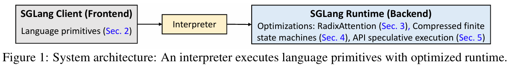
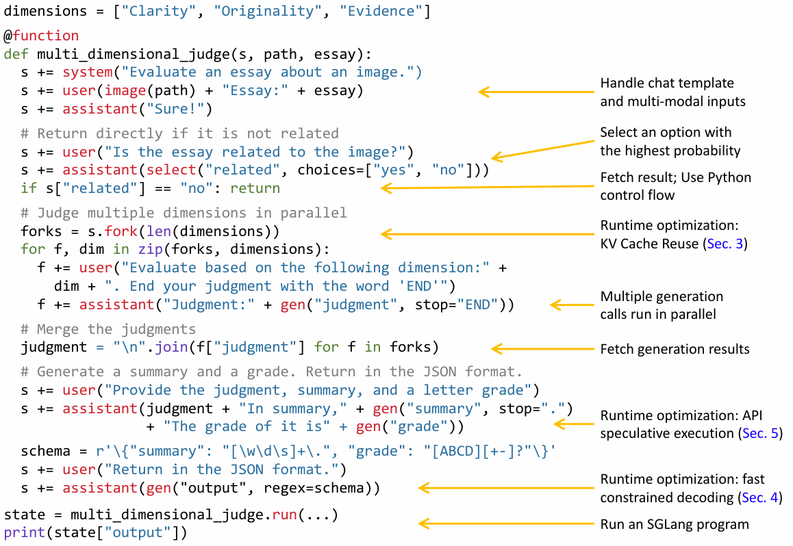
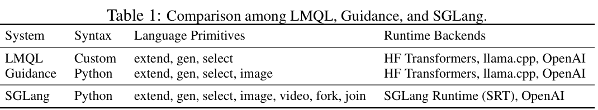
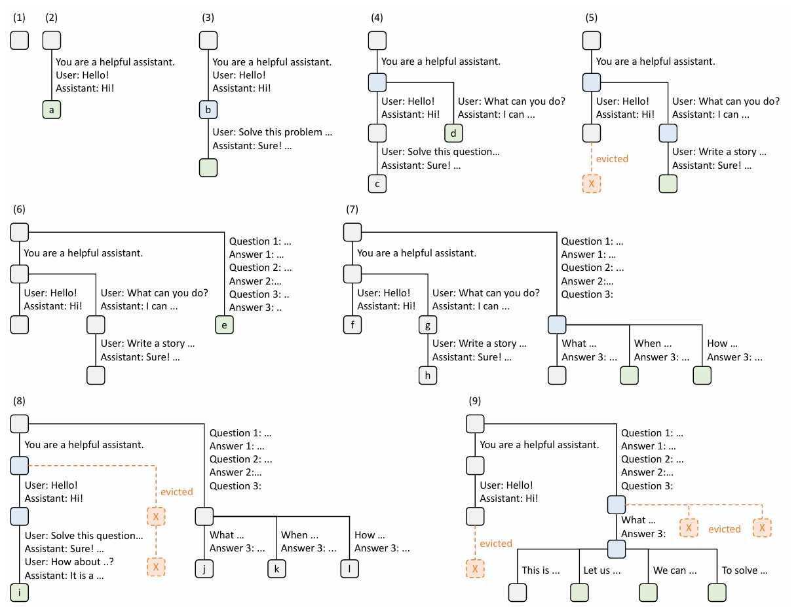
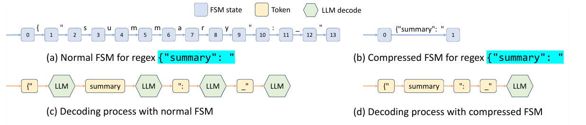
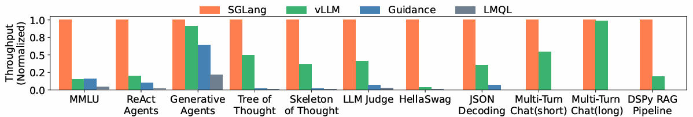
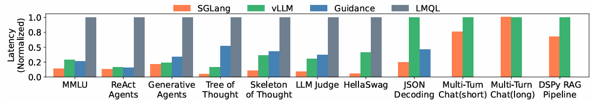
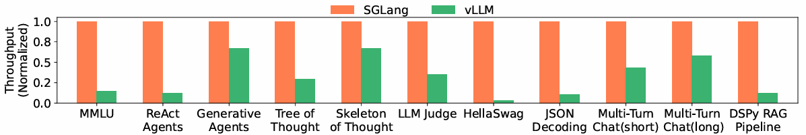
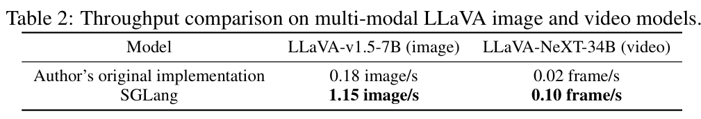
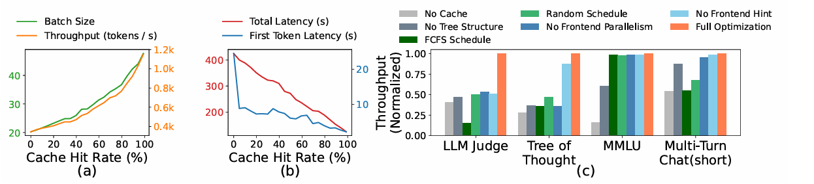

# SGLang: Efficient Execution of Structured Language Model Programs

> 阅读时间：2026.7.20-2026.7.22

## 0. 论文信息

- Title: SGLang: Efficient Execution of Structured Language Model Programs
- System: SGLang
- Authors: Lianmin Zheng, Liangsheng Yin, Zhiqiang Xie, Chuyue Sun, Jeff Huang, Cody Hao Yu, Shiyi Cao, Christos Kozyrakis, Ion Stoica, Joseph E. Gonzalez, Clark Barrett, Ying Sheng
- Version: arXiv:2312.07104v2（2024-06-06，论文标注为 preprint）
- PDF: `SGLang Efficient Execution of Structured Language Model Programs.pdf`
- Pages: 20
- Reading status: Finished

## 0.1 阅读进度清单

- [x] Abstract：确认问题、系统组成、摘要明确提到的两项优化和主要结果
- [x] 1 Introduction：理解为什么 LM Program 需要前后端协同设计
- [x] 2 Programming Model：走通 Figure 2，掌握核心原语与异步执行方式
- [x] 3 RadixAttention：理解 radix tree、LRU 与 cache-aware scheduling
- [x] 4 Compressed FSM：理解为什么一次前向可以确定多个 token
- [x] 5 API Speculative Execution：理解黑盒 API 场景下如何投机执行
- [x] 6.1 Setup：核对工作负载、模型、硬件、基线与指标
- [x] 6.2 End-to-End Performance：判断性能提升来自哪里、比较是否公平
- [x] 6.3 Ablation Study：分离各项优化的实际贡献
- [x] 7 Related Work：按需阅读，定位与 vLLM、Guidance、LMQL 的差异
- [x] 8 Future Directions and Conclusion：总结适用边界与开放问题
- [ ] Appendix A/B/D：遇到调度证明、FSM 实现或编译模式问题时再读

## 1. 一句话主线

> SGLang 用 Python 内嵌语言表达多调用、带控制流和结构化输出的 LM Program，并通过前端与运行时协同，用 RadixAttention、压缩 FSM 和 API 推测执行减少重复计算与串行等待。

## 2. 阅读前先带着这几个问题

1. SGLang 优化的基本单位为什么是“LM Program”，而不只是单次推理请求？
   **答：**因为他想做的是KV cache的高效复用，单次推理请求复用效率较低。
2. 前端语言向运行时暴露了哪些普通推理 API 看不到的结构信息？
3. RadixAttention 与 vLLM 的 PagedAttention 分别解决什么问题，二者如何配合？
4. 压缩 FSM 和 API 推测执行各自减少了哪一种串行开销？
5. 最高 6.4× 的吞吐提升适用于哪些负载，是否能代表一般工作负载？

## 3. 论文结构索引

页码按 PDF 页数记录。

- p.1：Abstract / 1 Introduction
- p.3：2 Programming Model
- p.4：3 Efficient KV Cache Reuse with RadixAttention
- p.6：4 Compressed Finite State Machine / 5 API Speculative Execution
- p.7：6 Evaluation / 6.1 Setup / 6.2 End-to-End Performance
- p.9：6.3 Ablation Study / 7 Related Work
- p.10：8 Future Directions and Conclusion
- p.14：Appendix A - RadixAttention
- p.16：Appendix B - Compressed FSM
- p.18：Appendix C / D - Additional Experiments / Compiler Mode

## Abstract

### 本节读完后回答

1. SGLang 的前端和运行时分别负责什么？
   **答：**SGLang的前端简化了对于生成和并行控制时需要的原语编程。运行时通过新的优化来加速执行，如用于KV缓存重用的RadixAttention和用于更快结构化输出解码的压缩有限状态机。
2. 摘要明确提到的两项运行时优化分别针对哪类瓶颈？
   **答：**RadixAttention可以复用KV cache，针对的是显存瓶颈；Compressed FSM针对结构化输出必须逐 token 约束解码、速度较慢的问题。
3. 论文报告的最高性能提升是多少，覆盖了哪些类型的任务？
   **答：**最高性能提升有6.4倍，覆盖了agent控制，逻辑推理，少样本学习基准测试，JSON编码，检索增强生成管线，多轮对话。

### 我的笔记

- 

## 1. Introduction

### 本节主线

- LM 应用正从单次聊天转向包含多次生成、控制流和结构化输入输出的程序。
- 现有接口使这类程序难写；现有推理引擎看不到程序结构，也难以复用跨调用的计算。
- SGLang 用前端语言表达结构，并让运行时利用这些结构做专门优化。

### 本节读完后回答

1. LM Program 的两个共同特征是什么？
   **答：**第一，LM program都通常包含多个LLM调用，其中穿插着控制流。第二，LM program 接收结构化的输入，并产生结构化的输出。
2. 为什么通用推理引擎难以自动利用跨调用的 KV cache 复用机会？
   **答：**因为通用推理引擎主要优化单个请求和当前 batch，却不知道这些请求在上层程序中的关系。
3. 前端与运行时为什么既能独立使用，又能协同获得更高性能？
   **答：**因为两者通过明确接口连接，功能上彼此解耦；但前端掌握程序结构，Runtime 掌握底层资源，结合后可以交换更多优化信息。

### 我的笔记

- 由于当前LLMs的输出格式经常会有限制（如JSON格式），在这些限制之下，有一些token可以不需要模型来输出，可以一次性就处理好，比如“{“summary”：”后面再切换到逐token生成。

- ==Prompt state（提示状态）==就是当前这条模型调用流程中，已经积累下来的全部上下文。

- FIgure 1
  

  系统架构图：一个解释器用优化的runtime运行语言原语。
  前端语言+后端runtime。
  前端简化了LM程序的编程，后端runtime加速了他们的运行。

- 在client方面：

  - 兼容了python语法
  - 提供SGLang解释器和编译器。解释器像流一样处理Prompt state，然后为了异步执行，把原语操作提交到流中。确保正确的同步控制和程序内的并行。
  - SGLang可以被追踪也可以编译优化。

- 在runtime方面：

  - 首先，使用了RadixAttention技术，使多个生成请求之间的KV cache可以自动复用。在现有的推理引擎中，一个request的KV cache会在处理完成之后被丢弃，从而无法在多个请求之间复用KV cache。为解决这个问题，作者的系统为所有在radix树中的requsts维护了一个KVcache的LRU cache。这个方法可以让KV cache像传统cache一样，还可以使用radix tree完成高效的查询插入删除。
  - 其次，使用了压缩FSM，加速了有限制输出格式的output。
  - 第三，API speculative execution。优化只能API调用的模型在多请求程序的表现。

## 2. Programming Model

### 阅读重点

- 结合 Figure 2 走通 `extend`、`gen`、`select`、`fork`、`join` 和结果读取。
- 区分 interpreter mode 与 compiler mode。
- 找出哪些前端操作会向运行时暴露并行、共享前缀或输出约束。

### 本节读完后回答

1. Prompt state `s` 如何把多次生成组织成一个程序？
   **答：**记录上下文

2. 异步 stream 在哪里并行，读取生成结果时又如何保证正确同步？

   **答：**在for处并行，使用gen函数将不同角度的生成结果记录到不同的f的judgment中。

3. Figure 2 中三种运行时优化分别对应哪段程序结构？
   **答：**for循环处，KV cache复用；在“In summary”处，有API推测运行；倒数第三行，快速约束解码。

### 我的笔记

- Figure 2
  

  红色字就是SGLang的原语操作，这个程序是评价一篇关于一张图片的文章
  函数 multi_dimensional_judge有三个参数：s, path, and essay

  s：prompt state

  path：图片文件路径

  essay：文章内容
  ==运行内容==：

  - 新的string和SGLang原语可以通过`+=`符号添加到s中
  - 开始，这个函数会把图像和文章都放入prompt中，然后会使用select来判断这篇文章和这张图片是否相关，把最终选择的结果（yes/no）存储到s["related"]中
  - 如果相关prompt会被fork到三个备份中来进行三个维度的评估，使用`gen`来把结果存储到`f["judgment"]`中
  - 接下来把 judgments都融合在一起，生成一个总结，评估一个字母分数
  - 最终按照JSON格式返回结果，遵循由正则表达式约束 regex 定义的模式。

- ==语言原语==：

  - `gen`：调用模型生成并将结果存储到第一个参数命名的变量中。它还支持名为“regex”的参数，让output以一种正则表达式定义的语法格式输出（例如JSON格式）。
  - `select`：调用模型在一个列表中选择可能性最高的答案。
  - `+=/extend`：让一串字符串添加到prompt中。
  - `[变量名]`：取出一次生成的结果
  - `rejoin`：重新合并prompt state
  - `image/video`：读取照片和视频输入

- ==运行模式==：

  - 使用一个interpreter是一个最简单的方式来运行SGLang，原语提交到流中异步执行。这里的异步执行主要体现在三个dimension分析可以不用按顺序来。

  - 也可选择编译成计算图，然后用图运行器来运行，这样可以做更多的优化。

    > 计算图：把 Python/SGLang 程序预先整理成一张“哪些步骤依赖哪些步骤”的流程图，然后由 Graph Executor 按图执行。

  - 还支持开源模型（使用SRT）的模式，还有闭源模型的API模式

- ==Table 1 比较不同的编程系统==：

  
  可以分为高层系统和低层系统。

  - 高层系统：提供预定义或者是自生成的提示词。
  - 低层系统：基本不改变提示词，但是允许直接操作提示词和原语。

## 3. Efficient KV Cache Reuse with ==RadixAttention==

### 阅读重点

- radix tree 中 token 前缀、树边和 KV cache 页之间的对应关系。
- 请求完成后缓存为何保留，内存不足时如何按 LRU 从叶节点驱逐。
- longest-shared-prefix-first 如何提高 cache hit rate，以及它与公平性的冲突。

### 本节读完后回答

1. RadixAttention 为什么能统一处理多轮对话、few-shot 和分叉生成的前缀复用？
   **答：**使用radix tree。

2. 缓存与运行中请求共享同一内存池时，系统如何避免驱逐正在使用的节点？
   **答：**使用reference count，等于零时才可以驱逐。

3. RadixAttention 与 PagedAttention 的职责有什么不同？
   **答：**PagedAttention 解决 KV Cache“怎么存”；RadixAttention 解决 KV Cache“哪些可以复用、保留多久”。

4. 分叉提示是什么？

   **答：**第一次发送明确标出了公共前缀的边界，并让 Runtime 先把它计算并放进 Radix Tree；第二次发送的各个分支就都能直接命中这个前缀。Frontend Hint天然知道分叉位置，把分叉告诉runtime，就不需要Runtime自己使用复杂的方式判断了。

### Figure 3 阅读记录

**绿色**：本次请求新加入的节点，也就是新计算并写入的 KV cache。

**蓝色**：本次请求命中的已有节点，对应从缓存中找到并复用的 KV cache。

**红色虚线和 `×`**：因为显存不足，按照 LRU 策略被淘汰的节点。

**灰色**：已经存在于树中，但当前这一步没有被访问或修改的节点。

- [x] 按 (1)–(9) 走一遍前缀匹配、节点分裂、插入和驱逐。

### ==我的笔记==

- RadixAttention是自动和系统级的KV cache复用，兼容continuous batching，pagedattention，tensor parallelism。
  - radix tree，压缩前缀树是把相同 token 前缀合并保存的压缩前缀树；SGLang 用它寻找可复用的最长 Prompt 前缀，并管理对应的 KV Cache。
  - 使用LRU替换策略，用reference counter计数有多少request使用相同的内存池，当ref count=0时才可以移除。
  - 前端首先发送前缀作为提示，确保前缀被正确插入树中，然后才发送剩下的prompt。这简化了runtime的计划和对照（因为这样就可以告诉runtime：共享到这里结束了）。

- Cache-aware scheduling缓存感知调度
  - 优先选择前缀长度相近的request而不是FCFS策略（与PagedAttention不同）,贪心策列会导致饥饿。

## 4. Efficient Constrained Decoding with Compressed Finite State Machine

### 本节读完后回答

1. 普通 FSM 为什么即使下一段内容完全确定，==仍然逐 token 解码？==
   **答：**因为普通FSM会一个一个输入模型，只是把模型的输出固定了。
2. 压缩 FSM 在什么条件下能用==一次 forward pass 处理多个 token==？
   **答：**当内容没有任何选择空间。压缩 FSM 会把连续且唯一的路径合并，一次forward pass处理多个token（增量prefill）。

### Figure 4 阅读记录

- ==普通 FSM 与压缩 FSM 的关键区别==：
  一个只能单个token，逐token解码，压缩FSM直接增量prefill一次完成多个词。

- 这项优化不能加速的情况：

  没有可压缩的单一路径，比如每隔一个token就要模型无限制的生成一个token。

### 我的笔记

- 如果指定格式输出，可以压缩指定格式token，一次全部输入模型，做一次增量prefill。不用一个一个token生成。

## 5. Efficient Endpoint Calling with API Speculative Execution

### 本节读完后回答

1. 黑盒 API 无法修改推理过程时，SGLang 投机执行了什么？
   **答：**直接忽视终止符，继续生成，interpreter把多生成的部分记录下来，并与后面的元操作格式相匹配。在部分有细致prompt engineering的情况下，模型以较高的准确率对齐模板，降低延迟和节约API调用费用。
2. 投机分支猜错的代价是什么，什么时候值得这样做？
   **答：**猜错时，需要丢弃额外生成的 token，并仍然执行原定 API 调用，因此浪费输出费用和生成时间；当后续格式高度可预测、公共输入很长、API 调用延迟和输入费用较高时，投机执行更值得使用。

### ==我的笔记==

- 直接忽视终止符，继续生成，interpreter把多生成的部分记录下来，并与后面的元操作格式相匹配。在部分有细致prompt engineering的情况下，模型以较高的准确率对齐模板，降低延迟和节约API调用费用。

## 6. Evaluation

### 6.1 Setup

#### 本节读完后回答

1. 实验是否同时覆盖单调用、多调用、结构化输出和多模态负载？
   **答：**包含，多模态负载体现在LLaVA模型处。
2. 与 Guidance、vLLM、LMQL 的比较分别控制了哪些变量？
   **答：**不使用会改变计算结果的优化，保证所有计算结果都相同。

#### ==我的笔记==

- 模型：精度float16
  - 密集型Llama-2 models
  - 稀疏MoE Mixtral models
  - 多模态LLaVA图像和视频 models
  - API model：OpenAI GPT-3.5

- 硬件：
  - 单A10G GPU（Llama-7B）
  - 多A10G GPUs（更大模型，使用张量并行，Mixtral-8x7B）
  -  A100G (80GB) GPUs（附加实验）

- 基准：Guidance、vLLM、LMQL
- 负载：
  - **5-shot MMLU：**只解码1个token
  - **20-shot HellaSwag benchmarks：**使用原语select选择最高概率的回答。
  - 对于 **ReAct Agent** 和 **Generative Agents（生成式智能体）**，我们从原论文中提取它们的运行轨迹，并对这些轨迹进行重放。
  - 在 **GSM8K** 数学问题上使用 **Tree-of-Thought（思维树）**，并使用 **Skeleton-of-Thought（思维骨架）** 进行建议生成。
  - 对于 **LLM Judge**，使用 **branch-solve-merge（分支—求解—合并）** 技术。
  - 对于 **JSON 解码**，使用正则表达式指定输出需要遵循的 Schema。
  - **多轮对话**，包含 4 轮，每一轮的输入长度在 256–512 个 token 之间随机取值。其中，短输出多轮对话每轮生成 4–8 个 token，长输出多轮对话每轮生成 256–512 个 token。
  - 此外，还测试了 DSPy 官方示例中的 **RAG（检索增强生成）流水线**。

- 性能指标：
  - 吞吐量：program per second
  - 延迟：只执行一个程序，不进行批处理，并报告多个实例的平均延迟。

### 6.2 End-to-End Performance

#### 本节读完后回答

1. 最高 6.4× 出现在哪个任务、模型和硬件设置下？
2. 不同工作负载的加速主要来自 KV cache 复用、并行执行还是约束解码？
3. 吞吐提高时，延迟和输出质量是否保持可比？

------

#### **==开源模型表现==**

##### Figure 5 阅读记录

归一化的Llama-7B模型吞吐量，越高越好。

##### Figure 6 阅读记录

归一化的Llama-7B模型延迟，越低越好。

##### 我的笔记

- 由Fig 5与Fig 6可观察到，吞吐量最高提升了6.4倍，延迟最高降低了3.7倍。
- Multi-Turn Chat(long)中提升不显著的原因是，在不同的聊天对话之间共享的部分较少，由解码时间占据了主要。其余提升收益均来自于KV cache的复用。
- 在最后五个测试中Guidance和LMQL因为过慢的表现和缺失功能而被排除了。LMQL是因为过慢的token处理和未优化的后端，而Guidance是因为缺少batching和并行的支持。

-----

#### **==有张量并行大模型的表现==**

##### FIgure 7 阅读记录

归一化的Mixtral-8x7B模型吞吐量，有张量并行，越高越好。

##### 我的笔记

- 在大模型上表现得趋势和在小一些的模型上的表现趋势比较类似，说明作者的优化可以很好的推广到规模大的模型上。
- 省略了Guidance和LMQL，是因为他们缺乏高效的张量并行实现。

-------

#### **==多模态模型表现==**

LLaVA-v1.5-7B (image) on llava-bench-in-the-wild and LLaVA-NeXT-34B (video) on ActivityNet.(图片/视频理解)

##### Table 2 阅读记录

##### 我的笔记

- SGLang在这些测试上有最高6倍的提升，还是源自于对于KV cache的复用。

------

#### ==**API模型的表现**==

在使用少样本prompt的情况下，推测执行的准确率很高，由于提取了三个字段，它将输入令牌的成本大约降低了三倍。

### 6.3 Ablation Study，消融实验

#### 本节读完后回答

1. 关闭 cache-aware scheduling 或改变缓存规模后，RadixAttention 的收益如何变化？
   **答：**关闭 cache-aware scheduling 后，FCFS 或随机调度容易在无关前缀间切换，造成缓存颠簸和命中率下降，进而减小可用 batch size、降低吞吐量并增加延迟。Figure 8 表明 cache hit rate 越高，batch size 和吞吐量越大，首 token 延迟与总延迟越低。论文没有直接改变缓存容量；从机制上看，缓存越小越容易驱逐有用前缀，而容量增加的收益会在工作集基本容纳后趋于饱和。
2. 压缩 FSM 的收益与正则表达式中确定性片段的长度有什么关系？
   **答：**正则表达式中的连续确定性片段越长，压缩 FSM 能合并的 token 越多，也就能用一次增量 prefill 替代更多次逐 token decode，收益通常越大。如果确定路径很短、频繁出现分支，或者输出主要是自由文本，则可压缩部分较少，收益有限。论文没有直接量化片段长度与加速比之间的关系。

#### FIgure 8 阅读记录

(a)(b)展示了Cache命中率的消融实验结果

(c)展示了RadixAttention消融实验结果

#### ==我的笔记==

- 图(a)(b)展示了cache的命中率对于batch size，吞吐量，还有延迟的影响。这两张图说明了一个更高的cache命中率就会带来更大的batch size、更高的吞吐量和更低的延迟。

- 图(c)中， 

  - "No Cache" ：没有使用任何cache
  - "No Tree-Structure"：使用一个表格形式的cache而不是树形
  - "FCFS Schedule"：使用先来先服务代替缓存感知策略
  - "Random Schedule"：使用随机顺序调度request
  -  "No Frontend Parallelism"：禁用interpreter中的并行
  -  "No Frontend Hint"：禁用分叉提示
  - "Full optimizations"：所有优化

  结果表明为了达到最好的表现，每一部分都有必要。禁用并行和分叉提示都会使表现达不到最优，这说明前端语言和后端运行时的协同设计的作用。

- RadixAttention开销非常小：完成100个request用了74.3秒，而管理RadixAttention数据结构只用了0.2秒，建议默认开启。

- 压缩FSM效率很高，将吞吐量提升至1.6倍。因为状态机需要预处理，因此状态机需要被复用才能提升效率，不然在每个request前预处理反而会使吞吐量下降2.4倍。

## 7. Related Work

本节以定位差异为主，不单独设置问题。重点记录 SGLang 与 LMQL、Guidance、vLLM/PagedAttention 以及 prefix caching 方法的边界。

### 我的笔记

- ==和vLLM的区别==：不同 API 调用/已完成请求之间自动匹配公共前缀，而vLLM只能做到以下两点：1、同一 sequence 解码时复用历史 KV；2、同一请求中 n>1、beam search 分支共享 Prompt KV。

## 8. Future Directions and Conclusion

### 本节读完后回答

1. 当前设计在哪些调度、公平性、编译或概率正确性方面仍有限制？
2. 用自己的话概括：SGLang 利用了 LM Program 的哪些结构信息，又把它们转化成了哪些系统收益？

### 我的笔记

## 附录按需索引

- Appendix A：需要理解 RadixAttention 伪代码、最优调度定理或多副本部署时阅读。
- Appendix B：需要理解 tokenization artifact、retokenization 或概率失真时阅读。
- Appendix C：需要补充实验设置和结果时阅读。
- Appendix D：需要理解 compiler mode 和 code movement 时阅读。
