# DistServe: Disaggregating Prefill and Decoding for Goodput-optimized Large Language Model Serving

> 阅读时间：2026.7.29-

## 0. 论文信息

- Title: DistServe: Disaggregating Prefill and Decoding for Goodput-optimized Large Language Model Serving
- System: DistServe
- Authors: Yinmin Zhong, Shengyu Liu, Junda Chen, Jianbo Hu, Yibo Zhu, Xuanzhe Liu, Xin Jin, Hao Zhang
- Venue: OSDI 2024
- arXiv: 2401.09670
- ISBN: 978-1-939133-40-3
- PDF: `DistServe.pdf`
- Pages: 18（USENIX pp. 193-210；本地 PDF 共 19 页，含封面）
- Reading status: In progress

## 0.1 阅读进度清单

- [x] Abstract：确认问题、方法、优化目标和主要结果
- [x] 1 Introduction + Figure 1：理解为什么要解耦 prefill 与 decode，以及 goodput 的含义
- [x] 2.1 LLM Inference：比较 prefill 与 decode 的计算和访存特征
- [x] 2.2 LLM Serving Optimization：理解 continuous batching、model parallelism 与 replication
- [x] 2.3 Problems and Opportunities + Figure 2：弄清干扰、调度失效和资源耦合
- [x] 3.1 Analysis for Prefill Instance + Figure 3-4 + Eq. (1)-(3)：分析 prefill batching、排队和并行策略
- [x] 3.2 Analysis for Decoding Instance + Figure 5：分析 decode batching、并行策略和 TPOT
- [x] 3.3 Practical Problems：核对变长 prompt、KV cache 传输和 placement constraints
- [x] 4.1 Placement for High Node-Affinity Cluster + Algorithm 1：理解高带宽集群中的 placement
- [x] 4.2 Placement for Low Node-Affinity Cluster + Algorithm 2：理解跨节点带宽受限时的 placement
- [x] 4.3 Online Scheduling：走通请求在 prefill/decode instances 之间的调度
- [x] 5 Implementation + Figure 6：了解系统架构、通信和底层推理引擎
- [x] 6.1 Experiments Setup + Table 1 + Figure 7：核对模型、硬件、负载、SLO 和 baseline
- [x] 6.2 End-to-end Experiments + Figure 8-9：比较 goodput 与最小可满足 SLO
- [x] 6.3 Latency Breakdown + Figure 10：拆分 latency 并检查 KV cache 传输
- [x] 6.4 Ablation Studies + Table 2 + Figure 11：检查 simulator 与两项核心设计
- [x] 6.5 Algorithm Running Time + Figure 12：检查 placement 搜索开销
- [ ] 7 Discussion：关注适用边界与局限
- [ ] 8 Related Work：联系已有 LLM serving 与 phase disaggregation 工作
- [ ] 9 Conclusion：用自己的话复述问题、方法、机制和证据
- [ ] Appendix A：按需核对 latency model
- [ ] Appendix B + Table 3：按需核对实验采用的 placement
- [ ] Appendix C + Figure 13-14：按需核对 99% SLO attainment 结果

> 本地 PDF 第 1 页是 USENIX 封面。下面同时记录 PDF 页码和论文印刷页码。

## Abstract

### 这一节只回答四个问题

1. 现有 LLM serving systems 把 prefill 和 decode 共置，会产生哪==两个核心问题==？

   **答：**一是 prefill 与 decode 之间会产生较强的相互干扰；二是两个阶段的资源分配和并行策略会相互耦合，无法针对各自的特点独立优化。

2. ==TTFT（time to first token）==和==TPOT（time per output token）==分别对应哪个阶段、衡量什么？

   **答：**TTFT对应的是prefill阶段，衡量prefill的速度；TPOT对应decode阶段，衡量decode的速度。

3. DistServe 的==核心做法==是什么？

   **答：**将prefill和decode的计算分配给不同的GPU。

4. 论文报告了多大的收益？

   **答：**相比 state-of-the-art systems，DistServe 最多可以服务 7.4 倍的请求，或满足 12.6 倍更严格的 SLO；这些结果要求超过 90% 的请求满足 latency constraints。

### 现在必须知道的词

- **SLO（Service-Level Objective）**：人为规定的服务性能目标，例如 `TTFT ≤ 0.4 秒`、`TPOT ≤ 0.04 秒`。

- **SLO attainment**：满足这些 SLO 的请求占全部请求的比例。

  例如一共处理 100 个请求：

​	92 个请求同时满足 TTFT 和 TPOT 约束
​	8 个请求至少有一项超标


​	那么：

​	\[ \text{SLO attainment}=\frac{92}{100}=92\% \]

​	DistServe 论文主要要求 SLO attainment 超过 90%，即至少	90% 的请求同时满足规定的 TTFT 和 TPOT。

- **Goodput**：在达到目标 SLO attainment 的前提下，同时满足 TTFT 和 TPOT 约束时，系统能够承载的最大请求速率，单位通常是 `requests/s`。

- **Per-GPU goodput**：将系统 goodput 除以使用的 GPU 总数，用于衡量 GPU 成本效率，单位通常是 `requests/s/GPU`。

  \[ \text{Per-GPU goodput} = \frac{\text{Goodput}}{\text{GPU 数量}} \]

- **Disaggregation（解耦/分离式部署）**：把 prefill 和 decode 分配到不同 GPU resources 上分别执行；prefill 完成后，需要把 KV cache 等中间状态传给 decode。

- **Instance（实例）**：持有一份完整模型权重、负责执行某类任务的一组计算资源。一个 instance 不一定只包含一张 GPU；使用 model parallelism 时，可以由多张 GPU 共同组成。

### 摘要信息核对

- 问题：把 prefill 和 decode 共置。一是 prefill 与 decode 之间会产生较强的相互干扰；二是两个阶段的资源分配和并行策略会相互耦合，无法针对各自的特点独立优化。
- 方法：将prefill和decode的计算分配给不同的GPU。
- 新增代价：将 prefill 和 decode 分配到不同 GPU 后，会产生两个阶段之间的额外通信开销。
- 结果：比 state-of-the-art systems，DistServe 最多可以服务 7.4 倍的请求，或满足 12.6 倍更严格的 SLO；这些结果要求超过 90% 的请求满足 latency constraints。

### ==我的复述==

当前 LLM serving systems都将prefill 和 decode 共置，会导致prefill与decode之间有较强的相互干扰（比如时间长短不一，但是在一个batch内，需要等待），而且还会导致两个阶段的资源分配和并行策略会相互耦合，无法针对各自的特点独立优化。

## 1. Introduction

### 阅读目标

- 区分 throughput 与 goodput。
- 理解 prefill-decoding interference。
- 理解 resource and parallelism coupling。
- 看懂 Figure 1 中各条曲线和 1.6 / 5.6 / 10 rps 的含义。

### 本节主线

1. LLM发展迅速，但是==处理一个端到端的LLM查询回避一个标准的查找查询慢。==为了解决这个问题，服务提供商需要过量的计算资源，特别是很多的GPU，导致了成本效益不足。因此，==对于所有的LLM服务商而言，在保证较高的SLO达成率的同时，降低每个LLM查询的花费，正逐渐变得重要。==

2. LLM服务中有两个阶段：prefill和decode。==TTFT（the time to first token）是指prefill阶段的持续时间；TPOT（time per output token）是指生成一个token需要的平均时间。==

   不同的应用对于每个指标都有不同的需求。

   > 例如，实时的chatbot需要极低的TTFT，但是TPOT只需要维持在人类阅读速度（250字/分钟）之上就可以了）。

   因此需要最大化per-GPU goodput，更高的有效吞吐直接意味着每条查询的更低开销。

3. 由于prefill和decode阶段共享一套LLM参数和KV cache，因此当前的LLM serving systems通常把这两个阶段并置在GPU中然后最大化系统的吞吐量。为了达到低延迟的需求，作者发现这些系统必须过度配置计算资源。

4. ==第一个问题==：将prefill和decode共置的方案会导致严重的prefill-decoding相互影响。prefill一般都会比decode花费时间更长，如果放置在一个batch中，就会出现decode在等待prefill，使TPOT时间变长。就算作者把他们分开来，这个问题依旧存在：正在执行的 prefill 会增加 decode 的排队时间并提高 TPOT，反之 decode 也会增加 prefill 的排队时间并提高 TTFT。优先调度任一阶段，都可能使另一阶段违反 latency requirement。

   ==第二个问题==：prefill和decode对于并行的需求以及延迟的要求都是不一样的，将他们共置，会共享资源分配，不能对于他们各自采用不同的并行策略。

5. 针对这些问题，作者提出了DistServe。有两个优点，首先，消除了prefill和decode共置的方案会导致严重的prefill-decoding相互影响；其次，将每个阶段独立于一组GPUs，可以自由分配资源和模型并行策略，来满足他们自己的延迟需求。==DistServe还具有一种算法，可以根据prefill和decode计算的分配方案和集群的带宽来放置它们，以最大限度地减少在阶段之间通信中间状态的开销。==

### 图表记录：Figure 1（PDF 第 2 页，论文第 193 页）

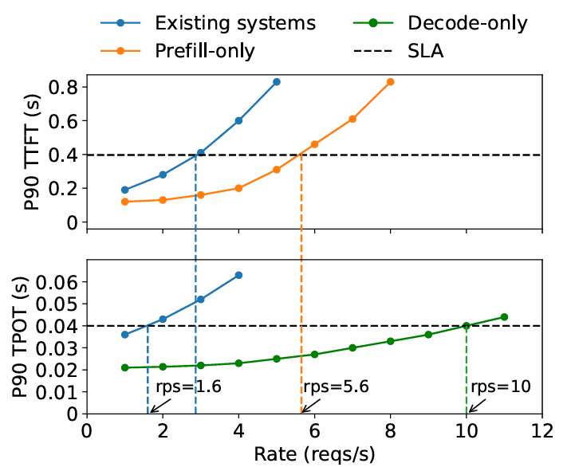

- 实验设置：13B参数的LLM部署在英伟达A100(80GB)上，使用相同的负载，输入长度512，输出长度64

- 横轴：request rates

- ==上图纵轴==：P90 TTFT

  表示 90% 的请求，其首个 token 等待时间不超过这个值。

  例如：P90 TTFT = 0.4 秒

  表示：

  - 90% 的请求能在 0.4 秒内看到第一个 token；
  - 最慢的 10% 请求需要超过 0.4 秒。

- ==下图纵轴==：P90 TPOT

​	论文先计算每个请求的平均 TPOT：

​	\[ TPOT_i = \frac{\text{第一个 token 之后的生成时间}} {\text{后续生成的 token 数}} \]

​	然后对所有请求的 TPOT 取第 90 百分位数。

​	例如：P90 TPOT = 0.04 秒

​	表示 90% 的请求平均生成一个后续 token 的时间不超过 0.04 秒，即约40 	ms/token。

- ==SLA 虚线==：服务等级协议，是服务提供方与客户之间的正式约定。
- 论文如何计算 per-GPU goodput：只有一张GPU，直接用goodput就行了。
- 图在支持什么论点：将prefill与decode阶段分开来，在不同的GPU上计算，可以显著提升吞吐量。==理想解耦方案使用两张 prefill GPU 和一张 decode GPU，整体 goodput 为 10 rps，因此 per-GPU goodput 约为 3.3 rps/GPU，是现有系统的约 2.1 倍。==
- ==我的理解==：在prefill-only时，request rate可以达到5.6reqs/s P90 TTFT才会下降到0.4。而在decode-only时，request rate可以达到10reqs/s P90 TPOT才会下降到0.04。都比现有系统更高。因为decode阶段的request rate几乎是prefill阶段的两倍，所以作者提出了最佳的解耦方案：使用两张 prefill GPU 和一张 decode GPU，整体 goodput 为 10 rps，因此 per-GPU goodput 约为 3.3 rps/GPU，是现有系统的约 2.1 倍。
- ==当前问题==：对于existing system来说，他们的吞吐量是和显卡数量成正比的吗，如果我使用两张显卡来运行这个系统，把最终的per GPU goodput计算出来，会和只用一张卡的一样？

### 本节读完后再回答

1. 为什么一次 LLM 请求需要分别用 TTFT 和 TPOT 衡量 latency？

   **答：**两个latency计算的是不同阶段的延迟，TTFT衡量的是prefill的速度，TPOT衡量的是decode的速度。为了提升用户体验，不同的LLM应用对于TTFT和TPOT有不同的要求。

2. 为什么 Figure 1 中整体 goodput 由更早违反 SLO 的指标决定？

   **答：**随着 request rate 增大，排队和执行延迟通常会上升。一个请求需要同时满足 TTFT 和 TPOT SLO，因此其中任何一项先超过限制，系统就不能继续提高有效请求率。==整体 goodput 是两项指标都仍满足 SLO 时的最大 request rate。==

3. Throughput 很高为什么不一定代表 goodput 很高？

   **答：**Throughput 统计系统完成的全部工作，即使部分请求已经违反 latency SLO；goodput 只衡量满足 SLO 的有效服务能力。因此，大 batch 可能提高 token throughput，同时增加排队和延迟，导致 goodput 并不高。

4. 共置为什么会造成 prefill-decoding interference？

   **答：**Prefill 和 decode 共用同一组 GPU、batch 和执行队列。==混批时，较长的 prefill 会拉长整个 batch 的执行时间，使 decode 等待并提高 TPOT==；decode jobs 也会增加 prefill 的执行时间。即使分开调度，两者仍会在同一组 GPU 上互相排队。

5. 共置为什么会造成 resource and parallelism coupling？

   **答：**共置使 prefill 和 decode 共享同一个 model instance 和同一组 GPU，因此两边被迫使用相同的资源数量和 model-parallel configuration。但两个阶段的计算特征和 latency requirements 不同，无法分别选择最适合自己的并行策略和资源配置。

6. Disaggregation 新增了哪些资源或通信开销？

   **答：**Prefill 和 decode instances 需要分别保存模型权重，增加了模型副本和 GPU 显存开销；prefill 完成后还需要向 decode instance 传输 KV cache 等中间状态，消耗 GPU 间带宽并产生额外通信延迟。如果两阶段的资源比例不合适，还可能产生 pipeline bubbles 和 GPU 空闲。

### 我的笔记

- 我的复述：参考本节主线。
- 当前问题：暂无。

## 2. Background and Motivation

### 本章阅读目标

- 补齐 prefill、decode、continuous batching 和 model parallelism 背景。
- 理解论文为什么认为已有缓解方法仍不能消除 interference。
- 明确 disaggregation 带来的机会和新增约束。

### 2.1 LLM Inference

#### 阅读目标

- 比较两个阶段每次处理的 token 数量。
- 判断两个阶段分别更接近 compute-bound 还是 memory-bandwidth-bound。
- 记录 KV cache 在两个阶段中的产生、保存和使用方式。

#### Prefill / Decode 对照表

| 对比维度 | Prefill | Decode |
| --- | --- | --- |
| 每步处理的 token 数 | 很多 | 一个 |
| 能否利用 token-level parallelism | 可以，所有token全部已知，可通过 causal mask 并行计算 | 每个请求每步只能处理一个新的token；一个batch处理一个请求。 |
| 主要计算形式 | 较大的 matrix-matrix multiplication（GEMM）以及 prompt attention | Matrix-vector / small-batch GEMM，并读取已有 KV cache 计算 attention |
| 主要硬件瓶颈 | ==compute-bound== | ==memory-bandwidth-bound== |
| latency metric | TTFT | TPOT |
| KV cache 行为 | 为全部 prompt tokens 生成并保存 KV cache，随后交给 decode | 反复读取已有 KV cache，并在每一步追加新 token 的 K/V |

#### 本节读完后回答

1. Prefill 为什么可以并行处理整个 prompt？

   **答：**   因为Prefill阶段每个token都是已知的，因此可以并行处理。

2. Decode 为什么对单个 request 只能逐 token 生成，却仍然可以在多个 requests 之间 batching？

   **答：**单个 request 的下一个 token 依赖此前已经生成的 token，因此不能并行生成多个未来 token；不同 requests 之间彼此独立，可以把每个 request 当前的一个 token 组成 batch，共用同一套模型参数在 GPU 上并行计算。每个 request 仍然使用各自的 KV cache。

3. 为什么两个阶段都要读取模型权重，但硬件瓶颈可能不同？

   **答：**Prefill 一次处理大量 prompt tokens，读取一次模型权重后可以对许多 tokens 进行计算，主要使用大规模 matrix-matrix multiplication，计算密度较高，因此通常是 compute-bound。Decode 每个 request 每步只处理一个新 token，却仍需要读取完整模型权重和历史 KV cache，计算量相对较少、数据读取量较大，因此通常是 memory-bandwidth-bound。

4. KV cache 为什么使两个阶段之间存在数据依赖？

   **答：**因此 decode 必须接收 prefill 产生的 KV cache，才能直接继续生成；否则就需要重新执行 prefill。此后 decode 每生成一个 token，还会继续向 KV cache 中追加新的 K/V。

#### 我的笔记与问题

- ==我的复述==：prefill阶段需要并行计算KV cache，是compute-bound；decode阶段需要读取以前的KV cache，是memory-bandwidth-bound。
- 当前问题：暂无

### 2.2 LLM Serving Optimization

#### 阅读目标

- 理解 continuous batching。
- 区分 intra-operator parallelism、inter-operator parallelism 和 replication。
- 记录不同策略对 execution time、queuing delay、rate capacity 和通信量的影响。

#### 并行策略对照表

| 策略 | 基本做法 | 主要收益 | 主要代价 | 更影响 TTFT 还是 TPOT |
| --- | --- | --- | --- | --- |
| Continuous batching | 将新request的prefill和正在进行的decoding放置到一起。 | 提高了GPU利用效率 | 需要在TTFT和TPOT之间权衡 |  |
| **Intra-operator** parallelism（TP，tensor并行） | 把计算密集型算子进行划分 | 减少了执行时间，从而降低了延迟，尤其是在预填充阶段的TTFT中 | 需要GPU之间较大的带宽 | TTFT和TPOT都有效，对TTFT更有效 |
| **Inter-operator** parallelism（PP，流水线并行） | 将LLM层组织成一个一个阶段，每个阶段跑在一张GPU上 | 随着每个GPU的增加，系统的速率容量呈线性扩展 | 由于级间通信，它适度增加了执行时间 |  |
| Replication（DP，数据并行） | 建立多份相同的模型实例，每个实例独立处理不同的 requests。 | 可以线性扩大系统的速率 | 更多的GPU |  |

#### 本节读完后回答

1. Continuous batching 为什么能提高 GPU utilization？

   **答：**能够尽可能地利用GPU并行地特性，将读取模型参数的时延分配给更多的request，从而提高GPU利用效率。Continuous batching 在每次迭代后动态移除已完成的 requests，并将新 requests 加入空出的 batch slots，使 batch 持续保持较高的并发度，从而更充分地利用 GPU 的并行计算能力，并提高 throughput。

2. Chunked prefill 想解决什么问题，又引入什么 trade-off？

   **答：**想解决由将prefill和decode放在一个batch内而导致的TTFT和TPOT平衡问题。但最终牺牲了TTFT来换取TPOT。

3. Intra-op 与 inter-op parallelism 分别怎样影响单次 execution time 和系统 rate capacity？

   **答：**Intra-op parallelism 将同一个算子切分到多张 GPU 上共同计算，主要用于缩短单次 execution time，从而降低 TTFT 或 TPOT；但它需要频繁的 GPU 间通信，速度提升通常不是线性的。Inter-op parallelism 将不同模型层分配到不同 GPU stages，单个 request 需要依次经过所有 stages，execution time 可能略微增加；但多个 requests 可以在不同 stages 中形成流水线，因此能够近似线性提高系统的 rate capacity。

4. Replication 与 model parallelism 的作用有什么不同？

   **答：**Replication 创建多个完整的 model instances，每个 replica 独立处理不同 requests，主要用于扩大系统 rate capacity 和降低排队延迟，但不会直接缩短单个 request 的 execution time，并且需要保存多份模型权重。Model parallelism 则将一个 model instance 切分到多张 GPU 上共同执行，可以让大模型跨 GPU 部署；==其中 intra-op 主要缩短 execution time，inter-op 主要通过流水线提高 rate capacity，但都会引入 GPU 间通信。==

#### 我的笔记与问题

- 我的复述：
- 当前问题：暂无

### 2.3 Problems and Opportunities

#### 阅读目标

- 把问题分成 interference、ineffective scheduling 和 resource coupling。
- 理解为什么仅调整 scheduling priority 不能解决两个 SLO 的冲突。
- 明确 prefill instance 与 decoding instance 的职责边界。

#### 图表记录：Figure 2（PDF 第 5 页，论文第 196 页）

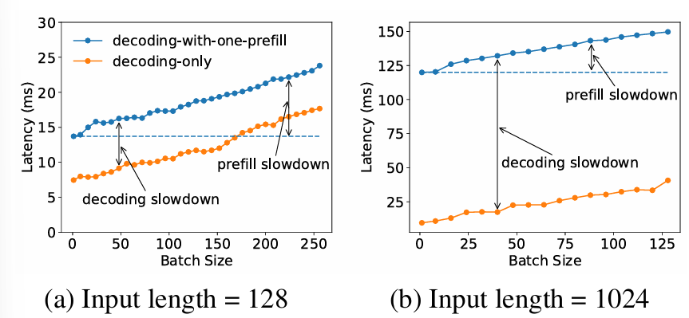

- 两个子图改变了什么变量：Input length
- Decoding-only baseline：只解码的表现
- 加入一个 prefill job 后：decode速度变慢了
- Input length 对 slowdown 的影响：input length越长，decode慢的越多。
- ==Prefill slowdown==：从batch size=0（也就是没有decode）开始与某一个batch大小相减，得到的就是引入不同大小batch的decode导致的时延。
- ==Decoding slowdown==：同样的batch大小下，添加了prefill导致时间的推迟
- ==图在支持什么论点==：就算GPU已经接近满载（长度1024），在此时添加decoding任务也会导致prefill任务的推迟。
- ==我的理解==：prefill和decode会相互影响。添加一个prefill到一个decoding request的batch中，双方都会被延缓，导致TTFT和TPOT的增加。就算GPU已经接近满载（长度1024），在此时添加decoding任务也会导致prefill任务的推迟。
- 当前问题：暂无

#### 本节读完后回答

1. Prefill 与 decode 放在同一个 batch 时，为什么两边都会变慢？

   **答：**decode需要等待prefill完成后才能结束。prefill需要较多的计算能力，将decode jobs加入进来，会占用计算单元。

2. 将 long prefill 切成 chunks 为什么只能缓解而不能消除 interference？

   **答：**因为它只是减轻了由长prefill导致的decode延缓，并没有消除。而且还会对prefill引入额外开销

3. 不混批、改为顺序调度为什么仍然会产生 queuing interference？

   **答：**decoding jobs需要等待正在GPU上prefill的部分。如果优先执行 prefill，就会使 decode 的延迟恶化；如果优先执行 decode，就会使 prefill 的延迟恶化。

4. Disaggregation 后为什么可能出现多个 prefill instances 对应一个 decoding instance？

   **答：**因为decoding计算的GPU利用率总是很低。多个 prefill instances 可以同时完成更多 requests 的 prefill，并把这些 requests 交给同一个 decoding instance。这样 decoding instance 每一轮就能把更多 requests 的 decode jobs 组成一个较大的 batch。

5. Disaggregation 把原问题转换成了哪些新的 placement 和 communication 问题？

   **答：**Disaggregation 后，prefill 必须把 KV cache 等中间状态传输给 decode，带来了额外的传输延迟、带宽占用和显存需求。系统还需要联合决定两个阶段的 GPU 数量、并行与复制策略以及物理节点位置，使两边处理能力匹配，并尽量让 KV cache 通过高带宽链路传输。

#### 我的笔记与问题

- ==我的复述==：PD相互影响、拖延。
- 当前问题：暂无

## 3. Tradeoff Analysis

### 本章阅读目标

- 分别分析 prefill 和 decode 的 batching、queuing 与 parallelism。
- 找出决定两阶段最优配置的变量。
- 理解后续 placement algorithm 的分析基础。

### 3.1 Analysis for Prefill Instance

#### 阅读目标

- 找到 prefill 从未饱和到 compute-bound 的临界点。
- 理解为什么 prefill batch size 通常不需要很大。
- 比较低 arrival rate 和高 arrival rate 下的 intra-op / inter-op 选择。

#### 图表记录：Figure 3(a)（PDF 第 6 页，论文第 197 页）

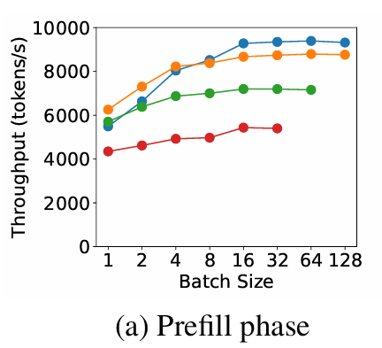

- 横轴：Batch size

- 纵轴：throughput吞吐量 tokens/s

- 不同曲线：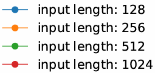

- Throughput 的拐点：batch size = 8-16

- 临界 input length \(L_m\)：512

- ==对 batching strategy 的启示==：需要预先对特定的LLM和GPUs进行了解，来确定一个特定的输入长度阈值，符号为$L_m$，只有当长度低于这个值的时候，才考虑将更多的requests放到batch中。实际上使用者的提示词长度通常是几百个token，所以在prefill阶段的batch size总体被保持的很小。

- ==我的理解==：

  当input length达到512的时候会完全占用A100 GPU。当已经达到compute-bound的时候，向batch内增加更多的request不能再提高GPU的效率，反而，他会按比例地拓展整体batch的处理时间，无意中拖延了batch中所有requests。

  **对于图3（a）**

  例如 length=512：

  \[ T_{\mathrm{batch}} = \frac{\text{batch size}\times512}     {\text{throughput}} \]

  粗略按照 Figure 3：

  \[ T(1)\approx\frac{512}{5600}=0.09s \]

  \[ T(16)\approx\frac{16\times512}{7200}=1.14s \]

  所以虽然吞吐量从约 5600 墦加到 7200 token/s，但 batch 执行时间从约 0.09 秒增加到了 1.14 秒。对于强调 TTFT 的 prefill 来说并不划算。

  因此==**作者提出阈值** \(L_m\)：==

  - 请求长度小于 \(L_m\)：GPU 尚未充分利用，可以 batching；
  - 请求长度大于 \(L_m\)：单个请求已经接近 compute-bound，应采用较小 batch，甚至不 batching。


#### 公式记录：Eq. (1)-(3)（PDF 第 6 页，论文第 197 页）

##### Eq. (1)：单设备 M/D/1 queue

$$
\mathrm{Avg\_TTFT}
=
D+\frac{RD^2}{2(1-RD)}.
\tag{1}
$$

- 各变量含义：

  \(R\)：请求到达率，单位通常是 requests/s。

  \(D\)：一个请求确定的服务时间；在这里可以理解为 prefill 的执行时间。

  \(RD\)：服务实例的利用率，通常记作 \(\rho\)。

  \(D\)：请求真正占用 GPU 执行 prefill 的时间。

- ==Execution time（实际prefill）==：D

- ==Queuing delay（排队时间）==：$\frac{RD^2}{2(1-RD)}$

##### Eq. (2)：2-way inter-op parallelism【PP】

$$
\mathrm{Avg\_TTFT}_{\mathrm{inter}}
=
D_s
+
\frac{R D_m^2}{2(1-RD_m)}
=
D
+
\frac{R D^2}{4(2-RD)}.
\tag{2}
$$

- 相比 Eq. (1) 改变了什么：D≈$D_s$≈2×$D_m$，$D_s$是指request走完各个prefill层级的延迟（忽略层间延迟约等于D），最慢的stage用了$D_m$才完成。

##### Eq. (3)：2-way intra-op parallelism 【TP】

$$
\mathrm{Avg\_TTFT}_{\mathrm{intra}}
=
\frac{D}{K}
+
\frac{R D^2}{2K(K-RD)}
\tag{3}
$$

- Speedup coefficient \(K\)：加速系数，由于内部传输开销导致的不完美加速。达不到2
- $D_s = \frac{D}{K}$
- 相比 Eq. (2) 的 trade-off：
- ==我的理解==：在较低的速率时，计算时间（第一项）是主要的影响因素，intra-op并行在计算上的加速，让他效率更高；但当速率上升时，排队延迟（第二项）逐渐上升，inter-op并行就变得逐渐领先，结合图4（a）也可以看出。

#### 图表记录：Figure 4（PDF 第 6 页，论文第 197 页）

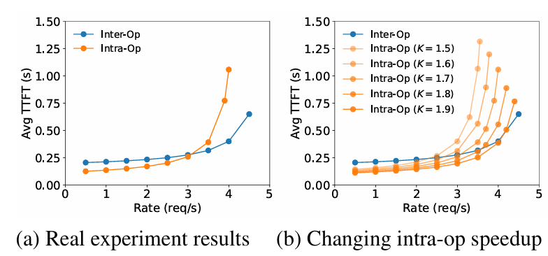

- Figure 4(a) 的实验设置：一个66 B参数的LLM模型使用不同的并行策略，跑在两张A100 GPU上。

- Arrival rate 较低时：Intra-Op更有优势

- Arrival rate 较高时：Inter-Op更有优势

- Figure 4(b) 改变了什么：改变了不同的加速系数K

- \(K\) 对选择的影响：K越小，效率越低

- TTFT SLO 对选择的影响：一个越严格的SLO会让intra-op更有优势，因为它可以减少运行时间。

- ==我的理解==：**请求率低，用intra-op；请求率高，用inter-op。**

  TTFT 可以拆成：

  \[ \mathrm{TTFT} = \text{请求自身的执行时间} + \text{排队时间} \]

  因此，不同负载下，优化重点不同。

  **请求率较低：intra-op 更好**

  低负载时几乎不用排队，TTFT 主要由执行时间决定。

  intra-op，也就是类似 TP，让两张 GPU 共同计算一个请求：

  \[ D_{\mathrm{intra}}=\frac{D}{K},\qquad 1<K<2 \]

  它可以缩短单个请求的执行时间，所以低负载或 TTFT SLO 很严格时更有优势。

  **请求率较高：inter-op 更好**

  inter-op，也就是类似 PP，把模型分成流水线阶段：

  - 一个请求的端到端执行时间仍接近 \(D\)；
  - 但流水线填满后，可以同时处理多个请求；
  - 大约每 \(D/2\) 时间就能接收或完成一个请求；
  - 因而提高系统处理速率，减少排队时间。

  所以高负载时，虽然 inter-op 没有明显缩短单个请求的纯执行时间，但它能防止请求在队列中越积越多。

  **可以类比为：**

  - **intra-op**：两个人一起为一个顾客服务，单个顾客完成得快；
  - **inter-op**：两个人组成流水线，单个顾客未必更快，但顾客多时队伍消化得更快。

- 当前问题：暂无

#### 本节读完后回答

1. Prefill batch size 为什么存在收益饱和点？

   **答：**因为prefill阶段是compute-bound，所以当当前计算量使GPU满载时，继续扩大batch size就会导致收益饱和。

2. 为什么低 arrival rate 更关注 execution time，而高 arrival rate 更关注 queuing delay？

   **答：**因为低arrival rate时，计算时间占主导；高arrival rate时，queuing delay占主导。

4. \(K\) 由哪些硬件、模型和 workload 因素决定？

   **答：**由输入长度，模型架构，传输带宽和放置。

#### 我的笔记与问题

- 当前问题：暂无

### 3.2 Analysis for Decoding Instance

#### 阅读目标

- 理解 decode 为什么需要较大的 batch 才能提高 GPU utilization。
- 记录 batch size 受到 KV cache capacity 的限制。
- 比较 intra-op、inter-op 与 replication 对 decode 的影响。

#### 图表记录：Figure 3(b)（PDF 第 6 页，论文第 197 页）

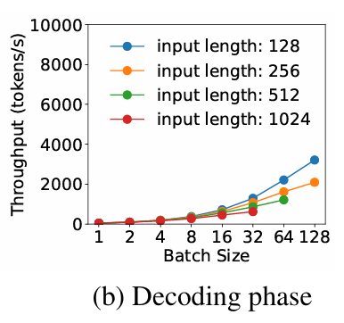

- Batch size 与 throughput 的关系：Batch size越大，troughput越大。
- Input length 的影响：Input length越长，troughput越小
- 与 prefill 曲线的差异：在decode阶段，batch size越大，吞吐量提升越多；与prefill相反。
- ==我的理解==：decode阶段需要较大的batch才可以提高 GPU utilization，与prefill阶段，在达到compute-bound之后，吞吐量随着batch size上升不明显完全相反。而将这==两个阶段分开==，就可以解决这个问题。

#### 图表记录：Figure 5（PDF 第 7 页，论文第 198 页）

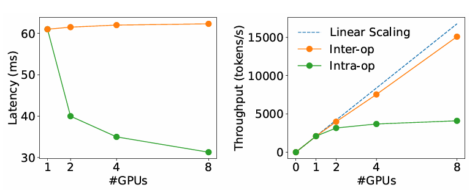

- 实验设置：13 B的模型，128的batch size和256的输入长度，在不同并行度下，decoding阶段的延迟和吞吐量
- 左图 latency：在intra-op方式下，随着GPU增加，延迟降低；在Inter-op方式下，随着GPU增加，延迟几乎不变。
- 右图 throughput：在在intra-op方式下，随着GPU增加，吞吐量增加较慢，且随GPU增加到2，吞吐量增长放缓；在Inter-op方式下，随着GPU增加，吞吐量增长近乎线性。
- Intra-op：在单个算子内部切分计算，典型方法是 Tensor Parallelism。
- Inter-op：将不同算子或模型层分配给不同设备，典型方法是 Pipeline Parallelism。
- TPOT SLO 对选择的影响：要是TPOT要求严格，Intra-op对于达成更低的延迟目标有更好的效果。除此之外，Inter-op更能以线性的方式增强吞吐量。
- ==我的理解==：注意TPOT就使用Intra-op，需要线性拓展吞吐量，就使用Inter-op。
- 当前问题：暂无。

#### 本节读完后回答

1. Decode 为什么通常需要 batching 才能充分利用 GPU？

   **答：**因为decode阶段通常只需要计算一个输出token，batching之后，可以在一次decode中为多个requests各生成一个token，复用了模型参数，平摊了传输模型参数的成本。还能形成规模更大的矩阵计算，从而提高GPU利用率。

2. Decode batch size 为什么受 KV cache memory 限制？

   **答：**因为当KV cache memory占用变大时，同样大小的显存就没办法容纳同样数量的request了，从而限制了batch size。

3. Batch 很大时，decode 的计算特征为什么会逐渐接近 prefill？

   **答：**decode的计算量会随着batch size的增大而增大，当batch size很大时，就会逐渐从memory-bandwidth-bound变为compute-bound。

4. 什么情况下更适合 intra-op，什么情况下更适合 inter-op 或 replication？

   **答：**当对于TPOT要求较高时，也就是要求TPOT很小的时候，就使用intra-op。当TPOT SLO有余量，主要目标是提高系统的rate capacity时，inter-op 可以利用流水线近线性地拓展吞吐能力。如果完整模型可以放入单张GPU，也可以使用replication，从而提高总处理能力并减少排队延迟。

#### 我的笔记与问题

- ==我的复述==：decode需要较大的 batch 才能提高 GPU utilization，在TPOT要求很高时，就使用intra-op，否则可以使用Inter-op或者replication，提升总处理能力并减少排队延迟。
- 与 PagedAttention 的联系：可以利用PagedAttention，在此基础上建立decoding instance。
- 当前问题：暂无。

### 3.3 Practical Problems

#### 阅读目标

- 检查 uniform prompt length 假设在真实 workload 中的问题。
- 量化 KV cache transfer 的大小和带宽需求。
- 理解 node affinity 为什么会影响 placement。

#### 记录重点

- Variable prefill length：==真实的部署场景是无法确定request长度地==，不统一的情况会导致prefill阶段的==流水线气泡==。会导致由M/D/1模型得出的排队模型结论有些许偏差。
- KV cache size 示例：在OPT-66B模型上，一个512-token的request会占用大致1.13GB的KV cache，如果假设request到达率为10个request每秒，那每秒就需要传输11.3GB的数据，相当于90Gbps的带宽（而论文真是跨节点只有25Gbps），才可以使开销不可见。
- Intra-node bandwidth：600GB/s
- Cross-node bandwidth：800Gbps

#### 本节读完后回答

1. 不同请求的 prompt 长度不一致，为什么会影响 inter-op pipeline efficiency？

   **答：**inter-op 将模型的不同层划分到多个 pipeline stages，并依靠不同 requests 在各阶段重叠执行来提高吞吐量。由于 prefill 的执行时间与 prompt 长度有关，当不同 requests 的 prompt 长度差异较大时，各请求占用 pipeline stage 的时间也不同。==长请求可能长时间占用某个 stage，使其他请求或其他 stages 等待输入，产生 pipeline bubbles==，从而降低 GPU 利用率和 pipeline throughput，并增加 TTFT。

2. 如何估算单位时间内需要传输的 KV cache 数据量？

   **答：**arrival rate乘上request占用的平均KV cache。

3. “通信开销可忽略”依赖哪些硬件和 placement 条件？

   **答：**==带宽足够高时，可以使用 InfiniBand；跨节点带宽不足时，需要把相互通信的 prefill 和 decoding instances 放在同一节点内，通过 NVLink 传输。==

4. 后续算法需要联合考虑哪些输入变量？

   **答：**一句话概括：模型+workload+SLO+集群拓扑--->parallelism+实例数量+placement

#### 我的笔记与问题

- ==我的复述==：不同请求的 prompt 长度不一致，会导致流水线气泡。想要忽略传输开销必须要依赖IB或者NVLink。
- 当前问题：placement条件是什么？第四章才讲。

## 4. Method

### 本章阅读目标

- 明确 placement 的定义、输入、输出和优化目标。
- 区分 high node-affinity 与 low node-affinity cluster。
- 走通 simulator、搜索、replication 和 online scheduling 的关系。

### 本章入口问题

1. DistServe 的 placement 需要同时决定哪三类事情？

   **答：**需要决定（a）对于prefill和decode阶段的instances怎么并行，（b）每种instance需要多少，（c）如何把他们放置到物理cluster上。

2. 为什么不能只用一个 closed-form formula 直接求解最优 placement？

   **答：**

### 4.1 Placement for High Node-Affinity Cluster

#### 阅读目标

- 理解高带宽跨节点网络放宽了什么约束。
- 走通“阶段内优化 parallelism，再用 replication 匹配 traffic rate”的两层过程。
- 理解 simulator 和 binary search 分别做什么。

#### 算法记录：Algorithm 1（PDF 第 8 页，论文第 199 页）

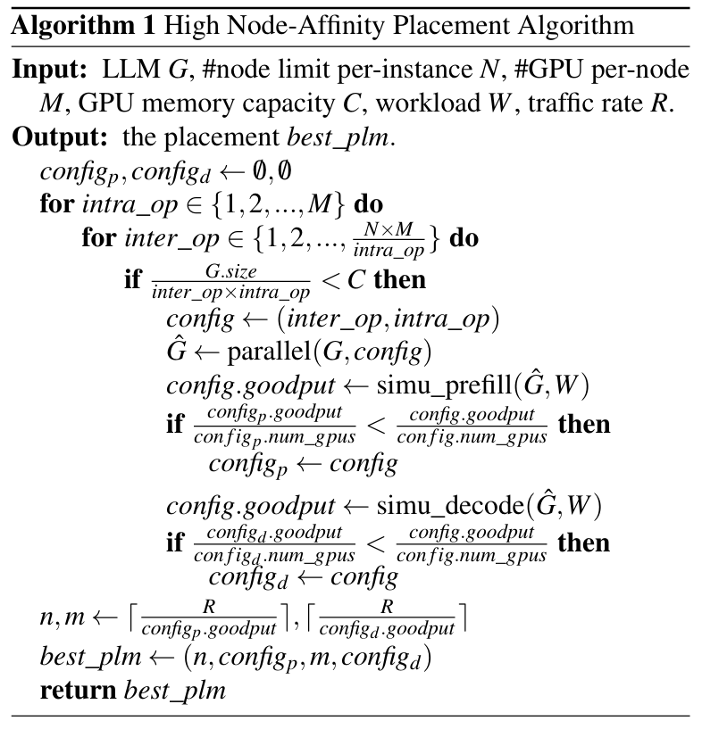

- 输入：

  - G：LLM大模型
  - N：一个instance最多允许跨越多少台服务器
  - M：每台服务器中有多少张GPU
  - C：GPU显存容量
  - W：工作负载，来自于历史request traces，并从中拟合workload分布，然后从该分布中重新采样，生成新的模拟请求。
  - R：目标流量，最终用R/goodput就是为了计算prefill和decode分别需要的instances的数量。

- 输出：best_plm:最好的placement

- 枚举变量：intra_op和inter_op

- Feasible condition：

- `simu_prefill`：接收了模拟请求W和已经按照当前配置方式配置的模型$\hat G$，模拟prefill阶段得到goodput值

- `simu_decode`：接收了模拟请求W和已经按照当前配置方式配置的模型$\hat G$，模拟decode阶段得到goodput值。

- Phase-level per-GPU goodput：将该goodput/使用的GPU数量。

- Replication 数量：根据目标流量R，用R/goodput就是为了计算prefill和decode需要的instances的数量，以该数量为目标进行replication。

- 时间复杂度：$O(NM^2)$

- 我的理解：详见复述。

- 当前问题：resample是怎么做的？随机采样吗？

  DistServe 根据历史 trace 拟合请求到达过程及输入、输出长度分布，再按照这些分布随机重采样生成模拟 workload。论文没有交代生产场景中使用的具体分布拟合方法；在实验中，请求长度来自选定的数据集，请求到达时间则按照 Poisson process 生成。

#### Simulator 记录

- ==Workload trace 如何获得==：从历史请求日志中收集请求到达时间、input length 和 output length，拟合其统计分布，再从该分布中随机重采样，生成供 simulator 使用的新 trace。
- ==Latency model 的作用==：根据FLOPs和可以使用的内存来估算一次推理运行时间。比如prefill latency model就预测：当前 prefill batch 中所有 prompt tokens 完成一次模型 forward pass 所需的时间；decode latency model就预测：一个 decoding instance 完成**一次 decode iteration** 所需的时间。
- SLO attainment 如何估计：不在真实GPU集群上测试，而是使用simulator估计。
- Maximum goodput 如何搜索：使用==二分查找法==查找不同的request率，使当前的goodput在满足SLO的同时达到最大值。

#### 本节读完后回答

1. ==为什么 high node-affinity 下可以分别优化 prefill 和 decode configuration？==

   **答：**因为集群具有高速跨节点网络，例如 InfiniBand，P/D instances 即使放在不同节点，KV cache 传输开销也可以近似忽略。因此二者没有必须同节点部署的 placement 约束，可以分别针对 TTFT 和 TPOT 选择最优 parallelism configuration。

2. Algorithm 1 为什么先找每个阶段的最优 per-GPU configuration，再做 replication？

   **答：**先解决“每个 instance 怎样配置最划算”，再解决“需要部署多少个 instances”。

3. Simulator 为什么需要 workload 的 arrival、input length 和 output length distributions？

   **答：**

   - arrival distribution 决定请求何时到达、是否突发，影响排队延迟；
   - input length 决定 prefill 计算时间、TTFT 和 KV cache 大小；
   - output length 决定 decode iteration 数量、请求占用 decoder 的时间，以及 active requests 和 KV cache 数量。

   Simulator 需要它们生成完整 workload trace，才能模拟队列、动态 batch、TTFT、TPOT 和 SLO attainment。只有平均 request rate 是不够的。

4. Binary search 搜索的变量是什么？

   **答：**变量是不同的request arrival rate。每次分别模拟判断该rate下的TTFT和TPOT是否满足SLO。满足就尝试更大的r，不满足就更小

#### 我的笔记与问题

- ==我的复述==：
  对于节点间带宽较高的cluster而言，作者提出的算法1：

  一个instance可以分到N个节点上，每个节点的GPU数量为M，显存容量为C；先考虑Intra-op，将分配给Intra-op的节点数量从1-M遍历，因此inter-op的遍历范围为1-$\frac{N \times M}{\text{intra\_op}}$

  接下来以当前的配置方式计算每个GPU的显存是否能够满足该模型的大小，不满足直接跳过当前配置方式

  如果满足，则开始分别评估prefill阶段以及decode阶段的 单GPU goodput，若当前阶段的 单GPU goodput大于历史最大，则记录下来。
  所有可能都遍历结束之后，将prefill和decode阶段最大的goodput配置分别取出来，再与目标request率相除，得到每个阶段该搭建的instance数量，从而才能达到最大值。

  > 可以理解成：
  >
  > \[ \boxed{ \mathrm{simu} = \text{workload 生成} + \text{排队与调度模拟} + \text{latency model} + \text{SLO 统计} + \text{goodput 搜索} } \]
  >
  > 论文伪代码把这些内部过程都封装在 `simu_prefill` 和 `simu_decode` 里了。

- 当前问题：暂无。

### 4.2 Placement for Low Node-Affinity Cluster

#### 阅读目标

- 理解跨节点带宽不足时，prefill/decode 为什么不能任意分开。
- 理解 Algorithm 2 为什么联合搜索一对 instances。
- 记录大模型跨节点放置的特殊情况。

#### 算法记录：Algorithm 2（PDF 第 8 页，论文第 199 页）

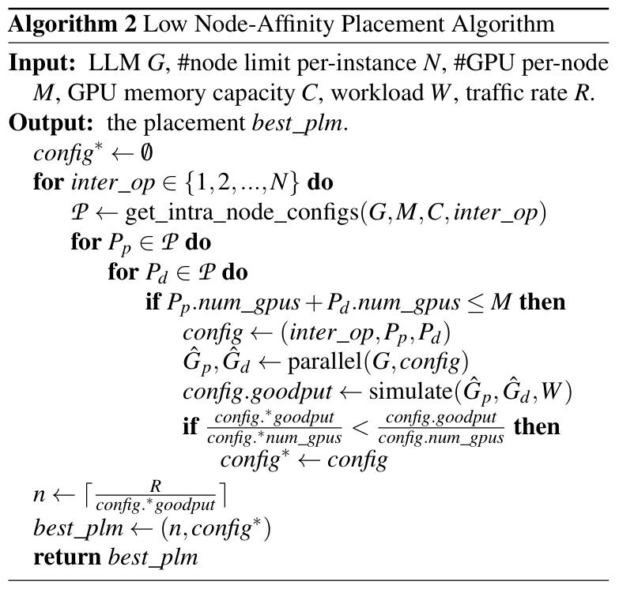

- 输入：
  - G：LLM大模型
  - N：一个instance最多允许跨越多少台服务器
  - M：每台服务器中有多少张GPU
  - C：GPU显存容量
  - W：工作负载，来自于历史request traces，并从中拟合workload分布，然后从该分布中重新采样，生成新的模拟请求。
  - R：目标流量，最终用R/goodput就是为了计算prefill和decode分别需要的instances的数量。

- 输出：best_plm:最好的placement

- ==get_intra_node_config==：

  固定 `inter_op` 后，模型已经被分成若干 stages。这个函数枚举一个 stage 在一台节点内可能采用的配置，例如：

  ```
  intra-op=1，使用1张GPU
  intra-op=2，使用2张GPU
  intra-op=4，使用4张GPU
  intra-op=8，使用8张GPU
  ```

  每种配置都要满足：

  \[ \frac{G.\mathrm{size}} {\mathrm{inter\_op}\times\mathrm{intra\_op}} <C \]

  即每张 GPU 上的模型权重分片必须能放入显存。

  这里得到的 \(\mathcal P\) 只是“物理上可行的候选菜单”，还没有判断哪一种性能最好

- ==枚举变量==： inter-op degree，即把模型切成多少个 pipeline stages；

- Intra-node GPU capacity constraint： intra-op的GPU总需求是否大于节点内GPU数量。公式：\(P_p.\mathrm{num\_gpus} + P_d.\mathrm{num\_gpus} \le M\)

- Joint simulation：再Algorithm 1中，simu是分别模拟的，然后将得到的最好结果分开来储存，但是在Algorithm 2中，simu是统一模拟的，因为Algorithm 2中的simu是将prefill与decode的intra-op比例固定好的，每一次测试都是不一样的prefill与decode的intra-op比例的测试

- Replication 数量：根据目标流量R，用R/goodput就是为了需要的instances的数量，以该数量为目标进行replication。

- 时间复杂度：不好计算

- 与 Algorithm 1 的==核心区别==：先划分inter-op，在不同的stage基础上做prefill和decode的intra-op。

- ==我的理解==：核心思想是把同一个pipeline stage的prefill segment和decode segment放在同一节点，这样KV cache就可以通过NVLink传输。

- ==当前问题==：算法二真的做到DP分离了吗？我总感觉还有一定程度的绑定关系？虽然是先优化后绑定的
  **答：**

  物理节点         **未完全分离**：对应 stages 必须同节点

  inter-op 划分  **绑定**：P/D 使用相同 stage 划分

  节点 GPU 预算 **绑定**：\(P_p.\mathrm{num\_gpus}+P_d.\mathrm{num\_gpus}\le M\)

  replication        **绑定**：整体复制联合 placement

#### 本节读完后回答

1. 为什么 low node-affinity 场景不能把两个阶段完全独立优化？

   **答：**因为low node-affinity场景下prefill和decode之间传输KV cache的速度受限，只能使prefill和decode维持在一个node中，借助NVLink完成。

2. 为什么 prefill/decode pair 通常需要共享一个 node 或高速互联域？

   **答：**因为prefill阶段完成的KV cache需要传输给decode阶段使用，因此需要借助高速互联域或者在一个node内。

3. 大模型无法在单节点放下完整 pair 时，算法如何扩展搜索空间？

   **答：**当完整 P/D pair 无法放入单节点时，Algorithm 2 枚举更大的 inter-op degree，将两个模型按相同的层边界切分为多个 instance segments，并把对应的 prefill/decode segments 放在同一节点。随后为每个 segment 枚举 intra-node configuration，从而把搜索空间从单节点完整 pair 扩展到最多跨 \(N\) 个节点的 stage-level paired placement，同时保证 KV cache 仍通过节点内 NVLink 传输。

#### 我的笔记与问题

- ==我的复述==：
- 当前问题：暂无

### 4.3 Online Scheduling

#### 阅读目标

- 记录请求如何分配给 prefill instance。
- 记录 KV cache 如何选择目标 decoding instance。
- 理解调度如何减少 pipeline bubbles 和负载不均。

#### 请求流程记录

1. Request arrival：到达一个centralized controller
2. Prefill instance selection：选择 prefill 队列最短的 instance
3. Prefill execution：完成 prefill，产生 KV cache
4. KV cache destination selection：选择当前负载最低的 decoding instance
5. KV cache transmission：prefill完成后，将KV cache存储起来，当decode instance有容量、准备处理的时候，才把所需的KV cache fetch过来。
6. Decode scheduling：
7. Request completion：

#### 本节读完后回答

1. Prefill scheduler 使用什么信息选择 instance？

   **答：**prefill 队列长度

2. Decoding instance 的选择为什么需要考虑已有 workload 和 KV cache capacity？

   **答：**

4. 离线 placement 与在线 scheduling 分别解决什么问题？

   **答：**离线placement完成了per-GPU goodput的最大化，主要解决了资源分配的问题。在线scheduling是在资源分配固定之后，根据当前真实负载压力灵活变动，应对请求长度变化和突发到达等情况，以及workload大范围波动时的处理。

#### 我的笔记与问题

- ==我的复述==：
  基础的调度顺序：首先会将新的请求加入到prefill队列最短的instance中，在完成prefill之后产生了KV cache，不会直接发往负载最低的decode instance，而是在decode instance由容量且准备处理的时候，才把所需要的KV cache拿过来，这样可以减少decode instance的压力。

  为了减少流水线气泡，作者发现batch中新增的token数量能近似反映它的执行时间，所以作者分析了目标模型和GPU来确定一个能使GPU跑满的$L_m$（每个模型都要重新算一次），当有多个短请求，就把它们合并，使总 prompt tokens 接近 \(L_m\)；长度已超过 \(L_m\) 的请求：单独调度。

  系统还会监视workload，若发现明显变化，就用最近历史数据重新运行 placement algorithm，然后重新部署合适的 P/D 配置。这不是每次请求都重新规划；论文认为 workload 的显著变化通常是小时级，而 placement 搜索只需秒级、重新加载模型通常是分钟级，因此可以接受。

- 当前问题：暂无。

## 5. Implementation

### 本章阅读目标

- 确认 DistServe 位于 serving stack 的哪一层。
- 记录 controller、prefill instances、decoding instances 和 communication library。
- 关注 DistServe 与底层推理引擎的边界。

### 图表记录：Figure 6（PDF 第 9 页，论文第 200 页）

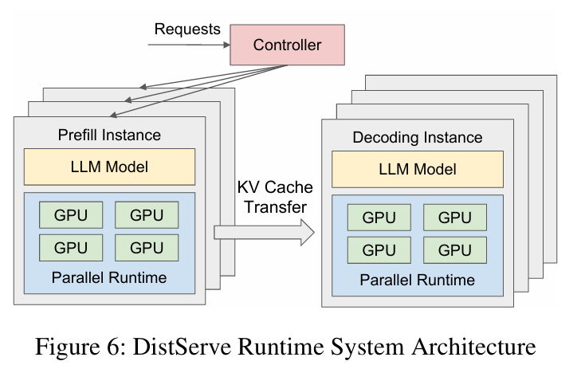

- 系统组件：一个部署算法模块、一个RESTfulAPI前端、一 个编排层和一个并行执行引擎。

### 实现速记

- 代码规模：部署算法模块、前端和编排层均使用6.5K行Python代码实现。并行执行引擎使用8.1K行C++/CUDA代码。
- 使用的语言/框架：
- 底层 inference engine：
- Model parallelism 支持：
- KV cache 通信实现：The orchestration layer 编排层
- 与 OpenAI API 的兼容：前端支持兼容 OpenAI API的接口

### 我的笔记与问题

- ==我的复述==：
- 当前问题：

## 6. Evaluation

### 本章阅读目标

- 核对实验比较是否公平。
- 区分 maximum per-GPU goodput 与 minimum achievable SLO 两类结果。
- 检查收益来自 disaggregation、tailored parallelism 还是 placement。

### 6.1 Experiments Setup

#### 阅读目标

- 记录模型、GPU、cluster topology、datasets、arrival process、SLO 和 baselines。
- 看懂 Table 1 与 Figure 7。
- 明确 goodput 和 SLO attainment 的计算方式。

#### 表格记录：Table 1（PDF 第 10 页，论文第 201 页）

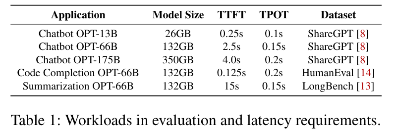

| Application | Dataset | TTFT SLO | TPOT SLO | ==备注== |
| --- | --- | --- | --- | --- |
| Chatbot | ShareGPT | 0.25s | 0.1s | 对于OPT-66和OPT-175B，我们会稍微延迟两个SLOs，因为模型执行延迟的增加。 |
| Code completion | HumanEval |  |  | SLO设置的很严格，但是没说设置为多少。 |
| Summarization | LongBench |  |  | 因为输入文本较长，采用宽松的TTFT，但是严格的TPOT。 |

#### 图表记录：Figure 7（PDF 第 10 页，论文第 201 页）

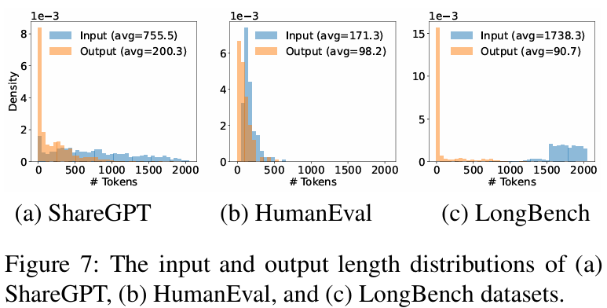

- 对 prefill/decode resource ratio 的预期影响：LongBench由于较长的input，会导致Prefill阶段的时间较长，所以对TTFT的设置较为宽松
- ==我的理解==：LongBench的input长度都分布在较长的位置，output分布都较短；而ShareGPT总体input长度分布的很均匀，output较短；HumanEval的input和output都较短。

#### 实验设置记录

- Models：OPT（不使用新的GPT模型是因为GPT使用了GQA和MQA这类memory efficient attention mechanisms）
- Node topology：a cluster with 4 nodes and 32 GPUs. Each node has 8 NVIDIA SXM A100 80GB GPUs connected with NVLINK.
- Arrival process：对于不同的request rate，使用Poission分布来生成到达时间。
- SLO attainment target：90%
- Baselines：vLLM（只支持Intra-op）， DeepSpeed-MII
- Metric 1：最大pre-GPU goodput
- Metric 2：最小SLO

#### 本节读完后回答

1. 三类 application 为什么使用不同的 TTFT/TPOT requirements？

   **答：**不同的application的workload不同，input长度较长时，很难达到目标TTFT。不同的使用场景，用户对于SLO的要求也会发生变化。

2. Request length distributions 为什么会改变最优 placement？

   **答：**输入长度分布决定 prefill 的计算量、TTFT 压力和产生的 KV cache 大小；输出长度分布决定 decode 要运行多少轮、KV cache 会增长多少，以及 TPOT 和显存压力。
   因此，不同 workload 会改变 prefill 与 decode 所需资源的比例、各自合适的并行方式和 instance 数量。并且 placement 要看整个长度分布（尤其长尾），不能只看平均长度。

3. 各 baseline 分别代表哪种 serving 或 scheduling 思路？

   **答：**

   - **vLLM**：共置式 serving。prefill 和 decode 共用同一组 GPU；使用 continuous batching 和 PagedAttention 提升吞吐量、管理 KV cache，但不消除两阶段干扰。论文中的 vLLM 仅使用 intra-op parallelism（TP）。
   - **DeepSpeed-MII**：共置式 serving + chunked prefill。将长 prompt 切块，与短 prompt 拼接以填满 token budget，从而缓解长 prefill 阻塞 decode；但两阶段仍共享 GPU，干扰没有被根除，并且 TTFT 可能变差。
   - **DistServe**：phase disaggregation。prefill 和 decode 使用独立 instance，并分别选择资源数和并行配置，再通过 KV cache 传输衔接。

#### 我的笔记与问题

- 当前问题：暂无。

### 6.2 End-to-end Experiments

#### 阅读目标

- 分别阅读 chatbot、code completion 和 summarization 结果。
- 区分“同一 SLO 下能承载多少 rate”和“同一 rate 下能满足多严格的 SLO”。
- 记录不同模型、workload 与 SLO 下的收益差异。

#### 图表记录：Figure 8（PDF 第 11 页，论文第 202 页）

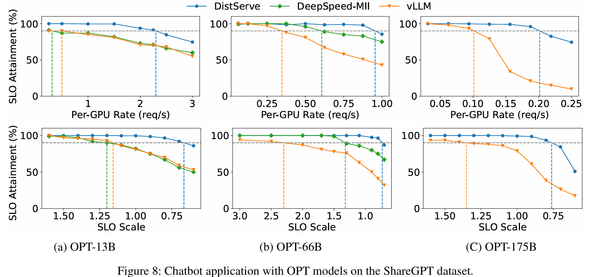

- Application / dataset：==ChatBot/ShareGPT==

- Models： OPT models

- Baselines：DeepSpeed-MII、vLLM

- SLO scale：

  固定 request rate，同时把 Table 1 中的 TTFT SLO 和 TPOT SLO 都乘以同一个系数。`scale = 1` 是原始 SLO；scale 越小，两个延迟要求越严格。
  例如 OPT-13B chatbot 原始要求为 TTFT \(0.25s\)、TPOT \(0.1s\)。若 scale \(=0.5\)，则变成 \(0.125s\) 和 \(0.05s\)。

- ==我的理解==：OPT-175B图中没有DeepSpeed-MII，这是因为kernel对形状有要求，每张GPU负责的词表大小必须是8的倍数，OPT-175B的词表大小是50272，只有当分到4张GPU时，才可以是8的倍数，但是4张GPU的显存大小没办法放下整个OPT-175B。因此oom了。

- 当前问题：暂无

#### 图表记录：Figure 9（PDF 第 12 页，论文第 203 页）

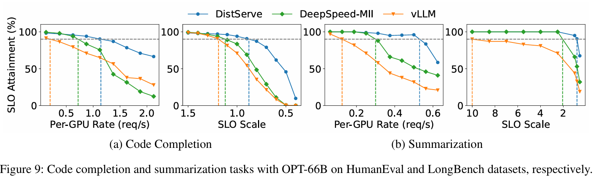

- 左半部分任务：Code Completion（OPT-66B）
- 右半部分任务：Summarization（OPT-66B）
- Workload length 特征：Code Completion的length更多的分布在较短的部分；Summarization的输入length较长，输出length较短。
- Baselines：DeepSpeed-MII、vLLM
- Per-GPU rate 结果：在Code Completion中，DistServe有5.7× 的request rate提升。在Summarization中，DistServe有 4.3×的request rate提升。
- SLO scale 结果：在Code Completion中，DistServe有1.4×的更严格的SLO scale。在Summarization中，DistServe有 12.6×的request rate提升。
- ==我的理解==：
- 当前问题：暂无

#### 本节读完后回答

1. DistServe 的 7.4× 与 12.6× 分别对应什么比较方式？

   **答：**7.4×来自于Chatbot对比实验中，和DeepSpeed-MII相比，最高有7.4倍的request rate提升。12.6×来自于Summarization对比实验中，和vLLM相比，最高有12.6倍更严苛的SLO。

2. 哪些 workload 获益最大，为什么？

   **答：**

   **Code completion**：相对 vLLM 的 request-rate 收益最大，为 **5.7×**。因为它的 TTFT SLO 极严格，成为主要瓶颈；DistServe 把 decode 干扰移走，并为 prefill 单独增加 intra-op parallelism，从而显著降低 TTFT。

   **Summarization / LongBench**：SLO 严格度收益最大，相对 vLLM 达 **12.6×**。因为 prompt 很长，若共置，长 prefill 会严重拖慢 decode；而此任务 TTFT 较宽松、TPOT 较严格，所以解耦对 TPOT 的改善特别显著。

   **Chatbot**：收益也明显，特别是 TPOT 较严格时；相对 DeepSpeed-MII 的最大 rate 收益 **7.4×** 出现在这组 chatbot 实验中。

3. 哪些结果说明 disaggregation 并非在所有 SLO 下都有相同收益？

   **答：**Figure 8、9 的 **SLO Scale 曲线**表明：当 SLO 较宽松时，各系统都容易达到接近 100% 的 attainment，DistServe 的相对优势较小；当 SLO 逐渐严格时，共置系统更早违反 TTFT 或 TPOT，DistServe 的优势才会显著扩大。

#### 我的笔记与问题

- 当前问题：暂无

### 6.3 Latency Breakdown

#### 图表记录：Figure 10（PDF 第 12 页，论文第 203 页）

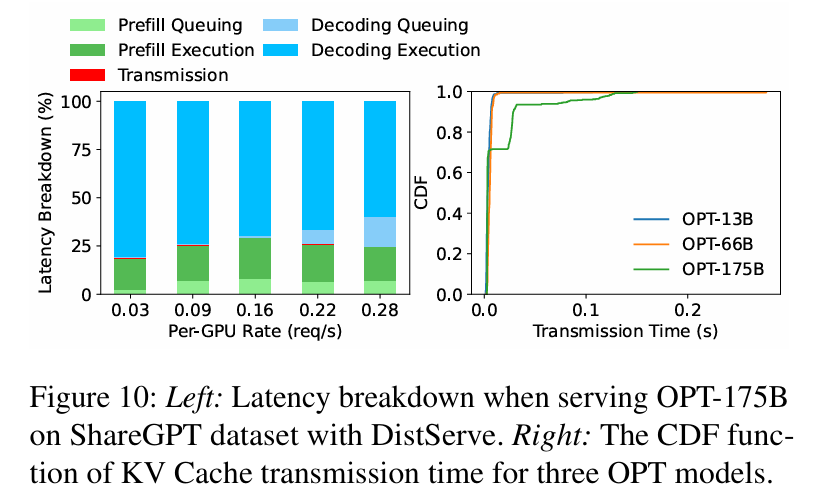

- Figure 10(a) 模型与 workload：OPT-175B在DistServe上，负载为ShareGPT，测量不同部分的延迟。
- Figure 10(b) 比较的模型：三个OPT模型
- KV cache transmission ==CDF==：传输时间的累积分布函数，即“某个Transmission time不超过 \(x\) 的样本比例是多少”
- ==我的理解==：KV cache的传输时间只占了总体延迟的不到0.1%，就算是通过展示传输时间的CDF，作者也发现尽管测试平台的节点间贷款很低，也有超过95%的request的延迟低于30ms，这就归因于第二种算法，把prefill和decode的instance都放置在一个机器中，启用节点内的NVLink带宽来传输。
- 当前问题：暂无

#### 本节读完后回答

1. End-to-end latency 由哪些部分组成？

   **答：**prefill queuing+prefill execution+decode queuing+decode execution+transmission。

3. 模型变大时，KV cache transmission time 如何变化？

   **答：**通常会变长，但是由于本论文采用的算法，把prefill和decode放在一个节点内，使用NVLink传输，所以变化不大

#### 我的笔记与问题

- 当前问题：暂无。

### 6.4 Ablation Studies

#### 表格记录：Table 2（PDF 第 13 页，论文第 204 页）

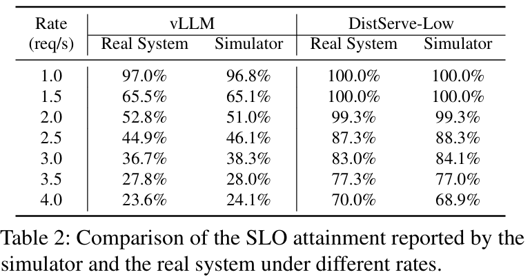

- 误差范围：在2%以内
- Simulator 是否足以支持 placement search：足以支持
- 当前问题：暂无。

#### 图表记录：Figure 11（PDF 第 13 页，论文第 204 页）

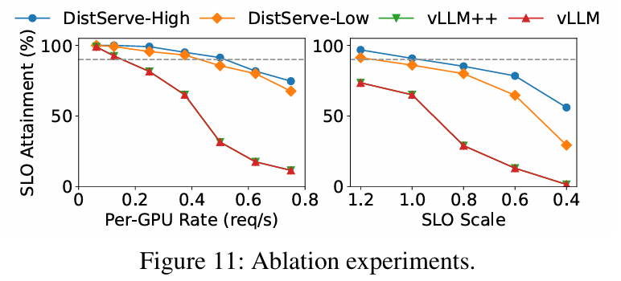

- Placement algorithm 的贡献：

  比较 **DistServe-High 与 DistServe-Low**。两者都做了 prefill/decode 分离，但 High 假设高跨节点带宽，placement 不必把对应 P/D stage 绑定在同一节点，因此搜索空间更大、资源分配更灵活，结果优于 Low。
  严格说，这个差距体现的是“**更宽松的网络拓扑约束 + 对应 placement algorithm**”带来的收益，不能只归因于算法本身。

- Tailored parallelism 的贡献：

- 比较 **vLLM++ 与 vLLM**。vLLM++ 会枚举可行的共置并行配置，但结果几乎与默认 vLLM 相同，说明只调整一套共同的并行配置无法明显改善性能。
  只有 P/D 分离后，才能分别为 prefill 和 decode 选择不同并行方式，tailored parallelism 才真正有用。

- 两项设计是否存在交互：
  **存在很强的交互。**disaggregation 消除了资源/并行耦合，才使 P/D tailored parallelism 成为可能；而 placement 决定这种分离在给定网络拓扑下能否高效实现。它们不是两个可以简单相加、完全独立的优化。

- ==我的理解==：Figure 11 不是在说“搜索更优 TP 就足够了”。`vLLM++ ≈ vLLM` 说明共置时调共同配置收益很小；`DistServe-Low ≫ vLLM++` 说明关键是先分离 P/D；`DistServe-High > DistServe-Low` 则说明若跨节点带宽更好，分离后的 placement 还能进一步减少约束、提升 goodput。

- 当前问题：用的全是模拟器？

#### 本节读完后回答

1. Table 2 验证了 simulator 的哪一项能力？

   **答：**对于attainment的预估是否正确

2. Figure 11 如何分别检验“只调并行参数”与“放宽 placement 约束”的收益？

   **答：**
   **只调并行参数的收益**：比较 `vLLM` 与 `vLLM++`。两者都保持 prefill/decode 共置；vLLM++ 额外枚举可行并行配置并选择最优。二者几乎没有差异，说明共置情况下，仅调整一套共同的并行参数难以提升 per-GPU goodput。

   **放宽 placement 约束的收益**：比较 `DistServe-Low` 与 `DistServe-High`。两者都已分离 P/D；Low 必须将对应 P/D stage 放同一节点，High 假设跨节点带宽高，可独立 placement。High 更好，说明放宽 KV 传输的拓扑约束能带来额外收益。

3. DistServe-Low 与 DistServe-High 的结果差异来自哪里？

   **答：**来自是否可以自由调整decode和prefill的并行方式，low会受到inter-op的限制。

#### 我的笔记与问题

- 当前问题：

### 6.5 Algorithm Running Time

#### 图表记录：Figure 12（PDF 第 13 页，论文第 204 页）

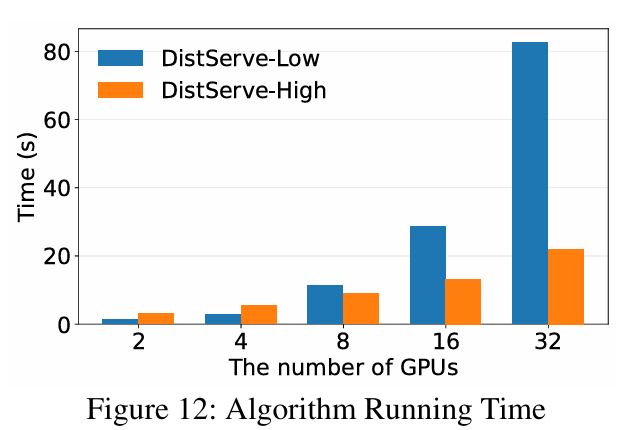

- 横轴：GPU数量
- 纵轴：时间
- 随 GPU 数量增长的趋势：数量越多，时间越长。
- 是否适合部署时运行：适合
- ==我的理解==：因为是模拟运行，所以不会受到模型大小的影响，只会根据新增token数量来预测运行时间，以及根据到达队列来预测排队时间，处理的是“到达、开始、完成”等**离散事件**，而非真实的大矩阵计算。
- 当前问题：暂无

#### 本节读完后回答

1. 两个 placement algorithms 的 running time 为什么不同？

   **答：**一个是高亲和节点，一个是低亲和节点。

#### 我的笔记与问题

- 当前问题：暂无。

## 7. Discussion

### 阅读目标

- 找出论文主动承认的假设与限制。
- 区分静态 placement、在线 scheduling 和动态 workload adaptation。
- 判断 disaggregation 在什么条件下可能不划算。

### 适用边界记录

- Workload stationarity：
- SLO 已知性：
- Cluster topology：
- KV cache transfer：
- Model weight duplication：
- Fault tolerance：
- Multi-tenancy：
- Dynamic reconfiguration：
- 与 chunked prefill 的关系：

### 本节读完后回答

1. DistServe 依赖哪些可预测的 workload statistics？

   **答：**

2. 如果 traffic pattern 快速变化，offline placement 会遇到什么问题？

   **答：**

3. 在什么模型、SLO 或 cluster 条件下，共置可能仍然更合适？

   **答：**

4. 论文没有解决哪些生产环境问题？

   **答：**

### 我的笔记与问题

- ==我的评价==：
- 当前问题：

## 8. Related Work

### 阅读目标

- 将相关工作按 LLM serving、model parallelism、batching/scheduling 和 disaggregation 分类。
- 比较各工作解决的主要瓶颈，而不只记录系统名称。

### 对照表

| 工作 | 主要优化对象 | Prefill/decode 是否分离 | 与 DistServe 的关系 |
| --- | --- | --- | --- |
| vLLM / PagedAttention |  |  |  |
| Orca |  |  |  |
| DeepSpeed-MII |  |  |  |
| FasterTransformer |  |  |  |
| FlexGen |  |  |  |
| Splitwise |  |  |  |
| Sarathi / chunked prefill |  |  |  |

### 本节读完后回答

1. vLLM 和 DistServe 分别主要优化哪一层问题？

   **答：**

2. Iteration-level scheduling 与 phase disaggregation 是替代还是互补关系？

   **答：**

3. DistServe 与其他 prefill/decode 分离工作的主要差异是什么？

   **答：**

### 我的笔记与问题

- 最相关工作：
- 核心差异：
- 当前问题：

## 9. Conclusion

### 结论核对

- 问题：
- 关键观察：
- 方法：
- Placement algorithm：
- Runtime：
- 实验证据：
- 新增代价：
- 适用条件：

### 全文读完后回答

1. 为什么“共享模型权重”不一定意味着 prefill 和 decode 应当共置？

   **答：**

2. DistServe 怎样把 TTFT/TPOT SLO 转换成 resource allocation 和 placement 问题？

   **答：**

3. 论文中最能证明 interference、resource coupling 和 communication feasibility 的证据分别是什么？

   **答：**

4. DistServe 的核心贡献更偏新 kernel、scheduler，还是 cluster-level resource management？

   **答：**

### ==我的全文复述==

>

### 最终评价

- 我认为最有价值的设计：
- 我认为最薄弱的假设：
- 与 vLLM / SGLang 笔记的联系：
- 仍未解决的问题：

## Appendix A. Latency Model for LLM Inference

### 阅读目标

- 仅在需要核对 simulator accuracy 时阅读。
- 记录 latency model 的符号、硬件假设和拟合参数。
- 区分 prefill 与 decode 的 GEMM、attention 和 memory-access 建模。

### A.1 Symbol Definition（PDF 第 18 页，论文第 209 页）

| Symbol | 含义 |
| --- | --- |
| \(h\) |  |
| \(n\) |  |
| \(s\) |  |
| \(m\) |  |
| \(B\) |  |
| \(l_i\) |  |
| \(t\) |  |
| \(t_2\) |  |
| \(b\) |  |

### A.2 Prefill Phase Latency Modeling（PDF 第 18 页，论文第 209 页）

- GEMM shapes：
- Arithmetic intensity：
- Compute-bound assumption：
- \(T_1\)：
- Attention memory access：
- Attention FLOPs：
- \(T_2\)：
- \(T_{\text{Prefill}}\)：
- \(C_1,C_2,C_3\) 如何获得：
- 我的理解：
- 当前问题：

### A.3 Decoding Phase Latency Modeling（PDF 第 18 页，论文第 209 页）

- GEMM shapes：
- Arithmetic intensity：
- Memory-bound assumption：
- \(T_3\)：
- Attention memory access：
- \(T_4\)：
- \(T_{\text{Decoding}}\)：
- \(C_4,C_5\) 如何获得：
- 我的理解：
- 当前问题：

### 附录读完后回答

1. 为什么 prefill GEMMs 和 decode GEMMs 被建模为不同的硬件瓶颈？

   **答：**

2. 为什么 prefill latency 与 \(t\)、\(t_2\) 都有关，而 decode latency 的形式不同？

   **答：**

3. 哪些常数来自理论，哪些必须通过 profiling 拟合？

   **答：**

## Appendix B. DistServe Placements in End-to-end Experiments

### 表格记录：Table 3（PDF 第 19 页，论文第 210 页）

<!-- 阅读到这里时插入 Table 3 截图 -->

- 不同模型：
- 不同任务：
- Prefill TP/PP：
- Decode TP/PP：
- Prefill/decode instance ratio：
- Placement 与正文分析是否一致：
- 当前问题：

## Appendix C. End-to-end Results under 99% SLO Attainment

### 图表记录：Figure 13-14（PDF 第 19 页，论文第 210 页）

<!-- 阅读到这里时插入 Figure 13-14 截图 -->

- 相比正文实验改变的唯一条件：
- Figure 13：
- Figure 14：
- 99% attainment 对 goodput 的影响：
- Baseline 排名是否变化：
- DistServe 收益是否变化：
- ==我的理解==：
- 当前问题：
