# MOONCAKE: Trading More Storage for Less Computation - A KVCache-centric Architecture for Serving LLM Chatbot

> 阅读时间：2026.8.3-2026-8-6

## 0. 论文信息

- Title: MOONCAKE: Trading More Storage for Less Computation - A KVCache-centric Architecture for Serving LLM Chatbot
- System: MOONCAKE / MOONCAKE Store
- Authors: Ruoyu Qin, Zheming Li, Weiran He, Jialei Cui, Feng Ren, Mingxing Zhang, Yongwei Wu, Weimin Zheng, Xinran Xu
- Affiliations: Moonshot AI, Tsinghua University
- Venue: FAST 2025
- PDF: `Mooncake.pdf`
- Pages: 16（USENIX pp. 155-170；本地 PDF 共 17 页，含封面）
- Open source: <https://github.com/kvcache-ai/Mooncake>
- Reading status: Finished

## 0.1 阅读进度

- [x] Abstract
- [x] 1 Introduction + Figure 1-2
- [x] 2 Preliminary and Problem Definition
  - [x] 2.1 Service Level Objectives of LLM Serving
  - [x] 2.2 More Storage for Less Computation + Table 1 + Equation (1)-(2)
- [x] 3 Design of MOONCAKE
  - [x] 3.1 Overview + Figure 3
  - [x] 3.2 MOONCAKE Store: Cache of KVCache
    - [x] 3.2.1 KVCache Management
    - [x] 3.2.2 Interface + Listing 1
    - [x] 3.2.3 Transfer Engine + Figure 4
  - [x] 3.3 MOONCAKE's Prefill Pool
- [x] 4 Scheduling
  - [x] 4.1 Prefill Global Scheduling + Algorithm 1
  - [x] 4.2 Cache Load Balancing + Figure 5
- [x] 5 Evaluation
  - [x] 5.1 Setup
  - [x] 5.2 End-to-end Performance + Table 2 + Figure 1、6-8
    - [x] 5.2.1 Workload
    - [x] 5.2.2 Effective Request Capacity
    - [x] 5.2.3 Prefill GPU Time
  - [x] 5.3 MOONCAKE Store + Figure 9-11
    - [x] 5.3.1 Quantitative Analysis of Cache Capacity
    - [x] 5.3.2 Practical Workload Experiment
    - [x] 5.3.3 Cache Replica
  - [x] 5.4 KVCache Transfer Performance + Figure 12-14
    - [x] 5.4.1 Transfer Engine
    - [x] 5.4.2 Bandwidth Demand by MOONCAKE
    - [x] 5.4.3 E2E Latency Breakdown
  - [x] 5.5 P/D Ratio + Figure 15
- [ ] 6 Related Work
- [ ] 7 Conclusion

> 本地 PDF 第 1 页是 USENIX 封面。正文从 PDF 第 2 页开始，对应论文印刷页 155。

## Abstract

### 内容框架

- 论文面向的实际系统与应用场景：Kimi、长上下文 LLM chatbot serving。
- 现有系统的问题：GPU 计算昂贵，而 CPU、DRAM、SSD 和 NIC 等资源未被充分利用。
- 核心方案：KVCache-centric disaggregated architecture。
- 系统的三个组成部分：P/D 分离、分布式 KVCache、面向 SLO 的全局调度。
- 主要评估指标：effective request capacity、TTFT、TBT。
- 需要记录的结果：真实 trace、生产部署和 transfer engine 的主要性能数据。

### 我的笔记

- MOONCAKE使用一个以KVCache为中心的分离架构，不仅分离了prefill和decode阶段的clusters，而且==还充分利用了服务器未完全开发利用的CPU, DRAM, SSD and NIC（网卡）资源。==

## 1. Introduction

### 内容框架

- LLM serving workload 的差异：输入长度、输出长度、到达分布和 SLO。

- MaaS provider 的==优化目标==：在 TTFT 和 TBT 等约束下最大化有效吞吐，而不只是最大化原始 throughput。

- 为什么要把 GPU 集群重新组织成不同的资源池？
  **答：**不同的资源池可以为了同一个目标做不同的优化，例如PD分离，decode和prefill具有不同的计算特征，因此需要各自优化。

- ==MOONCAKE Store==：在P/D分离的基础上更进一步，通过汇集GPU集群的CPU、DRAM、SSD和RDMA资源，设计了一个分解的KVCache。这个新架构利用了未充分使用的资源来实现高效的近GPU前缀caching，显著的提升了全局cache容量和结点间的传输带宽。

- 什么是==near-GPU prefix caching==？

  **答：**把可复用 prompt 前缀的 KVCache 保存在 GPU 周围的 DRAM、SSD 和其他高速可达内存中，在新请求命中相同前缀时快速加载到 GPU，从而避免重新执行 prefill。

- ==“Trading More Storage for Less Computation”==的基本思想。

- 为什么仅有分布式存储还不够，还需要 KVCache-centric scheduling。

- Prefill stage 与 decoding stage 的不同优化目标和资源约束。

- MOONCAKE 在生产环境中的部署规模与论文声称的主要收益。

- 论文贡献以及后续章节的组织方式。

### Figure 1：不同 TBT SLO 下的有效请求容量

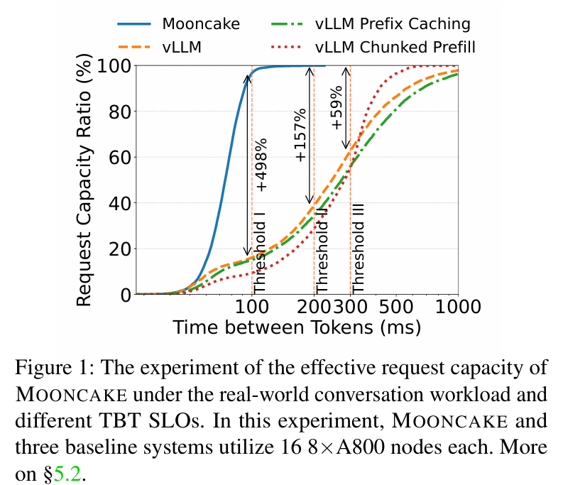

- 实验 workload 和集群规模。
  真实世界对话workload，集群规模是16个配备有8个A800的节点
- 横轴、纵轴的含义。
  横轴是TBT SLO，纵轴是满足延迟 SLO 的有效请求占全部请求的比例。
- MOONCAKE、vLLM、vLLM Prefix Caching、vLLM Chunked Prefill 的比较关系。

### Figure 2：MOONCAKE Architecture

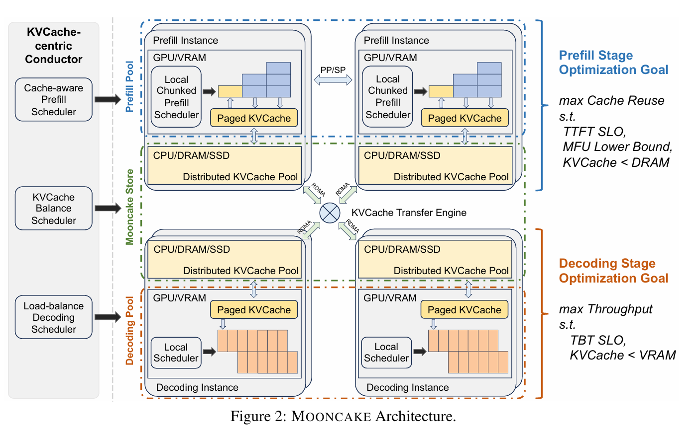

- Prefill Pool、Decoding Pool、MOONCAKE Store 和 Conductor 的边界。

  ==四者的边界可以概括为：==

  ```
  Conductor：决定请求去哪里、缓存如何分布
      ↓
  Prefill Pool：复用缓存并计算未命中的 prompt
      ↓ KVCache
  MOONCAKE Store：保存和传输 KVCache
      ↓ KVCache
  Decoding Pool：使用完整 KVCache 逐 token 生成
  ```

  Conductor就是通过KVCache-awareness和运行调度操作（例如，相关的swapping和replication）来完成对于requests的调度。把最高使用率的blocks复制到多个节点来避免fetching的拥塞，同时将最冷门的swap出去来减少储存花销。

- GPU/VRAM 与 CPU/DRAM/SSD 分别保存和处理什么。

  - **GPU**：负责实际执行模型计算，包括 Prefill 阶段的 prompt 处理和 Decode 阶段的逐 token 生成。
  - **CPU**：负责缓存管理、数据传输控制以及 GPU 与 DRAM/SSD 之间的数据搬运。
  - **VRAM**：保存模型权重、计算中间结果和当前计算所需的 Paged KVCache。Prefill 时保存正在复用或生成的 KVCache；Decode 时保存 active requests 的完整 KVCache。
  - **DRAM**：作为主要的 near-GPU KVCache 存储，保存可复用的 prefix KVCache、Prefill 新生成的 incremental KVCache，以及 Decode 节点接收到但尚未加载至 VRAM 的完整 KVCache。
  - **SSD**：提供容量更大但速度更慢的存储层，适合保存较冷的 KVCache，缓解 DRAM 容量不足。
  - **NIC/RDMA**：在不同节点的 DRAM或VRAM 之间传输 KVCache，将各节点的本地存储组织成分布式 KVCache pool。

- Cache-aware Prefill Scheduler、KVCache Balance Scheduler、Load-balance Decoding Scheduler 的职责。

  ==三者的分工可以概括为：==

  ```
  Cache-aware Prefill Scheduler
  → 请求在哪里执行 Prefill
  
  KVCache Balance Scheduler
  → KVCache 应该保存在哪里、需要多少副本
  
  Load-balance Decoding Scheduler
  → 请求在哪里执行 Decode
  ```

- Prefill stage 与 decoding stage 各自的优化目标和约束。

  - 在prefill阶段，主要的目标是尽可能复用KVCache，减少冗余计算。但是也有容量和获取延迟的挑战。
  - 在decode阶段，主要目标是在一个decoding batch中集合尽可能多的tokens来提升MFU（模型浮点计算利用率，表示 GPU 的理论计算能力中，有多少真正用于模型计算）。但同时也有TBT SLO的限制和可被VRAM容纳的聚合KVCache。

- 一次请求从 prefix cache reuse 到 decoding 的==完整数据路径==。

  - global scheduler (Conductor)会对于一次请求分配一对prefill和decode instances。
  - 向选定的prefill instance传输尽可能多的可复用KVCache。
  - 以chunks/layers的切分，分块完成prefill阶段，算一块传一块，持续地向对应decoding instance传输计算完成的KVCache。
  - 在decoding instance中，加载KVCache并将request添加到持续batching处理中，生成request的输出。

## 2. Preliminary and Problem Definition

### 2.1 Service Level Objectives of LLM Serving

#### 内容框架

- Decoder-only Transformer 推理的 prefill 和 decoding 两个阶段。
- Prefill 阶段的计算特征、KVCache 生成过程和对应延迟指标。
- Decoding 阶段的自回归特征、continuous batching 和对应延迟指标。
- TTFT 与 TBT 的定义及其分别反映的用户体验。
- 系统如何判断请求是否满足 SLO。
- GPU 资源无法快速弹性扩容时，为什么需要拒绝预计不能满足 SLO 的请求。
- 本文的整体优化目标与 goodput 概念之间的关系。

#### ==我的笔记==

- 在真实部署中，如果监视器发现了未满足的SLOs，就需要**添加推理资源**或者**删除一些到来的请求**。不过，由于目前 GPU 的供应是有限的，弹性扩展推理集群通常是不太可行的。所以选择主动的拒绝一些请求（这些请求是被预测到无法满足SLO的请求），从而来减轻cluster的负载。作者的主要目标就是最大化负载的同时满足SLOs，类似于其他研究中的goodput。

### 2.2 More Storage for Less Computation

#### 内容框架

- Prefix caching 如何利用相同输入前缀复用 KVCache。
- 为什么已有 local HBM/DRAM cache 的容量可能不足。
- 全局分布式缓存的收益与新增传输代价。
- Prompt 长度 `n`、命中前缀长度 `p` 与剩余计算量之间的关系。
- 复用 KVCache 所节省的 prefill FLOPs。
- 需要加载的 KVCache 大小以及 H2D/NIC 带宽的共同限制。
- 在什么带宽条件下，加载 KVCache 比重新计算更有利。
- 模型维度、GQA、计算吞吐和网络带宽如何影响收益。
- LLaMA3-70B 在 A800/H800 上的示例及其工程含义。

#### Table 1：符号与参数

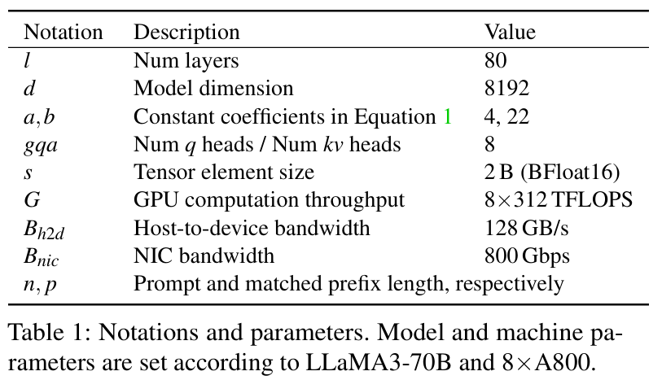

- 模型参数：层数、模型维度、GQA、数据类型。
- 硬件参数：GPU 计算吞吐、H2D 带宽、NIC 带宽。
- 请求参数：prompt 长度和 prefix match 长度。
- 后续推导中各符号的单位和取值。

#### Equation (1)-(2)

- ==Equation (1)：prefill FLOPs 与输入长度的关系。==
  $$
  \operatorname{flops}(n) = l\left(an^2d+bnd^2\right)
  \tag {1}
  $$
  **第一项**$l$是指模型层数，括号内的内容是指该模型每层的计算量。

  **括号内第一项**是指Attention计算，每个个token都需要与前面的tokens计算相关性。如果有n个token，需要计算的 token pair 数量大致随 \(n^2\) 增长，每次需要计算d次，因此是$n^2d$。\(QK^\mathsf{T} : (n\times d)(d\times n) \rightarrow n^2d\)

  **括号内第二项**是指线性层和MLP，一共有n个tokens，每个token都要进行规模为$d^2$计算。典型矩阵运算形式为：\[ (n\times d)(d\times d) \rightarrow nd^2 \]

- 命中长度为 `p` 时节省的计算量。

  **节约的计算量**是$l\left(ap^2d+bpd^2\right)$，但是这需要将KVCache传输到GPU的HBM内

- 对应 KVCache 的**传输数据量**：\(p\times l\times \left(2\times\frac{d}{gqa}\right) \times s\)

  每个 token 在每个 Transformer layer 都会产生：

  - 一个 Key 向量；
  - 一个 Value 向量。

  如果是普通 MHA，每个向量的总维度大约是 \(d\)。但 GQA 让多个 Query heads 共享 K/V heads，因此 K/V 的总维度缩小为：\[ \frac{d}{gqa} \]

  Key 和 Value 各一个，所以共有：\[ 2\times\frac{d}{gqa} \]个数值。

  转换成字节

  每个数值占用 \(s\) 字节。例如 BF16：\[ s=2\text{ bytes} \]

  因此，一个 token 在一个模型层中的 KVCache 大小为：\[ 2\times\frac{d}{gqa}\times s \]

  每一层都有独立的 KVCache。模型有 \(l\) 层，所以一个 token 的完整 KVCache 为：\[ l\times2\times\frac{d}{gqa}\times s \]

  长度为 \(p\) 的 prefix需要传输 \(p\) 个 tokens 的 KVCache，因此：
  $$
  p\times l\times \left(2\times\frac{d}{gqa}\right) \times s
  $$

- ==Equation (2)：传输复用优于重新计算的带宽阈值。论文主要用它求最低带宽==。
  $$
  \frac{B}{G} > \frac{2ds} {gqa\times\left(apd+bd^2\right)} \tag{2}
  $$
  B是指平均KVCache加载速度

  G是指平均计算吞吐量
  如果当前情况满足这个等式，就说明需要加载的KVCache数量少或是节约的计算量多。就可以达到减少GPU时间和花费，同时还能提升TTFT来优化用户体验。

- 推导所采用的假设及其可能不成立的场景。
  当计算速度增加时，传输带宽也要相对应增加，不然传输KVCache的时间比重新算一遍还长。

#### ==我的笔记==

- global cache主要带来**三个收益**：

  - **容量更大**：使用整个集群的 DRAM/SSD，而不是单个节点的内存。
  - **命中范围更大**：请求被调度到不同 Prefill Instances 时，仍然可以复用以前的 KVCache。
  - **支持负载均衡**：不必为了命中缓存一直把请求发送到同一个繁忙节点；可以把 KVCache 传给较空闲的节点。

- GQA是什么：多个 Query heads 共享同一组 Key/Value heads，从而减少 KVCache 的大小和读取开销。

  论文使用：\[ gqa=8 \]

  表示每个 K/V head 被 8 个 Query heads 共享。例如：

  ```
  Query heads = 64
  KV heads = 8
  gqa = 64 / 8 = 8
  ```

- 当一个==长度为n的prompt==有一个==长度为p的共享前缀==，他的prefill阶段可以优化成如下表达式：

  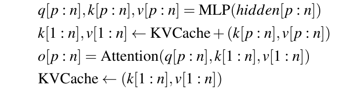

## 3. Design of MOONCAKE

### 3.1 Overview

#### 内容框架

- MOONCAKE 的整体 disaggregated architecture。
- Conductor 与 MOONCAKE Store 的职责分工。
- Conductor 如何根据缓存分布和 workload 选择 prefill/decoding instances。
- 一次请求的四个阶段：KVCache reuse、incremental prefill、KVCache transfer、decoding。
- Chunked prefill 的触发条件和作用。
- 新生成 KVCache 如何与 prefill 计算重叠并流式传给 decoding node。
- Prefill instance 与 decoding instance 分别依据什么 SLO 被选择。

#### Figure 3：Workflow of Inference Instances

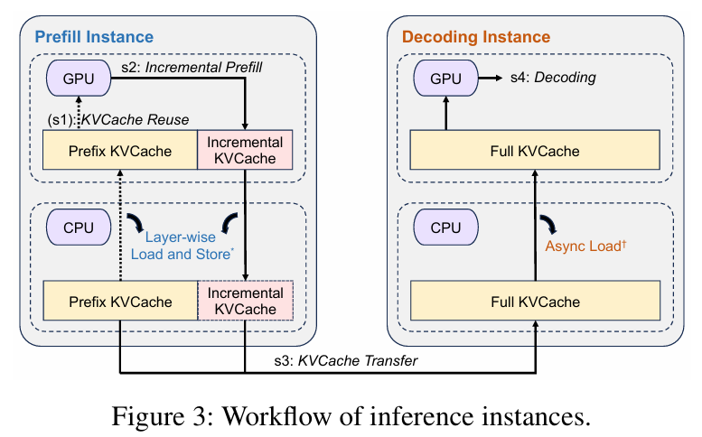

- Prefix KVCache、incremental KVCache 和 full KVCache 的区别。
  Prefix KVCache是前缀，之前算过的。
  incremental KVCache是没算过的，新算的，用于补齐KVCache。
  full KVCache就是把上两个接起来。
  
- GPU 与 CPU memory 之间的 load/store 路径。
  CPU的DRAM与GPU的VRAM

- Prefill instance 到 decoding instance 的==跨节点传输路径==。
  通过MoonCake store，具体一点就是：

  ```
  Prefill GPU VRAM
          ↓ store
  Prefill CPU DRAM
          ↓ NIC/RDMA，由MOONCAKE Store Transfer Engine负责
  Decode CPU DRAM
          ↓ load
  Decode GPU VRAM
  ```

- 四个步骤之间哪些串行执行，哪些可以==异步==重叠。
  KVCache Reuse和Incremental Prefill以及Decoding是**串行执行**的，KVCache Transfer可以与Incremental Prefill是**异步执行**。

#### ==我的笔记==

- Block key 如何生成？

  Block key 通常由两部分共同决定：

  1、当前 block 中的 tokens；

  2、当前 block 之前的 prefix。（因为KVCache依赖前缀，前缀变了，KVCache不一样了）

### 3.2 MOONCAKE Store: Cache of KVCache

#### 内容框架

- MOONCAKE Store 在整个系统中的作用。
- 分布式 KVCache 对容量、访问延迟和聚合带宽的要求。
- 为什么多 NIC、高带宽环境需要专门设计 transfer engine。
- 本节三个部分之间的关系：管理、接口、传输实现。

#### ==我的笔记==

- MOONCAKE Store的transfer engine是每台机器使用多个RDMA NICs。复用KVCache，可以减少计算开销的同时还可以降低TTFT，特别是将NIC带宽完全使用时。但是想完全使用带宽很有挑战，因为最高可以达到$8\times 400Gbps$。

#### 3.2.1 KVCache Management

##### 内容框架

- KVCache 的 paged block 组织方式。
- Block size 如何由模型规模和网络传输效率共同决定。
- Block hash key 如何结合当前 block 与 prefix 完成去重。
- 同一 block 为什么可能存在多个 replicas。
- 分布式 cache pool 的空间分配和 metadata。
- LRU eviction 的触发条件。
- 正在被请求使用的 block 如何避免被驱逐。

##### ==我的笔记==

- 每个block中包含的token数量是由模型规模以及最佳网络传输规模决定的，通常是介于16-512tokens之间。每个blocks有一个hash key标识，是由该block的hash和它前缀的hash决定。有相同的hash key的blocks可能会有很多个复制，这样能减少热门cache的获取延迟。
- MOONCAKE Store给每个cache block在cache pool中分配空间，并且记录元数据，比如block key和它的位置。当cache pool满的时候，会使用**LRU**来evict现存的cache block（除非这个block正在被request使用），然后用新的block覆写被移除的block。（一个是LRU算法，用一个状态来记录某个block上一次访问时间；一个是reference count记录当前是否有request在访问。）

#### 3.2.2 Interface

##### 内容框架

- Object-based APIs：`put`、`get`、`change_replica`。
- Memory transfer APIs 的注册、批量提交、状态查询和释放流程。
- DRAM 与 GPU VRAM 传输的支持方式。
- 何时使用 GPUDirect RDMA。
- 同步 batch transfer API 与异步完成状态之间的关系。

##### Listing 1：Memory Transfer APIs

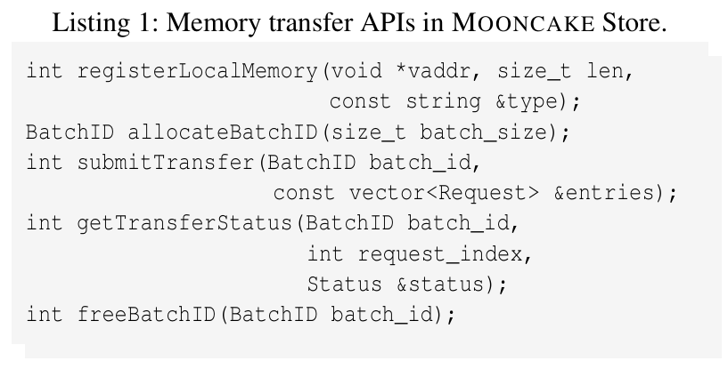

- 每个 API 的输入、输出和生命周期。
- `BatchID` 如何组织一组传输请求。
- 错误和未完成状态如何被上层观察。

##### ==我的笔记==

- MOONCAKE Store 向 Conductor 提供 `put`、`get` 和 `change_replica` 等 KVCache 对象接口，隐藏底层传输细节。底层提供批量内存传输 API，支持 DRAM 和 GPU VRAM，并在合适时使用 GPUDirect RDMA。内存必须预先注册；传输任务按 batch （和计算时的batch不一样）提交，数据搬运异步执行，上层通过 `getTransferStatus` 查询完成或错误状态。

#### 3.2.3 Transfer Engine

##### 内容框架

- Transfer engine 的==三个目标==：多 NIC 利用、连接管理抽象、临时故障处理。
- RoCEv2 网络环境和 MOONCAKE 的硬件拓扑。
- 为什么 NCCL 不适合这里的动态 DRAM-to-DRAM 传输需求。
- Topology-aware path selection 如何避开 UPI/PCIe 瓶颈。
- 传输切片如何聚合多条 RDMA 路径的带宽。
- Endpoint 的含义、按需建连和 endpoint pooling。
- SIEVE 在连接池淘汰中的作用。
- NIC、link、RDMA context 或 completion queue 故障时的恢复策略。

##### Figure 4：Transfer Engine

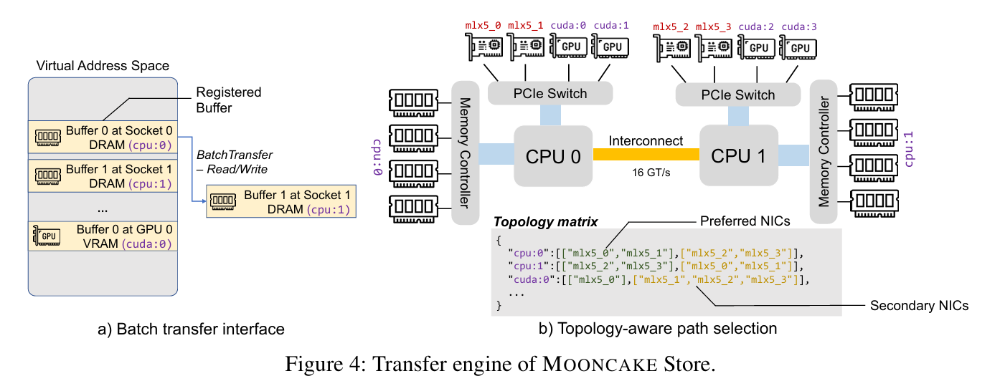

- Batch transfer interface 的数据组织方式。

- Topology matrix 中 preferred NICs 与 secondary NICs。

- CPU DRAM、GPU VRAM、PCIe switch 和 NIC 之间的拓扑关系。

- Local/remote NIC pair 的选择过程。

- ==我的理解：==作者使用支持RDMA的高速NIC，通过经过调优的RoCEv2以太网进行跨界点KVCache传输。如果使用一个节点内，但归属其他CPU的NIC（也就是secondary list），就需要通过UPI或PCIe传输，再经过NIC。如果是一台机器内的内存读取，CPU1直接通过UPI就能读到属于CPU0内存的内容。

- ==问题1==：为什么还画了UPI，UPI不是一个节点内才会出现的吗？

  > 因为图b)就是指一个节点内部的状态，左边的图a)和右侧的图b)不是严格的对应关系。 

- ==问题2==：为什么GPU0就只有一个preferred NIC，CPU0可以有两个？

  > 图中 `mlx5_0` 和 `mlx5_1` 都属于 CPU0 的本地 PCIe/NUMA 域。因此，访问 CPU0 所管理的 DRAM 时：
  >
  > ```
  > CPU0 DRAM → CPU0 PCIe Root Complex → mlx5_0
  > CPU0 DRAM → CPU0 PCIe Root Complex → mlx5_1
  > ```
  >
  > 两条路径都不用经过 CPU0—CPU1 之间的 UPI，所以都被列为 preferred：
  >
  > ```
  > "cpu:0": [
  >     ["mlx5_0", "mlx5_1"],       // preferred
  >     ["mlx5_2", "mlx5_3"]        // secondary
  > ]
  > ```
  >
  > GPU0 为什么只有一个 Preferred NIC？
  >
  > GPU0 的 VRAM 不在 CPU0 的内存控制器后面，而是在独立的 PCIe 设备中。要高效使用 GPUDirect RDMA，最好选择与 GPU0 **直接配对、具有最短 PCIe P2P 路径**的 NIC，即 `mlx5_0`：
  >
  > ```
  > GPU0 VRAM → 本地 PCIe 路径 → mlx5_0
  > ```

- RoCEv2 网络环境和 MOONCAKE 的硬件拓扑：RoCEv2是 `RDMA over Converged Ethernet version 2`，即在以太网上运行 RDMA。

- 为什么 NCCL 不适合这里的动态 DRAM-to-DRAM 传输需求？

  **答：**因为NCCL 主要是面向 GPU 集体通信的库，而 MOONCAKE Store 需要支持更多组合：

  ```
  DRAM → DRAM
  DRAM → GPU VRAM
  GPU VRAM → DRAM
  GPU VRAM → GPU VRAM
  ```

- Topology-aware path selection 如何避开 UPI/PCIe 瓶颈？

  **答：**每个server会产生一个拓扑矩阵然后将他广播到cluster中，这个矩阵对于不同种类的内存**列出了“preferred”和”secondary“两类NICs**。正常情况下，会选择在“preferred”列表中的NIC。在失败的情况下，会使用两个列表中的NIC。

- 传输切片如何聚合多条 RDMA 路径的带宽？
  **答：**一个单request的传输任务会被内部切分成多个slices，粒度为16KB。每个slice单独规划路径，可以最大化带宽使用率。

- Endpoint 的含义、按需建连和 **endpoint pooling**。
  **答：**Endpoint是指一对NIC之间建立的链接。Endpoint是按需建立的，知道第一个request出现时，才会开始连接。还有一个endpoint pooling，限制了最大活动连接数量。然后使用SIEVE算法来管理endpoint的eviction（类似于操作系统的CLOCK扫描算法）。如果连接失败了，它就会从endpoint pool里面移除，在下一次数据传输尝试时再建立。

- NIC、link、RDMA context 或 completion queue 故障时的**恢复策略**。

  ```text
  当前NIC/连接失败
          ↓
  标记并暂时避开故障资源
          ↓
  查找其他可达NIC路径
          ↓
  重新建立Endpoint/QP
          ↓
  重新提交传输请求
  ```

### 3.3 MOONCAKE's Prefill Pool

#### 内容框架

- 在已有 chunked prefill 的情况下，为什么仍然采用 P/D disaggregation。
- 长上下文请求对 TTFT 和跨节点并行的需求。
- 跨节点 Tensor Parallelism 的通信代价。
- Sequence Parallelism 的优势与短上下文效率、弹性调整和网络竞争问题。
- Chunked Pipeline Parallelism（CPP）的基本机制。
- Prompt chunk、pipeline stage 与多个 prefill nodes 的对应关系。
- CPP 如何减少跨节点通信并与 KVCache transfer 重叠。
- CPP 对长、短上下文请求的适应性。

#### ==我的笔记==

- 在已有 chunked prefill 的情况下，为什么仍然采用 P/D disaggregation？

  **答：**因为在chunked prefill的情况下，很难将MFU最大化的同时，满足decoding阶段的TBT SLO。

- 长上下文请求对 TTFT 和跨节点并行的需求。
  **答：**长上下文情景，通常会出现输入token是输出token长度的10倍到100倍，这就导致TTFT很重要。对于长上下文而言，跨节点并行是非常必要的。

- 跨节点 Tensor Parallelism 的通信代价。
  **答：**但是将TP拓展到多个节点上，需要两次RDMA all-reduce操作，显著降低prefill节点的MFU。MOONCAKE并不是不使用TP，只是将TP限制在节点之内，避免节点间的TP。

- Sequence Parallelism 的优势与短上下文效率、弹性调整和网络竞争问题。
  **答：**Sequence Parallelism 的==优势==在于，对于长输入request而言具有显著的加速作用，但是当有短一些的输入request时，与单节点TP相比，MFU反而更低。近期研究有使用弹性sequence并行策略来动态的增加或降低sequence并行组。尽管这是可行的，作者认为加到架构中太复杂了，而且SP仍然需要经常的节点间交流，这会导致MFU降低以及和==KVCache传输时竞争网络资源==。

- ==**Chunked Pipeline Parallelism（CPP）**==的==基本机制==。
  **答：**CPP（Chunked Pipeline Parallelism）主要用于让多个 Prefill 节点共同处理一个长请求，降低 TTFT。
  
  它同时进行两种划分：
  
  - **模型按层划分**：不同节点负责不同的模型层。
  - **输入按 token 划分**：长输入被切成多个不超过 `prefill_chunk` 的 chunk。
  
  例如：
  
  ```
  节点1：模型前部层
  节点2：模型中部层
  节点3：模型后部层
  ```
  
  流水线运行过程：
  
  | 时间 | 节点1   | 节点2   | 节点3   |
  | ---- | ------- | ------- | ------- |
  | T1   | Chunk 1 |         |         |
  | T2   | Chunk 2 | Chunk 1 |         |
  | T3   | Chunk 3 | Chunk 2 | Chunk 1 |
  
  同一个 chunk 仍然依次经过所有模型层，但不同 chunk 可以同时位于不同节点上。
  
  Chunk 之间的因果依赖不会被破坏，因为每个节点仍严格按照：
  
  ```
  Chunk 1 → Chunk 2 → Chunk 3
  ```
  
  的顺序计算。后面的 chunk 到达某节点时，前面 chunk 在该节点负责的模型层中生成的 KVCache 已经存在。
  
  CPP 相比跨节点 TP 和 SP 的优势是：
  
  - 只在流水线阶段边界传输 activation；
  - 不需要每层都进行跨节点 All-Reduce；
  - 通信可以和下一个 chunk 的计算重叠；
  - 减少网络开销，提高 Prefill MFU；
  - 特别适合长上下文请求。

## 4. Scheduling

### 4.1 Prefill Global Scheduling

#### 内容框架

- 普通 load-balancing scheduling 为什么不足以处理分布式 KVCache。
- Prefix match length、cache location、instance load 和 TTFT 之间的权衡。
- Conductor 如何逐 block 查找不同 prefill instances 的 prefix match。
- Offline regression model 如何估计 prefill execution time。
- Queueing time 和 KVCache transfer time 的估计方法。
- Instance selection 的目标函数。
- 预计无法满足 TTFT/TBT SLO 时如何处理请求。
- 预测误差和网络拥塞给调度带来的工程难点。

#### Algorithm 1：KVCache-centric Scheduling Algorithm

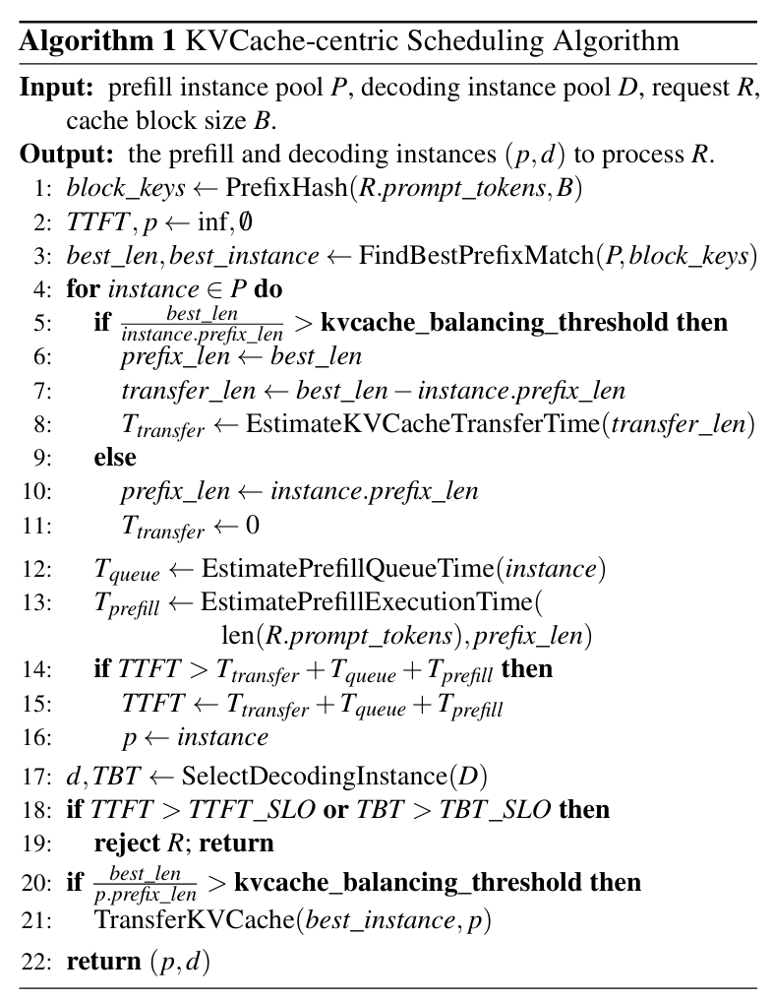

- 输入、输出和关键状态。
- `best_len` 与 instance local `prefix_len` 的区别。
- 何时选择远端最佳前缀并产生 transfer cost。
- TTFT 如何由 transfer、queue 和 prefill execution 三部分组成。
- Decoding instance 的选择与最终 admission control。
- Cache balancing threshold 在算法中的作用。

#### ==我的笔记==

- 除了考虑load-balance之外，MOONCAKE对于prefill instance的选择有更多的因素要考虑，比如前缀cache的命中长度和可复用KVCache的分布。尽管有对于更长前缀cache的倾向，把同一个request分配到其他节点上能保证整个系统的负载均衡和满足TTFT SLOs。为了解决这些矛盾，作者提出了cache-aware global scheduling。

- ==算法1==详解：

  1：先计算R这个request的hash值

  2：初始化TTFT和p（最终选定的prefill instance）

  3：在所有的instance中找到最长的匹配前缀，把前缀长度记录在best_len，把最长前缀instance记录在best_instance。

  4：开始遍历所有instance，找出TTFT最低的instance

  ​	5：比较最长前缀长度和当前instance的前缀长度比值是否大于kvcache_balancing_threshold这个阈值，如果大于就值得传输，反之就不传输了直接算。

- 4.1中讨论的是最初的简单的instance分配算法，不考虑instance之间的KV cache传输，只进行在已有前缀的基础上计算。4.2中，才加入了对于instance间前缀长度的讨论，什么时候应该传输，什么时候使用节点内的前缀更高效。

### 4.2 Cache Load Balancing

#### 内容框架

- 不同 KVCache blocks 的访问频率差异。
- 为什么缓存命中率与 instance load 可能发生冲突。
- 基于精确未来访问预测的方案为什么不现实。
- Heuristic-based hotspot migration 的基本策略。
- 何时远程拉取并复制 KVCache，何时直接重新计算。
- Hot cache replicas 如何降低访问拥塞并扩大可调度范围。
- Global cache-aware、local cache-aware、load balancing 和 random scheduling 的区别。

#### Figure 5：Prefill Scheduling Experiment

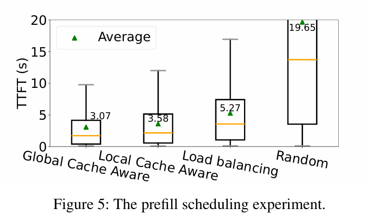

- 实验集群、workload 和比较方法。
  16 8×A800 nodes（实验集群），the conversation trace detailed in §5.2.1（workload），TTFT（比较方法）。
- 各调度策略的 TTFT 差异。
- Cache load balancing 带来的额外收益。   

#### ==我的笔记==

- a heuristic-based automated hotspot migration scheme：基于启发式的自动热点迁移方案：就是算法一

  1、找到拥有最长 Prefix KVCache 的节点。

  2、同时考虑这个节点的排队时间。

  3、如果它太忙，就把请求安排到较空闲的节点。

  4、如果远程 KVCache 足够有价值，就把它复制到这个空闲节点。

  5、如果传输 KVCache 还不如重新计算便宜，就直接重新计算。

## 5. Evaluation

### 5.1 Setup

#### 内容框架

- 评估要回答的两个核心问题。
- Testbed 的节点、GPU、NIC 和 MOONCAKE block size。
- MOONCAKE 与 baseline 的节点部署方式。
- TTFT、TBT 和 effective request 的具体统计方法。
- 不同实验使用的 TTFT/TBT thresholds。
- Prefill GPU time 和 cache hit rate 的定义。
- Baseline：vLLM、prefix caching、chunked prefill。
- vLLM 版本以及不同功能需要分开测试的限制。

#### ==我的笔记==

- 评估要回答的两个==核心问题==。
  1）在现实场景下，MOONCAKE的表现优于已有的LLM推理系统吗？

  2）与传统prefix caching方式相比，MOONCAKE Store显著提升了MOONCAKE的表现了吗？

- Testbed 的节点、GPU、NIC 和 MOONCAKE block size。
  每个节点有8个NVIDIA-A800-SXM4-80GB GPUs和4个200Gbps RDMA NICs，MOONCAKE Store KVCache block size大小设置为256。每个节点只能作为prefill instance或者decoding instance。

- TTFT、TBT 和 effective request 的具体统计方法。
  **TBT是计算最长的10%的token到达间隔的平均。**TTFT的阈值设置在30s，TBT的阈值根据不同的场景分别设置在100ms、200ms、300ms。只有TTFT和TBT在均满足他们各自的阈值之下的request才可以被认定为是有效request。effective request capacity是指有效request在所有request中的占比。当后续实验未提及TTFT时，说明TTFT已经满足30s的阈值。

- Baseline使用vLLM、及其prefix caching和chunked prefill两种模式。

### 5.2 End-to-end Performance（回答Question1）

#### 5.2.1 Workload

##### 内容框架

- 三类==workload==：Conversation、Tool & Agent、Synthetic。==测量在已经确定的SLO阈值内，可以达到的最大吞吐量。==
- 每类 workload 的输入长度、输出长度、prefix cache ratio 和 arrival pattern。
- Conversation workload 中多轮对话和长上下文的特征。
- Tool & Agent workload 中重复 system prompt 的特征。
- Synthetic workload 的数据集组成和混合方式。
- 多轮请求之间的顺序关系以及 Poisson arrival 的构造。

##### Table 2：Workload Statistics

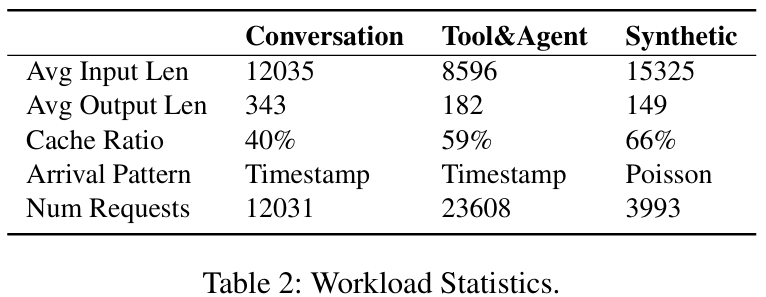

- 对比三类 workload 的平均输入/输出长度。
- 对比 cache ratio、arrival pattern 和请求数量。
- 哪些 workload 更依赖缓存容量，哪些更依赖热点复用。

##### ==我的笔记==

- 1小时的**Conversation**是从online 推理集群中采样的，有到达时间戳。
- Tool&Agent也是类似，超过1个小时的采样，有更高的prefix cacheing，更短的输入输出。
- **混合负载**使用了3种数据集：ShareGPT，Leval，LooGLE。ShareGPT是多轮短长度对话；Leval是一个针对模型长上下文能力的benchmark，模拟具有长系统提示词场景，这是tool and agent交互的典型表现。LooGLE是专为长上下文问答和总结任务设计的，有最高100ktokens的输入长度并且包含多轮对话和单论总结。总体来说火鹤负载有最长的平均输入长度，尽管有最高的prefix caching占比，他的cache命中比较分散，因此需要相当大的缓存容量。
  作者把多轮对话的每一轮转换成独立请求，并在后续请求中携带完整历史；对于共享同一个长 Prompt 的多问题数据，每个问题分别与公共 Prompt 组成请求。随后将短对话、Tool/Agent 和长文档任务按 1:1:1 混合，在保持每个对话内部轮次顺序的前提下随机打乱不同请求，最后通过泊松过程生成原数据集中缺失的请求到达时间。

#### 5.2.2 Effective Request Capacity

##### 内容框架

- 四种系统配置和统一节点规模。
- 不同 TBT thresholds 下最大有效请求容量的测量方式。
- Conversation workload 的长输入、长输出和 prefill/decode interference。
- Tool & Agent workload 的高 prefix reuse 特征。
- Synthetic workload 中分散 cache hits 对全局缓存容量的要求。
- MOONCAKE、vLLM Prefix Caching 和 vLLM Chunked Prefill 的差异来源。
- SLO 放宽或收紧时，各系统相对优势如何变化。

##### Figure 1

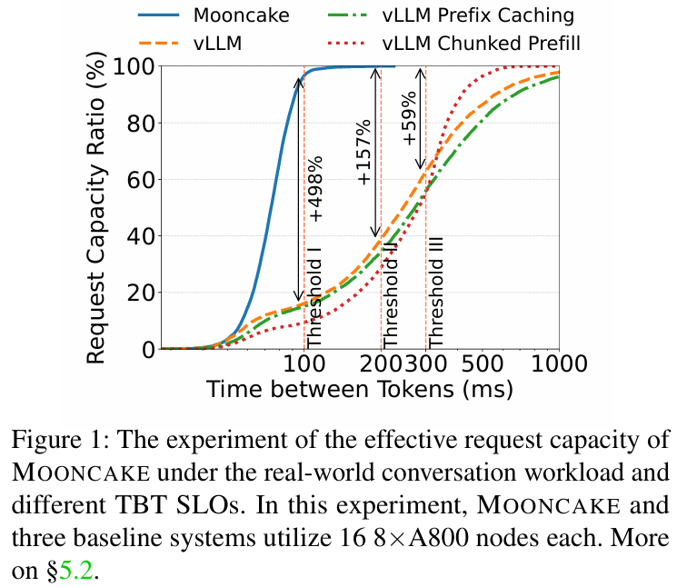

- workload: real-world conversation
- ==笔记：==多变的输入长度和更长的输出长度，导致了vLLM显著的TBT波动（这是由于在prefill阶段冗长的上下文）

##### Figure 6

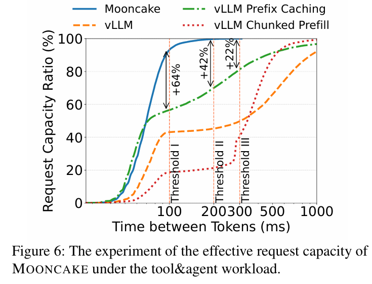

- workload: tool&agent
- ==笔记：==由于prefill处理时间较长，vLLM和具有chunked prerefill的vLLM在解码过程中会遇到更严重的中断，导致有效缓存容量低于具有prefix caching                    的vLLM。

##### Figure 7

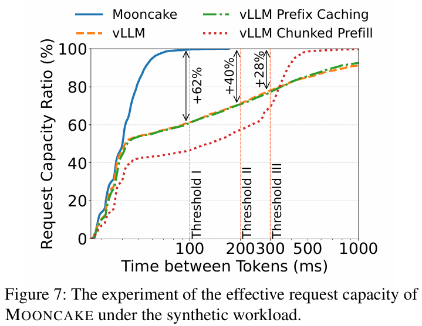

- workload：synthetic workload
- ==笔记：==该负载具有最长的平均输入长度和分散的cache热点。vLLM都与MOONCAKE相差较大，vLLM都无法缓解长上下文对decoding阶段的影响。

#### 5.2.3 Prefill GPU Time

##### 内容框架

- 为什么 prefill GPU time 能反映 KVCache reuse 所节省的计算。
- 不同 workload 的输入长度和 cache pattern 如何影响节省比例。
- GPU time 降低与 effective request capacity 提升之间的关系。

##### Figure 8

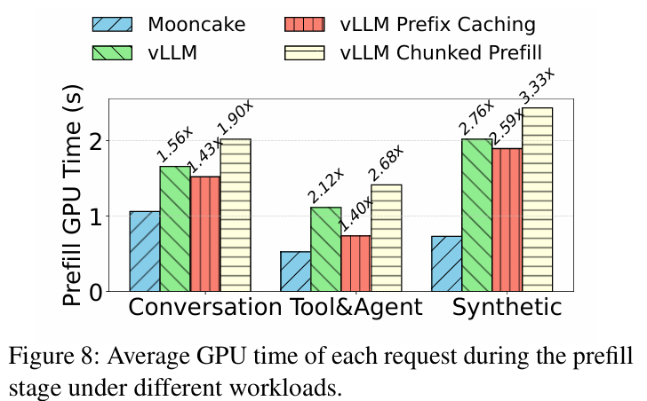

- 各 workload 的 prefill GPU time 对比。
- 结果是否与 cache ratio 和 prefix 分布一致。

##### ==我的笔记==

- Conversation负载的prefill GPU时间更长，这是因为更长的输入长度和更低的前缀cache率。
  然而在具有最高前缀cache率和分散cache热点的混合负载下，在MOONCAKE的全局cache池的帮助下，实现了最优的cache命中率。结果就是，尽管拥有最长平均输入长度，他的GPU时间还比conversation负载更短。
  最后，由于tool&agent负载具有最短的平均输入长度和相对高的前缀cache率，达成了最短的prefill GPU时间。
- 在不同的系统比较后，MOONCAKE在各个负载下都有显著的提升效果。

### 5.3 MOONCAKE Store（回答Question2）

#### 5.3.1 Quantitative Analysis of Cache Capacity

##### 内容框架

- Local cache 与 global cache 的理论容量差异。
- Cache size、cache hit rate 和 workload working set 的关系。
- 为什么 local DRAM 只能达到一部分理论 cache hit rate。
- 模型规模、KVCache per token 大小和可缓存 token 数量之间的关系。

##### Figure 9

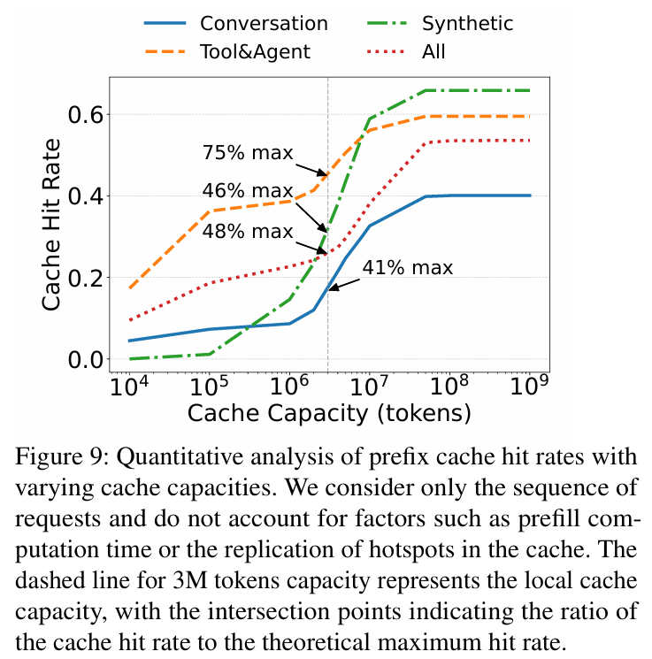

- 横纵轴与容量假设。
- 不同缓存层级或容量下的理论 cache hit rate。
- Global cache 的容量优势。

##### ==我的笔记==

- 量化了不同的cache容量对应的cache命中率，只考虑request的sequence，不考虑prefill计算时间或cache中的热点复制。虚线表示3M tokens容量时对应的命中率，也就是local cache能达到的最大命中率。作者还确定，当cache容量达到50M tokens时，就能达到最大的命中率，这需要至少20个节点的DRAM。

#### 5.3.2 Practical Workload Experiment

##### 内容框架

- 实际 workload 下 local/global cache 的实验设置。
- Global cache 对 cache hit rate 和 prefill computation time 的影响。
- 理论容量分析与实测结果是否一致。
- Cache hits 分散时全局池的作用。

##### Figure 10

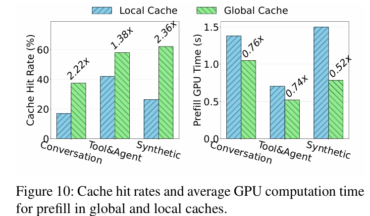

- Local cache 与 MOONCAKE Store 的 cache hit rate。
- 不同 workload 或集群规模下的变化。
- Cache hit improvement 如何转化为计算节省。

##### ==我的笔记==

- 配置了一个10个prefill节点的集群，并且限制所有request的输出长度为1来减少decoding阶段的影响。
- local cache 只能使用自己的cache，global cache可以跨节点共享。global cache有更高的命中率和更低的平均prefill GPU计算时间。

#### 5.3.3 Cache Replica

##### 内容框架

- 热点 KVCache 为什么会形成单节点带宽瓶颈。
- Replication 如何增加聚合读取带宽。
- Replica 数量与访问延迟、传输吞吐和存储容量之间的权衡。
- Cache load balancing policy 如何触发副本调整。

##### Figure 11

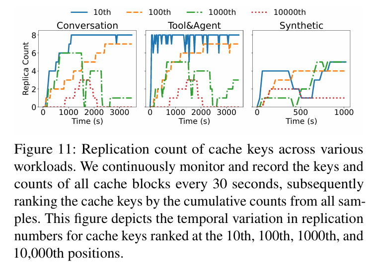

- 不同 replicas 数量下的传输或访问表现。
- 热点场景与非热点场景的差异。

##### ==我的笔记==

- 每三十秒采样一次，所有的cache key通过在所有样本中的累计次数从高到低排名，图中的线就是排名为10、100、1000、10000名的cache key的实时复制次数。
- 在conversation和tool&agent负载中最多的复制数量几乎占满了所有instance。而在混合负载中，共享的就很少，导致了很少的复制以及潜在的波动。
- 这说明了调度方案的高效，为热门cache复制，特别是在有高度集中的前缀cache的场景中。

### 5.4 KVCache Transfer Performance

#### 5.4.1 Transfer Engine

##### 内容框架

- Transfer engine 的 microbenchmark 设置。
- MOONCAKE Store 与其他传输方案的对比。
- DRAM-to-DRAM、GPU-to-GPU 或不同路径的带宽表现。
- 单 NIC 与多 NIC、不同传输大小下的带宽利用率。
- Topology-aware selection 和 transfer slicing 的贡献。

##### Figure 12

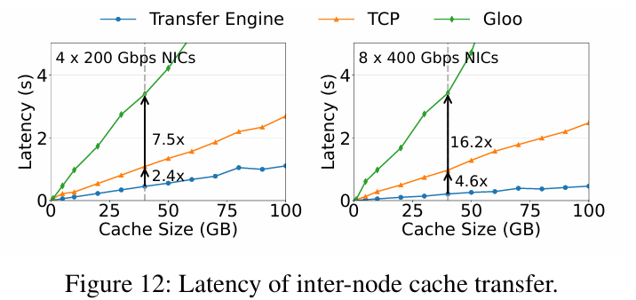

- 对比方案、数据路径和指标。
- 论文报告的加速比及其适用配置。

##### ==我的笔记==

- baseline采用Gloo与TCP-based transfer，均采用64的并行度和128KB的最小传输粒度。左图使用4个200Gbps的NIC，右图使用8个400Gbps的NIC。
- 图中的竖线表示为传输40GB数据时的延迟，对应的是LLaMA3-70B中128k tokens的cache大小。

#### 5.4.2 Bandwidth Demand by MOONCAKE

##### 内容框架

- 理论分析中的带宽阈值与实际流量的对应关系。
- A800/H800 集群的 NIC 带宽是否足以支持 KVCache reuse。
- Prefill computation、KVCache loading 和跨节点 transfer 的重叠程度。
- 网络带宽不足时会如何影响 TTFT 和系统收益。

##### Figure 13

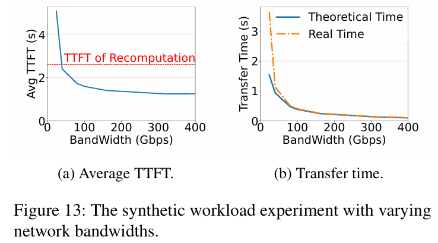

- 不同 workload 或配置下的带宽需求。
- 实际带宽、理论最低带宽和硬件上限之间的关系。

##### ==我的笔记==

- 在混合负载下，测试从24Gbps到400Gbps的带宽范围内的传输时间以及平均TTFT。当带宽超过100Gbps时，平均TTFT保持在2s以下，显著低于TTFT的重新计算基准线。当传输带宽跌至100Gbps以下时，系统性能就出现了显著的下滑，TTFT快速上升，出现明显的网络拥塞。为了最优的系统表现，作者推荐至少100Gbps的网络带宽。

#### 5.4.3 E2E Latency Breakdown

##### 内容框架

- 请求端到端路径中的主要延迟组成。
- Prefix KVCache load、incremental prefill、P/D transfer 和 decode admission 的开销。
- 哪些传输可以被计算覆盖，哪些会暴露在 TTFT 中。
- Context length 和 cache hit length 对 latency breakdown 的影响。

##### Figure 14

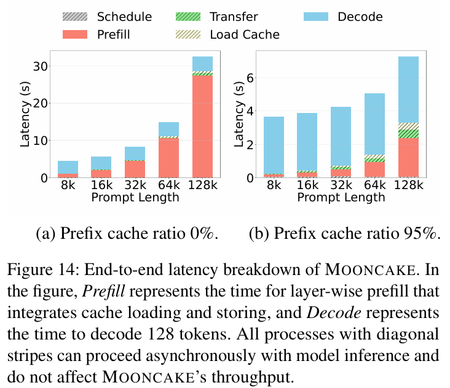

- 各阶段延迟占比。
- P/D disaggregation 新增的通信开销是否可控。

##### ==我的笔记==

- MOONCAKE的延迟可以分为五种：1）调度和排队时间；2）层级的预填充时间；3）cache传输时间；4）decoding节点从DRAM加载cache到HBM需要的时间；5）decoding时间。
- 图14使用的前缀cache率是0%和95%，可以观察到前缀caching显著降低了预填充时间。调度、传输和加载cache可以与模型推理异步执行，因此不会影响MOONCAKE的吞吐量。
- 此外，由于这些开销导致的TTFT增加量小于前缀缓存带来的减少量。即使考虑到开销，MOONCAKE中的前缀缓存仍可在输入长度为128k个Token时将TTFT降低86%。

### 5.5 P/D Ratio

#### 内容框架

- Prefill nodes 与 decoding nodes 数量比例的资源权衡。
- Prefill nodes 增加对 TTFT、TBT 和 decoding capacity 的影响。
- Decoding nodes 增加对 TBT、TTFT 和 prefill queue 的影响。
- 如何根据 workload 的输入/输出特征寻找最优 P/D ratio。
- 为什么生产环境采用相对固定的比例，而不是频繁动态切换节点角色。
- 何时仍然需要调整 P/D ratio。

#### Figure 15

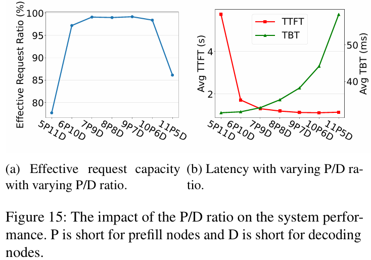

- 不同 P/D ratios 下的 effective request capacity。
- 不同 P/D ratios 下的平均 TTFT 和 TBT。
- 实验中最优比例及其与 workload 的关系。

#### ==我的笔记==

- 使用由16个节点组成的集群来测试不同P/D率。负载采用混合负载。然后计算 effective request capacity，TTFT和TBT设置为10s和100ms
- 作者也注意到一些先前的工作使用动态切换P/D的规则（我看过的文献中DistServe就提到了这一点，他的做法是遍历所有可能，并且使用模拟的方法判断当前组合是否最优），但是在实际部署时，他们发现在线流量的特征是总体稳定的，因此他们采用了固定的P/D比例并持续关注PD节点负载，只有在出现明显负载波动发生时，才切换节点规则。

## 6. Related Work

### 内容框架

- LLM serving scheduling 与 memory management：Orca、vLLM、FlexGen、Sarathi-Serve、FastServe。
- Prefill/decoding disaggregation 相关工作以及 MOONCAKE 的继承关系。
- Prefix caching：Prompt Cache、SGLang/RadixAttention。
- Hierarchical KV caching：CachedAttention。
- MOONCAKE 与已有工作的区别：全局分布式缓存、传输引擎、cache-aware scheduling 和生产级部署。
- 可与 MOONCAKE 组合的正交技术：KVCache compression、KVCache-friendly attention architecture。

### 我的笔记

- 

## 7. Conclusion

### 内容框架

- 论文最终解决的问题。
- KVCache-centric disaggregated architecture 的核心组成。
- “More Storage for Less Computation”成立所需的条件。
- 系统如何在有效吞吐和 latency SLO 之间取得平衡。
- 设计的主要收益、代价和适用 workload。
- 实验结果是否充分支持论文的核心论点。
- 与 DistServe、vLLM/PagedAttention、SGLang/RadixAttention 的关系。
- 阅读完成后，用自己的话总结论文的创新点和局限。

### 我的总结

- 
