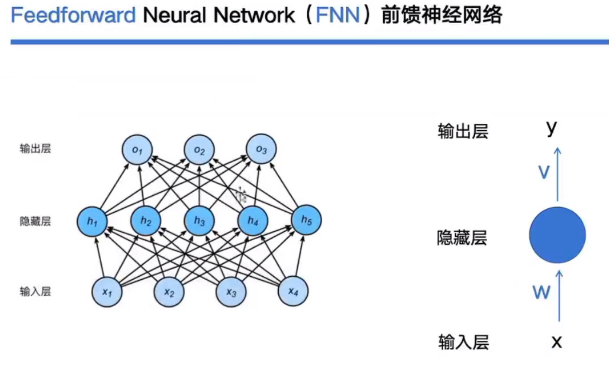
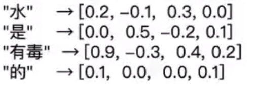
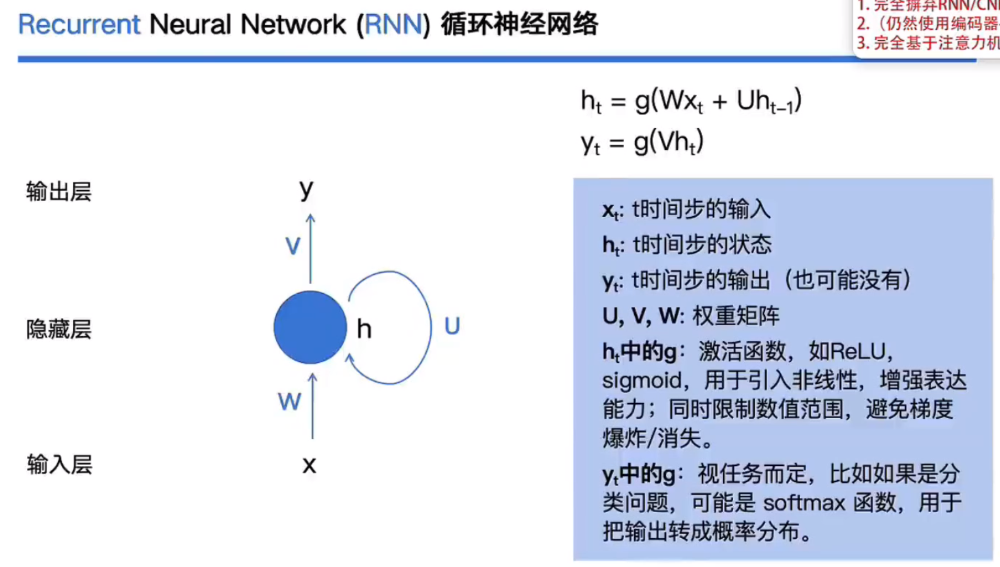
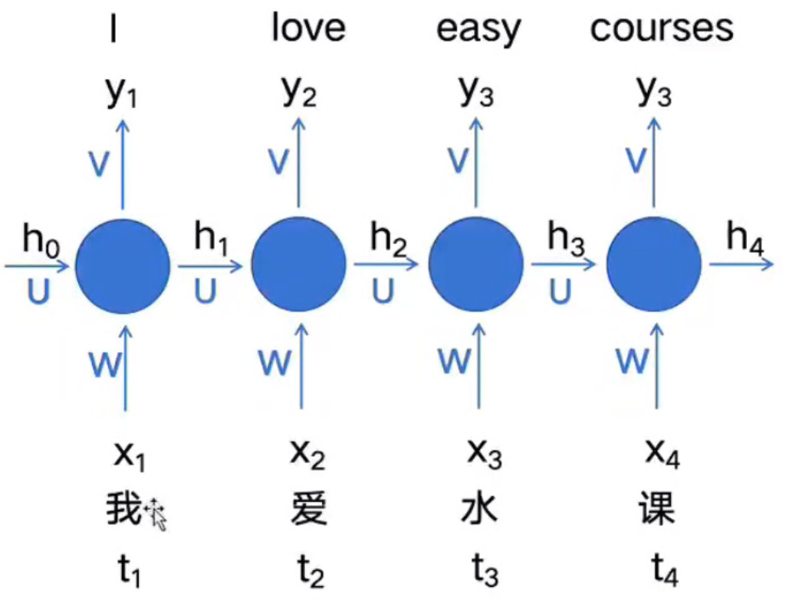
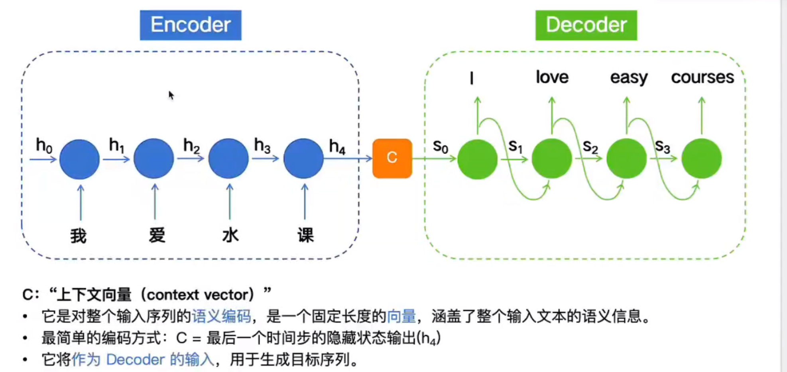
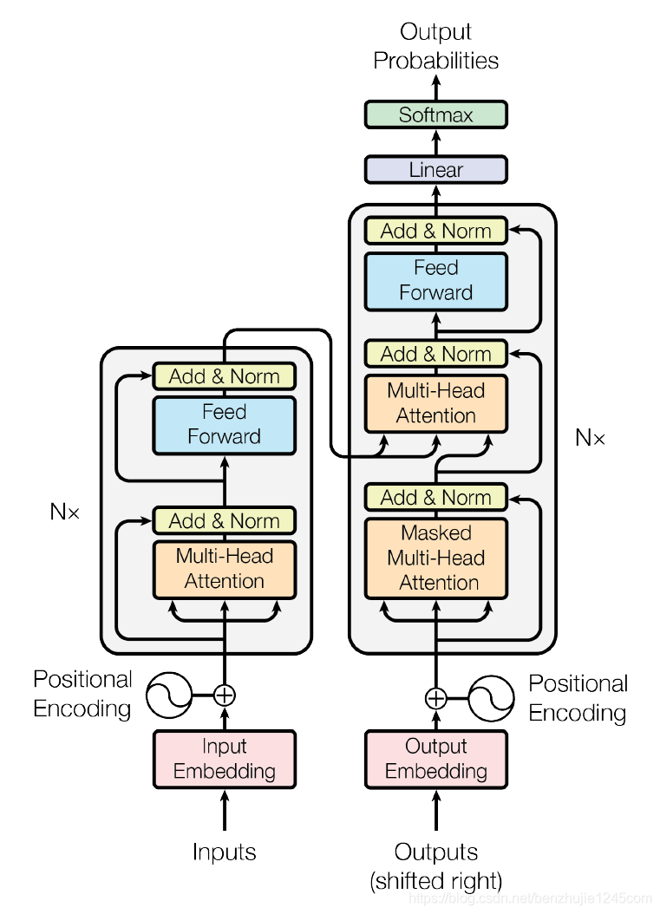

# LLM 基础

## 0. 背景基础



以当前图中的结构为例，输入层的维数是4维，当输入一句话：水是有毒的。


为了让这句话可以输入到模型中，有两种解决方案：

- 将各个token的第1维数字相加后除4，得到第1维输入，以此类推。优点是保持了原有模型简单的结构，缺点是丢失了语句中的位置信息。
- 将4个token前后首尾连接，组成一个16维的向量，模型结构也需要将输入扩大到16维，但是这样会导致计算复杂度明显上升。而且FNN的输入层是固定的，效率很低。仍会把句子当整体处理，无法理解先后关系。



基础结构就是把当前词的隐藏状态作为下一个词的辅助输入，依次迭代，这样就可以做到长上下文理解。FNN是一次输入一句话，RNN是输入一个词，就蹦一个词出来，类似下图：



为了解决输入输出不等长问题，以及不一定是翻译任务，输入与答案不一定都是一一对应的，因此出现了编解码器结构：



## 1. Transformer 基础

### 1.1 创新点

- 完全摒弃了RNN/CNN
- 完全基于注意力机制

### 1.2 架构



#### 1.2.1 词嵌入

将输入的各个token转变为==512维==的向量，具体实现是通过训练来得到词嵌入权重的。当前大模型很多都是自行训练词嵌入权重的，这样效果更好。

#### 1.2.2 位置编码

通过正弦余弦计算，得到的位置编码直接加到词向量上。可以让当前词向量包含位置信息。

#### 1.2.3 注意力模块（单头）

计算公式：\(A=\operatorname{softmax}\left(\frac{QK^T}{\sqrt{d_k}}\right)\)

将有位置编码的512维词向量X输入attention模块中，注意到有三个分叉，三个分叉分别包含$W_q$、$W_k$、$W_v$，每个都是==$512\times512$==大小的矩阵。

分别将==$1\times512$==的词向量X分别与这三个矩阵相乘，即$[1\times512]\times[512\times512]=[1\times512]$。分别得到三个==$1\times512$==的向量$X_q、X_k、X_v$。

如果输入的长度为t个token，每个token $X_i$都会有q，k，v。为了简化运算，会把各个token的q，k，v分别放置在一起，组成一个巨大的Q，K，V矩阵，大小均为为==$t\times512$==。

j通过$QK^T$计算得到QK Score Matrix（相似度矩阵），是大小为==$t\times t$==的矩阵，记录的是每个token与其他token（包括自己）的相关性。由于之后会经过softmax函数归一化，因此需要除以$\sqrt{d_k}$（$d_k$是指矩阵K的列数，也就是向量维数）把值缩放到较低的值，来缓解softmax函数导致的极大值梯度消失问题，最终得到==$t \times t$==的A。

计算得到的A再与V矩阵相乘得到最终的注意力权重，注意力权重矩阵的大小为==$t\times512$==。

#### 1.2.4 注意力模块（多头）

以8个头为例，需要先将原本大小为==$t\times512$==Q、K、V拆成8个大小为==$t\times64$==的Q、K、V小矩阵，每一组这个小矩阵就称之为一个头。每个头可以作为一个语义子空间。

多头注意力计算完后，会得到每个头的注意力权重矩阵，大小为==$t\times 64$==。需要将8个头的注意力权重矩阵合成一个注意力权重矩阵，大小为==$t\times512$==。其中**需要经过线性层**，不是简单的拼接。

> Q:为什么是8头的64维，不能8头512维吗？
>
> A:这样可以在不改变计算量的同时提高模型能力。
>
> Q:为什么多个头的输出矩阵合并起来要经过线性层？
>
> A:线性层的主要作用：
>
> - 融合不同头的信息：拼接只是把结果并排放置，头与头之间没有发生信息组合。
>
> - 将结果映射回模型的表示空间：方便与原输入进行残差相加。
>
> - 学习每个头、每个特征的重要性：模型可以加强、减弱或组合不同头提供的信息。
>
>   可以类比为：多个头就像多个领域不同的专家，每个专家分别提供一份分析。拼接只是把所有报告装订在一起，而输出线性层像一位编辑，将不同专家的信息重新组合成一份统一的结论。编辑方式也是训练得到的。

#### 1.2.5 层归一化

层归一化主要解决的是：

```
深层网络中隐藏状态的尺度不断漂移
        ↓
Attention容易饱和，梯度容易不稳定
        ↓
对每个Token的隐藏向量进行归一化
        ↓
每一层获得尺度稳定的输入
        ↓
Transformer更容易、更稳定地训练
```

它保留了隐藏向量所表达的信息结构，主要控制的是数值尺度，而不是把不同Token变成相同表示。

#### 1.2.6 前馈全连接网络

全连接层一般由两个线性变换（全连接层）和一个激活函数组成；

网络架构为：$FFN(X) = max(0,xW_1+b_1)W_2+b_2$

**第一个线性层：**把输入维度从$d_{model}$映射到更高的维度$d_{ff}$。在Transformer论文中，$d_{model}=512$，$d_{ff}=2048$；$W_1$是维度维（$d_{model}$，$d_{ff}$）的权重矩阵。$b_1$是维度为$d_{ff}$的偏置向量。

**激活函数：**在第一个线性层的输出上应用一个非线性的激活函数，通常是ReLU(max(0,x))函数。

**第二个线性层：**把$d_{ff}$映射回原始的$d_{model}$维度。$W_2$是维度为（$d_{ff}$，$d_{model}$）的权重矩阵。$b_2$是维度为$d_{model}$的偏置向量。

------

## 2. Batch

一次处理一组样本，比逐条处理更高效，又比一次处理全部数据更省内存。

- 提高效率：GPU并行计算，充分利用算力。
- 节约显存：整个数据集通常放不进显存，需要拆成batch才可以训练。
- 减少更新开销：可以跑完一个batch中后，更新一次参数，比每条样本都更新更高效。

==**小batch**==
优点：可以节约显存，随机性强。

缺点：计算效率低（未充分利用并行资源），梯度波动大。

==**大batch**==

优点：可以提高计算效率，梯度稳定。

缺点：显存占用大，过大的时候会导致泛化变差。

### 2.1 Batch如何产生梯度

假设Batch中有4个样本，每个样本都产生自己的Loss：

```
L₁、L₂、L₃、L₄
```

Batch Loss通常是这些Loss的**平均值**：

\[ L=\frac{L_1+L_2+L_3+L_4}{4} \]

对应的梯度也是多个样本梯度的**平均值**：

\[ g=\frac{g_1+g_2+g_3+g_4}{4} \]

然后优化器使用这个平均梯度更新模型。

因此：

- 小Batch的梯度随机性较大。
- 大Batch的梯度通常更加稳定。
- 大Batch每处理相同数量数据时，参数更新次数更少。

例如有1024个样本：

```
Batch Size = 1：更新1024次
Batch Size = 32：更新32次
Batch Size = 256：更新4次
```

因此改变Batch Size时，学习率、Warmup和训练步数等配置也可能需要调整。

### 2.2 Mini Batch、Micro Batch和Global Batch

#### 2.2.1 Mini Batch

传统机器学习中，Batch通常就是Mini Batch：

```
从整个数据集中取出一小批样本
→ 计算梯度
→ 更新一次模型
```

之所以叫Mini Batch，是为了区别于：

- Full Batch：一次使用整个数据集。
- Stochastic：一次只使用一个样本。
- Mini Batch：一次使用一部分样本。

现代深度学习里，**人们一般直接把Mini Batch简称为Batch。**

#### 2.2.2 Micro Batch

Micro Batch是单张GPU一次前向和反向实际处理的样本数。（取决于GPU一次可以放几个Sample）

例如：不能直接设置：

```
Batch Size = 8
```

否则会显存不足。

于是把8个Sample切成4个Micro Batch：

```
Micro Batch 1：Sample 1、2
Micro Batch 2：Sample 3、4
Micro Batch 3：Sample 5、6
Micro Batch 4：Sample 7、8
```

配置为：

```
Micro Batch Size = 2
Gradient Accumulation Steps = 4
```

执行过程是：

```
Micro Batch 1 → Forward → Backward → 保存梯度g₁//每次保存梯度会÷2，平均梯度
Micro Batch 2 → Forward → Backward → 累加梯度g₂
Micro Batch 3 → Forward → Backward → 累加梯度g₃
Micro Batch 4 → Forward → Backward → 累加梯度g₄
                                      ↓
                              optimizer.step()//在这里总梯度÷4
                                      ↓
                                  更新参数
```

这4个Micro Batch处理期间，模型参数都不变。

#### 2.2.3 Local Batch

一张GPU或一个数据并行副本在一次参数更新前总共处理的样本数量。

如果：

```
Micro Batch Size = 2
Gradient Accumulation Steps（梯度累计步数） = 8
```

那么：\[ LocalBatchSize=2\times8=16 \]

#### 2.2.4 Global Batch

所有数据并行副本在一次参数更新前共同处理的样本数量：

\[ GlobalBatchSize = MicroBatchSize \times GradientAccumulationSteps \times DPSize \]

假设：

```
Micro Batch Size = 2
Gradient Accumulation Steps = 4
DP Size = 4
```

那么：

\[ GlobalBatchSize=2\times4\times4=32 \]

表示：

> 模型每更新一次参数，整个分布式系统一共处理32个序列。

如果每个序列有2048个有效Token，那么每次更新最多处理：

\[ 64\times2048=131072 \]个Token。

### 2.3 训练batch和推理batch

#### 2.3.1 训练

在训练时一条sample是可以并行计算的（而推理一条sequence只能一次一次迭代），比如：

”今天天气很好“这一句话的训练，可以这样：

今天

今天天气

今天天气很好

```
Global Batch
    ↓ 按DP拆分
Local Batch
    ↓ 按显存/流水线拆分
Micro Batches
    ↓
Forward + Backward
    ↓
梯度汇总
    ↓
一次Optimizer Step
```

训练Batch存在明确的终点：

```
参数更新
```

#### 2.3.2 推理

```
请求队列
    ↓ 调度器选择
Scheduler / Iteration Batch
    ↓ 按阶段区分
Prefill Batch / Decode Batch / Mixed Batch
    ↓ 可选执行拆分
Micro Batches
    ↓
Forward + 采样
    ↓
更新KV Cache和请求状态
    ↓
进入下一轮动态调度
```

推理Batch不存在Optimizer Step这样的全局终点。每个请求生成结束后独立离开。

### 2.4 Batch的内部细节

对于两条长度不一的请求，会先通过padding将其对齐。

假设当前有两个请求：

```
请求A：我 喜欢
请求B：今 天 天气 很好
```

Token ID假设为：

```
A：[10, 11]
B：[20, 21, 22, 23]
```

将短序列补齐到长度4：

```
input_ids =
[
  [10, 11, PAD, PAD],
  [20, 21, 22, 23 ]
]
```

形状是：

```
[B, S] = [2, 4]
```

Attention Mask是：

```
[
  [1, 1, 0, 0],
  [1, 1, 1, 1]
]
```

含义是：

```
请求A只能使用位置0、1
请求B可以使用位置0、1、2、3
```


假定模型内部维度H为512

所以[B,S,H]=[2,4,512]

原始词嵌入之后的向量都是[2,4,512]，为了便于简化矩阵运算，会把他们展平成[2*4,512]即[8,512]。这样计算QKV效率更高


但是在真正计算attention时，不能展平之后进行相乘，只能每个request的head一一对应。进行**四维矩阵乘法**：

当前：

```
Q:  [B, N, S_q, D]
Kᵀ: [B, N, D, S_k]
```

这里真正参与矩阵乘法的是最后两维：

```
[S_q, D] × [D, S_k]
→ [S_q, S_k]
```

前面的：

```
[B, N]
```

表示一共有`B×N`组彼此独立的矩阵乘法。

本例：

```
B = 2
N = 2
```

因此实际需要计算4组矩阵：

```
请求A，Head 0：
Q[A,0]: [4,4] × K[A,0]ᵀ: [4,4]
→ Score[A,0]: [4,4]

请求A，Head 1：
Q[A,1]: [4,4] × K[A,1]ᵀ: [4,4]
→ Score[A,1]: [4,4]

请求B，Head 0：
Q[B,0]: [4,4] × K[B,0]ᵀ: [4,4]
→ Score[B,0]: [4,4]

请求B，Head 1：
Q[B,1]: [4,4] × K[B,1]ᵀ: [4,4]
→ Score[B,1]: [4,4]
```

框架将这4个矩阵乘法批量提交给GPU。

### 2.5 Continuous Batching

核心定义是：

==推理系统不会等一个固定Batch中的所有请求全部生成完才接收新请求，而是在每一轮模型Forward结束后，移除已完成请求、加入新请求，并重新组成下一轮Batch。==
自回归Decode是一个一个生成Token的，每生成一次，就叫一次迭代，每次迭代前组成一次batch，把已经完成的sequence去掉，新的sequence加进来。

#### 2.5.1例子

当前服务中有三个请求：

```
Request A：生成1个答案
Request B：生成3个候选答案
Request C：Beam Width = 2
```

对应：

```
Request A
└── Sequence A₀

Request B
├── Sequence B₀
├── Sequence B₁
└── Sequence B₂

Request C
├── Sequence C₀
└── Sequence C₁
```

统计结果：

```
Request数量 = 3
Active Sequence数量 = 1 + 3 + 2 = 6
```

模型Decode Forward看到的是：

```
Batch = [A₀, B₀, B₁, B₂, C₀, C₁]
```

输入：

```
input_ids: [6, 1]
```

输出：

```
logits: [6, V]
```

因此模型视角的Decode Batch Size是6。

**下一轮**如果：

- `A₀`结束；
- `B₁`结束；
- C的Beam Search剪掉一条路径；
- 新请求D加入并产生`D₀`；

下一轮可能是：

```
[B₀, B₂, C₀, D₀]
```

此时：

```
活跃Request数 = 3  # B、C、D
活跃Sequence数 = 4
Decode Batch Size = 4
```

## 3. MoE

MoE 并不是替代整个 Transformer，也不是多个完整 LLM，而主要是把：

\[ \boxed{\text{一个 Dense MLP}} \]

替换成：

\[ \boxed{\text{Router + 多个稀疏激活的 MLP}} \]


目的是为了能够在扩大模型MLP层参数，提高模型能力的同时，降低MLP层的参数占用


### 3.1 MoE路由机制

- **Token Choice**：token选择专家
  大多数的选择，容易导致负载不均衡的现象。
- **Expert Choice**：专家选择token
  容易导致token drop，即某些token没有被专家选择的情况，而且在自回归decode中，token都是一个一个生成的，不太适合。


Top-k路由的专家索引**本身不可微**，但被选中专家的 gate 权重通常仍可获得梯度。

也就是说，计算图可以粗略理解为：

```
             Router Wr
                │
                ▼
        [0.49 0.30 0.15 0.06]
                │
           ┌────┴────┐
           │         │
        Top-k      gate weights
           │         │
           ▼         ▼
        {1, 2}    0.62, 0.38
           │         │
           │      可微路径
           │         │
           ▼         ▼
          E1(x)     ×0.62
          E2(x)     ×0.38
             \       /
              \     /
                y
                │
               Loss
```

**梯度不是通过 `{1,2}` 这个离散索引反传，而是通过 \(g_1,g_2\) 这条连续路径反传。**


每个专家本身就是一个MLP，每个专家都有独立的参数。transformer block可以选择全部使用MoE或者Dense 和 MoE 交替。

### 3.2 训练稳定性与负载均衡

#### 3.2.1. 为什么 MoE 容易训练不稳定

设一层有 \(N\) 个专家。对第 \(t\) 个 token：

\[ z_{t,i}=x_t^\top W_{r,i} \]

\[ p_{t,i}=\operatorname{softmax}(z_t)_i \]

Router 选择 Top-\(k\) 专家：

\[ S_t=\operatorname{TopK}(p_t) \]

MoE 输出：

\[ y_t=\sum_{i\in S_t}g_{t,i}E_i(x_t) \]//E是i号专家输出，g是当前专家的权重


只有被选中的专家会处理该 token。这很容易形成正反馈。从而导致==Router collapse 或 expert collapse。==

它会同时造成三类问题：

- 训练问题：冷门专家几乎收不到梯度；
- 模型问题：大量专家参数没有得到有效利用；
- 系统问题：热门专家所在 GPU 工作繁重，其他 GPU 等待。

#### 3.2.2 负载均衡损失

DeepSeekV3的**辅助无损负载平衡**就是为了避免 负载均衡损失 对于权重的影响，只通过辅助的参数来帮助模型判断如何选择专家，不影响权重的更新。

## 4. LLM并行

### 4.1 DP

假设有 8 张 GPU：

- 每张卡放一份完整模型。
- 每张卡读取不同的样本。
- 前向、反向独立执行。
- 反向结束后，对**梯度做 All-Reduce**。
- 所有模型副本用相同梯度更新，因此参数保持一致。

> 所有的DP都是需要在一个Global Batch完成之后，计算平均梯度，再更新参数。不然不同的GPU之间的参数会逐渐分化。

#### 4.1.1 DP的优缺点

**优点：**每张卡计算完整且规则，GPU利用效率通常很好。通信集中在反向梯度同步，可以和反向梯度的计算重叠。

**缺点：**由于每张卡都保存完整参数、梯度和优化器状态；导致很多内容都没必要地复制了四遍。

#### 4.1.2 FSDP 和 ZeRO ==仍然属于 DP==

ZeRO 分级：

- **ZeRO-1**：分片 optimizer states；将优化器分片，每个GPU划分得到的优化器负责模型参数的一部分，在参数更新之前，其他GPU会把当前GPU所需要的该梯度传输给它，来计算其负责的部分的平均梯度，使用部分的优化器更新部分的模型参数。

- **ZeRO-2**：再分片 gradients；

  ZeRO-2 真正新增的是：

  1. 梯度一产生就分桶归约。
  2. 非本卡负责的梯度立即释放。
  3. 梯度累积结果只以 \(1/N\) 分片形式长期存在。
  4. 通信可以与后续层的反向计算重叠。

- **ZeRO-3**：再分片 parameters。

FSDP `FULL_SHARD` 可以近似理解成 ZeRO-3 的执行模式：

1. 平时每卡只保存参数分片；
2. 执行某个模块前 All-Gather 所需参数；
3. 每个 rank 仍对自己的样本执行完整层计算；
4. 反向用 ==Reduce-Scatter== 聚合并重新分片梯度；（Reduce-Scatter是因为每个部分的参数都是被分在不同的GPU上的，因此参数更新需要先聚合求平均梯度之后，再根据不同梯度对应的参数所在的GPU，来Scatter）
5. 完整参数用完后释放。

### 4.2 TP

#### 4.2.1 经典 Megatron 切法

Transformer **MLP** 为：

\[ X[N,H] \rightarrow W_1[H,4H] \rightarrow W_2[4H,H] \]

第一层按输出维切：

\[ W_1^{(i)}:[H,4H/t] \]

每个 rank 计算：

\[ U_i=XW_1^{(i)} \]

得到：

\[ U_i:[N,4H/t] \]

经过激活函数后，第二层按输入维切：

\[ W_2^{(i)}:[4H/t,H] \]

每卡得到一个部分结果：

\[ Y_i=\phi(U_i)W_2^{(i)} \]

最后：

\[ Y=\sum_iY_i \]

因此需要 All-Reduce。

#### 4.2.2 Attention切割

通常把 Attention Heads 分给不同 TP rank


先假设 **TP=2、8 个 Attention Heads、hidden size \(H\)**。两张 GPU 处理的是**同一批 token**，这点和 DP 完全不同。

##### 1、进入 Attention 时，两张卡最开始看到相同的 \(X\)

输入：

\[ X\in\mathbb{R}^{N\times H} \]

可以先理解成：

```
GPU0：X
GPU1：X
```

正常 Attention 要计算：

\[ Q=XW_Q,\quad K=XW_K,\quad V=XW_V \]

**如果没有 TP**，假设：

\[ W_Q,W_K,W_V\in\mathbb{R}^{H\times H} \]

**TP=2** 后，把 QKV projection **按照输出维度切开**：

\[ W_Q=[W_Q^{(0)},W_Q^{(1)}] \]

其中：

\[ W_Q^{(0)},W_Q^{(1)} \in\mathbb{R}^{H\times H/2} \]

K、V 同理。

于是：

```
                 同一个 X（这里有点问题，没分成8个独立的head）
                /       \
               ↓         ↓
GPU0: WQ0 WK0 WV0     GPU1: WQ1 WK1 WV1
       ↓                     ↓
    Q0 K0 V0              Q1 K1 V1
```

得到：

\[ Q_0,Q_1\in\mathbb{R}^{N\times H/2} \]

注意这里**不需要通信**。

因为：

\[ Q=[Q_0,Q_1] \]

GPU0 和 GPU1 各算完整 Q 的一半就行。

##### 2、Attention计算都不用合并，只需要按照attention head的计算步骤来。


##### 3、最终的Output Projection

Attention 算完以后：

```
GPU0：A0 ∈ R^(N × H/2)
GPU1：A1 ∈ R^(N × H/2)
```

完整 Attention 输出应该是：

\[ A=[A_0,A_1] \]

然后==多头Transformer 要经过一次线性层计算：==

\[ Y=AW_O \]

如果把：

\[ W_O \]

按照**输入维度**切：

\[ W_O= \begin{bmatrix} W_O^{(0)}\\ W_O^{(1)} \end{bmatrix} \]

其中：

\[ W_O^{(i)} \in\mathbb{R}^{H/2\times H} \]

那么：

\[ Y = [A_0,A_1] \begin{bmatrix} W_O^{(0)}\\ W_O^{(1)} \end{bmatrix} \]

根据矩阵乘法：

\[ \boxed{ Y=A_0W_O^{(0)}+A_1W_O^{(1)} } \]

于是 GPU0 计算：

\[ Y_0=A_0W_O^{(0)} \]

GPU1 计算：

\[ Y_1=A_1W_O^{(1)} \]

但是注意真正的结果是：

\[ \boxed{Y=Y_0+Y_1} \]

所以这里必须发生一次通信：

```
GPU0: Y0 ──┐
           ├── All-Reduce(SUM) → Y
GPU1: Y1 ──┘

最后：

GPU0：Y
GPU1：Y
```

这就是：

==Attention output 需要一次规约。==

#### 4.2.3 TP收益与成本

**收益：**

- 参数、梯度、优化器状态理想上约缩小到 \(1/t\)；
- 单层计算量约缩小到 \(1/t\)；
- Attention heads、FFN 中间激活可以分片；
- 能解决“一个 Transformer block 本身都放不下”的问题。

**成本：**

- 几乎每层都要通信；
- 对网络延迟和带宽非常敏感；
- TP 太大会让每卡 GEMM 变小，计算效率下降（切的太碎，每张GPU的矩阵就会过小）；
- hidden size、head 数、KV head 数通常要满足可整除约束；
- 自回归 decode 每次只有少量 token，==**TP 通信更容易成为瓶颈**==。

### 4.3 PP

PP 沿模型深度切层。

例如 24 层、PP=4：

```
GPU0：Layer 1–6
  ↓ activation
GPU1：Layer 7–12
  ↓
GPU2：Layer 13–18
  ↓
GPU3：Layer 19–24
```

前向时传激活，反向时反方向传激活梯度。

如果一次只处理一个 batch，那么 GPU1 等 GPU0、GPU2 等 GPU1，大量设备处于空闲状态。**因此 PP 会把 batch 切成很多 microbatch，让不同 stage 同时处理不同 microbatch。**

**PP 的关键问题**

- **==最慢 stage 决定整个 pipeline 的吞吐；==**
- 不能只按照层数平均切，embedding、LM head、MoE 层可能明显更重；
- PP 越大，bubble 和 stage 边界越多；
- PP 能解决“模型整体太深”，但不能解决“单层本身放不下”；
- activation checkpointing 能进一步省显存，但会增加重计算。

### 4.4 EP

EP 只适用于 MoE 模型。

假设某个 MoE 层有 8 个专家、EP=4，每卡放两个专家。Router 为每个 token 选择 top-k 专家。

典型执行过程：

```
本地 token
  → Router 选择专家
  → 按目标专家重新排列 token
  → All-to-All 派发
  → 本地专家 FFN / Grouped GEMM
  → All-to-All 返回
  → 按路由权重合并输出
```

如果一个 token 的 top-2 专家分别在 GPU1 和 GPU3，它的 hidden state 会发送到两张卡，专家计算完成后再返回原 rank 合并。

**EP 节省什么：**

- routed expert 参数、梯度、优化器状态理想上约按 EP 度分片；
- dense attention、embedding、router 不会因为 EP 自动变小；
- 每个 token 只激活 top-k 个专家，因此要区分：
  - **总参数量**；
  - **每 token 激活参数量**。

**EP 最大的性能问题：**

- All-to-All 网络开销；
- 热专家导致负载不均；
- 某些 rank token 很多，其他 rank 空闲；
- EP 太大后，每个专家得到的 token 太少，Grouped GEMM 变成小矩阵；
- top-2 通信和专家计算通常显著高于 top-1；
- decode 阶段每步 token 很少，EP 往往比大 batch prefill 更难跑满。

EP 不等于“一张卡一个专家”。一张卡可以放多个专家；如果单个专家仍然太大，还可以对专家内部使用 Expert TP。MoE 的经典设计可参考 [GShard](https://arxiv.org/abs/2006.16668) 和 [Megatron Core MoE 文档](https://docs.nvidia.com/megatron-core/developer-guide/latest/user-guide/features/moe.html)。
