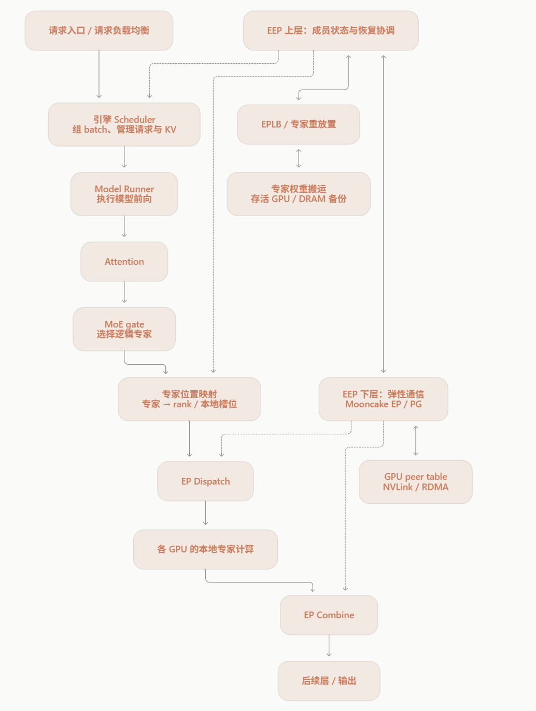

**EEP 这类方法主要运行在推理引擎内部，横跨“专家管理与恢复”以及“EP 通信”两层。向上连接引擎的执行循环，向下连接 GPU 通信、专家权重与网络。**

我这里按论文 [《Surviving Partial Rank Failures in Wide Expert-Parallel MoE Inference》](https://arxiv.org/html/2605.10670v1) 中的 EEP 来解释：它实际集成于 **SGLang + Mooncake**。可以用它理解这类方法在 vLLM 一类引擎中的位置，但不能直接认为它就是 vLLM 的某个模块。

**1．先把 EEP 放进整个架构**

下面实线表示正常计算路径，虚线表示状态控制与恢复关系。这是便于理解的模块图：



**理解这张图时，要区分两条路径：正常情况下，token 沿模型计算路径流动；发生故障时，恢复逻辑修改这条路径依赖的成员状态、专家位置和通信状态。**

**2．向上连接：引擎执行循环与专家放置管理**

EEP 上层需要知道“哪些 rank 还活着”，并据此决定是否修复专家布局。

它与执行循环的接口，可以概念化为：

```
执行一轮 forward
      ↓
检查 rank 状态变化
      ↓
如有故障，协调专家重放置、搬运权重、更新映射
      ↓
确认新配置可执行
      ↓
进入下一轮 forward
```

在 SGLang 当前源码里，可以看到几个直接对应的入口：

| 模块或函数                           | 连接的职责                        |
| ------------------------------------ | --------------------------------- |
| `ElasticEPStateManager`              | 保存活动 rank 等弹性状态          |
| `maybe_rebalance_after_rank_fault()` | 状态变化后调用 EPLB 重放置专家    |
| `maybe_recover_ep_ranks()`           | 检查恢复中的 rank，并协调重新接入 |
| 专家位置元数据                       | 告诉执行路径每个专家实际位于哪里  |

因此，**它需要接入引擎的执行边界，同时调用专家管理模块**。这些状态与调用关系可以在 [SGLang 弹性 EP 源码](https://github.com/sgl-project/sglang/blob/main/python/sglang/srt/elastic_ep/elastic_ep.py) 中看到。

这里还有一个关键区别：

```
模型 gate：这个 token 应该使用逻辑专家 E17
专家位置映射：E17 当前位于 rank 3 的槽位 2
```

恢复时主要改变第二项，保持模型选择的逻辑专家能够被执行。[专家位置元数据实现](https://github.com/sgl-project/sglang/blob/main/python/sglang/srt/eplb/expert_location.py)

**3．向下连接：Dispatch/Combine 通信与权重恢复**

这两部分需要配合解决两个不同问题：

| 故障造成的问题           | EEP 需要连接的下层模块              |
| ------------------------ | ----------------------------------- |
| 通信仍在等待失效 rank    | EP 通信后端、peer table、同步计数器 |
| 失效 rank 上的专家不可达 | 专家放置管理、权重传输、备份服务    |

论文的通信层实现在 **Mooncake EP / Mooncake PG**。GPU 通信 kernel 查询可修改的 peer table；超时发现失效 peer 后，将其排除。专家修复与 rank 重新接入安排在 forward 之间，并通过更新表内容，避免要求健康 rank 重新捕获 CUDA Graph。[论文 §3–4](https://arxiv.org/html/2605.10670v1#S3)

权重恢复则连接存活 GPU 和 CPU DRAM 备份。SGLang 的 `ExpertBackupManager` 是独立进程，保存专家权重，并通过 Mooncake Transfer Engine 注册内存、提供传输所需的信息。[备份管理源码](https://github.com/sgl-project/sglang/blob/main/python/sglang/srt/elastic_ep/expert_backup_manager.py)

**4．用一次 rank 失效串起来**

假设 rank 5 失效，原本它持有专家 E40：

```
EP 通信发现 rank 5 不可达
              ↓
更新活动成员状态，停止等待它
              ↓
恢复逻辑发现 E40 缺少可用位置
              ↓
EPLB 计算存活 ranks 上的新布局
              ↓
从可用副本或 DRAM 备份补齐权重
              ↓
发布新的专家映射与通信状态
              ↓
存活 ranks 继续服务
```

**只在 scheduler 中停止向 rank 5 分配新请求是不够的**：其他 rank 的请求仍可能选中 E40。反过来，只修改专家映射也不够，旧通信逻辑仍可能等待 rank 5。

另外，论文 EEP 会让故障发生时正在执行的请求报错，由客户端重试；它恢复的是实例后续的服务能力，并不保证每个在途请求无中断完成。[故障范围与请求语义，§3.1](https://arxiv.org/html/2605.10670v1#S3.SS1)

对应到 vLLM，相关位置也是 **Engine Core 执行循环、EPLB、MoE 模块及通信后端**。不过 vLLM 官方介绍的 Elastic EP 使用另一套重配置流程，包含通信组切换和图重新预热，不能把论文 EEP 的“健康 rank 无需重新捕获图”直接套过去。[vLLM Elastic EP 实现说明](https://vllm-project.github.io/2026/05/14/elastic-expert-parallelism.html)

所以，你可以把这类研究的核心接口记成：

**上接引擎执行循环；中间协调活动成员、专家映射与权重；下接 EP 通信后端。**

10:52