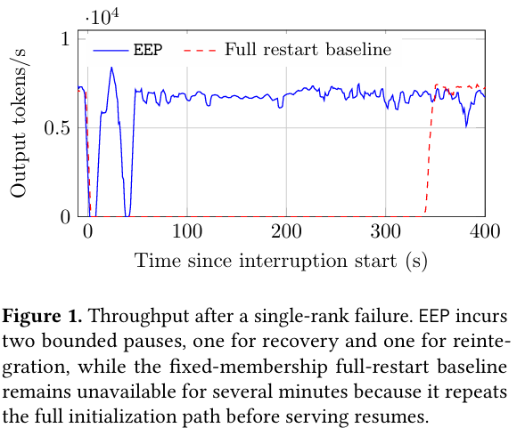
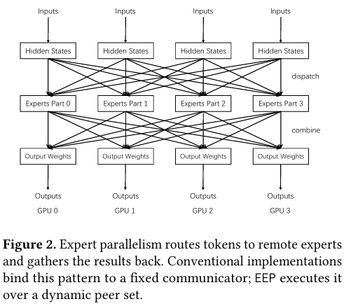
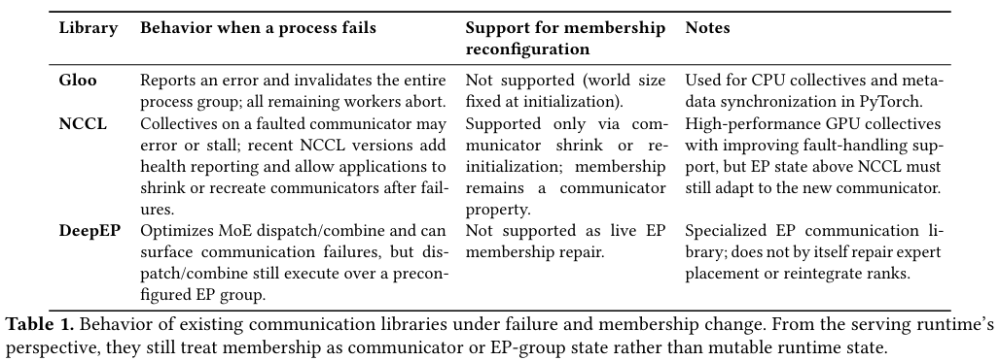
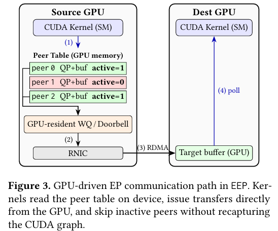
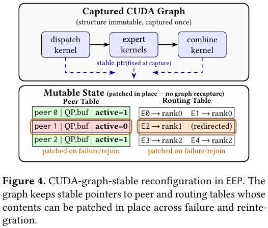
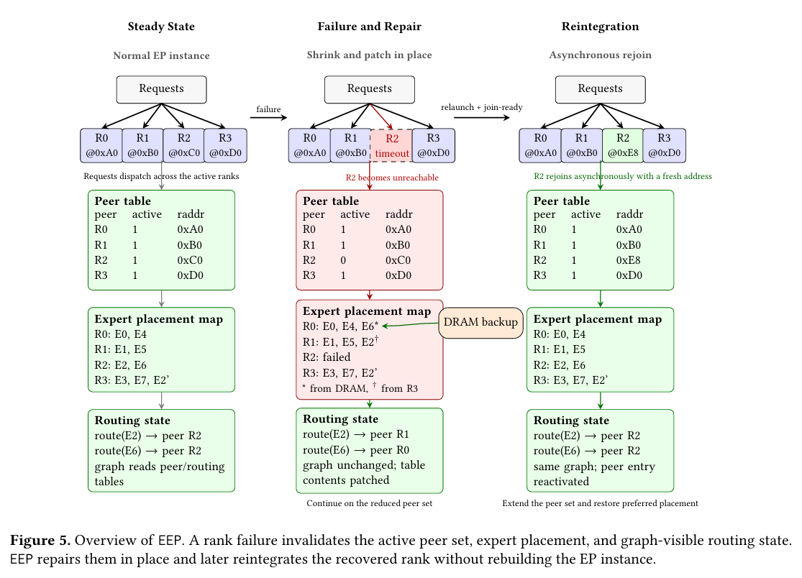
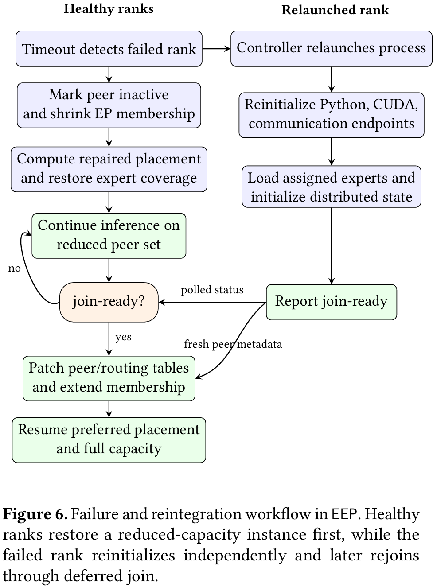
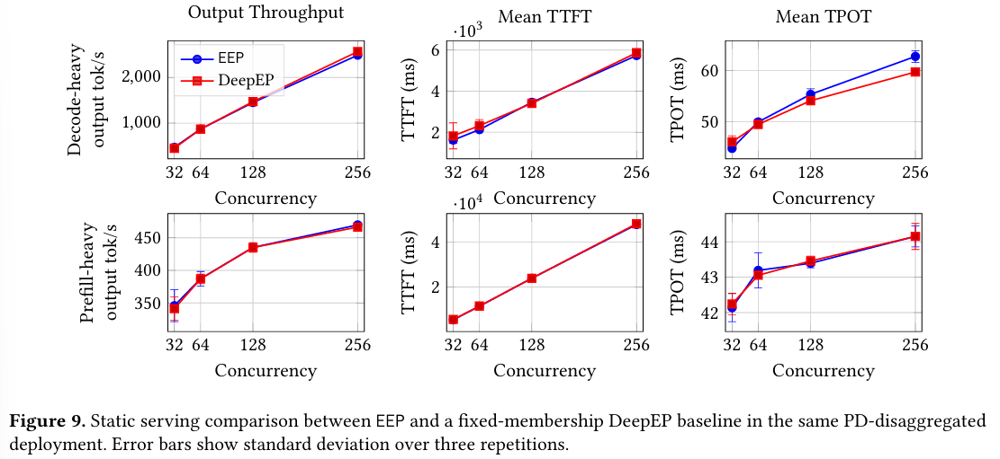
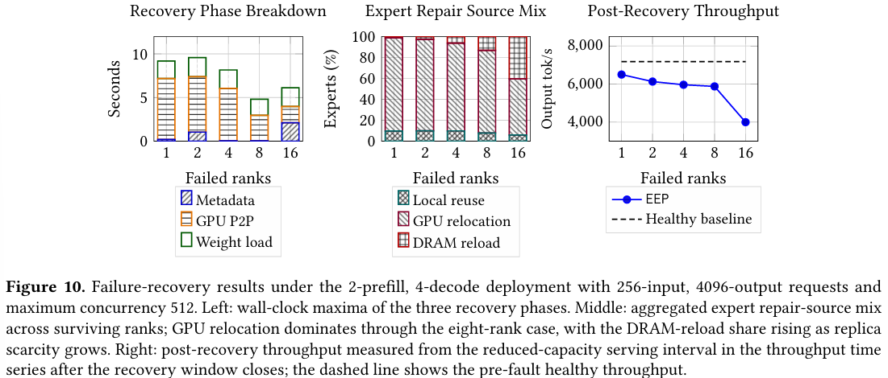
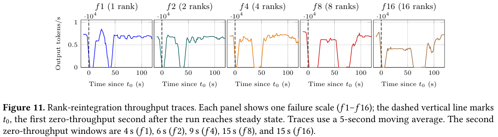

# Surviving Partial Rank Failures in Wide Expert-Parallel MoE Inference

## 0. 论文信息

- **系统**：EEP
- **来源**：arXiv:2605.10670v1，2026-05-11
- **关键词**：MoE Serving、Expert Parallelism、Fault Tolerance、GPUDirect RDMA、CUDA Graph
- **原文**：[PDF](./Surviving-Partial-Rank-Failures-in-Wide-Expert-Parallel-MoE-Inference.pdf)

### 阅读进度

- [x] Abstract & Introduction
- [x] Background
- [x] System Design
- [x] Evaluation
- [ ] 总结

## 1. Abstract & Introduction

### 概况

- 研究问题：EP中易出现的单个rank崩溃而导致整个系统崩溃。

- **现有方法的问题**：当前MoE模型都依赖大规模的EP来完成，这么做会有一个系统的代价：每一个系统decoding step都会依赖于所有激活的EP ranks，因此一个rank的故障会导致整个系统的崩溃。当前已有EP技术栈对于这类问题解决能力很弱，因为rank配置都是在开始时固定的，导致后续许多依赖在此基础上的communicator state, expert placement, 和routing metadata baked into CUDA execution graphs都无法更新，导致系统无法在保持instance有效的同时，收缩系统。

- **论文方案**：EEP

- **本文方法（EEP）的能力：**不重建通信基础的情况下恢复对等连接能力，通过带宽感知层次结构对于丢失的专家范围进行修复。重新整合修复好的ranks，不需要正常运行的ranks重构CUDA Graph。

- **关键实验结果**：结果表明，显式可变成员保持了稳态快速路径，在静态服务下保持在固定成员DeepEP基线的4.4%以内，同时将整个实例停机时间的局部秩故障转化为两个有界中断。（这是为了证明EEP方法在正常运行的状态下，并没有导致过多的运行损耗）

- **根本问题：**现有的EP系统在初始化encode成员时建立固定的结构。这一耦合创造了**3个导致部分容错机制难以设计的矛盾：**
  （1）==**CUDA-graph执行**和**online reconfiguration**是结构上矛盾的：==

  > CUDA graph对于高性能服务非常重要，因为他们消除了每一步的内核启动开销，但是他们是**通过在capture阶段固定：内核结构，启动参数和指针标识来实现的这一结果。**
  >
  > **缩减Communicator是不够的**：假设 Rank 3 故障：
  >
  > ```
  > 原 Communicator：
  > {Rank 0, Rank 1, Rank 2, Rank 3}
  > 
  > 缩减后：
  > {Rank 0, Rank 1, Rank 2}
  > ```
  >
  > 这只解决了底层通信不再等待 Rank 3，但上层仍然存在：
  >
  > - **Rank 3 上的专家丢失；**
  > - **Expert→Rank 映射仍然过期；**
  > - **Dispatch/Combine 路由需要修改；**
  > - **通信缓冲区布局可能改变；**
  > - **CUDA Graph 仍然引用旧状态。**
  >
  > 所以Communicator 恢复，不等于整个 EP instance 恢复有效。
  >
  > 
  >
  > **重新捕获 CUDA Graph 也不好**：当然可以把剩余 ranks 的所有状态重建，然后重新捕获 CUDA Graph，但这条路径需要：
  >
  > ```
  > 重新建立 EP 状态
  > → 重新放置专家
  > → 重新分配缓冲区
  > → 模型 warm-up
  > → 重新捕获 CUDA Graph
  > → 重新实例化 CUDA Graph
  > ```
  >
  > 而且所有健康 ranks 也必须暂停服务并参与。模型越大、rank 越多，需要 warm-up 和捕获的内容越多，恢复时间通常越长。
  >
  > 这**会让一个 rank 的局部故障再次扩大成整个 instance 的长时间停机。**
  >
  > 
  >
  > 一句话总结就是：==online reconfiguration是动态的，与CUDA graph的静态性相矛盾。==

  （2）==通过**快速降级模式恢复**是和**保持MoE模型的语义完整性**是结构上矛盾的：==

  >MoE模型不能随意忽略与崩溃的rank一起消失的专家。如果在缩减的peer上继续运行，可能会导致语义不完整；而如果通过等待故障节点修复或是从存储系统重新加载所有专家，这会破坏服务的可用性。

  （3）==**异步的rank恢复** 和 **同步的分布式初始化** 是结构上矛盾的：==

  > **异步 Rank 恢复**：故障 Rank 可以在后台独立恢复，健康 Ranks 继续提供服务。
  >
  > **同步分布式初始化**：所有 Ranks 必须一起进入初始化流程，并在多个集体操作和屏障处互相等待。
  >
  > 异步恢复是“坏掉的 Rank 自己在后台准备”；同步初始化是“所有 Ranks 必须停下来陪它一起初始化”。EEP 要做的是让故障 Rank 先独立准备好，最后再通过一次短暂切换加入现有实例。

  在这三个矛盾指向了解决部分容错机制一个不同的方式：==**目标不是让重启更迅速，而是在成员变动的同时，保持健康EP instance有效**==

### Figure 1



Figure 1是对比EEP和一个完全重启的基准的对比试验，他们在时间0处同时遇到一个rank故障的情况。

横轴：时间（s）

纵轴：吞吐量（tokens/s）

==结果==：重启基准经过了数分钟才完成服务恢复，而EEP只经历了两次有界的暂停：第一次是 11 s的恢复，随后进入一段能够正常处理请求、但服务容量有所降低的稳定运行阶段；当修复后的 Rank 重新加入时，系统再经历约 8 s的重新接入暂停。共计 19 s的下线时间。

### Evaluation

主要回答三个问题：

（1）在稳定服务状态下，与固定成员的基准相比，显示可变成员的开销是多少？
（2）一个有效的服务容量有所降低的instance恢复与全instance重启相比，快了多少？

（3）修复的ranks是否可以在不强制健康ranks重构graph的条件下，重新加入？

### Contribution

- 在部分故障的条件下，在线 EP 实例有效性的形式化定义
- 一个不需要重建EP instances就可以修复它们的设计
- 将方案集成到完整的 MoE 推理服务系统中，并进行整体实现和评估。（将EEP整合到SGLang中）

### 我的复述

> 当今大规模EP，任何一个rank出现问题，都会导致整个系统的崩溃，而当前的EP技术栈对于这种错误的应对能力很弱。本文的EEP可以在不大幅度削弱服务能力的同时，把一次局部 rank 故障原本会造成的“整个推理实例持续停机”，转化为两次时间有限的短暂停顿。
>
> 系统性问题主要就是如何在不重启系统的情况下修复这三种状态：
>
> （1）communication的目标是活动的，不是故障的
>
> （2）每一个逻辑expert都至少在一个活动rank上是可达的
>
> （3）CUDA-graph的分发和收集都是与当前成员相匹配的
>
> EEP就是围绕**一个原则**建立的：将成员身份表示为**显式的、可变的runtime状态，而不是固定的通信结构**。
>
> 它修复由故障而影响的状态（peer可达性，expert覆盖范围，CUDA-graph在实际使用时可访问的状态），而不是重建整个instance。
>
> 它通过三层结构来恢复在故障后的expert覆盖范围：**本地复用，GPU到GPU重定位和从DRAM重新加载**。
>
> 它还保持交流和路由状态在graph中是稳定的但是在runtime中是可变的，所以健康的rank可以继续重复原本捕获的graph，就算发生了rank故障或修复后的重新加入


## 2. 背景与问题

### MoE Expert Parallelism

- Expert 在 GPU 之间如何分布：多个专家被分配到了多个GPU上
- Token 的执行过程：Router → Dispatch → Expert → Combine
- 为什么一个 decoding step 依赖所有 active EP ranks：不同的token可能会被路由到任意一个专家或Top-k个专家，因此所有的专家都应当做好准备，从而导致了一个decoding step需要保证所有的EP rank保持active，从而保证语义完整。

### Figure 2



每个inference step都包含如图所示的两步：token的分发和结合

### Rank failure 带来的三个问题

1. **Peer 不可达**
2. **部分 Expert 丢失**
3. **CUDA Graph 中的路由状态失效**

### 现有系统为什么需要整体重启

现有通信库都是将成员与communicator相绑定，都**不能做到在不重建的条件下完成修复**。尽管NCCL实现了对 RAS（Reliability、Availability、Serviceability） 健康状态支持以及 communicator 缩容流程，但是**仍然需要基于新的 Rank 集合，重新构建那些与 communicator 绑定的 EP 状态。**

### Table 1 不同已有通信库在遇到故障时的解决方案




Gloo虽然可以报告错误，但是**整个 Process Group 失效**，导致剩余 Workers Abort

NCCL虽然可以缩减communicator，得到一个**不含故障成员的communicator，但应用必须重建上层 EP 状态**


DeepEP虽然可以报告 Dispatch/Combine 通信故障，但**原操作仍绑定预配置 EP Group，不会自行修复 Expert Placement，不支持 Rank 原地退出和重新加入**


### GPUDirect RDMA

[GPUDirect RDMA详解](GPUDirect-RDMA/GPUDirect-RDMA.md)

高性能的MoE推理需要高速，机器之间细粒度的GPU到GPU传输。现代集群都采用了支持RDMA的NIC来交换数据，这样可以减少延迟和最小化CPU接入。与传统CPU主导的RDMA相比，可以减少内存请求、准备work request和Ring the NIC doorbell。

**MoE Decode 的通信特点是：**

- **单次数据量较小；**
- **通信轮次频繁；**
- **每个 MoE 层都有 Dispatch 和 Combination；**
- **所有通信都位于生成下一个 Token 的关键路径上。**

==**如果每次通信都返回 CPU，CPU 开销就会直接增加 TPOT，并削弱 CUDA Graph 的效果。**==

GPU-initiated RDMA不仅是为了降低延迟，它还可以让EP交流变成一系列的GPU侧的动作。这也在CUDA内核内实现了原子性地直接跳过故障peers，在一个缩减的集合内继续以及后续重新激活恢复后的peers

#### Figure 3 GPU-initiated RDMA



### CUDA-graph

[CUDA-graph补充](CUDA-graph/CUDA-graph.md)

CUDA graphs能够捕获一个GPU负载并且每一步都用最少的CPU介入来重复它，对于MoE推理服务的吞吐量目标来说非常重要，这一优势来自于结构上的限制，在capture时就固定的：启动顺序，kernel之间的执行顺序，以及pointer identity（就是 CUDA Graph 捕获的那些具体 GPU 内存地址）。在一次次replay中，只有可达的**内存内容**可以通过这些固定的指针发生变化。

==communicator 缩容运行并不能解决这个问题，而只是把重建的边界向上传递了，communicator不需要重建，但是上层的EP状态（比如缺失专家处理、专家恢复）仍然需要围绕当前的rank集合来进行重建。==任何部分故障的容错机制必须要保存健康ranks的graph结构，==成员变动可以通过补丁的方式修改graph可见状态中的内容，但不能重建graph==。

这激发了EEP的设计理念：==**稳定指针指向可变 Peer/Route Table**==

#### Figure 4 固定指针+可变表内容



## 3. EEP 的解决方案

### 故障模式与可恢复的范围

EEP 处理的是==**“少数 Rank 明确停止响应”**==的局部故障：它==**放弃故障瞬间正在执行的请求**==，先在 Forward Pass 之间修复剩余实例，再允许故障 Rank 后台恢复并重新加入；对于错误结果、网络分区和单纯变慢等复杂故障，则交给其他机制处理。

### 核心思想

> EEP 不重新构建整个 EP instance，而是修复故障导致失效的状态。
>
> routing table和peer table的两级设计：
>
> ```
> Logical Expert
>       ↓
> Routing Table
> 确定 Expert 当前位于哪个 Rank/Slot
>       ↓
> Peer Table
> 确认 Rank 是否 Active，并获取通信端点
>       ↓
> NVLink / GPU-initiated RDMA
> ```
>
> peer table会在rank出现问题时立刻标记inactive，但是routing table需要进行计算，才能知道缩容状态的服务的expert如何放置，

- ==**EEP恢复peer-set：**==通过一个驻留在GPU中的peer table，直接原地禁用故障 Rank 对应的表项，而不销毁整个 Peer Table。CUDA Graph 中的 kernels 继续执行，只是在读取 Peer Table 时跳过 Rank 2。

  > **==我的理解==：**GPU graph中原本固化的是一系列通讯配置，而在EEP中，固化了指向 Peer Table 的稳定指针，通信配置在Kernel 在运行时根据表内容**动态查询并选择**实际通信对象。这种做法就让成员信息不是编码在communicator identity或者是CUDA graph中，而是编码在可变的设备侧状态
  >
  > EEP 本来就需要 GPU Counter （通信进度/完成计数器）来判断 Dispatch/Combination 是否完成；==**只要给这套轮询机制加入超时处理（目前设定的是1s），就能顺带发现失联 Rank**==，因此不需要另设 CPU Heartbeat/Watchdog 来参与高频通信路径。

- ==**EEP恢复Expert-coverage Validity（Figure 5）：**==通过一个需要修复placement，通过本地复用，GPU间搬迁或者DRAM backup。

  > ==**我的理解**==：EEP将peer-set修复和expert-coverage修复分成独立的步骤，前者关注在存活rank上的传输连续性，后者重构expert的放置，让所有expert都是可达状态。
  >
  > 当一个rank不可达之后，runtime会计算出一个建立在已有存活ranks上的placement（the expert-parallelism load balancer ，EPLB），然后修复路径会根据当前带宽以及延迟来满足新的placement。
  >
  > （1）当专家权重（副本）已经在目标rank：只需要修改元数据以及路由表信息，元数据一般是指新的物理槽位，路由表信息是为了更新该副本的新位置，让该副本变为正式权重。
  >
  > （2）专家权重的备份存储在另一个健康的rank中：EEP会进行一个GPU到GPU的搬迁，由于专家的丢失往往是多个专家一起丢失的，所以搬迁不是单条传输，是**批量处理**的。
  >
  > （3）所有的GPU驻留的专家副本都和故障rank一起消失了：这是最坏的情况，将专家权重放置在持久存储介质中会导致速度变慢，这与部分容错机制的目的相违背。**对此EEP在宿主机的DRAM中建立了一套分布式专家备份服务（每一个节点都有一个管理员进程，这个进程在固定的RNIC注册的内存空间内，存储专家权重的子集，经过共同的存储，这些管理员进程会有全部的专家参数备份）。当一个专家参数丢失之后，就可以从内存中通过RDMA将该专家的参数读取到显存中。**（评估：对于评估中使用的671B参数模型，四个节点中的每一个在DRAM中都有大约167.5GB的模型权重。）

- ==**EEP恢复graph-visible routing validity：**==通过将可变的peer和routing表与修复的缩容配置方案相匹配。

  > ==**我的理解**==：恢复过程中，系统将权重移到新的rank的新local slot中，会在原地更新路由表，顺带就完成了恢复graph-visible routing validity

- ==**Rank的重新整合（Figure 6）：**==是上述过程的逆向转换，通过一种延迟加入协议，修复后的 Rank 可以独立完成预热；随后，系统再次扩展活跃 Peer 集合，恢复首选的 Expert 布局，而健康 Ranks 则继续执行此前捕获的同一组 CUDA Graph。

  > ==**我的理解**==：故障Rank的恢复流程与已有健康Rank所运行的缩容服务是异步的，冗长的恢复过程从健康rank的关键路径中脱离出来

- 实现上述三个修复步骤，需要在两个层次上进行协调。

  - 通信层（第 4.1 节和第 4.2 节）通过**一个驻留在 GPU 上、内容可原地修改的 Peer Table**，以及一种使恢复过程保持异步的延迟加入机制，负责保证 Peer 集合的有效性和 CUDA Graph 可见路由的有效性。

  - 推理系统层（第 5.1 节和第 5.2 节）则通过显式的 Expert 位置元数据、修复后的 Expert 布局以及权重传输，**负责保证 Expert 覆盖的有效性**。

  这两个层次中的任何一个都无法独立完成恢复：仅修复通信状态无法保证每个逻辑 Expert 仍然可达；而仅在推理层重新进行路由，仍然会面临集合通信卡死的问题。接下来的各小节将把这两个层次作为一个相互协调的恢复机制进行介绍。

  

### Figure 5



### Figure 6 健康ranks和重新启动的rank的并行以及合并




## 4. 实验

对于EEP的验证，主要有==三个方面的问题==：

1. 在静态的情况下（即不出现错误，不改变rank数量），EEP会引入多大的开销？

2. 在出现一次部分故障之后，EEP要花费多久才可以切换到一个有效的缩容推理实例？
3. 修复后的 Rank 能否在不迫使健康 Rank 重建整个推理实例的情况下重新加入？

### 实验设置

- **硬件**：六个节点组成的计算集群，每个节点搭配8张由NVLink连接的英伟达GPU，节点间采用 $8 \times 400Gbps$ Mellanox RoCE连接。每个节点都运行Ubuntu 24.04.2 LTS, CUDA 12.9, driver 535.161.08,和 Mellanox OFED 23.10，打开GPUDirect RDMA
- **模型：**DeepSeek-V3，671B参数的MoE模型，256个专家
- **Baseline**：DeepEP
- **workload**：==静态性能实验==采用两种不同的负载：第一种是decode为主的负载，1024个token输入，1024个token输出；第二种是是prefill为主的负载，4096个token输入，256个token输出。系统中的请求数量控制在32-256个requests之间。==故障恢复实验==采用一种更强的 decode-heavy工作负载，256个token输入，4096个token输出，最多512个request并发。
- **故障注入**：通过SIGKILL终止GPU进程来模拟rank故障。系统在出现故障之后，在系统转变到缩容稳定服务状态后，才开始获取恢复后的吞吐量。
- **EP规模**：没提？

### 实验数据图

#### Figure 9 静态性能实验



#### Figure 1 故障恢复实验


DeepEP用了==348s==，EEP只有两次有界的中断

#### Figure 10



**1）左图：不同数量的故障rank对于修复时间的影响**

==疑问：为什么Failed Rank数量增多反而还比Fail Rank数量少的情况恢复速度快？==
**2）中图：恢复rank时不同恢复方法的占比**

**3）右图：恢复后的缩容吞吐量**

虚线表示在故障前的baseline（7.2K tokens/s）

#### Figure 11 Rank重新聚合表现




## 5. 总结与评价

### 三点贡献

1. 
2. 
3. 

### 优点

- 

### 局限

- 

### 对我的启发

- 

### 一句话总结

> 

## 6. 文章主线

1. Wide EP 性能高，但一个 rank 故障可能中断整个服务。
2. 根因是 membership、Expert placement 和 CUDA Graph 路由被固定绑定。
3. EEP 将 membership 变成可修改的运行时状态，并分别修复三类失效状态。
4. 服务先缩容恢复，故障 rank 修好后再异步加入。
5. 用实验说明 EEP 的正常开销、恢复速度及相对 full restart 的优势。

## 7. 阅读问题与术语

### 问题

- [ ] 
- [ ] 

### 术语

| 术语 | 解释 |
|---|---|
| EP rank | EP 通信组中的一个进程，通常对应一块 GPU |
| Dispatch | 把 token 发送到目标 Expert 所在的 rank |
| Combine | 把 Expert 输出返回并合并 |
| Live EP validity |  |

