# Every Microsecond Matters: Achieving Near Speed-of-Light Latency in GPU Collectives

## 0. 论文信息

- **作者**：Siyuan Shen 等
- **机构**：ETH Zurich、NVIDIA
- **来源**：arXiv:2607.16100v1，2026-07-17
- **关键词**：GPU Collectives、AllReduce、Low Latency、NCCL、Symmetric Memory、NVLink、LLM Inference
- **原文**：[PDF](./Every-Microsecond-Matters-Achieving-Near-Speed-of-Light-Latency-in-GPU-Collectives.pdf)
- **页数**：14 页；正文至第 12 页，参考文献从第 12 页开始。
- **阅读时间**：待记录
- **阅读状态**：未开始

> 以下内容框架与问题根据本地 PDF 整理，供阅读时参考；“我的笔记”“我的复述”和实验记录留待阅读后填写。页码均指本地 PDF 页码。

### 阅读进度

- [x] Abstract（p. 1）
- [x] I. Introduction（pp. 1-2，Figure 1）
- [x] II. Background（pp. 2-3，Figure 2）
- [x] III. Toward Near Speed-of-Light AllReduce（pp. 3-4，Figure 3）
- [x] IV. Designing Barrier-Free Collectives（pp. 4-6，Figure 4-5、Table I）
- [x] V. Low-Latency API Design（pp. 6-8，Figure 6-9）
- [x] VI. Measuring the Speed-of-Light of AllReduce（p. 8，Figure 10）
- [x] VII. Microbenchmarks（pp. 8-10，Figure 11-12）
- [x] VIII. Case Studies（pp. 10-11，Figure 13-14）
- [ ] IX. Related Work and Discussion（p. 12）
- [ ] X. Conclusion（p. 12）
- [ ] 总结与复述

### 建议阅读主线

1. **问题**：为什么 decode 阶段的小消息 AllReduce 对延迟敏感？
2. **瓶颈**：现有实现中的 barrier 开销来自哪里？
3. **机制**：数据到达检测与 buffer 复用，分别如何保证正确性？
4. **下界**：论文如何定义和测量 Speed-of-Light（SoL）？
5. **收益与边界**：不同算法在什么规模下占优，能为真实应用带来多少收益？

## Abstract

### 内容框架

- 研究场景：scale-up 网络内的 GPU 集合通信，以及长上下文 LLM 推理。
- 关注问题：小消息通信延迟与硬件 SoL 下界之间的差距。
- 方法线索：barrier-free 同步、symmetric memory、multicast，以及 NCCL device-side API。
- 阅读实验时区分：单次通信延迟、端到端 ITL、吞吐量。

### 我的笔记

- 背景：长上下文的decode heavy LLM推理是一个非常典型的场景，许多细小的合作比如AllReduce，都会影响token的生成。

- 设计理念：实现近乎最优的设计，包括**无障碍同步**以及对于**对称内存**和**多播**的高效使用。

  > ==**Symmetric memory：对称内存**==
  >
  > 可以理解为：**每张 GPU 都准备一块规格、布局相对应的通信区域**。
  >
  > 例如，三张 GPU 都分配一个相同大小的数组 `buffer`：
  >
  > ```
  > GPU 0：buffer[0] buffer[1] buffer[2] ...
  > GPU 1：buffer[0] buffer[1] buffer[2] ...
  > GPU 2：buffer[0] buffer[1] buffer[2] ...
  > ```
  >
  > 这样，程序就可以通过 **“目标 GPU 编号 + 数组中的位置”** 定位远程数据，例如“访问 GPU 2 的 `buffer[1]`”。通信库负责将这个逻辑位置转换为实际的远程访问地址。[NVIDIA 对称内存说明](https://docs.nvidia.com/nvshmem/api/latest/using.html)
  >
  > 这里的“对称”指**内存组织相对应**，各 GPU 中存放的数据可以不同；它们仍是各自显存中的独立区域。
  >
  > 在这篇论文里，这种组织方式便于 CUDA kernel 直接访问其他 GPU 的通信 buffer，构建细粒度的通信操作。
  >
  > ==**Multicast：多播**==
  >
  > 意思是：**将同一份数据发送给一组 GPU**。
  >
  > 例如 GPU 0 要把数据 `x` 发给 GPU 1、2、3：
  >
  > ```
  > 逐个发送：
  > GPU 0 → GPU 1：x
  > GPU 0 → GPU 2：x
  > GPU 0 → GPU 3：x
  > 
  > 硬件多播：
  >                 ┌→ GPU 1
  > GPU 0 → 互连硬件 ├→ GPU 2
  >                 └→ GPU 3
  > ```
  >
  > 逐个发送需要软件分别执行多个目标的写入；硬件多播可以通过一次多播写操作，由互连硬件将数据分发到多个目标，减少发送端的指令和重复操作。
  >
  > NCCL 通过支持 NVLink SHARP 的硬件来实现多播
  >
  > 
  >
  > 这两个概念都用于加速 GPU 之间的通信：**symmetric memory 让各 GPU 的通信内存有统一的组织方式；multicast 让同一份数据高效地送给多个 GPU。**
  >
  > 放到论文的 **AllReduce** 中理解：每张 GPU 都需要把自己的局部结果交给其他参与者。==**对称内存提供组织一致的接收位置，multicast 则帮助把数据一次分发给多个接收方**==，从而降低通信开销。

- 细节：作者基于 **NCCL 提供的 GPU 端通信接口**（device-side 设备端，指的是GPU及其运行的程序；Host side主机端，指的是CPU端及其运行的程序），建立了低延迟接口来建立==**自定义的集合通信 GPU 内核**==。并且使用这些接口在NCCL中实现新的对称collective

  > **custom collective kernels** 就是 **“自定义的集合通信 GPU 内核”**。可以拆成三部分理解：
  >
  > - **collective**：多张 GPU 共同参与的通信操作，例如 AllReduce、AllGather、ReduceScatter。
  > - **kernel**：在 GPU 上执行的一段程序，这里的 kernel 指 GPU 内核。
  > - **custom**：开发者根据需求，自己编写通信步骤、同步方式和数据处理逻辑

- 效果：在Microbenchmarks中，对于小和中型的信息，有显著的延迟降低，**实际延迟只比这个理论下界高出不超过 7%**。在实际部署中，降低了token间延迟，提高了吞吐量。同时还加快了cuSOLVERMp

  > **cuSOLVERMp** 是 NVIDIA 的分布式线性代数库，支持多节点、多 GPU 协同求解大型矩阵问题，例如线性方程组和特征值问题。

## 1. Introduction

### 内容框架

- ==为什么长上下文、小 batch 的 decode 会频繁触发小消息 AllReduce？==

  由于长上下文，KV Cache占用变大，所以一个batch中可以容纳的请求数量就少，每次AllReduce大小是和请求数量成正比的，因此每次AllReduce调用时，消息大小会变得相对较小。

- 为什么带宽优化不能直接解决这一场景的延迟问题？

  由于每次AllReduce调用消息大小会变小，所以带宽完全可以满足消息大小，从而延迟就变成了主要需要考虑的问题。

- 作者将哪些开销识别为关键瓶颈？

- 分别记录分析、算法、API 和系统集成方面的贡献。

### Figure 1：通信延迟与推理关键路径

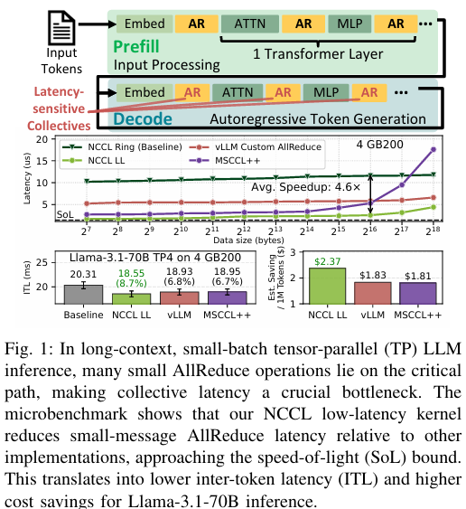

- 场景和硬件配置：4 个 GB200
- 通信延迟如何影响 ITL（类似TPOT，两次生成token间的延迟）：
- 图中结果与对应的比较基线：中间长图，对于不同的Data size时的延迟，Baseline是NCCL Ring。左下角图，不同的方法的ITL，Baseline是指使用NCCL原有的通信kernel。右下角图，不同方法与NCCL原有通信内核相比节约的开销。

### 我的笔记

技术栈：

```
 NCCL 已有的 device-side API
 提供底层 GPU 通信能力
             ↓ 作者在此基础上封装
 低延迟 API / 可复用通信原语
 例如 send、recv、bcast、recvReduce
             ↓ 按通信算法组合
 完整的低延迟 collective kernel
 例如 one-shot AllReduce
```

贡献：

```
1、在设备端API层的基础上，设计和应用了一系列的低延迟传输API，来促进自定义集合内核的研发
2、使用提出的低延迟API，建立了新的低延迟AllReduce算法，包含一种新颖的“双发LL128原子设计”
```

### 我的复述

> 待读完本节后，用自己的话说明“为什么每一微秒都重要”。

## 2. Background

### 2.1 GPU Communication Libraries

- NCCL、NVSHMEM、MPI 分别提供什么抽象？

  > **第一类：以集合通信为重点的库**
  >
  > | 库         | 主要对应的硬件生态 | 典型功能                               |
  > | ---------- | ------------------ | -------------------------------------- |
  > | **NCCL**   | NVIDIA GPU         | AllReduce、AllGather、ReduceScatter 等 |
  > | **RCCL**   | AMD GPU            | 与 NCCL 类似的集合通信                 |
  > | **oneCCL** | Intel 生态         | 面向分布式计算的集合通信               |
  >
  > 它们的共同思路是：**开发者指定“要完成哪种集合通信”，库负责高效执行。** 例如，调用 AllReduce，库负责组织各 GPU 的传输与归约。[AMD RCCL](https://rocm.docs.amd.com/projects/rccl/en/latest/what-is-rccl.html)、[Intel oneCCL](https://www.intel.com/content/www/us/en/developer/tools/oneapi/oneccl.html)
  >
  > **第二类：提供细粒度远程内存操作的库**
  >
  > 这里对应 **NVIDIA 的 ** 和 **AMD 的 rocSHMEM**。
  >
  > 它们采用 SHMEM / PGAS 思路，让开发者表达这样的操作：
  >
  > ```
  > 向 GPU 2 的某个内存位置写数据
  > 从 GPU 3 的某个内存位置读数据
  > 等待某个位置的标记发生变化
  > ```
  >
  > 相比直接调用完整的 AllReduce，开发者可以自己安排更细的通信与计算步骤。这就是文中的 **“finer device-side control”**。[NVSHMEM 官方介绍](https://docs.nvidia.com/nvshmem/api/latest/introduction.html)
  >
  > 这里的 **one-sided communication（单边通信）** 表示：发起方可以执行远程读写，接收方无需为每次传输调用一个配对的 `recv`；但仍需要事先准备可访问的内存，并保证同步正确。
  >
  > **第三类：通用消息传递体系 MPI**
  >
  > **MPI 本身是通信标准**，Open MPI、MPICH 等是具体实现。它既提供点对点通信，也提供集合通信。
  >
  > **CUDA-aware MPI 不是另一个独立的库名称**，而是说某个 MPI 实现能够识别 GPU 内存，让程序直接把 GPU buffer 交给 MPI 通信。
  >
  > 这段最需要记住的关系是：
  >
  > ```
  > NCCL / RCCL / oneCCL：偏重高效完成集合通信
  > NVSHMEM / rocSHMEM：提供细粒度远程内存操作
  > MPI：更通用的进程间通信标准
  > ```
  >
  > **这些能力存在重叠。** NVSHMEM 也提供集合通信，NCCL 现在也提供 device-side API。作者是在介绍它们的主要定位，为后面选择 NCCL 作为实现基础铺垫。==NCCL 从“优化好的集合通信”出发，向底层控制扩展；NVSHMEM 从“分布式内存访问”出发，支持开发者构建通信算法。本文使用 NCCL 的底层接口，所以两者在这里已经很接近。==

- collective 与 point-to-point、one-sided communication 有什么区别？
  ```
  PGAS：如何组织和描述分布在各 GPU 上的内存
      ↓
  One-sided 操作：如何读写这些远程内存
      ↓ 配合算法、计算与同步
  Collective：共同完成 AllReduce 等整体任务
  ```

### 2.2 Device-Initiated Communication and Symmetric Memory

- device-initiated communication 如何改变 CPU 与 GPU 的分工？
- symmetric object、symmetric heap、PE/rank 分别表示什么？
- 对称内存的类型、大小、布局约束是什么？远程地址如何确定？
- 区分同一 NVLink domain 内的 LSA / multimem 与跨域的 GIN。

### Figure 2：通信方式与对称内存

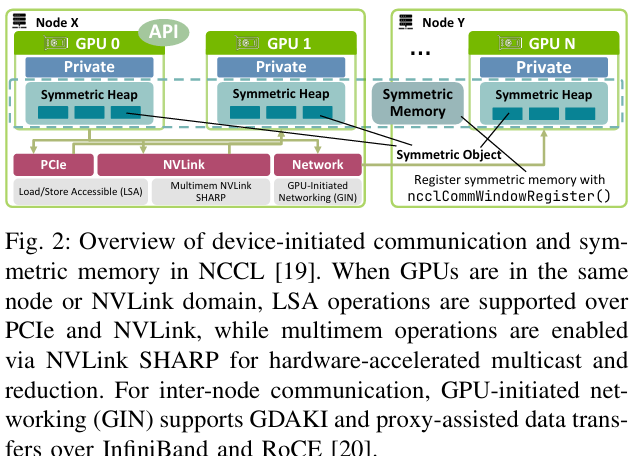

- 图中不同通信路径与适用范围：
- 本文实际优化的范围：

### 我的笔记

- **GPU原生通信库**已经变成对于现代HPC和AI系统传统框架的重要补充
- 作者选择NCCL而不是NVSHMEM，是因为其==应用更广泛==。


- GPUs通过PCIe或者NVLink连接，并且支持CUDA Virtual Memory Management，对称内存区域可以被映射到一个统一的地址空间，使他们支持LSA（load/store accessible）

  > VMM在硬件支持的情况下，可以把 **GPU 1 的一块显存映射到 GPU 0 可访问的虚拟地址中**。GPU 0 随后就有机会通过指针访问那块远程显存。
  >
  > 对称内存方便通信库根据**“目标 rank + 对象内位置”**定位远程数据。（==**为什么要用对称内存？显存通过VMM映射之后，也可以让其他GPU访问。**==）
  >
  > **LSA 是一种可访问性描述**：对于当前 GPU，这个 peer 的内存能否直接用 load/store 访问。

- 作者所做的工作==不只是NVIDIA独占的==，只要有GPU-initiated access to peer memory, remote writes that become visible to GPU-side polling, and device side ordering or fence operations before buffer reuse，都可以应用提出的协议和内核

- 作者==专注于scale-up==，不考虑scale-out通信，原因如下：1、当前LLM推理的并行组都是定义为单个的scale-up域。2、 即使整个任务跨域，域内优化仍然能发挥作用。3、新硬件正在扩大单个 scale-up 域的容量。

## 3. Toward Near Speed-of-Light AllReduce

### 3.1 Low-Latency AllReduce Algorithms

- **One-shot**：画出各 rank 的数据传输与本地归约过程。
- **Two-shot**：画出 ReduceScatter 和 AllGather 两个阶段。
- **Push / Pull**：分别是谁发起远程访问，关键路径上包含哪些操作？
- 比较通信量时，明确是“每 GPU”还是“全系统”的统计口径。

### 3.2 Cost of Memory Barriers

- barrier 需要参与者完成哪些信号交换与等待？
- Figure 3 的测量方式、横纵轴与硬件配置是什么？
- 一次 AllReduce 中调用几次 barrier，其开销占比如何计算？

### Figure 3：

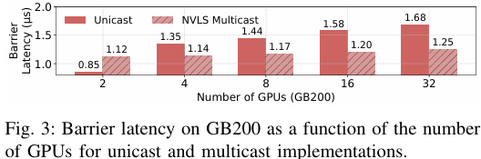

屏障同步的两种实现方式（主要区别是“我已到达屏障”这个同步标记如何通知其他 GPU）

Unicast（单播）：分别向各个 peer 发送标记

Multicast（组播）：借助硬件向一组 peers 分发标记

结论：每个屏障将会占用超过1微秒的开销，在AllReduce内核中，需要有两次这样的屏障，在之前的图一中，一次小message的AllReduce需要花费大约5微秒，两层屏障就要占用40%的时间。

### 我的笔记

- **AllReduce 规定了最终要得到什么结果，而实现这个结果可以采用不同的通信步骤。**

  ==**两种常见分解**==是：

  \[ \text{AllReduce} \equiv \text{ReduceScatter}\rightarrow\text{AllGather} \]
  \[ \text{AllReduce} \equiv \text{Reduce}\rightarrow\text{Broadcast} \]

  > 假设有 4 张 GPU，每张持有一个长度为 4 的向量：
  >
  > ```
  > GPU 0：[ 1,  2,  3,  4]
  > GPU 1：[ 5,  6,  7,  8]
  > GPU 2：[ 9, 10, 11, 12]
  > GPU 3：[13, 14, 15, 16]
  > ```
  >
  > 我们执行 **AllReduce(sum)**，对相同位置的元素求和：
  >
  > ```
  > 第一个位置：1 + 5 + 9 + 13 = 28
  > 第二个位置：2 + 6 + 10 + 14 = 32
  > 第三个位置：3 + 7 + 11 + 15 = 36
  > 第四个位置：4 + 8 + 12 + 16 = 40
  > ```
  >
  > 最终，**每张 GPU 都得到完整的 `[28, 32, 36, 40]`**。
  >
  > **AllReduce**的目标是每个GPU都能得到完整的数组
  >
  > 1. ReduceScatter → AllGather：各自得到一块，再互相补齐
  >
  > 2. Reduce → Broadcast：一张先得到全部结果，再发给大家
  >
  > ==Reduce并不是只有一张卡计算（星型结构），可以使用树形结构==
  >
  > 例如 4 张 GPU：
  >
  > ```
  > 第 1 轮，并行执行：
  > GPU 1 → GPU 0：GPU 0 合并两者的数据
  > GPU 3 → GPU 2：GPU 2 合并两者的数据
  > 
  > 第 2 轮：
  > GPU 2 → GPU 0：发送已经合并的结果
  >               GPU 0 得到最终结果
  > ```
  >
  > 这样，GPU 0 收到的是一部分原始数据和一部分**已归约的结果**，而不是独自接收并处理所有 GPU 的原始数据。

- 不同的AllReduce算法有不一样的复杂度：比如==**tree-based**和**recursive-doubling**==就是O(logN)的复杂度而基于环型结构的算法就是O(logN)
  tree-base算法如上，对于树型结构的补充
  recursive-doubling就是每次两个节点互相交换值并且相加，所有节点的值最终趋于一致

- 同步的次数可以被压缩到O(1)的复杂度，分为两种：==**one-shot算法**和**two-shot算法**==。

  **One-shot：**
  有两种数据传输方式，==push mode和pull mode==，作者认为push mode效率更高，只需要半个RTT，但是需要额外的buffering，而pull mode需要一个完整的RTT。这一点在two shot中也是一样的，**全都是使用push**，只是作者没有重复展开。

  **Two-shot：**

  分为两个阶段，首先是ReduceScatter阶段，每张显卡计算分配给自己的那些数据，得到最终答案的一部分；其次是AllGather阶段，把每张显卡上的部分答案都互相传输，使每张卡上都有最终完整答案。**与oneshot相比多了一次同步，但是message size减小了，提升了总体的表现。**例如N个ranks，每张卡输入M bytes数据，one-shot需要==O(N*M)==的传输体积，而two-shot只需要==O(M)==的传输体积。

- ==作者一直提到的**memery barriers**是指一个等待阶段，让所有参与者都完成了之后，再继续推进后面的任务。==

## 4. Designing Barrier-Free Collectives

> 本节重点：分别追踪“数据何时可读”和“buffer 何时可复用”。阅读时标出消除的 barrier 范围，以及仍然存在的轮询、原子操作和局部同步。

### 4.1 LL（Low Latency）

- data 与 flag 如何打包，接收方如何判断数据就绪？

  传统方式是先将data（很大，如4096B）写入到目标GPU显存中，然后再更新目标GPU显存中的flag（8B），目标GPU通过轮询flag来判断数据是否传输到位；在LL中，==**是将data和flag打包成一个写入单元**==，通过**一次具有所需原子性保证的 16 字节（8字节data，8字节flag）** store写入接收方，接收方仍然轮询flag判断传输是否完成。

- 原子写入依赖什么保证？
  在协议依赖的==硬件保证==下。

- 带宽利用率与 scratch 空间的代价是什么？

  有效数据带宽利用率缩小了一半，因为原本flag可以忽略不计，现在flag和data一样大。scratch空间扩大了一倍，同样传输4096B，传统只需要8B的Flag，但是LL需要4096B的Flag。

### 4.2 Sentinel

- sentinel 如何表示数据尚未到达？

  和LL不同，sentinel这个方法是使用一个不可能会在计算中出现的哨兵值（比如 -NaN）来表示数据还没有到达。与LL相比，sentinel==优点==是：保留了原有的传输带宽而且使用了更小的scratch空间。==缺点==是：每次传输都需要重置哨兵位，增加了buffer管理难度。而且还需要使用者避免在数据中出现哨兵值（如-NaN），才可以保证哨兵位检测的正确性。 

  **一句话总结**：每次传输前恢复到一个值，检测这个值是否变化，变化了，说明传输结束了。

### 4.3 Bidirectional Communication & Double Buffering

- 目的是什么？
  消除两次iterations之间的barriers。
- 双缓冲（Double buffering）是什么：每张 GPU 准备两块临时接收区，交替使用。
- 双向通信（Bidirectional communication）是什么：A 每轮给 B 发数据，也必须收到 B 的对应轮次数据，完成处理后才能继续下一轮。

### Figure 4

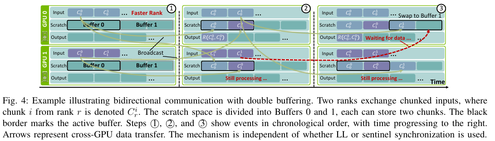

内容：对于两个速率不同的GPU（GPU0速率更快）交换分块输入，黑色边框表示当前的激活的buffer

步骤1时，每个rank都从scratch buffer中命名为buffer 0的buffer开始，

步骤2时，GPU会将自己的第一个输入传输给其他GPU，由于GPU0的处理速度更快，因此先完成reduce操作，而GPU1仍然在处理，

步骤3时，GPU0的buffer切换到buffer1并且广播了第二个输入

只有当GPU0收到GPU1发来的C时，就隐含了GPU1完成上一阶段的计算任务，可以开始使用上一阶段的写入过的buffer0了。从而做到消除了barrier的作用。

### 4.4 ==LL128 Atomic AllReduce==

-   按 Figure 5 拆解 ReduceScatter 和 AllGather。
- flag carrier、displaced elements、extra threads 分别解决什么问题？
- cache-line 级原子性如何让计数 flag 与数据归约保持一致？
- 记录硬件、数据类型、归约操作和数值确定性的限制。

### Figure 5

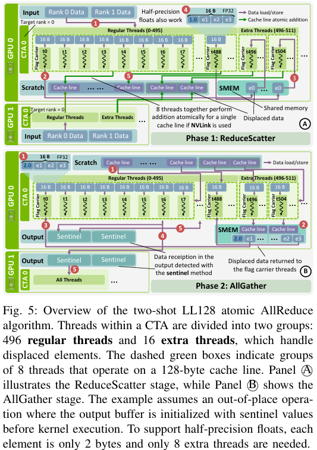

ReduceScatter

> **1．先明确：它还是 ReduceScatter → AllGather**
>
> 假设只有两个 GPU。每份输入分为两块：
>
> - 第一块的求和结果由 GPU 0 负责。
> - 第二块的求和结果由 GPU 1 负责。
>
> 先只看**归 GPU 0 负责的第一块**，把数据量缩小：
>
> ```
> GPU 0 的输入：[10, 20, 30, 40]
> GPU 1 的输入：[ 5,  6,  7,  8]
> 
> 希望得到：   [15, 26, 37, 48]
> ```
>
> 两个 GPU 都向 GPU 0 上的同一块 scratch 累加区提交贡献。
>
> 这里的 **atomic add** 是“原子加法”：多个 GPU 同时向同一个位置加数，更新不会相互覆盖。
>
> **2．怎样知道两个 GPU 都已经加完了？**
>
> 作者在传输的数据组里，拿出一个位置作为计数器。
>
> 但是，这个位置原本存着有效数据，不能直接丢掉。因此先把原来的第一个数挪走，再填入 `1`：
>
> ```
> GPU 0：
> 原始数据       [10, 20, 30, 40]
> 挪走 10 后     [ 1, 20, 30, 40]
>                 ↑
>              贡献计数
> 
> GPU 1：
> 原始数据       [ 5,  6,  7,  8]
> 挪走 5 后      [ 1,  6,  7,  8]
> ```
>
> 把目标累加区理解为从零开始，那么累加过程是：
>
> ```
> 初始：           [0,  0,  0,  0]
> 
> GPU 0 贡献后：   [1, 20, 30, 40]
> 
> GPU 1 也贡献后： [2, 26, 37, 48]
>                  ↑
>           两个 GPU 都贡献了
> ```
>
> 所以，对于 \(N\) 个 GPU：
>
> \[ \text{flag}=1+1+\cdots+1=N \]
>
> 接收方轮询这个位置，看到它等于 \(N\)，就知道这一组数据的贡献已经齐了。
>
> **关键前提是：论文依赖 NVLink 对该方案所用的 128B 缓存行更新提供原子性保证。** 因而计数与同组数据的更新能够关联起来。普通代码里把“计数器加一”和“数据相加”分开执行，不能直接得到这个结论。
>
> **3．被挪走的 10 和 5 怎么办？**
>
> 它们也必须参与跨 GPU 求和。
>
> 作者安排了 **extra threads，额外线程**，专门处理这些被挪走的元素：
>
> ```
> GPU 0 被挪走的数：10 ─┐
>                       ├─ 原子累加 → 15
> GPU 1 被挪走的数： 5 ─┘
> ```
>
> 等结果就绪，再把 `15` 放回原来被计数器占用的位置：
>
> ```
> 恢复前：[ 2, 26, 37, 48]
>          ↑
>        计数器
> 
> 恢复后：[15, 26, 37, 48]
>          ↑
>      真正的数据结果
> ```
>
> **所以 displaced elements 就是“为了给 flag 腾位置而被挪走的数据”，不是被丢弃的数据。**
>
> **4．对应到实际的 8 个线程、128B**
>
> 上面用了四个数演示。论文实际按下面的粒度组织：
>
> | 层级             | FP32 情况下处理的内容                      |
> | ---------------- | ------------------------------------------ |
> | 一个线程         | 16B，即 4 个数 `e0～e3`                    |
> | 一组 8 个线程    | 128B，即 32 个数                           |
> | 每组的第一个线程 | 作为 **flag carrier**，负责承载、检查 flag |
>
> 注意：**每组只挪走一个元素，不是每个线程都挪走一个。**
>
> 它的过程可以读成：
>
> ```
> 每组第一个线程：
> 把自己的 e0 放进 shared memory
>               ↓
> CTA 内 __syncthreads()
>               ↓
> 额外线程从 shared memory 取走这些数据
>               ↓
> 原位置填入 1
>               ↓
> 普通线程和额外线程一起执行原子累加
> ```
>
> 这里的 **shared memory 是同一个 CTA 内线程之间交接数据的中转站**。跨 GPU 的求和发生在目标 GPU 的 scratch 中。
>
> Figure 5 中的 `496 regular threads + 16 extra threads`，就是把一个 CTA 的线程分成“处理主体数据”和“处理被挪走数据”两部分。

AllGather

> 负责这块结果的 GPU，先等待 scratch 中对应的 flag 达到 \(N\)，然后：
>
> 1. 额外线程把已经求和的 displaced elements 放入 shared memory。
> 2. CTA 内同步。
> 3. flag carrier 取回这些结果，恢复被 flag 占用的位置。
> 4. 把完整、正确的结果块分发到输出中。
>
> 每个 GPU 都负责一块，最后所有 GPU 获得全部结果，完成 AllReduce。
>
> 这里仍然出现 `__syncthreads()`，因为它需要 **CTA 内的线程同步**；论文要消除的是前面讨论的昂贵的**跨 GPU 全局 barrier**。

### 4.5 Algorithm Comparison：Table I

> 按原表填写；保留 N、M、D 的定义，区分每轮空间与整体消息大小。
>
> 符号及其含义：
>
> \(M\)：每个 GPU 在一次 AllReduce 中的完整输入大小
>
> \(D\)：每个 GPU 在一次分块迭代中处理的输入大小
>
> \(D/N\)：two-shot 中，这一轮分配给某个 GPU 负责归约的那一份
>
> K：AllReduce处理轮数
>
> 则M=KD

| 算法 | 每 GPU 通信量 | 每轮同步次数 | 每轮 scratch 空间 | 确定性 / 适用限制 |
| --- | --- | --- | --- | --- |
| One-shot（LL） | 2（N-1）M | 1 | 2ND | 确定的 |
| One-shot（Sentinel） | （N-1）M | 1 | ND | 确定的 |
| Two-shot（LL） | 4（N-1）M/N | 2 | 2D | 确定的 |
| Two-shot（Sentinel） | 2（N-1）M/N | 2 | D | 确定的 |
| Two-shot（LL128 Atomic） | 2（N-1）M/N | 2 | D/N | 不确定的 |

### 我的笔记

- （N-1）是指当前GPU给其他所有N-1个GPU传输

- LL128 Atomic

  - 原子加法的同步是使用==L2 cache==，更便宜

  - 有更少的scratch buffer空间，只使用==D/N的空间==。

  - ==传输的flag较少==：32位的浮点运算，每计算128B数据，需要多传输4B的flag。对于16B的浮点运算，每计算128B数据，需要多传输2B的flag。
  - 需要NVLink保证cache-line级的原子加法
  - LL128 Atomic 是先在发送端把计数值嵌入数据，再通过原子加法更新目标 GPU 的累加区。
  - 该算法==不支持乘法==，因为前面的flag位1*1还是等于1。
  - 这个算法的运算结果是==不确定的==，因为浮点运算的顺序是不确定的。
  
- ==**两种机制具体出现在哪些时刻？**==

  | 时刻                                                     | 起作用的机制                         |
  | -------------------------------------------------------- | ------------------------------------ |
  | 接收方等待 `flag1／2／3`，再读取对应数据                 | **LL：检测本轮数据到达，排除旧数据** |
  | A 提前把第 1 轮数据写到 Buffer 1，不影响 B 读取 Buffer 0 | **双缓冲：隔离前后两轮的存储空间**   |
  | A 收到 B 的第 1 轮数据，知道 B 已处理完第 0 轮           | **双向通信：提供隐式消费确认**       |
  | A 据此在第 2 轮安全覆盖 Buffer 0                         | **三者配合，实现缓冲区安全复用**     |

- ==**消除内存屏障的逻辑：**==

### 我的复述

> 用一个两 rank 的例子说明：没有全局 memory barrier 时，算法仍如何保证正确性？

## 5. Low-Latency API Design

### 内容框架

- **Figure 6**：host-side 与 device-side API 的职责。

  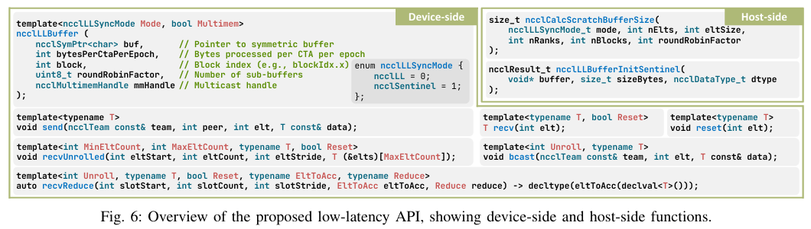

  接口分成两类：==**CPU 端负责准备内存，GPU 端负责实际通信**==

  - **右上角 Host-side**：CPU 调用的两个准备函数，计算需要多大的缓冲区，并按需初始化。
  - **其余 Device-side**：
    - **`ncclLLBuffer`：管理缓冲区和通信模式**，选择 LL 或 Sentinel，管理双缓冲、当前迭代等状
    - **通信原语：执行基本操作**
      提供发送、接收、广播、归约和重置，供开发者组合成完整的集合通信算法。

  使用过程大致是：

  ```
  CPU：计算需要多少 scratch → 分配对称内存 → 按需初始化
                                  ↓
                            启动 GPU kernel
                                  ↓
  GPU：建立 ncclLLBuffer 对象 → 调用发送、接收、归约等操作
  ```

  因此，CPU 不需要介入每一次数据交换。

- **Figure 7**：`ncclLLBuffer` 的布局、CTA、epoch 与 sub-buffer 的关系。

  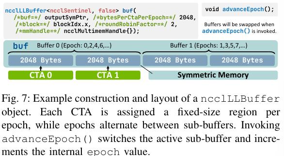

  ==**把一块对称内存划分成两个交替使用的缓冲区，每个缓冲区内再给不同 CTA 分配独立空间。**==也就是**Double Buffering**。

  图中有两个 CTA，每个 CTA 在每个缓冲区中分到 **2048B**：

  ```
  Buffer 0：[CTA 0 的 2048B][CTA 1 的 2048B]
  Buffer 1：[CTA 0 的 2048B][CTA 1 的 2048B]
  ```

  处理不同分块迭代时，两个缓冲区轮流使用：

  ```
  Epoch 0 → Buffer 0
  Epoch 1 → Buffer 1
  Epoch 2 → Buffer 0
  Epoch 3 → Buffer 1
  ……
  ```

  ==调用 `advanceEpoch()`，就表示**推进到下一次迭代，同时切换缓冲区**。==

  所以，这个布局同时实现两件事：

  - **CTA 之间空间独立**：各用各的区域，避免相互覆盖。
  - **前后迭代使用不同缓冲区**：配合前面讲的双向通信，==让快的 GPU 可以继续推进，同时保护上一轮尚未读完的数据。==

  这里的 epoch 是**分块迭代编号**，不是训练中的 epoch。

- **Figure 8**：`send` / `recv` 的配对关系与数据类型约束。

  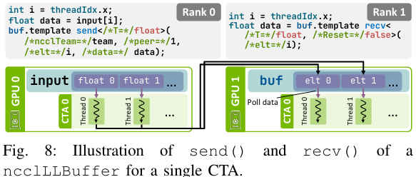

  **GPU 0 的线程把输入写到 GPU 1 的缓冲区，GPU 1 的线程等待数据到达后读取。**

  **① 左边：GPU 0 发送**

  同一个 CTA 内，不同线程负责不同元素：

  ```
  Thread 0：读取 input[0] → send → GPU 1 的 buf[0]
  Thread 1：读取 input[1] → send → GPU 1 的 buf[1]
  ……
  ```

  所以，图中的黑色箭头表示**跨 GPU 的数据写入**。

  **② 右边：GPU 1 接收**

  GPU 1 上的线程读取对应槽位：

  ```
  Thread 0：等待 buf[0] 就绪 → 读取
  Thread 1：等待 buf[1] 就绪 → 读取
  ……
  ```

  “Poll data”就是**轮询**，检查方式由选择的 LL 或 Sentinel 模式决定。

  这里的 `recv()` 是检查、读取**本 GPU 的接收缓冲区**，不需要每次向 GPU 0 发起读取请求。

- `recvUnrolled`、`recvReduce`、`bcast`、`reset` 分别封装了哪些工作？

  | API／原语      | 作用                                                         |
  | -------------- | ------------------------------------------------------------ |
  | `send`         | 把数据写入指定对端的缓冲槽位                                 |
  | `recv`         | 轮询数据是否就绪，然后读取，可选重置槽位                     |
  | `recvUnrolled` | 用编译期展开优化多个元素的接收，可以在编译的时候就指定接受元素的数量。 |
  | `recvReduce`   | 接收多个 GPU 的数据，并执行归约                              |
  | `bcast`        | 把数据发送给所有参与 GPU，可使用硬件 multicast               |
  | `reset`        | 将槽位恢复为可复用状态                                       |

  ```C++
  // recvUnrolled概念示意：start 和实际接收数量可以到运行时才确定
  if (count > 0) 接收(start);
  if (count > 1) 接收(start + stride);
  if (count > 2) 接收(start + 2 * stride);
  ```

- `advanceEpoch()` 如何参与 buffer 复用？reset 返回是否代表全局可见？

- LL128 atomic 为什么没有纳入同一套 thread-level primitives？

- 哪些通信模式可以使用这些机制，哪些仍需要显式 barrier？

- 区分 one-shot 与 two-shot 对 symmetric scratch / output buffer 的要求。

### ==Example One-shot AllReduce（Figure 9）==

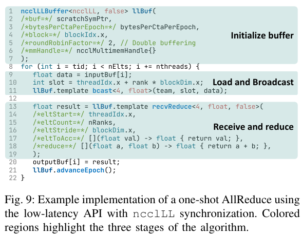

- 用自己的话或伪代码复述：加载输入 → 广播 → 等待并归约 → 输出 → 切换 epoch。

  - 第一段Initialize buffer->初始化buffer，建立缓冲区对象。这一段的代码选择了：**LL同步**，**双缓冲**（`roundRobinFactor = 2`，不同迭代交替使用两个子缓冲区），**不使用硬件 multicast**（这里的 `false` 表示通过普通写入完成后面的广播。）
  - 第八行->把输入元素分给不同的线程。每个线程先处理属于自己的数据，然后按照线程的数量跳着处理后续的元素。
  - 第二段Load and Broadcast->读取自己的数据，广播到各 GPU。第一行取出当前GPU的输入。第二行计算缓冲区中的槽位（计算方式：\[ slot=\text{线程编号}+\text{GPU 编号}\times\text{CTA 线程数} \]），接下来使用bcast将data写入各个GPU相同编号的槽位
  - 第三段Receive and reduce->接收同一输入位置的各份数据，然后求和。三个参数：从当前线程对应的槽位threadIdx.x出发，每隔 blockDim.x 个槽位取一个，一共接收 nRanks 个。两个 lambda 表达式：

  ```
  [](float val) -> float { return val; }
  [](float a, float b) -> float { return a + b; }
  ```

  ​	分别表示：

  ​		接收后保持 `float` 类型，不额外转换。

  ​		使用加法进行归约。

  ​	`recvReduce` 会等待数据就绪，接收并求和。

  - 第二十、二十一行：写结果，切换到下一次迭代

- 每一步调用了什么 API，对应第 4 节的哪个正确性条件？

### 我的笔记

- 作者对于设计API的三个要求
  1. 可以兼容NCCL已有的设备侧接口
  2. 通过一个统一的抽象将前面提到的低延迟技术封装起来
  3. 足够的灵活性，可以作为自定义通信内核的构建块。
- ncclLLBuffer封装了已有的对称内存，并对其统一管理：
  - **同步方式**：选择 LL 或 Sentinel。
  - **缓冲区布局**：为不同 CTA、不同分块迭代安排空间。
  - **迭代状态**：通过 epoch 标识当前轮次，支持双缓冲或多缓冲。
  - **发送方式**：选择是否使用硬件 multicast。

## 6. Measuring the Speed-of-Light of AllReduce（==计算理论最小值==）

### Figure 10：最小数据移动路径

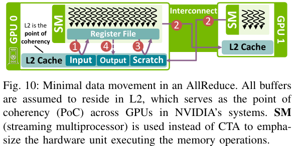

- 逐步标出 input、SM register file、L2、remote scratch、output 之间的数据路径。
- ==为什么以 128-byte cache line 为分析单位？==
  因为small-message延迟是由内存系统管理的最小单元传输决定的。
- 下界模型假设哪些访问命中 L2，忽略了哪些开销？

​	忽略了store指令写入内存的耗时，

- 为什么模型中的下界与 rank 数量无关，实际测量是否也如此？

### 公式推导与测量记录

- SoL 公式及各变量含义：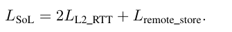

  先抓住一点：**这个公式是在估算“最理想的 one-shot push AllReduce”，不是计算 LL128 Atomic 或普通 two-shot 的完整耗时。**

  作者只保留了**必须先后发生的三段数据移动**：

  \[ \boxed{ L_{\mathrm{SoL}} = \underbrace{L_{\mathrm{L2\_RTT}}}_{读取自己的输入} + \underbrace{L_{\mathrm{remote\_store}}}_{把输入推给对方} + \underbrace{L_{\mathrm{L2\_RTT}}}_{对方读取收到的输入} } \]

  下面用两个 GPU 走一遍。

  L2_RTT是当前GPU的L2 Cache传输到当前GPU的SM的延迟

  remote_store是从SM写入到其他GPU中的L2的延迟

- L2 RTT 如何测量，采用什么近似？
  使用__threadfence()，此指令在L2级别强制执行排序和可见性，迫使SM等待外发内存事务到达缓存。因此，其延迟提供了L2 RTT的良好近似值。

- GPU 间 ping-pong 如何用于估计 remote store 延迟？
  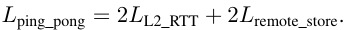

  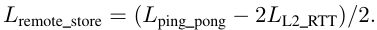

### 我的笔记

- 最终SoL延迟设定为==**1.404微秒**==

## 7. Microbenchmarks

### 7.1 Experimental Setup

- GPU / NVLink domain / 节点配置：每个节点4个Blackwell GPUs，共计72个GPUs使用一个NVLink域连接起来，共享130TB/s的NVLink带宽。
- 软件版本、CTA / thread 配置：使用NVIDIA vLLM container (v26.02)这个容器包括Ubuntu 24.04, CUDA 13.1, vLLM 0.15.1, PyTorch 2.11以及OpenMPI 4.1.9。每个内核使用64CTAs，每个CTA最高512threads
- 实验：实验进行十次取平均值，误差条表示标准偏差，通常太小而不可见。
- 消息大小、数据类型、rank 数量、重复次数与误差统计：
- 比较基线及各自不支持的配置：

### 7.2 Impact of Scratch Buffer（Figure 12）

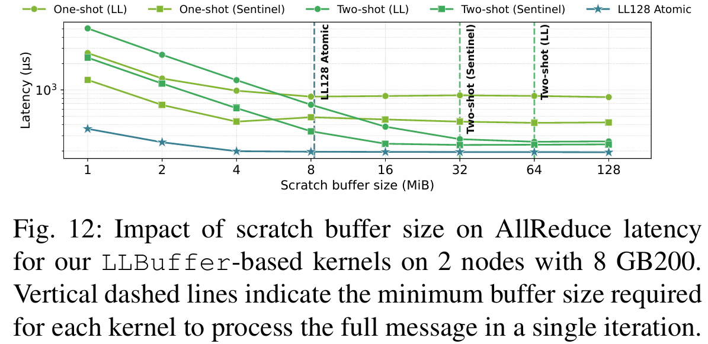

实验内容：32MiB的message，每个节点4GPUs，因此对于LL128 Atomic来说至少需要8MiB，Two-shot（Sentinel）至少需要32MiB，Two-shot（LL）至少需要64MiB，也就是竖线，竖线左侧==说明不能在一个iteration中完成，需要分块进行多次AllReduce==。还可以发现竖线右侧一般都趋于平稳。

- ==为什么更大的 buffer 不一定让 one-shot 更快？==

  增大缓冲区虽然减少迭代次数，但也让每轮同时发送的数据更多，增加 NVLink 的瞬时带宽压力，因而继续增大容量的收益可能很小。

- 不同算法的默认 buffer 容量如何选定？

  对于oneshot，选择4MiB，对于twoshot以及LL28 atomic，选择64MiB。

### 7.3 Latency（Figure 11）

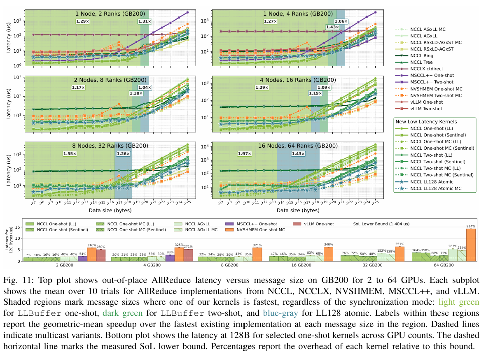

最下面的图表，重点关注消息大小只有一条cache line，并且将不同的oneshot延迟和SoL下界比较。实验只展示了32bit floats结果，16bits浮点结果非常相似。在2GPUs的条件下，one-shot AllReduce只有7%的开销

图像背景颜色的计算方式：已有的最快耗时/作者实现的耗时。

- 不同消息区域
  左侧==**小消息区域**==：数据很少，实际传输数据的时间不长。此时，通信阶段、就绪检测和指令执行等开销更显眼。

  因此：

  - one-shot 只需要一个通信阶段，容易获得低延迟。
  - LL 在很小的消息下可以表现很好。
  - 虽然 one-shot 发送的数据更多，但消息足够小时，这个代价还不大。

  这就是多张子图左侧出现大片浅绿色的原因。

  **==中间区域==：传输量和缓冲区效率开始重要。**

  消息变大后，one-shot 向各 GPU 分发完整输入的代价增加。two-shot 虽多一个阶段，却减少了每个 GPU 的通信量。

  LL128 Atomic 又通过直接累加，减少保存、读取多份输入及软件归约的工作，因此可能在这一段占优。

  **==右侧大消息区域==：带宽和硬件归约更重要。**

  这时，已有的硬件优化内核可能重新取得优势。作者的新内核仍要轮询、接收并处理来自多个 GPU 的数据，这些成本会随规模增加。

  所以，图展示的是**不同内核互补**，而不是“新算法从小消息到大消息全部替代旧算法”。

  **==GPU 数量增加时的变化==**

  **LL128 Atomic 和 MC 的价值更明显**

  对比 2／4 GPU 与 32／64 GPU 的子图，可以关注两件事。

  首先，**LL128 Atomic 的优势不是在小规模下就特别突出**。原子操作有竞争和串行化成本；GPU 较少时，普通线程直接求和也很快。

  随着 GPU 数量增加，普通方案需要处理更多来源，LL128 Atomic 直接累加的设计才更有机会体现扩展性优势。

  其次，**MC 在较大规模下更重要**。向很多 GPU 分发数据时，减少发送端重复操作更有价值；某些已有内核还使用硬件归约，进一步减少软件处理。

  比如 64 GPU 子图中，左侧 one-shot 区域标出了 **1.97×**，说明作者对大规模、小消息场景仍能获得明显收益。但继续向右看，又能看到其他内核更适合的区域。

- multicast 在小规模与大规模下的收益有什么区别？

  小规模下多播可能有少量开销，大规模下对集合通信的扩展性更重要。

- LL128 atomic 在什么条件下优于普通 two-shot？
  消息大小开始变大，GPU数量开始增加时

- “接近 SoL”的结果对应什么配置，能否推广到所有 GPU 数量？

  不能，只对应GPU数量较少的配置。

### 我的笔记

- **小消息：one-shot 最有优势。** 最佳情况下，2 GPU、128B 消息的延迟仅比 SoL 下界高约 **7%**。

  **消息增大：算法优势发生切换。** Sentinel 逐渐体现带宽优势，two-shot 减少通信量；LL128 Atomic 在 GPU 数量较多时更具竞争力。

  **多播有助于扩展，但并非开启就一定最快。** 大规模下，结合硬件归约的已有实现仍可能胜过作者的新内核。

  **scratch 太小会增加分块迭代次数。** 增大容量通常能降低开销，但容量继续增加不保证持续加速，one-shot 还可能遇到更高的瞬时带宽压力。

## 8. Case Studies

### 8.1 LLM Inference（Figure 13）

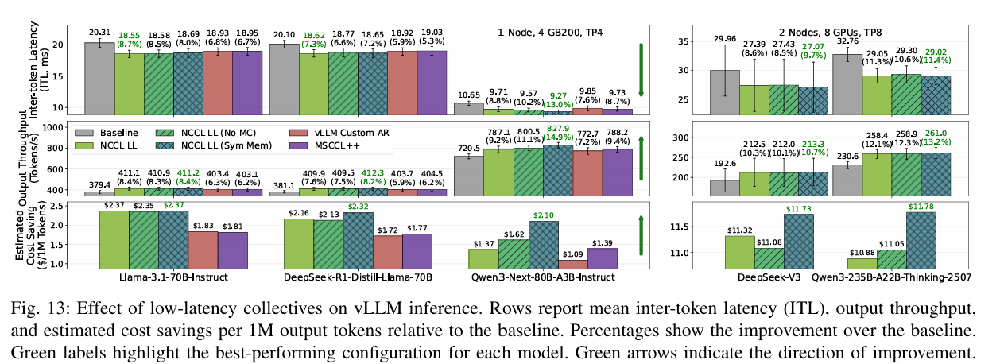

- 模型、TP 配置、上下文长度、输出长度与 batch size：
  模型使用几个流行的开源LLM
  TP配置：1 node with 4 GPUs (TP=4) and 2 nodes with 8 GPUs (TP=8).
  上下文长度（==模拟长上下文推理情景==）：100–200k tokens 
  输出长度：16K output tokens
  batch size： 8

- baseline、NCCL LL、No MC、Sym Mem 分别启用了什么？

 | 配置                  | 使用哪些内核                                              | 多播 MC                            | 输入、输出额外注册为对称内存 |
  | --------------------- | --------------------------------------------------------- | ---------------------------------- | ---------------------------- |
  | **Baseline**          | 仅使用 NCCL legacy 内核                                   | 正文未单独说明，不能理解为必然关闭 | 未启用本实验的 Sym Mem 配置  |
  | **NCCL LL**           | 小消息使用作者的 LLBuffer one-shot；超过阈值回退到 legacy | 开启                               | 否                           |
  | **NCCL LL (No MC)**   | 同上                                                      | **关闭**                           | 否                           |
  | **NCCL LL (Sym Mem)** | 除 one-shot 外，还允许选择 two-shot、LL128 Atomic         | 开启                               | **是**                       |

- ITL 与 throughput 的测量口径有何区别？

- 端到端收益为什么小于单个 AllReduce 的收益？

- 成本估计采用什么假设，是否包含完整生产部署成本？

### 8.2 Traditional HPC（Figure 14）

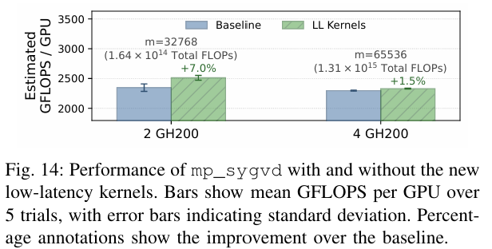

- cuSOLVERMp 的任务、平台、矩阵规模与基线：
  实验平台：the Alps supercomput ingcluster。每个Alps node有4个用150GB/s的NVLink连接的GraceHopperSuperchips (GH200)。由于不支持多节点，只用一个节点测试。

- 哪些 kernel 能被该应用使用，哪些受 buffer 注册方式限制？

  cuSOLVERMp **没有把应用缓冲区注册为对称内存**，因此：

  | Kernel                | 本实验中能否使用              | 原因                                                         |
  | --------------------- | ----------------------------- | ------------------------------------------------------------ |
  | 作者的 one-shot       | **能，用于小于 1 MiB 的消息** | 只依赖 NCCL 提供的对称 scratch，不要求应用输出缓冲区对称注册 |
  | 作者的普通 two-shot   | **受限，未启用**              | 需要对称、可由其他 GPU 直接访问的输出缓冲区                  |
  | LL128 Atomic          | **受限，未启用**              | 应用缓冲区的注册方式未满足其使用条件                         |
  | 原有 NCCL legacy 内核 | **能**                        | 仍作为其他消息范围的执行路径                                 |

  所以，**Figure 14 的收益主要证明小消息 one-shot 内核的应用价值，不能归因于 LL128 Atomic。**

- 为什么不同矩阵规模下的收益不同？

  作者发现，矩阵规模 \(m=32768\) 时收益更明显，因为**通信占总运行时间的比例更高**。

  矩阵增大到 \(m=65536\) 后，计算工作更重，通信优化对整个程序的相对影响就小一些。

### 我的笔记

- 

## 9. Related Work and Discussion

- 与已有 NCCL / NVSHMEM / MSCCL++ 实现的关系：
- 与面向 EP 的 DeepEP 等通信方案的优化目标有何区别？
- 本文为什么没有将 NIXL 作为对比基线？
- 经验式 kernel 选择与性能模型各有什么优缺点？
- thread-level API 在性能、易用性和可扩展性之间的取舍：

### 我的笔记

- 

## 10. Conclusion 与我的总结

### 一句话概括

> 待填写。

### 论文解决了什么问题

- 

### 核心机制与贡献

- 

### 最有说服力的实验依据

- 

### 局限与可继续研究的问题

- 

### 与之前阅读的联系

- **vLLM / SGLang**：推理关键路径、TP 通信与端到端指标之间的联系。
- **EEP**：比较 TP AllReduce 与 EP dispatch / combine 的通信模式及同步需求。
- **Mooncake / DistServe**：比较 scale-up 集合通信优化与 P/D 分离、KVCache 传输优化各自作用的路径。
- **我的理解**：

## 11. 疑问与补充知识

| 问题 / 术语 | 出现位置 | 当前理解 / 卡点 | 解答与依据 | 状态 |
| --- | --- | --- | --- | --- |
| AllReduce / ReduceScatter / AllGather | III | 待记录 | 待补充 | 待解决 |
| Symmetric Memory / LSA / Multimem | II | 待记录 | 待补充 | 待解决 |
| Atomicity / Ordering / Visibility | IV-V | 待记录 | 待补充 | 待解决 |
| CTA / Warp / L2 / Cache Line | IV-VI | 待记录 | 待补充 | 待解决 |

## 12. 阅读记录

| 日期 | 本次阅读范围 | 收获 / 卡点 | 下次从哪里继续 |
| --- | --- | --- | --- |
| 待填写 | 待填写 | 待填写 | 待填写 |
