# Llumnix: Dynamic Scheduling for Large Language Model Serving

> 阅读时间：2026.10.30-

## 0. 论文信息

- Title: Llumnix: Dynamic Scheduling for Large Language Model Serving
- System: Llumnix
- Authors: Biao Sun, Ziming Huang, Hanyu Zhao, Wencong Xiao, Xinyi Zhang, Yong Li, Wei Lin
- Affiliations: Alibaba Group
- Venue: OSDI 2024
- arXiv: [2406.03243](https://arxiv.org/abs/2406.03243)
- 原文：[本地 PDF](./Llumnix.pdf)
- 官方页面：[USENIX](https://www.usenix.org/conference/osdi24/presentation/sun-biao)
- PDF 来源：[USENIX 正式版](https://www.usenix.org/system/files/osdi24-sun-biao.pdf)
- Pages: 19（USENIX pp. 173-191；本地 PDF 共 20 页，含封面）
- Open source（论文所列地址）：<https://github.com/AlibabaPAI/llumnix>
- 阅读状态：未开始
- 关键词：LLM Serving、Request Rescheduling、Live Migration、KV Cache、Virtual Usage、Performance Isolation、Auto-scaling

> 以下框架依据正式版 PDF 的章节、图表和算法整理；问题用于引导阅读，“我的笔记”“我的复述”和实验结果留待阅读后填写。所有进度默认未完成。
>
> 本地 PDF 第 1 页为 USENIX 封面；正文从 PDF 第 2 页开始，对应印刷页 173。换算关系：印刷页码 = PDF 页码 + 171。参考文献从 PDF 第 16 页开始，Artifact Appendix 位于第 20 页。

## 0.1 阅读进度

- [x] Abstract（PDF p. 2）
- [x] 1 Introduction（PDF pp. 2-3，Figure 1）
- [x] 2 Background（PDF p. 4，Figure 2）
- [x] 3 Motivation（PDF pp. 4-5，Figure 3-5）
- [x] 4 Llumnix Design
  - [x] 4.1 Overview（PDF p. 6）
  - [x] 4.2 Live Migration of LLM Requests（PDF pp. 6-7，Figure 6-7）
  - [x] 4.3 Distributed Scheduling Architecture（PDF p. 7，Figure 8）
  - [x] 4.4 Dynamic Scheduling Policy（PDF pp. 7-9）
    - [x] 4.4.1 Goals and Definitions（PDF pp. 7-8）
    - [x] 4.4.2 Virtual Usage（PDF p. 8，Figure 9）
    - [x] 4.4.3 Policies（PDF pp. 8-9，Algorithm 1）
- [x] 5 Implementation（PDF pp. 9-10）
- [x] 6 Evaluation
  - [x] 6.1 Experimental Setup（PDF pp. 10-11）
  - [x] 6.2 Migration Efficiency（PDF p. 11，Figure 10）
  - [x] 6.3 Serving Performance（PDF pp. 11-13，Figure 11-12）
  - [x] 6.4 Support for Priorities（PDF p. 13，Figure 13）
  - [x] 6.5 Auto-scaling（PDF pp. 13-14，Figure 14-15）
  - [x] 6.6 Scheduling Scalability（PDF p. 14，Figure 16）
- [ ] 7 Related Work（PDF pp. 14-15）
- [ ] 8 Conclusion（PDF p. 15）
- [ ] A Artifact Appendix（PDF p. 20，按需）
- [ ] 总结、对比与我的复述

## 0.2 建议阅读主线

1. 问题：请求到来时能知道什么？运行后又会发生哪些变化？
2. 机制：请求迁移需要带走什么状态，如何保证正确性和延迟？
3. 策略：谁决定迁移，依据什么指标，又如何处理不同目标？
4. 证据：每个设计对应哪组实验，结果依赖哪些条件？
5. 联系：与已经读过的 vLLM、DistServe、Mooncake 放在一起理解。

## Abstract

### 内容框架

- 论文的问题、方法、机制和评估目标分别是什么？
- 摘要中的收益分别对应什么指标、基线与实验条件？阅读实验后回来核对。

### 我的笔记

- heterogeneous（异质的）：**heterogeneous requests 指请求之间的需求差异很大**。例如：

  | 请求                 | 输入长度 | 输出长度 | 延迟要求     |
  | -------------------- | -------- | -------- | ------------ |
  | 总结一篇长文章       | 长       | 较短     | 可以稍等     |
  | 根据一句话写长篇故事 | 短       | 长       | 可能较宽松   |
  | 实时聊天             | 通常较短 | 不定     | 希望快速响应 |

### ==我的复述==

Llumnix的目标就是为了负载均衡，保证负载之间的隔离，减轻资源碎片，而且还能划分出请求的优先级以及SLOs（主要使用了两个优先级来划分，一个是**Scheduling priority**，在排队时优先安排，可以做到减少等待、尽早开始响应；还有一个是**Execution priority**，执行时给予更低负载、更少干扰的环境加快后续 token 生成）。对此，还采用了**live迁移机制**：能够在当前request正在后续生成的同时，将KV Cache复制到目标instance上，也会逐步把新生成的部分传输到目标instance上，当剩余的数量小于一定值时，就会暂停当前instance上的服务，复制最后的KV Cache，最后让目标instance接手后续推理。

## 1. 引言（Introduction）

### 内容框架

- 应用和请求有什么差异？哪些差异会影响服务系统？
- 为什么一次请求分发不足以应对后续变化？
- 作者提出了哪些调度目标，它们之间是否存在冲突？
- 操作系统的类比在这里对应哪些对象和操作？

### Figure 1：调度场景

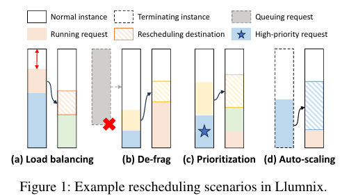

- 逐个画出图中的请求和实例，解释每次移动的目的。
  （a）负载均衡（b）减少碎片，让等待的request进入instance（c）优先级调度，让优先级高的request独享instance或让该instance负载较低（d）自动缩容扩容机制，据负载，自动增加或减少提供服务的实例数量。

- 同一个请求迁移机制如何服务不同目标？

  通过一种叫==**虚拟用量**==的机制来把这些需求表达成同一种调度信号：

  **普通运行请求**：按实际显存占用计算。

  **队首等待请求**：虽然尚未占用显存，也把它需要的空间计入虚拟用量，推动该实例迁出运行请求。

  **高优先级请求**：额外计入一份资源余量，让调度器更早感知该实例“负载偏高”，迁走普通请求。

  **待关闭实例**：加入虚拟用量为无穷大的假请求，推动剩余请求迁出。

### 我的笔记

当前LLM服务有如下**特性**（作者将其类比成操作系统上包含优先级的多核调度问题）：

**异构性（heterogeneity）**：输入长度、输出长度和延迟要求因应用而异。

**不可预测性（unpredictability）**：事先不知道最终会生成多少 token，因此执行时间和 KV cache 显存需求也难以准确预测。

对此就出现了**三个问题**：

| 难题                        | 具体含义                                                     |
| --------------------------- | ------------------------------------------------------------ |
| **Isolation：性能隔离**     | 请求的显存需求不断增长，可能发生资源竞争、抢占，造成延迟波动和 SLO 违反。 |
| **Fragmentation：资源碎片** | 分散请求能减少干扰，却会把空闲显存分散到多个实例，导致长输入请求找不到足够空间。 |
| **Priorities：优先级服务**  | 不同请求需要不同响应速度，系统需要真正提供不同待遇。         |

==关键矛盾==：**把请求分散开，有利于隔离；把资源集中起来，又有利于接纳大请求。**

## 2. 背景（Background）

### 内容框架

- 回顾 prefill、decode、KV cache 和 continuous batching。
- 一个请求的显存占用如何随执行过程变化？
- 结合已读的 vLLM，说明 PagedAttention 解决的问题和本篇继续讨论的问题。

### Figure 2：排队与抢占

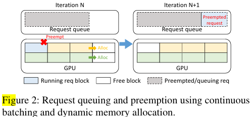

- 从 iteration N 走到 N+1，逐步记录 block 的分配和请求状态变化。

  刚进入GPU的蓝色req block被Preepted回到原本的Request queue，因为当前正在运行的requests有更大的空间需求

- 被抢占的请求接下来需要经历什么？

  暂停生成并重新排队，等待资源可用后再次被调度。

## 3. 动机（Motivation）

### Figure 3：抢占的影响

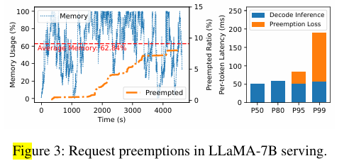

- 左图讲解的是**显存使用率随时间变化，以及抢占的比例**

​	虽然平均内存占用只有62.84%，但是曲线明显存在波动和高峰。

- 右图讲解的是**不同的延迟分位点上的表现**

横轴的 P50、P80、P95、P99 表示请求延迟分布中的不同位置。例如，P99 是约 99% 的请求不超过的延迟水平。

柱子把每 token 延迟拆成两部分：

| 组成                 | 含义                                     |
| -------------------- | ---------------------------------------- |
| **Decode Inference** | 正常执行 decode 的计算耗时               |
| **Preemption Loss**  | 抢占导致的额外排队和 KV cache 重计算开销 |

这里统计的是**每个请求在整个 decode 过程中的平均每 token 延迟**，包含抢占带来的停顿，不是单次 GPU decode 计算耗时。

==一句话总结==就是：平均内存占用只有约 63%，仍会发生抢占。而抢占会带来额外排队和 KV cache 重计算，可以发现最慢的请求很多都是受到抢占的影响。

### Figure 4：请求间干扰

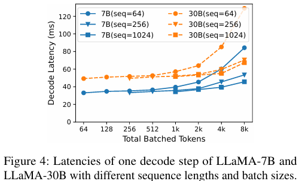

测试不同的batch size对于不同的大小的模型以及不同长度的seq以及batched token的数量对于decoding延迟的影响。==**同一个 batch 中，请求会竞争计算和显存带宽资源，影响彼此的 decode 速度。即使没有发生抢占，请求也可能因为与其他请求一起执行而变慢。**==

- 控制变量是什么？曲线随哪些因素变化？

  控制的变量有模型的大小，请求对应的 token 序列的长度，不同的batched token数量。

==**一句话总结**==：请求数量变多，模型参数变大，少量长请求变成多个短请求，都会导致延迟增加

### Figure 5：资源碎片

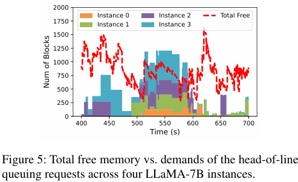

红线是指当前所有空闲的显存空间，其他的所有颜色之和，就是当前队列中，第一个正在等待的request申请的所需blocks数量，可以发现在大部分时间，所有的空余内存是可以满足三个instance的等待request需求的，说明了资源碎片的问题。

## 4. Llumnix 的设计

### 4.1 总体思路

#### 内容框架

- 画出新请求进入、执行、迁移、继续生成直至完成的路径。
- 哪些属于迁移机制，哪些属于调度策略？
- 机制成立需要满足哪些模型、状态和资源条件？

#### 我的笔记

Llumnix设计目标：

- **负载均衡**（tradeoff）：==仅仅通过调度时观察内存使用率来做负载均衡是次优的方案==，因为一个request最终需要的内存是不可预测的。因此Llumnix通过request的真实使用增长来做负载均衡。
- **去碎片化**（tradeoff）：负载均衡会导致更高的内存碎片化，Llumnix通过移动request来腾出连续的空间。
- **优先级调度**：为高优先级的request动态提供资源，不需要静态预留机器。
- **自动缩容扩容**：在自动缩容扩容的过程中重新调度，可以让一个instance快速空载退出或负载进入

作者认为高度动态且高效的重调度request很有挑战，简单地重计算或是复制KV cache会导致严重的计算停顿和服务中断，其开销甚至达到正常解码开销的 50 倍以上。

Llumnix采用**可扩展架构（scalable architecture）**并且结合了（详见4.3）：

Global Scheduling：全局调度，关注整个集群的负载情况。

Local Scheduling：局部调度，关注某个模型实例内部的具体请求。

### 4.2 请求的在线迁移

#### 内容框架

- 哪些状态必须传输，哪些状态在目标实例上已经存在？
- 迁移中的计算与复制如何配合？
- 区分迁移总时长、请求暂停时间和其他请求受到的影响。
- 思考网络变慢、请求变长和多个迁移并发时可能发生什么。

#### Figure 6：迁移时间线

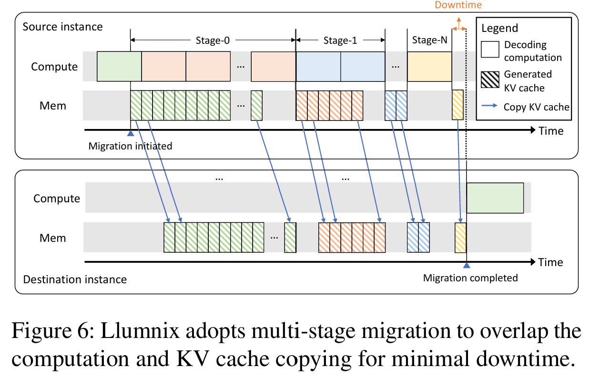

##### 我的笔记

可以做到一边传输一边计算，只有最后的一个阶段的stage-N的传输没有被overlap，因此Llumnix需要暂停计算，将最后一块的KV传输完成之后，才可以在新的instance上继续之前的计算。所以Llumnix的停机时间就只是复制一次迭代中产生的KV Cache，和sequence的长度无关。

==**重要的机制设计（追逐？）：**==stage的划分非常简单，stage0内需要传输的工作量，就是在开始传输时，需要传输的kv cache数量，stage1就是在传输stage0的时候产生的新的kv cache。由于传输速度比kv cache的生成速度更快，所以传输的kv cache数量会越来越少。

注：由于传输速度很快，其实就只有两个stage，第一个stage会传输除了最后一个block以外的其他所有block（就是vLLM中的block，一般设定在16个token）。

#### Figure 7：迁移协议与正确性

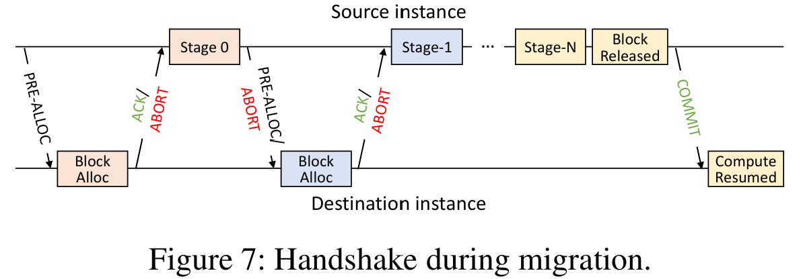

##### ==我的笔记==

与Llumnix借鉴的VM热迁移不同的是，Llumnix不需要关注脏页的问题，因为KV Cache一旦计算出来后就不会变化，但是有两点需要额外考虑：

- 在传输的过程中，request仍然会保持处理，在迁移的过程中可能就会内存不足（OOM）。
- 由于request在decoding的过程中随时都会生成EOS（停止生成符）以及continuous batching的特性，所有完成的request会马上移出batch，因此需要实时的通讯，保证已经结束的request的迁移任务可以马上停止（ABORT）。

### 4.3 分布式调度架构

#### 内容框架

- Figure 8 中每个组件持有什么状态，负责哪些决策？
- 全局调度器与 llumlet 如何交换信息？
- 从一次迁移触发开始，沿控制路径追踪到实际数据搬运。
- 哪些工作量随实例数增加，哪些随请求数增加？

#### Figure 8：Llumnix框架设计

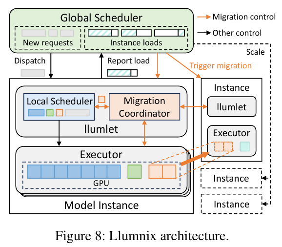

#### ==我的笔记==

由于Llumnix的动态调度策略需要更频繁地查询每个cluster中正在运行的request，因此将Scheduler分为全局的Global Scheduler和instance-level的scheduler（llumlet）。

GlobalScheduler不直接跟踪或者调度request，都是围绕instance的memory负载展开的。

当需要负载均衡，传输KV Cache时，Global Scheduler只是配对源和目标instance，**最终的传输由llumlets决定传输哪些requests**。

计算内存负载并不是简单地计算物理内存负载，而是作者全新定义的==“virtual usages”==。

### 4.4 动态调度策略

#### 4.4.1 目标与定义

- 列出策略的优化目标，并区分 scheduling priority 与 execution priority。

  - 首要目标是通过降低等待延迟、抢占和干扰，从而==降低prefill和decode的延迟==。
  - 第二目标是**自适应负载**。作者发现重调度效果和==集群的负载==也有关，当负载过低或者过高时，重调度的效果也会被限制。

    > | 集群负载 | 对请求迁移的影响                                             |
    > | -------- | ------------------------------------------------------------ |
    > | **太低** | 大多数实例都很空闲，排队、抢占和请求间干扰本来就少，迁移能改善的空间有限。 |
    > | **太高** | 许多实例都接近满载。即使某个实例急需减压，其他实例也可能没有足够的 KV cache 空间接收请求。 |
    > | **适中** | 可能有的实例因请求变长而变忙，另一些实例还有余量。此时把请求迁过去，既能缓解源端压力，目标端也接得住。 |
  - 新的目标是**request优先级**。有两种优先级：==scheduling priority和execution priority==。高调度优先级的request可以得到优先调度。高运算优先级的request可以分配到更低负载的load中，从而达到更低的SLOs，更快的生成速度以及更少的干扰。目前支持high和normal两种优先级。   

#### 4.4.2 虚拟用量（Virtual Usage）

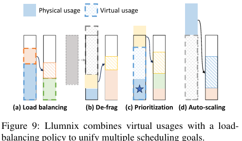

- 结合 Figure 9 比较实际占用与调度器使用的用量。
- 为普通运行请求、排队请求、高优先级请求和待关闭实例分别走一遍规则。
- 用两个实例、几个请求构造一个例子，观察规则如何改变迁移方向。

#### 4.4.3 具体策略与 ==Algorithm 1==

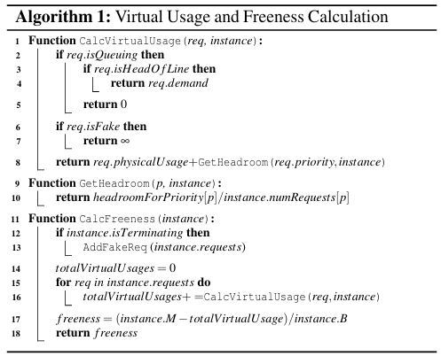

#### ==我的笔记==

- 作者将上述情况分为两大类：

  - loading balance
  - 在instance上creating free space（即消除碎片化，优先级调度，迁出待下线实例上的剩余请求）

- ==virtual memory机制：==

  - 对于排队等待的request：在一个instance上位于队头的request，直接给他分配一定大小的virtual usage，这样可能就会出现figure 9(b)的情况，从而开始消除碎片化。

    > 作者认为，这种启发式的方法还有很多的想象空间，比如，可以逐渐提高一个request的virtual usage，慢慢提升至最终需要的大小，给正在运行的request一些时间，可以给正在收尾的request完成工作的机会。但在当前的工作里，作者是**直接采用需要的内存大小**(algo 1,line 4)，这样可以降低排队延迟。

  - 运算优先级：有些request具有很高的运算优先级，Llumnix就尝试避免把他调度到一个超出规定负载的instance上面。主要方式就是通过**超额预留一段headroom **（figure9(c) & algo1 line 8）。如果一个instance中有n个高优先级request，就会把headroom平分成n份（algorithm1 line10）。

  - 自动缩容扩容：当一个全新的instance开始执行，Llumnix的负载均衡机制会通过移动其他instance上的request，使其饱和。如果要移除一个instance，就会人为添加一个fake request，这个request的virtual usage是无穷大的，这样就可以把其他的移除了。

- ==算法1：==

  - CalcFreeness是计算整个instance的freeness的函数，如果该instance要被移除，会往队列中添加一个fake request，在计算这个fake request的virtual usage的时候，直接记为无穷。接下来会初始化整个instance的总计virtual usage = 0，然后遍历所有request，如果在等待队列中，直接记为0，在队头，则会像正在计算的request一样返回virtual usage。virtual usage在返回时还会添加一个优先级控制的headroom。

- 策略：

  - ==调度：==新到达的request会有更高的调度优先级，在相同的优先级条件下，遵循先来先服务策略。每次迁移都会把request迁移到最空闲的instance上，对此有freeness计算公式（algorithm1 line17）：

    F=(M−∑V)/B

    F表示freeness；M表示总体内存；V表示每个request的virtual usage；B表示batch size

    **为什么要除以B？**

    因为B表示batch size，这个数值说明了每次iteration会产生的新的token数量。这个数值决定了显存的消耗速度，F就能说明该instance还能撑多久。

    由于virtual usage可以大于真实内存大小，freeness这个值可以是负数。

  - ==迁移：==**Llumnix会选择那些freeness值大于或小于阈值的instance（即空闲或过载）**来作为源instance和目标instance开始迁移。llumlet作为local scheduler，在选择迁移request时会选择**低优先级的和更短的sequence长度的request作为迁移对象**。如果在迁移过程中，instance的freeness值不再超出阈值，则停止传输。

  - ==自动缩容扩容：==通过判断freeness的平均值来缩容扩容，将平均值控制在[x,y]直接，大于y就缩容，小于x就扩容。每次选择requests最少的instance作为目标。

## 5. 实现（Implementation）

### 内容框架

- 调度层如何接入推理引擎？哪些接口需要修改或暴露？
- 沿一份 KV cache 的传输路径记录 CPU、GPU、通信库与 CUDA stream。
- block fusion 解决什么开销？引入了哪些额外复制？
- 迁移后生成的 token 如何返回原来的客户端？
- 故障处理可以保证什么，哪些请求仍会失败？
- 区分论文实验原型和正式发布实现，结合附录核对。

### 我的笔记

以 **从实例 A 迁移到实例 B** 为例：

- **Llumnix** 决定迁哪个请求、迁到哪里。
- **Ray** 支撑跨机器的控制调用，比如让 A 向 B 请求预留 KV blocks，并收到确认。
- **Gloo** 传输实际的 KV cache，**B 上的 vLLM** 拿到状态后继续生成。

传输KV cache使用Gloo，是因为Gloo支持并行传输requests，而NCCL不安全。

为了instance之间传输链路不影响TP，作者将TP限制在一个机器内部。

**block融合**：由于vLLM的分块策略，所有的KV cache都是非连续的，每次只传输一个block，要多次调用Send/Recv原语。因此作者将所有要传输的blocks汇总到CPU内存中，可以用一次Send/Recv原语就完成多个blocks的传输。

**故障处理：**

| 故障情况                          | Llumnix 的处理                                               |
| --------------------------------- | ------------------------------------------------------------ |
| **Global scheduler 故障**         | 前端暂时绕过全局调度器，按简单规则把新请求发给可用实例，同时停用迁移。服务仍能接收请求。 |
| **推理实例或同机的 llumlet 故障** | 该实例上正在运行的请求会被中止。                             |
| **迁移过程中有实例故障**          | 握手协议会中止这次迁移。如果是目标端故障、源端仍健康，请求可以留在源端继续运行。如果源端故障，请求会被中止。 |

## 6. 实验（Evaluation）

### 6.1 实验设置

- 核对 GPU、节点、网络、模型、并行方式和推理引擎版本。

- 记录真实数据与合成负载的输入 / 输出长度、到达分布和突发程度。

- 核对每个 baseline 的具体实现，特别是 INFaaS++ 的改动。

- 按原文记录 mean、P99、端到端、prefill 和 decode latency 的统计口径。

- 哪些实验固定实例数，哪些允许扩缩容？哪些使用真实 GPU？

- table 1 测试sequence的长度分布

  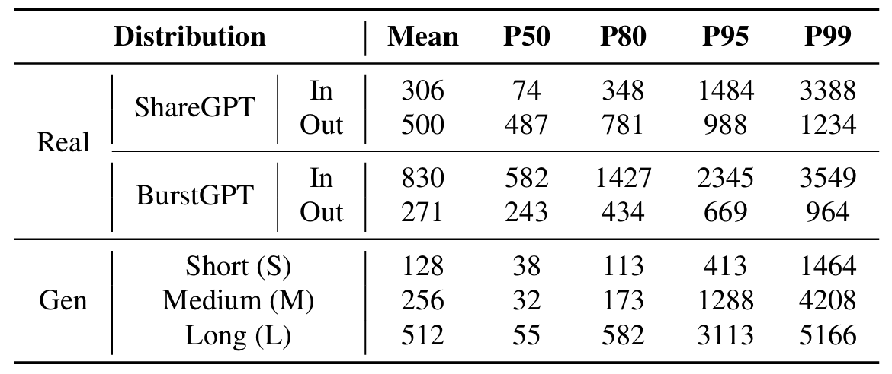

#### 我的笔记

作者使用的是**“幂律长度分布”**。在这里，它用来模拟一种长尾工作负载：**大多数请求的输入或输出很短，少数请求却特别长。**

### 6.2 迁移效率（Figure 10）

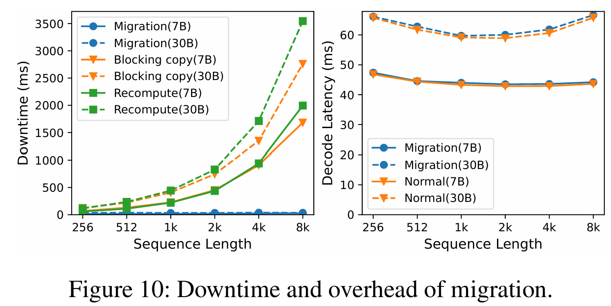

- 两幅图各验证哪个问题？比较对象、变量和测量方法是什么？
- 对照 §4.2 的推导，核对暂停时间与序列长度的关系。
- 区分迁移中的瞬时影响和整段服务期间的平均开销。

#### ==我的笔记==

左图说明Migration受sequence长度和模型参数的影响不大，与其他方式比起来效率极高。

右图说明在Migration运行的同时，decoding所受影响不大，与普通状态的decoding几乎无异。

### 6.3 在线服务表现（Figure 11-12）

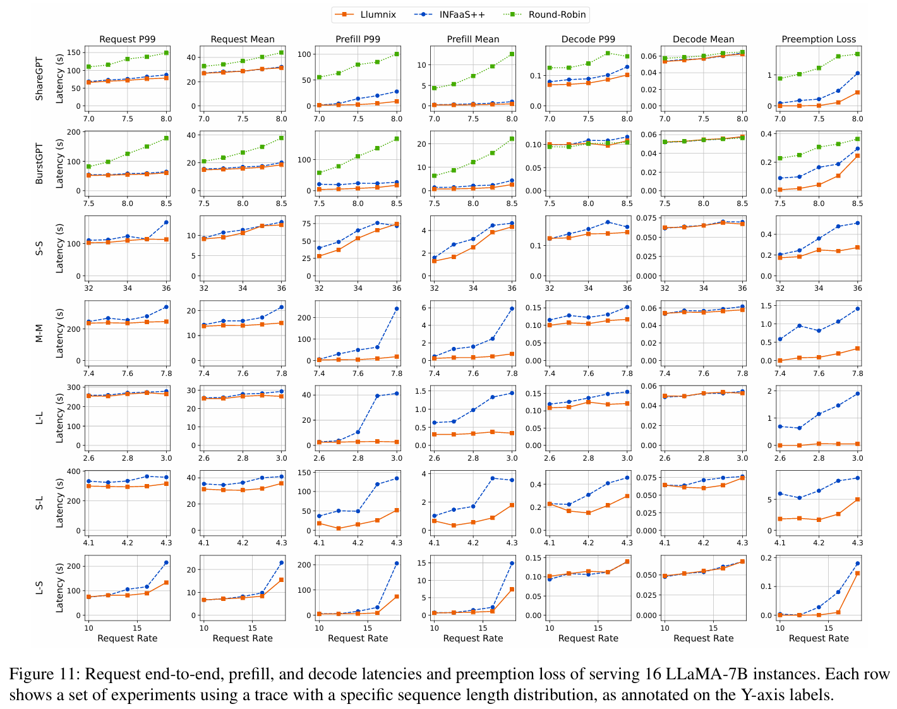

- 按负载逐行比较各项延迟，避免只摘录最大收益。

- Figure 11 中各列分别说明什么？收益来自哪个延迟组成部分？

  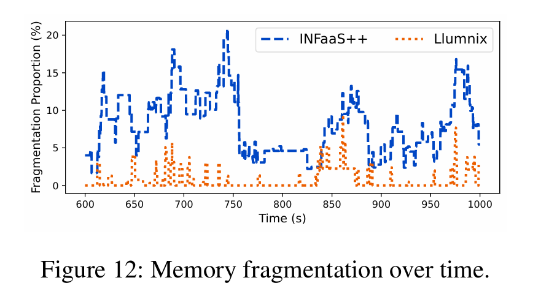

- Figure 12 的碎片指标如何计算，分母是什么？

- 哪些现象支持作者的因果解释，还有哪些条件需要核对？

#### ==我的笔记==

Fig11前两行是在真实测试集上进行的，前两行Llumnix都明显强于最基础的Round-Robin，这是因为request长度变化幅度较大，只是简单的分配给各个instance并不能做到负载均衡。

底部五行是生成的不同数据集分布，S、M、L分别表示输入输出的长度。

最右列可以看到不同的request rate和延迟的关系，Llumnix的loss都是最低的。

Fig12是在M  M的数据集上，request rate是7.5。这里的fragmentation比例的计算方式如下举例：

有三个instance，总显存大小16GB，总计空闲碎片空间为8GB，每个instance队首的等待request大小均为3GB，则如果内存空间没有碎片化则还可以放6GB的request，所以有效碎片就记为6GB，则fragmentation比例就是6GB/16GB。

### 6.4 优先级支持（Figure 13）

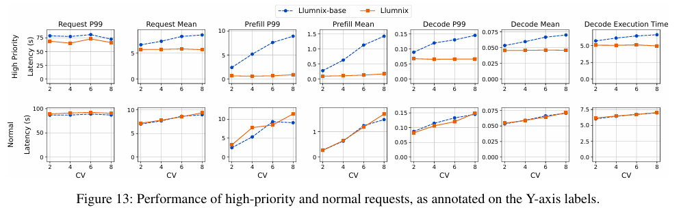

- 高优先级占比、负载变化、对照组和参数如何设置？
- 分别观察高优先级和普通请求，记录收益与代价。
- 从排队和执行两个方面解释差异，核对能否归因到具体策略。

#### ==我的笔记==

Llumnix-base是指没有优先级划分的Llumnix，第一行表示高优先级的request的延迟，可以看到**即使在高CV的情况下，高优先级request仍然保持这同样的延迟表现**，第二行是为了说明**Llumnix的普通请求并没有因为高优先级调度而受到显著的影响**。

### 6.5 自动扩缩容（Figure 14-15）

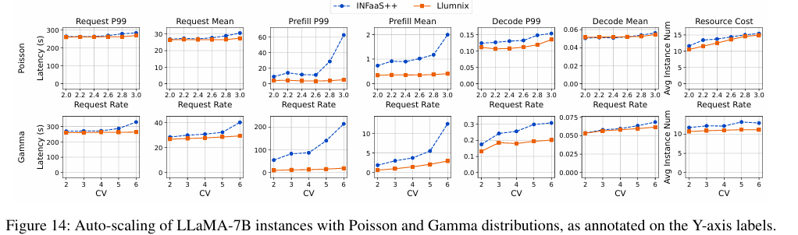

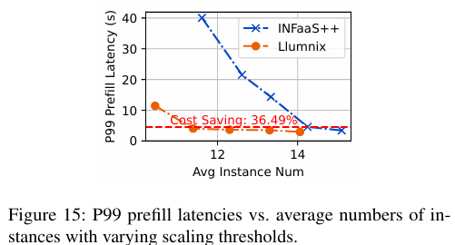

- 比较相同负载下的延迟与资源开销。
- 再比较相近尾延迟目标下的资源开销，区分这两种比较口径。
- 扩缩容阈值如何影响结果？成本以什么单位统计？

#### ==我的笔记==

Fig14：

第一组实验让系统越来越繁忙。

第二组实验则让系统的平均请求量不变，但是请求到达越来越不均匀。

最右一列展示instance数量

图14为了说明request总量变多（上）和突发负载（下）的情况，Llumnix的表现咋样。可以观察到Llumnix延迟更低，instance数量更少。

Fig15：

可以直接观察到，达到相同的延迟目标，Llumnix使用的instance数量更少。

### 6.6 调度可扩展性（Figure 16）

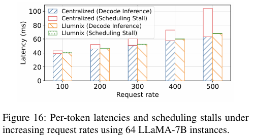

- 测试规模、对照组和模拟部分分别是什么？
- 如何区分推理耗时和调度停顿？
- 这项实验能支持哪些结论，还有哪些端到端问题没有覆盖？

#### 我的笔记

作者直接使用sleep替代一整个batch的transformer运算，因为超过testbed容量。

Llunix在500request rate时延迟更高，这是可能是因为batch size不同，同一时间的request不同。

集中式调度的请求状态同步和调度决策开销会随着负载增加而形成瓶颈，导致额外的 Scheduling Stall。

## 7. 相关工作

### 内容框架

- 按优化层次整理相关工作：算子、单实例、跨实例、集群资源管理。
- 挑选最接近的一项，明确问题定义、方法与适用条件的差别。

### 我的笔记

（待读后填写）

## 8. 结论

### 我的复述

- 要解决的问题：
- 关键观察：
- 核心机制：
- 调度策略：
- 实验证据：
- 适用边界与局限：

## A. Artifact 附录（按需阅读）

- 核对可复现实验、硬件需求、代码版本和执行入口。
- 区分实验原型与正式版本的实现及容错能力。
- 如果后续读代码，先记录采用的分支和 commit，再与正文对应。

### 我的笔记

（待读后填写）

## 9. 与已读论文的联系

> 此节为个人比较框架，阅读后填写。

| 比较维度 | vLLM | DistServe | Mooncake | Llumnix |
| --- | --- | --- | --- | --- |
| 问题与优化目标 | | | | |
| 调度 / 资源管理粒度 | | | | |
| KV cache 的作用 | | | | |
| 请求或状态何时移动 | | | | |
| 网络与通信要求 | | | | |
| 主要指标与适用边界 | | | | |

### 延伸思考

- 请求迁移与 P/D 分离有什么关系，二者能否结合？
- 加入 prefix caching 后，调度和迁移需要考虑哪些新因素？
- 本文哪些问题与自己关注的 GPU 通信、RDMA 和网络资源管理有关？

## 10. 疑问与待查资料

| 问题 | 出处（小节 / 图 / 页码） | 当前理解 | 待查来源 / 实验 | 状态 |
| --- | --- | --- | --- | --- |
| 待读时记录 | | | | 未解决 |